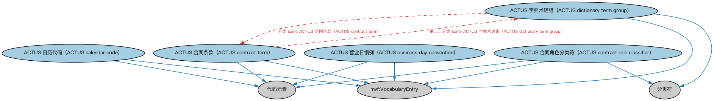

# ACTUS 合约条款本体（ACTUS Contract Terms Ontology）结构与公理说明

本文档对应 `ACTUSContractTerms.rdf` / `ACTUSContractTerms.ttl`，说明该本体的类、继承关系、属性和公理约定。结构图见 `ACTUSContractTerms-structure.png`（`ACTUSContractTerms-structure.svg` 为可缩放版本）。

## 1. 本体概述

定义 ACTUS（算法合约类型统一标准，Algorithmic Contract Types Unified Standards）中金融合约的标准条款要素：名义本金、利率、各类日期安排等机器可计算的参数。

**在体系中的位置**：属于 ACTUS 对接域，是 FIBO 与 ACTUS 标准接轨的三件套之一（合约条款、条款映射、受控词汇）。

**上下游关系**：上游依赖 FND 的协议、合同、金融日期、货币金额等基础本体；下游由 ACTUS 合约条款映射本体引用，把条款对接到 FIBO 概念体系。

**与相近概念的差别**：FND/Agreements/Contracts 建模的是通用合同结构（当事方、条款、义务），而本本体建模的是让合约现金流可以被算法精确计算的参数集——一个面向法律语义，一个面向计算。

本本体中类与类的核心关系如下（完整细节见各类小节）：

- **ACTUS 营业日惯例（ACTUS business day convention）** 继承 **代码元素（CodeElement）**
- **ACTUS 营业日惯例（ACTUS business day convention）** 继承 **mvf:VocabularyEntry（VocabularyEntry）**
- **ACTUS 日历代码（ACTUS calendar code）** 继承 **代码元素（CodeElement）**
- **ACTUS 日历代码（ACTUS calendar code）** 继承 **mvf:VocabularyEntry（VocabularyEntry）**
- **ACTUS 合同角色分类符（ACTUS contract role classifier）** 继承 **分类符（Classifier）**
- **ACTUS 合同角色分类符（ACTUS contract role classifier）** 继承 **代码元素（CodeElement）**
- **ACTUS 合同角色分类符（ACTUS contract role classifier）** 继承 **mvf:VocabularyEntry（VocabularyEntry）**
- **ACTUS 合同条款（ACTUS contract term）** 继承 **代码元素（CodeElement）**
- **ACTUS 合同条款（ACTUS contract term）** 继承 **mvf:VocabularyEntry（VocabularyEntry）**
- **ACTUS 字典术语组（ACTUS dictionary term group）** 继承 **分类符（Classifier）**
- **ACTUS 字典术语组（ACTUS dictionary term group）** 继承 **mvf:VocabularyEntry（VocabularyEntry）**

## 2. 类（Class）

| 类（Class） | 定义（Definition） |
|---|---|
| ACTUS 营业日惯例（ACTUS business day convention） | ACTUS 支持的一组营业日惯例之一的代码元素。 code element for one of a set of conventions that ACTUS supports |
| ACTUS 日历代码（ACTUS calendar code） | 适用于特定合同的日历代码。 code for a calendar that applies to a particular contract |
| ACTUS 合同角色分类符（ACTUS contract role classifier） | 对合同当事方在处理合同时所涉各类角色的分类符。 classifier for various roles that are relevant to how the contract is processed by a particular contract party |
| ACTUS 合同条款（ACTUS contract term） | 表示一个或多个 ACTUS 合同类型之某方面条款的代码。 code denoting a term describing an aspect of one or more ACTUS contract type(s) |
| ACTUS 字典术语组（ACTUS dictionary term group） | 对通常一起使用的一组 ACTUS 字典参数的分类符。 classifier for a collection of ACTUS dictionary parameters that tend to be applied together |

以下按类逐个展开：每个类给出继承关系、相关属性与公理约定；子类在父类之下降一级编号。

### 2.1 ACTUS 营业日惯例（ACTUS business day convention）

定义：ACTUS 支持的一组营业日惯例之一的代码元素。

- 父类：**代码元素（CodeElement）**、**mvf:VocabularyEntry（VocabularyEntry）**

属性：

| 属性 | 定义 | 说明 |
|---|---|---|
| **被包含于（isIncludedIn）** | — | — |
| **定义于（isDefinedIn）** | — | — |

公理：

- **定义于（isDefinedIn）**的取值固定为 AlgorithmicContractTypesDataDictionary。
- **被包含于（isIncludedIn）**的取值固定为 AlgorithmicContractTypesDataDictionary。

### 2.2 ACTUS 日历代码（ACTUS calendar code）

定义：适用于特定合同的日历代码。

- 父类：**代码元素（CodeElement）**、**mvf:VocabularyEntry（VocabularyEntry）**

属性：

| 属性 | 定义 | 说明 |
|---|---|---|
| **被包含于（isIncludedIn）** | — | — |
| **定义于（isDefinedIn）** | — | — |

公理：

- **定义于（isDefinedIn）**的取值固定为 AlgorithmicContractTypesDataDictionary。
- **被包含于（isIncludedIn）**的取值固定为 AlgorithmicContractTypesDataDictionary。

### 2.3 ACTUS 合同角色分类符（ACTUS contract role classifier）

定义：对合同当事方在处理合同时所涉各类角色的分类符。

- 父类：**分类符（Classifier）**、**代码元素（CodeElement）**、**mvf:VocabularyEntry（VocabularyEntry）**

属性：

| 属性 | 定义 | 说明 |
|---|---|---|
| **分类（classifies）** | — | — |
| **由……分类（isClassifiedBy）** | — | — |
| **指代（denotes）** | — | — |

公理：

- **分类（classifies）**至少有一个取值，类型是**角色（role）**。
- **指代（denotes）**至少有一个取值，类型是**角色（role）**。
- **由……分类（isClassifiedBy）**的取值固定为 ACTUSContractTermGroup-ContractIdentification。

### 2.4 ACTUS 合同条款（ACTUS contract term）

定义：表示一个或多个 ACTUS 合同类型之某方面条款的代码。

- 父类：**代码元素（CodeElement）**、**mvf:VocabularyEntry（VocabularyEntry）**

属性：

| 属性 | 定义 | 说明 |
|---|---|---|
| **具有参数名（has parameter name）** | 将名称与 ACTUS 数据字典中定义的定量或定性因子关联，该因子用作一个或多个合同类型分类的条件。 associates a name with a quantitative or qualitative factor defined in the ACTUS data dictionary used as a condition for classification of one or more contract type | 子属性：具有文本值 |
| **刻画（characterizes）** | — | — |
| **由……分类（isClassifiedBy）** | — | — |
| **被包含于（isIncludedIn）** | — | — |
| **具有标签（hasTag）** | — | — |
| **具有文本名称（hasTextualName）** | — | — |
| **定义于（isDefinedIn）** | — | — |

公理：

- **具有参数名（has parameter name）**存在取值约束。
- **具有文本名称（hasTextualName）**至少有一个取值，类型是**xsd:string（string）**。
- **具有标签（hasTag）**至少有一个取值，类型是**xsd:string（string）**。
- **刻画（characterizes）**至少有一个取值，类型是**ACTUS 合同类型（ACTUSContractType）**。
- **定义于（isDefinedIn）**的取值固定为 AlgorithmicContractTypesDataDictionary。
- **由……分类（isClassifiedBy）**至少有一个取值，类型是**ACTUS 字典术语组（ACTUS dictionary term group）**。
- **被包含于（isIncludedIn）**的取值固定为 AlgorithmicContractTypesDataDictionary。

### 2.5 ACTUS 字典术语组（ACTUS dictionary term group）

定义：对通常一起使用的一组 ACTUS 字典参数的分类符。

- 父类：**分类符（Classifier）**、**mvf:VocabularyEntry（VocabularyEntry）**

属性：

| 属性 | 定义 | 说明 |
|---|---|---|
| **分类（classifies）** | — | — |
| **被包含于（isIncludedIn）** | — | — |
| **定义于（isDefinedIn）** | — | — |

公理：

- **分类（classifies）**至少有一个取值，类型是**ACTUS 合同条款（ACTUS contract term）**。
- **定义于（isDefinedIn）**的取值固定为 AlgorithmicContractTypesDataDictionary。
- **被包含于（isIncludedIn）**的取值固定为 AlgorithmicContractTypesDataDictionary。

## 3. 其他属性

以下属性未绑定到本体的具体类（定义域在外部本体或未声明）：

数据属性（Datatype Property）：

| 属性 | 定义 |
|---|---|
| **具有选项序号（has option sequence number）** | 指明可选元素在枚举列表中的出现次序。 specifies the order of occurance of an optional element in an enumerated list |
| **具有参数映射（has parameter mapping）** | 将 ACTUS 数据字典中定义的定量或定性参数映射到其他事物（如 FIBO 中规定的属性）。 maps a quantitative or qualitative parameter defined in the ACTUS data dictionary with something else, such as a property specified in FIBO |

## 4. 依赖（owl:imports，13 个）

本本体通过 `owl:imports` 引入以下本体，各项的中文名称与简介如下：

| 导入本体 | 中文名称 | 简介 |
|---|---|---|
| `ACTUS/ACTUSTaxonomy.rdf` | ACTUS 受控词汇本体（ACTUS Controlled Vocabulary） | 收录 ACTUS 标准合约类型（如本金摊还型年金合约 PAM、到期一次偿还合约 NAM）的受控词汇。 |
| `FND/Utilities/AnnotationVocabulary.rdf` | FIBO 标注词汇表（FIBO Annotation Vocabulary） | 定义 FIBO 专用的标注属性（如释义来源、成熟度等级），用于本体自身的元数据标注。 |
| `https://www.omg.org/spec/Commons/AnnotationVocabulary/` | OMG 通用标注词汇表（OMG Commons Annotation Vocabulary） | OMG 通用本体库（Commons）中的标注词汇表，提供概念映射等标注属性，FIBO 用它标注术语与外部标准的对应关系。 |
| `https://www.omg.org/spec/Commons/Classifiers/` | OMG 通用分类器本体（OMG Commons Classifiers） | OMG 通用本体库（Commons）中的分类器本体，定义分类方案、类别与归类关系的通用概念，FIBO 的分类建模建立在其上。 |
| `https://www.omg.org/spec/Commons/CodesAndCodeSets/` | OMG 通用代码与代码集本体（OMG Commons Codes and Code Sets） | Commons 库中的代码本体，定义代码、代码集及其维护方的通用概念，是 ISO 4217、ISO 3166 等编码体系建模的基础。 |
| `https://www.omg.org/spec/Commons/Collections/` | OMG 通用集合本体（OMG Commons Collections） | Commons 库中的集合本体，定义集合、成员等通用概念。 |
| `https://www.omg.org/spec/Commons/Designators/` | OMG 通用指称符本体（OMG Commons Designators） | Commons 库中的指称符本体，定义名称、标识符等「指代某物的符号」的通用概念。 |
| `https://www.omg.org/spec/Commons/Identifiers/` | OMG 通用标识符本体（OMG Commons Identifiers） | Commons 库中的标识符本体，定义标识符及其编码方案的通用概念。 |
| `https://www.omg.org/spec/Commons/PartiesAndSituations/` | OMG 通用参与方与情境本体（OMG Commons Parties and Situations） | Commons 库中的参与方本体，定义独立主体、参与方及其角色扮演的通用概念，是 FIBO 参与方模型的上游。 |
| `https://www.omg.org/spec/Commons/QuantitiesAndUnits/` | OMG 通用量与单位本体（OMG Commons Quantities and Units） | Commons 库中的量与单位本体，定义数量、度量单位、量纲的通用概念，支撑金额、比率等数值表达。 |
| `https://www.omg.org/spec/Commons/RolesAndCompositions/` | OMG 通用角色与构成本体（OMG Commons Roles and Compositions） | Commons 库中的角色本体，定义角色及整体—部分构成关系的通用概念。 |
| `https://www.omg.org/spec/Commons/TextDatatype/` | OMG 通用文本数据类型（OMG Commons Text Datatype） | Commons 库中的文本数据类型定义，提供带语言标记的文本等基础数据类型。 |
| `https://www.omg.org/spec/MVF/MultipleVocabularyFacility/` | OMG 多词汇设施（OMG Multiple Vocabulary Facility，MVF） | OMG 的多词汇设施规范本体，提供词汇表与概念映射的元模型，供 ACTUS 等外部词汇与 FIBO 概念对接使用。 |

## 5. 文件

- 官方 RDF/XML：`ACTUSContractTerms.rdf`
- 中文 Turtle：`ACTUSContractTerms.ttl`
- 结构图：`ACTUSContractTerms-structure.png` / `ACTUSContractTerms-structure.svg`