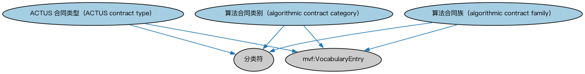

# ACTUS 受控词汇本体（ACTUS Controlled Vocabulary）结构与公理说明

本文档对应 `ACTUSTaxonomy.rdf` / `ACTUSTaxonomy.ttl`，说明该本体的类、继承关系、属性和公理约定。结构图见 `ACTUSTaxonomy-structure.png`（`ACTUSTaxonomy-structure.svg` 为可缩放版本）。

## 1. 本体概述

收录 ACTUS 标准合约类型的受控词汇个体，如本金摊还型年金合约（PAM）、到期一次偿还合约（NAM）等。

**在体系中的位置**：ACTUS 对接域的词汇层，为合约分类提供标准类型取值。

**上下游关系**：依赖 ACTUS 合约条款本体与 FND 基础本体；被需要按 ACTUS 类型标注合约的应用使用。

**与相近概念的差别**：与 ACTUS 合约条款本体分工不同——后者定义条款参数的结构，本本体只提供合约类型的枚举清单；与 FIBO 自身的贷款、债券分类是两套并存的标准，通过映射本体衔接。

## 2. 类（Class）

| 类（Class） | 定义（Definition） |
|---|---|
| ACTUS 合同类型（ACTUS contract type） | 对算法能力的分类符，即据以基于条款生成信贷协议、金融工具或相关合同现金流的规则。 |
| 算法合同类别（algorithmic contract category） | 在 ACTUS 现金流族内、对一组信贷协议、金融工具或相关合同所产生现金流的分类符。 |
| 算法合同族（algorithmic contract family） | 基于共同特征对合同类型集合（如信贷协议、金融工具或相关合同）的分类符。 |

### 2.1 继承关系（Inheritance）

- ACTUS 合同类型（ACTUS contract type） ⊑ 分类符
- ACTUS 合同类型（ACTUS contract type） ⊑ mvf:VocabularyEntry
- 算法合同类别（algorithmic contract category） ⊑ 分类符
- 算法合同类别（algorithmic contract category） ⊑ mvf:VocabularyEntry
- 算法合同族（algorithmic contract family） ⊑ 分类符
- 算法合同族（algorithmic contract family） ⊑ mvf:VocabularyEntry

## 4. 数据属性（Datatype Property）

| 属性（Property） | 中文（English） | 定义（Definition） |
|---|---|---|
| fibo-actus-acv:hasCoverageDescription | 具有覆盖范围描述（has coverage description） | 描述该分类符所适用的合同范围。 |

## 5. 公理约定（Axioms）

- ACTUS 合同类型（ACTUS contract type）：具有覆盖范围描述（has coverage description） only xsd:string
- ACTUS 合同类型（ACTUS contract type）：restriction
- ACTUS 合同类型（ACTUS contract type）：restriction
- 算法合同类别（algorithmic contract category）：restriction
- 算法合同类别（algorithmic contract category）：restriction
- 算法合同族（algorithmic contract family）：restriction
- 算法合同族（algorithmic contract family）：restriction

## 6. 依赖（owl:imports，8 个）

本本体通过 `owl:imports` 引入以下本体，各项的中文名称与简介如下：

| 导入本体 | 中文名称 | 简介 |
|---|---|---|
| `FND/Utilities/AnnotationVocabulary.rdf` | FIBO 标注词汇表（FIBO Annotation Vocabulary） | 定义 FIBO 专用的标注属性（如释义来源、成熟度等级），用于本体自身的元数据标注。 |
| `https://www.omg.org/spec/Commons/AnnotationVocabulary/` | OMG 通用标注词汇表（OMG Commons Annotation Vocabulary） | OMG 通用本体库（Commons）中的标注词汇表，提供概念映射等标注属性，FIBO 用它标注术语与外部标准的对应关系。 |
| `https://www.omg.org/spec/Commons/Classifiers/` | OMG 通用分类器本体（OMG Commons Classifiers） | OMG 通用本体库（Commons）中的分类器本体，定义分类方案、类别与归类关系的通用概念，FIBO 的分类建模建立在其上。 |
| `https://www.omg.org/spec/Commons/CodesAndCodeSets/` | OMG 通用代码与代码集本体（OMG Commons Codes and Code Sets） | Commons 库中的代码本体，定义代码、代码集及其维护方的通用概念，是 ISO 4217、ISO 3166 等编码体系建模的基础。 |
| `https://www.omg.org/spec/Commons/Collections/` | OMG 通用集合本体（OMG Commons Collections） | Commons 库中的集合本体，定义集合、成员等通用概念。 |
| `https://www.omg.org/spec/Commons/Designators/` | OMG 通用指称符本体（OMG Commons Designators） | Commons 库中的指称符本体，定义名称、标识符等「指代某物的符号」的通用概念。 |
| `https://www.omg.org/spec/Commons/TextDatatype/` | OMG 通用文本数据类型（OMG Commons Text Datatype） | Commons 库中的文本数据类型定义，提供带语言标记的文本等基础数据类型。 |
| `https://www.omg.org/spec/MVF/MultipleVocabularyFacility/` | OMG 多词汇设施（OMG Multiple Vocabulary Facility，MVF） | OMG 的多词汇设施规范本体，提供词汇表与概念映射的元模型，供 ACTUS 等外部词汇与 FIBO 概念对接使用。 |

## 7. 文件

- 官方 RDF/XML：`ACTUSTaxonomy.rdf`
- 中文 Turtle：`ACTUSTaxonomy.ttl`
- 结构图：`ACTUSTaxonomy-structure.png` / `ACTUSTaxonomy-structure.svg`