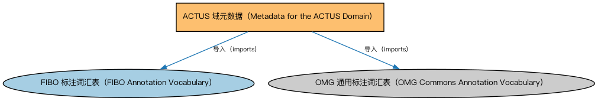

# ACTUS 域元数据（Metadata for the ACTUS Domain）说明

本文档对应 `MetadataACTUS.rdf` / `MetadataACTUS.ttl`。

## 1. 本文件是什么

声明 ACTUS 域的构成（合约条款、条款映射、受控词汇三个本体）及版本信息。ACTUS 域把算法合约类型统一标准接入 FIBO。

从机制上说，这是一个元数据清单（metadata manifest）文件：它本身不定义任何类或属性，而是通过 `dct:hasPart` 声明一个域或模块由哪些本体构成，并携带版本 IRI、版权、许可与成熟度等发布管理信息。它回答的问题是「这个域/模块包含什么、当前是什么版本」，供发布工具和文档系统按模块组织内容；它的 `owl:imports` 只引入标注词汇表，不是用来加载业务本体的入口（加载入口是 `All*` 与 `About*` 聚合文件）。

## 2. 声明的构成（dct:hasPart，3 个）

| 构成项 | 中文名称 | 简介 |
|---|---|---|
| `ACTUS/ACTUSContractTermMapping.rdf` | ACTUS 合约条款映射本体（ACTUS Contract Term Mapping Ontology） | 把 ACTUS 算法合约标准中的合约条款映射到 FIBO 概念，实现两套模型的互操作。 |
| `ACTUS/ACTUSContractTerms.rdf` | ACTUS 合约条款本体（ACTUS Contract Terms Ontology） | 定义 ACTUS（算法合约类型统一标准）中的合约条款要素。 |
| `ACTUS/ACTUSTaxonomy.rdf` | ACTUS 受控词汇本体（ACTUS Controlled Vocabulary） | 收录 ACTUS 标准合约类型（如本金摊还型年金合约 PAM、到期一次偿还合约 NAM）的受控词汇。 |

## 3. 标注依赖（owl:imports，2 个）

以下导入仅用于支撑元数据标注本身（如成熟度等级、概念映射），不属于业务内容：

| 导入本体 | 中文名称 | 简介 |
|---|---|---|
| `FND/Utilities/AnnotationVocabulary.rdf` | FIBO 标注词汇表（FIBO Annotation Vocabulary） | 定义 FIBO 专用的标注属性（如释义来源、成熟度等级），用于本体自身的元数据标注。 |
| `https://www.omg.org/spec/Commons/AnnotationVocabulary/` | OMG 通用标注词汇表（OMG Commons Annotation Vocabulary） | OMG 通用本体库（Commons）中的标注词汇表，提供概念映射等标注属性，FIBO 用它标注术语与外部标准的对应关系。 |

## 4. 文件

- 官方 RDF/XML：`MetadataACTUS.rdf`
- 中文 Turtle：`MetadataACTUS.ttl`
- 结构图：`MetadataACTUS-structure.png` / `MetadataACTUS-structure.svg`