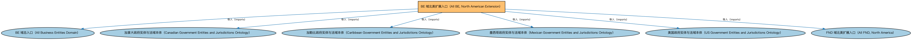

# BE 域北美扩展入口（All BE, North American Extension）聚合说明

本文档对应 `AllBE-NorthAmerica.rdf` / `AllBE-NorthAmerica.ttl`。

## 1. 本文件是什么

聚合 BE 域中北美法域的扩展本体（美国、加拿大、墨西哥、加勒比地区政府实体与法域个体）。

从机制上说，这是一个聚合入口（load-all）文件：它本身不定义任何新的类或属性，只通过 `owl:imports` 把一组本体打包在一起。应用只要导入这一个文件，推理机就会把它列出的所有本体一次性加载进来，免去逐个声明的麻烦。因此它的价值不在「内容」，而在「组合」——组合方式本身就表达了发布方的意图（例如按域打包、按区域扩展打包、按是否含参考数据打包）。

## 2. 聚合的本地本体（6 个）

以下本体均可在本目录结构中找到同名 `.rdf` 文件及配套中文文档：

| 导入本体 | 中文名称 | 简介 |
|---|---|---|
| `BE/AllBE.rdf` | BE 域总入口（All Business Entities Domain） | 聚合商业实体（Business Entities，BE）域的全部生产本体：法律实体、公司、合伙、信托、所有权与控制权、政府实体等，一次导入即获得 BE 域完整模型。 |
| `BE/GovernmentEntities/NorthAmericanJurisdiction/CAGovernmentEntitiesAndJurisdictions.rdf` | 加拿大政府实体与法域本体（Canadian Government Entities and Jurisdictions Ontology） | 收录加拿大的政体、联邦与省政府、法域个体。 |
| `BE/GovernmentEntities/NorthAmericanJurisdiction/CaribbeanGovernmentEntitiesAndJurisdictions.rdf` | 加勒比政府实体与法域本体（Caribbean Government Entities and Jurisdictions Ontology） | 收录加勒比地区各国与属地（开曼群岛、百慕大等）的政体、政府与法域个体。 |
| `BE/GovernmentEntities/NorthAmericanJurisdiction/MXGovernmentEntitiesAndJurisdictions.rdf` | 墨西哥政府实体与法域本体（Mexican Government Entities and Jurisdictions Ontology） | 收录墨西哥的政体、政府与法域个体。 |
| `BE/GovernmentEntities/NorthAmericanJurisdiction/USGovernmentEntitiesAndJurisdictions.rdf` | 美国政府实体与法域本体（US Government Entities and Jurisdictions Ontology） | 收录美国的政体、联邦与各州政府、法域个体，是北美金融建模最常用的法域参考数据。 |
| `FND/AllFND-NorthAmerica.rdf` | FND 域北美扩展入口（All FND, North America） | 聚合 FND 域中北美地区的扩展内容（美国邮政服务地址及其参考个体），与 AllFND 配合使用以覆盖北美地址场景。 |

## 3. 文件

- 官方 RDF/XML：`AllBE-NorthAmerica.rdf`
- 中文 Turtle：`AllBE-NorthAmerica.ttl`
- 结构图：`AllBE-NorthAmerica-structure.png` / `AllBE-NorthAmerica-structure.svg`