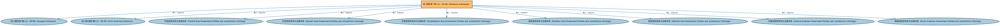

# BE 域参考个体入口（All BE, Reference Individuals）聚合说明

本文档对应 `AllBE-ReferenceIndividuals.rdf` / `AllBE-ReferenceIndividuals.ttl`。

## 1. 本文件是什么

聚合 BE 域的全部参考数据个体本体（全球各法域的政体、政府与法域实例），供需要完整参考数据的应用加载。

从机制上说，这是一个聚合入口（load-all）文件：它本身不定义任何新的类或属性，只通过 `owl:imports` 把一组本体打包在一起。应用只要导入这一个文件，推理机就会把它列出的所有本体一次性加载进来，免去逐个声明的麻烦。因此它的价值不在「内容」，而在「组合」——组合方式本身就表达了发布方的意图（例如按域打包、按区域扩展打包、按是否含参考数据打包）。

## 2. 聚合的本地本体（9 个）

以下本体均可在本目录结构中找到同名 `.rdf` 文件及配套中文文档：

| 导入本体 | 中文名称 | 简介 |
|---|---|---|
| `BE/AllBE-Europe.rdf` | BE 域欧洲扩展入口（All BE, European Extension） | 聚合 BE 域中欧洲法域的扩展本体（欧盟及欧洲各区域政府实体与法域个体），与 AllBE 配合用于欧洲场景。 |
| `BE/AllBE-NorthAmerica.rdf` | BE 域北美扩展入口（All BE, North American Extension） | 聚合 BE 域中北美法域的扩展本体（美国、加拿大、墨西哥、加勒比地区政府实体与法域个体）。 |
| `BE/GovernmentEntities/AsianJurisdiction/CentralAsiaGovernmentEntitiesAndJurisdictions.rdf` | 中亚政府实体与法域本体（Central Asia Government Entities and Jurisdictions Ontology） | 收录中亚地区各国（如哈萨克斯坦等）的政体、政府与法域个体，用于确定实体注册或监管所属的法域。 |
| `BE/GovernmentEntities/AsianJurisdiction/EasternAsiaGovernmentEntitiesAndJurisdictions.rdf` | 东亚政府实体与法域本体（Eastern Asia Government Entities and Jurisdictions Ontology） | 收录东亚地区各国（中国、日本、韩国等）的政体、政府与法域个体。 |
| `BE/GovernmentEntities/AsianJurisdiction/SoutheasternAsiaGovernmentEntitiesAndJurisdictions.rdf` | 东南亚政府实体与法域本体（Southeastern Asia Government Entities and Jurisdictions Ontology） | 收录东南亚地区各国（新加坡、马来西亚、泰国等）的政体、政府与法域个体。 |
| `BE/GovernmentEntities/AsianJurisdiction/SouthernAsiaGovernmentEntitiesAndJurisdictions.rdf` | 南亚政府实体与法域本体（Southern Asia Government Entities and Jurisdictions Ontology） | 收录南亚地区各国（印度、巴基斯坦等）的政体、政府与法域个体。 |
| `BE/GovernmentEntities/AsianJurisdiction/WesternAsiaGovernmentEntitiesAndJurisdictions.rdf` | 西亚政府实体与法域本体（Western Asia Government Entities and Jurisdictions Ontology） | 收录西亚地区各国（沙特阿拉伯、阿联酋等）的政体、政府与法域个体。 |
| `BE/GovernmentEntities/LatinAmericanJurisdiction/CentralAmericanGovernmentEntitiesAndJurisdictions.rdf` | 中美洲政府实体与法域本体（Central American Government Entities and Jurisdictions Ontology） | 收录中美洲各国（巴拿马、哥斯达黎加等）的政体、政府与法域个体。 |
| `BE/GovernmentEntities/LatinAmericanJurisdiction/SouthAmericanGovernmentEntitiesAndJurisdictions.rdf` | 南美洲政府实体与法域本体（South American Government Entities and Jurisdictions Ontology） | 收录南美洲各国（巴西、阿根廷等）的政体、政府与法域个体。 |

## 3. 文件

- 官方 RDF/XML：`AllBE-ReferenceIndividuals.rdf`
- 中文 Turtle：`AllBE-ReferenceIndividuals.ttl`
- 结构图：`AllBE-ReferenceIndividuals-structure.png` / `AllBE-ReferenceIndividuals-structure.svg`