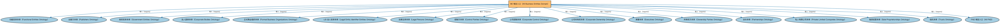

# BE 域总入口（All Business Entities Domain）聚合说明

本文档对应 `AllBE.rdf` / `AllBE.ttl`。

## 1. 本文件是什么

聚合商业实体（Business Entities，BE）域的全部生产本体：法律实体、公司、合伙、信托、所有权与控制权、政府实体等，一次导入即获得 BE 域完整模型。

从机制上说，这是一个聚合入口（load-all）文件：它本身不定义任何新的类或属性，只通过 `owl:imports` 把一组本体打包在一起。应用只要导入这一个文件，推理机就会把它列出的所有本体一次性加载进来，免去逐个声明的麻烦。因此它的价值不在「内容」，而在「组合」——组合方式本身就表达了发布方的意图（例如按域打包、按区域扩展打包、按是否含参考数据打包）。

## 2. 聚合的本地本体（17 个）

以下本体均可在本目录结构中找到同名 `.rdf` 文件及配套中文文档：

| 导入本体 | 中文名称 | 简介 |
|---|---|---|
| `BE/FunctionalEntities/FunctionalEntities.rdf` | 功能实体本体（Functional Entities Ontology） | 定义「功能实体」：按其在商业中承担的功能（而非法律形式）刻画的实体，是出版方、登记机构等功能性主体的基础。 |
| `BE/FunctionalEntities/Publishers.rdf` | 出版方本体（Publishers Ontology） | 定义出版方及其出版物，用于标识金融信息与文档的发布来源。 |
| `BE/GovernmentEntities/GovernmentEntities.rdf` | 政府实体本体（Government Entities Ontology） | 定义政府、政体（polity）、法域（jurisdiction）及政府实体的核心概念，是各区域政府实体本体的共同基础。 |
| `BE/LegalEntities/CorporateBodies.rdf` | 法人团体本体（Corporate Bodies Ontology） | 定义依法设立、具有独立法律人格的法人团体（corporate body），是股份有限公司等具体法人类型的上位概念。 |
| `BE/LegalEntities/FormalBusinessOrganizations.rdf` | 正式商业组织本体（Formal Business Organizations Ontology） | 定义以营利为目的、依法注册的正式商业组织，连接法律实体与其商业功能。 |
| `BE/LegalEntities/LEIEntities.rdf` | LEI 法人实体本体（Legal Entity Identifier Entities Ontology） | 定义持有全球法人识别编码（LEI）的法人实体，对接 ISO 17442 标准的 LEI 体系。 |
| `BE/LegalEntities/LegalPersons.rdf` | 法律主体本体（Legal Persons Ontology） | 定义法律主体（legal person）与法定实体（legal entity）的核心概念：能持有权利义务、可起诉与被诉的主体。 |
| `BE/OwnershipAndControl/ControlParties.rdf` | 控制方本体（Control Parties Ontology） | 定义处于控制关系中的各方角色：控制方、被控制方、实际控制人等。 |
| `BE/OwnershipAndControl/CorporateControl.rdf` | 公司控制本体（Corporate Control Ontology） | 定义公司层面的控制关系：控股股东、多数/少数控制、表决权控制等。 |
| `BE/OwnershipAndControl/CorporateOwnership.rdf` | 公司所有权本体（Corporate Ownership Ontology） | 定义公司层面的所有权关系：股东、股份持有与受益所有权。 |
| `BE/OwnershipAndControl/Executives.rdf` | 高管本体（Executives Ontology） | 定义公司高管（executive）、董事会成员及其职务角色，刻画「谁在管理公司」。 |
| `BE/OwnershipAndControl/OwnershipParties.rdf` | 所有权方本体（Ownership Parties Ontology） | 定义所有权关系中的各方角色：所有者、受益所有人、名义持有人等。 |
| `BE/Partnerships/Partnerships.rdf` | 合伙本体（Partnerships Ontology） | 定义合伙企业及普通合伙、有限合伙等形态，刻画合伙人之间的权利义务。 |
| `BE/PrivateLimitedCompanies/PrivateLimitedCompanies.rdf` | 私人有限公司本体（Private Limited Companies Ontology） | 定义私人有限公司（private limited company）这类不公开募股的有限责任公司形态。 |
| `BE/SoleProprietorships/SoleProprietorships.rdf` | 独资经营本体（Sole Proprietorships Ontology） | 定义由单一自然人拥有和经营的独资企业形态。 |
| `BE/Trusts/Trusts.rdf` | 信托本体（Trusts Ontology） | 定义信托（trust）及委托人、受托人与受益人之间的信托关系。 |
| `FND/AllFND.rdf` | FND 域总入口（All FND） | 聚合基础（Foundations，FND）域的全部生产本体，一次导入即可获得 FIBO 全部基础概念（协议、合同、参与方、日期、所有权等），是依赖 FND 全域时的标准入口。 |

## 3. 文件

- 官方 RDF/XML：`AllBE.rdf`
- 中文 Turtle：`AllBE.ttl`
- 结构图：`AllBE-structure.png` / `AllBE-structure.svg`