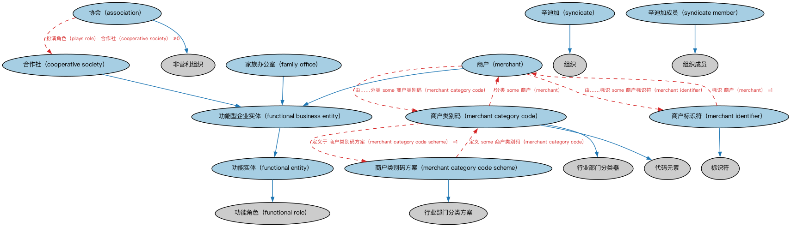

# 功能实体本体（Functional Entities Ontology）结构与公理说明

本文档对应 `FunctionalEntities.rdf` / `FunctionalEntities.ttl`，说明该本体的类、继承关系、属性和公理约定。结构图见 `FunctionalEntities-structure.png`（`FunctionalEntities-structure.svg` 为可缩放版本）。

## 1. 本体概述

定义「功能实体」：按其在商业活动中承担的功能（而非法律形式）刻画的实体，如登记机构、出版方、市场运营方。

**在体系中的位置**：BE 域功能实体模块的核心，与「法律实体」视角互补，构成 BE 域的两条主线之一。

**上下游关系**：上游依赖 FND 的组织与参与方本体；下游被出版方本体以及 FBC 的功能实体各本体扩展——金融服务实体、市场、监管机构本质上都是按功能刻画的实体。

**与相近概念的差别**：与法律主体（Legal Person）的差别在于划分维度不同：法律主体按法律人格划分，功能实体按商业功能划分；同一家银行既是法律主体，也是功能实体。

## 2. 类（Class）

| 类（Class） | 定义（Definition） |
|---|---|
| 协会（association） | 由其成员拥有并代表成员行事的非营利组织。 |
| 合作社（cooperative society） | 由使用其服务的人拥有并为其利益运营的组织。 |
| 家族办公室（family office） | 承担一个家族事务日常行政与管理的组织。 |
| 功能型企业实体（functional business entity） | 按其所从事商业活动的性质定义的功能实体。 |
| 功能实体（functional entity） | 按其所履行职能定义的参与方。 |
| 商户（merchant） | 为盈利而从事他人所生产货物之购销的参与方。 |
| 商户类别码（merchant category code） | 国际上用于对商户进行分类的代码。 |
| 商户类别码方案（merchant category code scheme） | 定义一组用于商户服务分类之代码的方案。 |
| 商户标识符（merchant identifier） | 商户的唯一标识符，例如用于交易交换目的。 |
| 辛迪加（syndicate） | 为完成特定业务而组成的临时性自组织联盟，由个人、公司或其他实体构成。 |
| 辛迪加成员（syndicate member） | 作为联盟成员、为大型交易汇集资源并分担风险的个人或组织所扮演的角色。 |

### 2.1 继承关系（Inheritance）

- 协会（association） ⊑ 非营利组织
- 合作社（cooperative society） ⊑ 功能型企业实体（functional business entity）
- 家族办公室（family office） ⊑ 功能型企业实体（functional business entity）
- 功能型企业实体（functional business entity） ⊑ 功能实体（functional entity）
- 功能实体（functional entity） ⊑ 功能角色（functional role）
- 商户（merchant） ⊑ 功能型企业实体（functional business entity）
- 商户类别码（merchant category code） ⊑ 行业部门分类器
- 商户类别码（merchant category code） ⊑ 代码元素
- 商户类别码方案（merchant category code scheme） ⊑ 行业部门分类方案
- 商户标识符（merchant identifier） ⊑ 标识符
- 辛迪加（syndicate） ⊑ 组织
- 辛迪加成员（syndicate member） ⊑ 组织成员

## 4. 数据属性（Datatype Property）

| 属性（Property） | 中文（English） | 定义（Definition） |
|---|---|---|
| fibo-be-fct-fct:hasMerchantCategoryDescription | 具有商户类别描述（has merchant category description） | 提供该代码所适用行业的文本描述。 |

## 5. 公理约定（Axioms）

- 协会（association）：扮演角色（plays role） 合作社（cooperative society） ≥0
- 功能型企业实体（functional business entity）：由…扮演（is played by） 正式组织 ≥0
- 功能实体（functional entity）：由…扮演（is played by） 参与方（party） ≥0
- 商户（merchant）：由……分类 some 商户类别码（merchant category code）
- 商户（merchant）：由……标识 some 商户标识符（merchant identifier）
- 商户类别码（merchant category code）：定义于 商户类别码方案（merchant category code scheme） =1
- 商户类别码（merchant category code）：restriction
- 商户类别码（merchant category code）：具有商户类别描述（has merchant category description） some xsd:string
- 商户类别码（merchant category code）：分类 some 商户（merchant）
- 商户类别码方案（merchant category code scheme）：定义 some 商户类别码（merchant category code）
- 商户标识符（merchant identifier）：标识 商户（merchant） =1
- 辛迪加（syndicate）：具有成员 some 参与方（party）
- 辛迪加成员（syndicate member）：由…扮演（is played by） some（是……的成员 only 辛迪加（syndicate））

## 6. 依赖（owl:imports，13 个）

本本体通过 `owl:imports` 引入以下本体，各项的中文名称与简介如下：

| 导入本体 | 中文名称 | 简介 |
|---|---|---|
| `BE/LegalEntities/FormalBusinessOrganizations.rdf` | 正式商业组织本体（Formal Business Organizations Ontology） | 定义以营利为目的、依法注册的正式商业组织，连接法律实体与其商业功能。 |
| `FND/Arrangements/ClassificationSchemes.rdf` | 分类方案本体（Classification Schemes Ontology） | 定义分类方案（classification scheme）、类别及「将事物归入类别」的关系，支撑证券分类、行业分类等具体分类体系。 |
| `FND/Relations/Relations.rdf` | 关系本体（Relations Ontology） | FIBO 最底层的基础本体，定义参考（reference）、分类（classify）等通用关系与抽象概念，全库普遍依赖。 |
| `FND/Utilities/AnnotationVocabulary.rdf` | FIBO 标注词汇表（FIBO Annotation Vocabulary） | 定义 FIBO 专用的标注属性（如释义来源、成熟度等级），用于本体自身的元数据标注。 |
| `https://www.omg.org/spec/Commons/AnnotationVocabulary/` | OMG 通用标注词汇表（OMG Commons Annotation Vocabulary） | OMG 通用本体库（Commons）中的标注词汇表，提供概念映射等标注属性，FIBO 用它标注术语与外部标准的对应关系。 |
| `https://www.omg.org/spec/Commons/Classifiers/` | OMG 通用分类器本体（OMG Commons Classifiers） | OMG 通用本体库（Commons）中的分类器本体，定义分类方案、类别与归类关系的通用概念，FIBO 的分类建模建立在其上。 |
| `https://www.omg.org/spec/Commons/CodesAndCodeSets/` | OMG 通用代码与代码集本体（OMG Commons Codes and Code Sets） | Commons 库中的代码本体，定义代码、代码集及其维护方的通用概念，是 ISO 4217、ISO 3166 等编码体系建模的基础。 |
| `https://www.omg.org/spec/Commons/Collections/` | OMG 通用集合本体（OMG Commons Collections） | Commons 库中的集合本体，定义集合、成员等通用概念。 |
| `https://www.omg.org/spec/Commons/Designators/` | OMG 通用指称符本体（OMG Commons Designators） | Commons 库中的指称符本体，定义名称、标识符等「指代某物的符号」的通用概念。 |
| `https://www.omg.org/spec/Commons/Identifiers/` | OMG 通用标识符本体（OMG Commons Identifiers） | Commons 库中的标识符本体，定义标识符及其编码方案的通用概念。 |
| `https://www.omg.org/spec/Commons/Organizations/` | OMG 通用组织本体（OMG Commons Organizations） | Commons 库中的组织本体，定义组织、组织成员与组织结构的通用概念。 |
| `https://www.omg.org/spec/Commons/PartiesAndSituations/` | OMG 通用参与方与情境本体（OMG Commons Parties and Situations） | Commons 库中的参与方本体，定义独立主体、参与方及其角色扮演的通用概念，是 FIBO 参与方模型的上游。 |
| `https://www.omg.org/spec/Commons/RolesAndCompositions/` | OMG 通用角色与构成本体（OMG Commons Roles and Compositions） | Commons 库中的角色本体，定义角色及整体—部分构成关系的通用概念。 |

## 7. 文件

- 官方 RDF/XML：`FunctionalEntities.rdf`
- 中文 Turtle：`FunctionalEntities.ttl`
- 结构图：`FunctionalEntities-structure.png` / `FunctionalEntities-structure.svg`