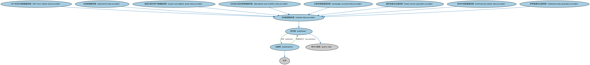

# 出版方本体（Publishers Ontology）结构与公理说明

本文档对应 `Publishers.rdf` / `Publishers.ttl`，说明该本体的类、继承关系、属性和公理约定。结构图见 `Publishers-structure.png`（`Publishers-structure.svg` 为可缩放版本）。

## 1. 本体概述

定义出版方（publisher）及其出版物，用于标识金融信息与文档的发布来源。

**在体系中的位置**：BE 功能实体模块的配套本体，是功能实体的一个具体化。

**上下游关系**：上游依赖功能实体本体；下游被需要标注发布来源的场景引用，如文档、市场数据、指数发布。

**与相近概念的差别**：出版方是「谁发布了它」这个功能角色，与文档本体（FND/Arrangements/Documents）建模的内容本身相区分——一个是主体，一个是载体。

## 2. 类（Class）

| 类（Class） | 定义（Definition） |
|---|---|
| API 优先市场数据提供商（API-first market data provider） | 主要通过程序化接口交付金融信息、以 API 提供实时或历史数据的市场数据提供商。 |
| 另类数据提供商（alternative data provider） | 提供源自网络活动、情感分析、地理空间信号等的非传统数据集的市场数据提供商。 |
| 加密与数字资产数据提供商（crypto and digital-asset data provider） | 为数字通证和加密资产提供定价、参考数据和分析的市场数据提供商。 |
| 衍生品与波动率数据提供商（derivatives and volatility data provider） | 为衍生品（含期权、期货和结构化产品）提供定价、隐含波动率曲面和分析的市场数据提供商。 |
| 交易所数据源提供商（exchange-sourced data provider） | 分发直接源自交易场所的金融信息（含订单簿数据、成交、报价）的市场数据提供商。 |
| 固定收益专业提供商（fixed income specialist provider） | 专注于固定收益工具（如债券、信用产品和货币市场工具）定价、参考数据和分析的市场数据提供商。 |
| 机构市场数据提供商（institutional market data provider） | 向银行、资产管理公司等金融机构提供多资产金融信息、分析和参考数据的市场数据提供商。 |
| 市场数据提供商（market data provider） | 提供金融市场所用金融信息、参考数据、分析或相关数据集的发布方。 |
| 出版物（publication） | 向公众分发、通常制作多份副本的文件。 |
| 发布者（publisher） | role of person(s) or organization(s) responsible for the printing or distribution of an item, whether in digital or print (physical) form |
| 参考数据专业提供商（reference data specialist provider） | 专注于权威参考数据（含公司行动、工具标识符、分类和实体信息）的市场数据提供商。 |

### 2.1 继承关系（Inheritance）

- API 优先市场数据提供商（API-first market data provider） ⊑ 市场数据提供商（market data provider）
- 另类数据提供商（alternative data provider） ⊑ 市场数据提供商（market data provider）
- 加密与数字资产数据提供商（crypto and digital-asset data provider） ⊑ 市场数据提供商（market data provider）
- 衍生品与波动率数据提供商（derivatives and volatility data provider） ⊑ 市场数据提供商（market data provider）
- 交易所数据源提供商（exchange-sourced data provider） ⊑ 市场数据提供商（market data provider）
- 固定收益专业提供商（fixed income specialist provider） ⊑ 市场数据提供商（market data provider）
- 机构市场数据提供商（institutional market data provider） ⊑ 市场数据提供商（market data provider）
- 市场数据提供商（market data provider） ⊑ 发布者（publisher）
- 出版物（publication） ⊑ 文件
- 发布者（publisher） ⊑ 参与方角色（party role）
- 参考数据专业提供商（reference data specialist provider） ⊑ 市场数据提供商（market data provider）

## 3. 对象属性（Object Property）

| 属性（Property） | 中文（English） | 定义（Definition） | 说明 |
|---|---|---|---|
| fibo-be-fct-pub:hasPublisher | 具有发布方（has publisher） | 标识承担信息发布角色的参与方。 | 定义域（domain）：出版物（publication）；值域（range）：发布者（publisher）；逆属性（inverseOf）：发布（publishes）；子属性（subPropertyOf）：具有参与方角色（has party role） |
| fibo-be-fct-pub:isPublishedBy | 由……发布（is published by） | 标识传播该材料的独立方（个人或组织）。 | 定义域（domain）：出版物（publication）；值域（range）：参与方（party）；子属性（subPropertyOf）：具有参与方（has party） |
| fibo-be-fct-pub:publishes | 发布（publishes） | 编制并发行材料供公众使用。 | 定义域（domain）：发布者（publisher）；值域（range）：出版物（publication）；子属性（subPropertyOf）：体现在…中（is manifested in） |

## 5. 公理约定（Axioms）

- 发布者（publisher）：由…扮演（is played by） 参与方（party） ≥0

## 6. 依赖（owl:imports，5 个）

本本体通过 `owl:imports` 引入以下本体，各项的中文名称与简介如下：

| 导入本体 | 中文名称 | 简介 |
|---|---|---|
| `FND/Utilities/AnnotationVocabulary.rdf` | FIBO 标注词汇表（FIBO Annotation Vocabulary） | 定义 FIBO 专用的标注属性（如释义来源、成熟度等级），用于本体自身的元数据标注。 |
| `https://www.omg.org/spec/Commons/AnnotationVocabulary/` | OMG 通用标注词汇表（OMG Commons Annotation Vocabulary） | OMG 通用本体库（Commons）中的标注词汇表，提供概念映射等标注属性，FIBO 用它标注术语与外部标准的对应关系。 |
| `https://www.omg.org/spec/Commons/Documents/` | OMG 通用文档本体（OMG Commons Documents） | Commons 库中的文档本体，定义文档及其组成部分的通用概念。 |
| `https://www.omg.org/spec/Commons/PartiesAndSituations/` | OMG 通用参与方与情境本体（OMG Commons Parties and Situations） | Commons 库中的参与方本体，定义独立主体、参与方及其角色扮演的通用概念，是 FIBO 参与方模型的上游。 |
| `https://www.omg.org/spec/Commons/RolesAndCompositions/` | OMG 通用角色与构成本体（OMG Commons Roles and Compositions） | Commons 库中的角色本体，定义角色及整体—部分构成关系的通用概念。 |

## 7. 文件

- 官方 RDF/XML：`Publishers.rdf`
- 中文 Turtle：`Publishers.ttl`
- 结构图：`Publishers-structure.png` / `Publishers-structure.svg`