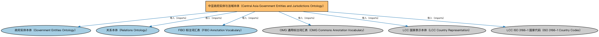

# 中亚政府实体与法域本体（Central Asia Government Entities and Jurisdictions Ontology）说明

本文档对应 `CentralAsiaGovernmentEntitiesAndJurisdictions.rdf` / `CentralAsiaGovernmentEntitiesAndJurisdictions.ttl`。

## 1. 本文件是什么

收录中亚地区各国（如哈萨克斯坦等）的政体、政府与法域个体，用于确定实体注册或监管所属的法域。

从机制上说，这是一个个体（individuals）文件：它本身不定义任何新的类或属性，装的全是命名个体（owl:NamedIndividual）——也就是一条条真实存在的实例数据（如具体的货币、市场、监管机构、法域）。它的 `owl:imports` 引入的是这些个体所属的类定义所在的本体。应用需要实例级参考数据时加载这类文件。

## 2. 个体构成（共 15 个）

按个体所属类型统计（类型名为中文（English）对照）：

| 类型（Class） | 个体数量 |
|---|---|
| 国家政府（NationalGovernment） | 5 |
| 管辖权（Jurisdiction） | 5 |
| 主权国家（SovereignState） | 5 |

个体数量较少，全部列出：

| 个体 | 类型 |
|---|---|
| Government of Turkmenistan | 国家政府（NationalGovernment） |
| Government of the Kyrgyz Republic | 国家政府（NationalGovernment） |
| Government of the Republic of Kazakhstan | 国家政府（NationalGovernment） |
| Government of the Republic of Tajikistan | 国家政府（NationalGovernment） |
| Government of the Republic of Uzbekistan | 国家政府（NationalGovernment） |
| jurisdiction of Turkmenistan | 管辖权（Jurisdiction） |
| jurisdiction of the Kyrgyz Republic | 管辖权（Jurisdiction） |
| jurisdiction of the Republic of Kazakhstan | 管辖权（Jurisdiction） |
| jurisdiction of the Republic of Tajikistan | 管辖权（Jurisdiction） |
| jurisdiction of the Republic of Uzbekistan | 管辖权（Jurisdiction） |
| state of Kazakhstan | 主权国家（SovereignState） |
| state of Kyrgyzstan | 主权国家（SovereignState） |
| state of Tajikistan | 主权国家（SovereignState） |
| state of Turkmenistan | 主权国家（SovereignState） |
| state of Uzbekistan | 主权国家（SovereignState） |

## 3. 依赖的本体（owl:imports，6 个）

以下导入提供个体所属的类定义与相关参考数据：

| 导入本体 | 中文名称 | 简介 |
|---|---|---|
| `BE/GovernmentEntities/GovernmentEntities.rdf` | 政府实体本体（Government Entities Ontology） | 定义政府、政体（polity）、法域（jurisdiction）及政府实体的核心概念，是各区域政府实体本体的共同基础。 |
| `FND/Relations/Relations.rdf` | 关系本体（Relations Ontology） | FIBO 最底层的基础本体，定义参考（reference）、分类（classify）等通用关系与抽象概念，全库普遍依赖。 |
| `FND/Utilities/AnnotationVocabulary.rdf` | FIBO 标注词汇表（FIBO Annotation Vocabulary） | 定义 FIBO 专用的标注属性（如释义来源、成熟度等级），用于本体自身的元数据标注。 |
| `https://www.omg.org/spec/Commons/AnnotationVocabulary/` | OMG 通用标注词汇表（OMG Commons Annotation Vocabulary） | OMG 通用本体库（Commons）中的标注词汇表，提供概念映射等标注属性，FIBO 用它标注术语与外部标准的对应关系。 |
| `https://www.omg.org/spec/LCC/Countries/CountryRepresentation/` | LCC 国家表示本体（LCC Country Representation） | OMG 国家语言代码库（LCC）中的国家表示本体，定义国家、国家标识等概念，是 ISO 3166 各国代码个体的类定义来源。 |
| `https://www.omg.org/spec/LCC/Countries/ISO3166-1-CountryCodes/` | LCC ISO 3166-1 国家代码（ISO 3166-1 Country Codes） | LCC 中 ISO 3166-1 标准的国家/地区代码个体集（如 CN、US、MX），供法域与地址建模引用。 |

## 4. 文件

- 官方 RDF/XML：`CentralAsiaGovernmentEntitiesAndJurisdictions.rdf`
- 中文 Turtle：`CentralAsiaGovernmentEntitiesAndJurisdictions.ttl`
- 结构图：`CentralAsiaGovernmentEntitiesAndJurisdictions-structure.png` / `CentralAsiaGovernmentEntitiesAndJurisdictions-structure.svg`