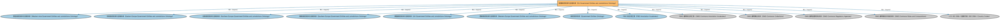

# 欧盟政府实体与法域本体（EU Government Entities and Jurisdictions Ontology）说明

本文档对应 `EUGovernmentEntitiesAndJurisdictions.rdf` / `EUGovernmentEntitiesAndJurisdictions.ttl`。

## 1. 本文件是什么

收录欧盟层面的政体、机构与法域个体（欧盟本身及其超国家机构）。

从机制上说，这是一个个体（individuals）文件：它本身不定义任何新的类或属性，装的全是命名个体（owl:NamedIndividual）——也就是一条条真实存在的实例数据（如具体的货币、市场、监管机构、法域）。它的 `owl:imports` 引入的是这些个体所属的类定义所在的本体。应用需要实例级参考数据时加载这类文件。

## 2. 个体构成（共 8 个）

按个体所属类型统计（类型名为中文（English）对照）：

| 类型（Class） | 个体数量 |
|---|---|
| 超国家实体（SupranationalEntity） | 4 |
| 管辖权（Jurisdiction） | 2 |
| 监管机构（RegulatoryAgency） | 1 |
| 政府（Government） | 1 |

个体数量较少，全部列出：

| 个体 | 类型 |
|---|---|
| Council of Europe | 超国家实体（SupranationalEntity） |
| European Commission | 超国家实体（SupranationalEntity） |
| European Commission as regulatory agency | 监管机构（RegulatoryAgency） |
| European Economic Area jurisdiction | 管辖权（Jurisdiction） |
| European Free Trade Association | 超国家实体（SupranationalEntity） |
| European Union entity | 超国家实体（SupranationalEntity） |
| European Union jurisdiction | 管辖权（Jurisdiction） |
| Government of the European Union | 政府（Government） |

## 3. 依赖的本体（owl:imports，13 个）

以下导入提供个体所属的类定义与相关参考数据：

| 导入本体 | 中文名称 | 简介 |
|---|---|---|
| `BE/GovernmentEntities/AsianJurisdiction/WesternAsiaGovernmentEntitiesAndJurisdictions.rdf` | 西亚政府实体与法域本体（Western Asia Government Entities and Jurisdictions Ontology） | 收录西亚地区各国（沙特阿拉伯、阿联酋等）的政体、政府与法域个体。 |
| `BE/GovernmentEntities/EuropeanJurisdiction/EasternEuropeGovernmentEntitiesAndJurisdictions.rdf` | 东欧政府实体与法域本体（Eastern Europe Government Entities and Jurisdictions Ontology） | 收录东欧各国（波兰、捷克、匈牙利等）的政体、政府与法域个体。 |
| `BE/GovernmentEntities/EuropeanJurisdiction/NorthernEuropeGovernmentEntitiesAndJurisdictions.rdf` | 北欧政府实体与法域本体（Northern Europe Government Entities and Jurisdictions Ontology） | 收录北欧各国（瑞典、挪威、丹麦等）的政体、政府与法域个体。 |
| `BE/GovernmentEntities/EuropeanJurisdiction/SouthernEuropeGovernmentEntitiesAndJurisdictions.rdf` | 南欧政府实体与法域本体（Southern Europe Government Entities and Jurisdictions Ontology） | 收录南欧各国（意大利、西班牙、希腊等）的政体、政府与法域个体。 |
| `BE/GovernmentEntities/EuropeanJurisdiction/UKGovernmentEntitiesAndJurisdictions.rdf` | 英国政府实体与法域本体（UK Government Entities and Jurisdictions Ontology） | 收录大不列颠及北爱尔兰联合王国的政体、政府与法域个体（英格兰、苏格兰、威尔士、北爱尔兰）。 |
| `BE/GovernmentEntities/EuropeanJurisdiction/WesternEuropeGovernmentEntitiesAndJurisdictions.rdf` | 西欧政府实体与法域本体（Western Europe Government Entities and Jurisdictions Ontology） | 收录西欧各国（法国、德国、荷兰等）的政体、政府与法域个体。 |
| `BE/GovernmentEntities/GovernmentEntities.rdf` | 政府实体本体（Government Entities Ontology） | 定义政府、政体（polity）、法域（jurisdiction）及政府实体的核心概念，是各区域政府实体本体的共同基础。 |
| `FND/Utilities/AnnotationVocabulary.rdf` | FIBO 标注词汇表（FIBO Annotation Vocabulary） | 定义 FIBO 专用的标注属性（如释义来源、成熟度等级），用于本体自身的元数据标注。 |
| `https://www.omg.org/spec/Commons/AnnotationVocabulary/` | OMG 通用标注词汇表（OMG Commons Annotation Vocabulary） | OMG 通用本体库（Commons）中的标注词汇表，提供概念映射等标注属性，FIBO 用它标注术语与外部标准的对应关系。 |
| `https://www.omg.org/spec/Commons/Collections/` | OMG 通用集合本体（OMG Commons Collections） | Commons 库中的集合本体，定义集合、成员等通用概念。 |
| `https://www.omg.org/spec/Commons/RegulatoryAgencies/` | OMG 通用监管机构本体（OMG Commons Regulatory Agencies） | Commons 库中的监管机构本体，定义监管机构及其监管职权的通用概念。 |
| `https://www.omg.org/spec/Commons/RolesAndCompositions/` | OMG 通用角色与构成本体（OMG Commons Roles and Compositions） | Commons 库中的角色本体，定义角色及整体—部分构成关系的通用概念。 |
| `https://www.omg.org/spec/LCC/Countries/ISO3166-1-CountryCodes/` | LCC ISO 3166-1 国家代码（ISO 3166-1 Country Codes） | LCC 中 ISO 3166-1 标准的国家/地区代码个体集（如 CN、US、MX），供法域与地址建模引用。 |

## 4. 文件

- 官方 RDF/XML：`EUGovernmentEntitiesAndJurisdictions.rdf`
- 中文 Turtle：`EUGovernmentEntitiesAndJurisdictions.ttl`
- 结构图：`EUGovernmentEntitiesAndJurisdictions-structure.png` / `EUGovernmentEntitiesAndJurisdictions-structure.svg`