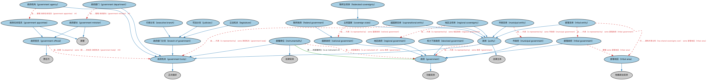

# 政府实体本体（Government Entities Ontology）结构与公理说明

本文档对应 `GovernmentEntities.rdf` / `GovernmentEntities.ttl`，说明该本体的类、继承关系、属性和公理约定。结构图见 `GovernmentEntities-structure.png`（`GovernmentEntities-structure.svg` 为可缩放版本）。

## 1. 本体概述

定义政府（government）、政体（polity）与法域（jurisdiction）的核心概念：政体是具有主权的政治实体，政府是其行政机关，法域是其法律效力的适用范围。

**在体系中的位置**：BE 政府实体模块的根基，全球 17 个区域政府实体与法域本体全部建立在它之上。

**上下游关系**：上游依赖 FND 的法律核心、正式组织、地点本体；下游是各区域政府实体个体本体，以及 FBC、LOAN 等需要表达监管法域、注册地的本体。

**与相近概念的差别**：政体、政府、法域三者常被混用但含义不同——国家是政体，国务院/政府内阁是政府，「适用中国法律」指的是法域；与 FND/Law/LegalCore 的法域概念衔接并落到具体国家。

本本体中类与类的核心关系如下（完整细节见各类小节）：

- **政府部门分支（branch of government）** 继承 **政府机关（government body）**
- **权力下放政府（devolved government）** 继承 **政府（government）**
- **行政分支（executive branch）** 继承 **政府部门分支（branch of government）**
- **联邦政府（federal government）** 继承 **国家政府（national government）**
- **联邦主权体（federated sovereignty）** 继承 **主权国家（sovereign state）**
- **政府（government）** 继承 **功能实体（FunctionalEntity）**
- **政府机构（government agency）** 继承 **政府机关（government body）**
- **政府任命官员（government appointee）** 继承 **政府官员（government official）**
- **政府任命官员（government appointee）** 继承 **高管（Executive）**
- **政府机关（government body）** 继承 **正式组织（FormalOrganization）**
- **政府部门（government department）** 继承 **政府机关（government body）**
- **政府部长（government minister）** 继承 **政府官员（government official）**
- 其余 19 条关系从略。

## 2. 类（Class）

| 类（Class） | 定义（Definition） |
|---|---|
| 政府部门分支（branch of government） | 国家政府的分支，拥有相互独立、互不冲突的权力与职责范围。 division of the government of a state, with separate and independent powers and areas of responsibility so that the powers of one branch are not in conflict with the powers associated with the other branches |
| 权力下放政府（devolved government） | 治理次国家领土的政府及政客，其权力可能是临时的、可撤销的，最终归属于中央政府。 government and the politicians that that run a subnational territory with powers that may be temporary and reversible, ultimately residing with the central government |
| 行政分支（executive branch） | 经授权负责政府日常行政管理的政府部门分支。 the branch of government that is authorized and responsible for the daily administration of the government |
| 联邦政府（federal government） | 在中央政府之下联合的各州，中央政府有别于各成员州各自的政府。 union of states under a central government distinct from the individual governments of the separate states |
| 联邦主权体（federated sovereignty） | 以中央（联邦）政府之下若干部分自治的州或地区的联合为特征的政体。 polity characterized by a union of partially self-governing states or regions under a central (federal) government |
| 政府（government） | 控制国家或共同体的体系。 system by which a state or community is controlled |
| 政府机构（government agency） | 政府机器中负责某领域监督与行政的永久或半永久组织，常为受任命的委员会。 permanent or semi-permanent organization, often an appointed commission, in the machinery of government that is responsible for the oversight and administration of specific functions |
| 政府任命官员（government appointee） | 由政府法令指定领导或以某种身份参与政府机构的个人。 individual designated by government decree to lead, or participate in some capacity in a government body |
| 政府机关（government body） | 作为超国家、国家、联邦、州或地方政府之机构、部属单位或其他机关的正式组织。 formal organization that is an agency, instrumentality, or other body of a supranational, national, federal, state, or local government, including certain multijurisdictional agencies and departments that carry out the business of government |
| 政府部门（government department） | 负责政府公共行政某个领域的专门组织。 specialized organization responsible for a sector of government public administration |
| 政府部长（government minister） | 被任命或当选担任政府高级职务的行政官员。 government official that is an executive, who is either appointed or elected to a high office in the government |
| 政府官员（government official） | 经选举或任命管理政府某方面事务的人。 person elected or appointed to administer some aspect of a government |
| 部属单位（instrumentality） | 服务公共目的、与政府关系密切但不是政府机构的组织。 organization that serves a public purpose and is closely tied to a government, but is not a government agency |
| 司法分支（judiciary） | 由法院系统构成的政府部门分支，以超国家、国家、联邦或地区当局之名解释和适用法律。 branch of government that comprises the system of courts that interprets and applies the law in the name of the supranational, national, federal, or regional government, depending on its jurisdiction |
| 立法机关（legislature） | 政治单位（通常为国家政府）的立法机构，有权制定、修改和废止公共政策。 the law-making body of a political unit, usually a national government, that has power to enact, amend, and repeal public policy |
| 市政实体（municipal entity） | 通常代表城市、镇区或其他行政区划的政体，具有法人地位和自治权力或管辖权。 polity that typically represents a city, township, or other administrative subdivision having corporate status and powers of self-government or jurisdiction |
| 市政府（municipal government） | 城市、镇区或其他行政区划的地区政府。 regional government of a city, township, or other administrative subdivision |
| 国家政府（national government） | 治理整个国家（相对于地方政府）的政府及政客。 government and the politicians that that run a country as a whole (as opposed to local government) |
| 政体（polity） | 作为超国家实体、王室、国家或下级民政当局（如省、县、市）的法律主体。 legal person that is a supranational entity, crown, state, or subordinate civil authority, such as a province, prefecture, county, municipality, city, or district representing the people of that entity |
| 地区政府（regional government） | 地理区域（如县、小城镇或类似社区）的行政机构。 administrative body for a geographic area, such as a county, smaller town, or other similar community |
| 地区主权体（regional sovereignty） | 对应行政区划、行政单位、行政实体或国家行政区划的法律主体。 legal person that corresponds to an administrative division, administrative unit, administrative entity or country subdivision (or, sometimes, geopolitical division or subnational entity), that has the capacity to incur debt, issue contracts, and enter into relations with other similar entities |
| 主权国家（sovereign state） | 由对一个地理区域拥有主权的单一中央政府所代表的非物理法人实体。 non-physical juridical entity that is represented by one centralized government that has sovereignty over a geographic area |
| 超国家实体（supranational entity） | 依国际法或条约建立、或在国际层面注册成立的政府或非政府实体。 governmental or non-governmental entity that is established by international law or treaty or incorporated at an international level |
| 部落地区（tribal area） | 由原住民群体而非主权国家或地区政府实体管辖的地理区域的指称。 designation for geographic region administered by a group of indigenous people rather than by a sovereign state or regional governmental entity |
| 部落实体（tribal entity） | 代表主权部落（原住民）政府基本单位的法律实体。 legal entity that represents fundamental unit of sovereign tribal (indigenous) government |
| 部落政府（tribal government） | 代表原住民群体、对该群体拥有合法治理权（包括立法权）的政府。 government representing a group of indigenous people that has legal authority to govern those people, including authority to legislate the existence of tribal entities |

以下按类逐个展开：每个类给出继承关系、相关属性与公理约定；子类在父类之下降一级编号。

### 2.1 政府（government）

定义：控制国家或共同体的体系。

- 父类：**功能实体（FunctionalEntity）**
- 直接子类：**权力下放政府（devolved government）**、**市政府（municipal government）**、**国家政府（national government）**、**地区政府（regional government）**、**部落政府（tribal government）**

属性：

| 属性 | 定义 | 说明 |
|---|---|---|
| **具有成员（hasMember）** | — | — |
| **管辖（governs）** | — | — |

公理：

- **具有成员（hasMember）**可以有 0 个或多个**N8d1d605fd1264202a2343bb2fa1da371**。
- **管辖（governs）**至少有一个取值，类型是**地缘政治实体（GeopoliticalEntity）**。
- 与**部属单位（instrumentality）**互斥：同一个体不能同时属于两者。

#### 2.1.1 权力下放政府（devolved government）

定义：治理次国家领土的政府及政客，其权力可能是临时的、可撤销的，最终归属于中央政府。

- 父类：**政府（government）**

#### 2.1.2 市政府（municipal government）

定义：城市、镇区或其他行政区划的地区政府。

- 父类：**政府（government）**

属性：

| 属性 | 定义 | 说明 |
|---|---|---|
| **管辖（governs）** | — | — |

公理：

- **管辖（governs）**至少有一个取值，类型是**市政区（Municipality）**。

#### 2.1.3 国家政府（national government）

定义：治理整个国家（相对于地方政府）的政府及政客。

- 父类：**政府（government）**
- 直接子类：**联邦政府（federal government）**

属性：

| 属性 | 定义 | 说明 |
|---|---|---|
| **管辖（governs）** | — | — |

公理：

- **管辖（governs）**至少有一个取值，类型是**国家（Country）**。

##### 2.1.3.1 联邦政府（federal government）

定义：在中央政府之下联合的各州，中央政府有别于各成员州各自的政府。

- 父类：**国家政府（national government）**

公理：

- 该属性存在取值约束。

#### 2.1.4 地区政府（regional government）

定义：地理区域（如县、小城镇或类似社区）的行政机构。

- 父类：**政府（government）**

属性：

| 属性 | 定义 | 说明 |
|---|---|---|
| **管辖（governs）** | — | — |

公理：

- **管辖（governs）**至少有一个取值，类型是**地缘政治实体（GeopoliticalEntity）**。

#### 2.1.5 部落政府（tribal government）

定义：代表原住民群体、对该群体拥有合法治理权（包括立法权）的政府。

- 父类：**政府（government）**

属性：

| 属性 | 定义 | 说明 |
|---|---|---|
| **管辖（governs）** | — | — |

公理：

- **管辖（governs）**至少有一个取值，类型是**部落地区（tribal area）**。

### 2.2 政府机关（government body）

定义：作为超国家、国家、联邦、州或地方政府之机构、部属单位或其他机关的正式组织。

- 父类：**正式组织（FormalOrganization）**
- 直接子类：**政府部门分支（branch of government）**、**政府机构（government agency）**、**政府部门（government department）**、**部属单位（instrumentality）**、**政体（polity）**

属性：

| 属性 | 定义 | 说明 |
|---|---|---|
| **具有目标（hasObjective）** | — | — |

公理：

- **具有目标（hasObjective）**可以有 0 个或多个**公共宗旨（PublicPurpose）**。

#### 2.2.1 政府部门分支（branch of government）

定义：国家政府的分支，拥有相互独立、互不冲突的权力与职责范围。

- 父类：**政府机关（government body）**
- 直接子类：**行政分支（executive branch）**、**司法分支（judiciary）**、**立法机关（legislature）**

##### 2.2.1.1 行政分支（executive branch）

定义：经授权负责政府日常行政管理的政府部门分支。

- 父类：**政府部门分支（branch of government）**

##### 2.2.1.2 司法分支（judiciary）

定义：由法院系统构成的政府部门分支，以超国家、国家、联邦或地区当局之名解释和适用法律。

- 父类：**政府部门分支（branch of government）**

属性：

| 属性 | 定义 | 说明 |
|---|---|---|
| **具有部分（hasPart）** | — | — |

公理：

- **具有部分（hasPart）**至少有一个取值，类型是**法院（CourtOfLaw）**。

##### 2.2.1.3 立法机关（legislature）

定义：政治单位（通常为国家政府）的立法机构，有权制定、修改和废止公共政策。

- 父类：**政府部门分支（branch of government）**

#### 2.2.2 政府机构（government agency）

定义：政府机器中负责某领域监督与行政的永久或半永久组织，常为受任命的委员会。

- 父类：**政府机关（government body）**

属性：

| 属性 | 定义 | 说明 |
|---|---|---|
| **由……管理（isManagedBy）** | — | — |

公理：

- **由……管理（isManagedBy）**可以有 0 个或多个**政府任命官员（government appointee）**。
- 与**政府部门（government department）**互斥：同一个体不能同时属于两者。

#### 2.2.3 政府部门（government department）

定义：负责政府公共行政某个领域的专门组织。

- 父类：**政府机关（government body）**

属性：

| 属性 | 定义 | 说明 |
|---|---|---|
| **由……管理（isManagedBy）** | — | — |

公理：

- **由……管理（isManagedBy）**可以有 0 个或多个**政府部长（government minister）**。

#### 2.2.4 部属单位（instrumentality）

定义：服务公共目的、与政府关系密切但不是政府机构的组织。

- 父类：**政府机关（government body）**、**法律实体（LegalEntity）**

属性：

| 属性 | 定义 | 说明 |
|---|---|---|
| **是……的部属单位（is an instrument of）** | 将某政府的部属单位关联到它所支持的政府。 relates an instrumentality of some government to the government that it supports | 值域：政府（government） |
| **由……授权要求（isMandatedBy）** | — | — |

公理：

- **是……的部属单位（is an instrument of）**至少有一个取值，类型是**政府（government）**。
- **由……授权要求（isMandatedBy）**可以有 0 个或多个**成文法（StatuteLaw）**。

#### 2.2.5 政体（polity）

定义：作为超国家实体、王室、国家或下级民政当局（如省、县、市）的法律主体。

- 父类：**政府机关（government body）**、**法律主体（LegalPerson）**
- 直接子类：**市政实体（municipal entity）**、**地区主权体（regional sovereignty）**、**主权国家（sovereign state）**、**超国家实体（supranational entity）**、**部落实体（tribal entity）**

属性：

| 属性 | 定义 | 说明 |
|---|---|---|
| **对……拥有主权（has sovereignty over）** | 将政体关联到其行使政治统治权的地缘政治实体。 relates a polity to a geopolitical entity where the polity exercises dominion and authority of a political state | 值域：地缘政治实体；子属性：管辖 |
| **由……代表（is represented by）** | 将治理体系关联到其选出的代表。 relates a system of governance to its chosen representatives | — |

公理：

- **对……拥有主权（has sovereignty over）**至少有一个取值，类型是**地缘政治实体（GeopoliticalEntity）**。
- **由……代表（is represented by）**至少有一个取值，类型是**政府（government）**。

##### 2.2.5.1 市政实体（municipal entity）

定义：通常代表城市、镇区或其他行政区划的政体，具有法人地位和自治权力或管辖权。

- 父类：**政体（polity）**

属性：

| 属性 | 定义 | 说明 |
|---|---|---|
| **对……拥有主权（has sovereignty over）** | 将政体关联到其行使政治统治权的地缘政治实体。 relates a polity to a geopolitical entity where the polity exercises dominion and authority of a political state | 值域：地缘政治实体；子属性：管辖 |
| **由……代表（is represented by）** | 将治理体系关联到其选出的代表。 relates a system of governance to its chosen representatives | — |

公理：

- **对……拥有主权（has sovereignty over）**至少有一个取值，类型是**市政区（Municipality）**。
- **由……代表（is represented by）**至少有一个取值，类型是**市政府（municipal government）**。

##### 2.2.5.2 地区主权体（regional sovereignty）

定义：对应行政区划、行政单位、行政实体或国家行政区划的法律主体。

- 父类：**政体（polity）**

属性：

| 属性 | 定义 | 说明 |
|---|---|---|
| **对……拥有共享主权（has shared sovereignty over）** | 将政体关联到其与他者共享统治权的地缘政治实体。 relates a polity to a geopolitical entity where the polity exercises shared dominion and authority of a political state | 子属性：对……拥有主权（has sovereignty over） |
| **由……代表（is represented by）** | 将治理体系关联到其选出的代表。 relates a system of governance to its chosen representatives | — |

公理：

- **对……拥有共享主权（has shared sovereignty over）**至少有一个取值，类型是**地缘政治实体（GeopoliticalEntity）**。
- **由……代表（is represented by）**至少有一个取值，类型是**地区政府（regional government）**。

##### 2.2.5.3 主权国家（sovereign state）

定义：由对一个地理区域拥有主权的单一中央政府所代表的非物理法人实体。

- 父类：**政体（polity）**
- 直接子类：**联邦主权体（federated sovereignty）**

属性：

| 属性 | 定义 | 说明 |
|---|---|---|
| **对……拥有完全主权（has full sovereignty over）** | 将政体关联到其拥有绝对、最高且不受他者约束之统治权的地缘政治实体。 relates a polity to a geopolitical entity where the polity has absolute, supreme and ultimate dominion and authority of a political state subject to no higher power, expressed within its territory in full self-government and in complete freedom from any outside influence | 子属性：对……拥有主权（has sovereignty over） |
| **由……代表（is represented by）** | 将治理体系关联到其选出的代表。 relates a system of governance to its chosen representatives | — |

公理：

- **对……拥有完全主权（has full sovereignty over）**至少有一个取值，类型是**国家（Country）**。
- **由……代表（is represented by）**至少有一个取值，类型是**国家政府（national government）**。

###### 2.2.5.3.1 联邦主权体（federated sovereignty）

定义：以中央（联邦）政府之下若干部分自治的州或地区的联合为特征的政体。

- 父类：**主权国家（sovereign state）**

公理：

- 该属性存在取值约束。
- 该属性存在取值约束。

##### 2.2.5.4 超国家实体（supranational entity）

定义：依国际法或条约建立、或在国际层面注册成立的政府或非政府实体。

- 父类：**政体（polity）**

属性：

| 属性 | 定义 | 说明 |
|---|---|---|
| **对……拥有共享主权（has shared sovereignty over）** | 将政体关联到其与他者共享统治权的地缘政治实体。 relates a polity to a geopolitical entity where the polity exercises shared dominion and authority of a political state | 子属性：对……拥有主权（has sovereignty over） |
| **由……代表（is represented by）** | 将治理体系关联到其选出的代表。 relates a system of governance to its chosen representatives | — |

公理：

- **对……拥有共享主权（has shared sovereignty over）**至少有一个取值，类型是**国家（Country）**。
- **由……代表（is represented by）**至少有一个取值，类型是**政府机关（government body）**。

##### 2.2.5.5 部落实体（tribal entity）

定义：代表主权部落（原住民）政府基本单位的法律实体。

- 父类：**政体（polity）**

属性：

| 属性 | 定义 | 说明 |
|---|---|---|
| **对……拥有共享主权（has shared sovereignty over）** | 将政体关联到其与他者共享统治权的地缘政治实体。 relates a polity to a geopolitical entity where the polity exercises shared dominion and authority of a political state | 子属性：对……拥有主权（has sovereignty over） |
| **由……代表（is represented by）** | 将治理体系关联到其选出的代表。 relates a system of governance to its chosen representatives | — |

公理：

- **对……拥有共享主权（has shared sovereignty over）**至少有一个取值，类型是**部落地区（tribal area）**。
- **由……代表（is represented by）**至少有一个取值，类型是**部落政府（tribal government）**。

### 2.3 政府官员（government official）

定义：经选举或任命管理政府某方面事务的人。

- 父类：**责任方（ResponsibleParty）**
- 直接子类：**政府任命官员（government appointee）**、**政府部长（government minister）**

属性：

| 属性 | 定义 | 说明 |
|---|---|---|
| **由…扮演（is played by）** | — | — |

公理：

- **由…扮演（is played by）**恰好有 1 个**具有法律行为能力的自然人（LegallyCompetentNaturalPerson）**。
- **由…扮演（is played by）**至少有一个取值，该取值满足：**是……的成员（isMemberOf）**可以有 0 个或多个**政府机关（government body）**。

#### 2.3.1 政府任命官员（government appointee）

定义：由政府法令指定领导或以某种身份参与政府机构的个人。

- 父类：**政府官员（government official）**、**高管（Executive）**

属性：

| 属性 | 定义 | 说明 |
|---|---|---|
| **由…扮演（is played by）** | — | — |

公理：

- **由…扮演（is played by）**可以有 0 个或多个**Nfcde7588ab5341feb2337222d3786794**。

#### 2.3.2 政府部长（government minister）

定义：被任命或当选担任政府高级职务的行政官员。

- 父类：**政府官员（government official）**、**高管（Executive）**

### 2.4 部落地区（tribal area）

定义：由原住民群体而非主权国家或地区政府实体管辖的地理区域的指称。

- 父类：**地缘政治实体（GeopoliticalEntity）**

## 3. 其他属性

以下属性未绑定到本体的具体类（定义域在外部本体或未声明）：

对象属性（Object Property）：

| 属性 | 定义 | 说明 |
|---|---|---|
| **由……选举产生（is elected by）** | 标识通过投票选出任职的官员或政府。 identifies an official or government chosen to hold office by voting | 逆属性：选举 |

## 4. 依赖（owl:imports，15 个）

本本体通过 `owl:imports` 引入以下本体，各项的中文名称与简介如下：

| 导入本体 | 中文名称 | 简介 |
|---|---|---|
| `BE/FunctionalEntities/FunctionalEntities.rdf` | 功能实体本体（Functional Entities Ontology） | 定义「功能实体」：按其在商业中承担的功能（而非法律形式）刻画的实体，是出版方、登记机构等功能性主体的基础。 |
| `BE/LegalEntities/LegalPersons.rdf` | 法律主体本体（Legal Persons Ontology） | 定义法律主体（legal person）与法定实体（legal entity）的核心概念：能持有权利义务、可起诉与被诉的主体。 |
| `BE/OwnershipAndControl/Executives.rdf` | 高管本体（Executives Ontology） | 定义公司高管（executive）、董事会成员及其职务角色，刻画「谁在管理公司」。 |
| `FND/AgentsAndPeople/People.rdf` | 人员本体（People Ontology） | 定义自然人（person）的核心属性：姓名、出生日期、国籍、身份标识与联系方式，为雇员、客户、签署人等角色提供「人」的基础模型。 |
| `FND/GoalsAndObjectives/Objectives.rdf` | 目标本体（Objectives Ontology） | 定义目标（objective）及其与组织、计划的关系，用于表达机构的经营目标与投资目标。 |
| `FND/Law/LegalCore.rdf` | 法律核心本体（Legal Core Ontology） | 定义法域（jurisdiction）、法律、法规等核心法律概念，为监管主体与适用法律建模。 |
| `FND/Relations/Relations.rdf` | 关系本体（Relations Ontology） | FIBO 最底层的基础本体，定义参考（reference）、分类（classify）等通用关系与抽象概念，全库普遍依赖。 |
| `FND/Utilities/AnnotationVocabulary.rdf` | FIBO 标注词汇表（FIBO Annotation Vocabulary） | 定义 FIBO 专用的标注属性（如释义来源、成熟度等级），用于本体自身的元数据标注。 |
| `https://www.omg.org/spec/Commons/AnnotationVocabulary/` | OMG 通用标注词汇表（OMG Commons Annotation Vocabulary） | OMG 通用本体库（Commons）中的标注词汇表，提供概念映射等标注属性，FIBO 用它标注术语与外部标准的对应关系。 |
| `https://www.omg.org/spec/Commons/BusinessAuthorizations/` | OMG 通用商业授权本体（OMG Commons Business Authorizations） | OMG 通用本体库（Commons）中的商业授权本体，定义授权、签章与代理权限的通用概念。 |
| `https://www.omg.org/spec/Commons/Collections/` | OMG 通用集合本体（OMG Commons Collections） | Commons 库中的集合本体，定义集合、成员等通用概念。 |
| `https://www.omg.org/spec/Commons/Locations/` | OMG 通用位置本体（OMG Commons Locations） | Commons 库中的位置本体，定义地理位置、地点的通用概念。 |
| `https://www.omg.org/spec/Commons/Organizations/` | OMG 通用组织本体（OMG Commons Organizations） | Commons 库中的组织本体，定义组织、组织成员与组织结构的通用概念。 |
| `https://www.omg.org/spec/Commons/RegulatoryAgencies/` | OMG 通用监管机构本体（OMG Commons Regulatory Agencies） | Commons 库中的监管机构本体，定义监管机构及其监管职权的通用概念。 |
| `https://www.omg.org/spec/Commons/RolesAndCompositions/` | OMG 通用角色与构成本体（OMG Commons Roles and Compositions） | Commons 库中的角色本体，定义角色及整体—部分构成关系的通用概念。 |

## 5. 文件

- 官方 RDF/XML：`GovernmentEntities.rdf`
- 中文 Turtle：`GovernmentEntities.ttl`
- 结构图：`GovernmentEntities-structure.png` / `GovernmentEntities-structure.svg`