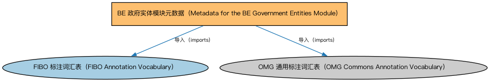

# BE 政府实体模块元数据（Metadata for the BE Government Entities Module）说明

本文档对应 `MetadataBEGovernmentEntities.rdf` / `MetadataBEGovernmentEntities.ttl`。

## 1. 本文件是什么

声明政府实体（Government Entities）模块的构成：政府实体核心本体加上全球各区域（亚洲五区、欧洲六区、拉美两区、北美四区）的政府实体与法域参考本体。

从机制上说，这是一个元数据清单（metadata manifest）文件：它本身不定义任何类或属性，而是通过 `dct:hasPart` 声明一个域或模块由哪些本体构成，并携带版本 IRI、版权、许可与成熟度等发布管理信息。它回答的问题是「这个域/模块包含什么、当前是什么版本」，供发布工具和文档系统按模块组织内容；它的 `owl:imports` 只引入标注词汇表，不是用来加载业务本体的入口（加载入口是 `All*` 与 `About*` 聚合文件）。

## 2. 声明的构成（dct:hasPart，18 个）

| 构成项 | 中文名称 | 简介 |
|---|---|---|
| `BE/GovernmentEntities/AsianJurisdiction/CentralAsiaGovernmentEntitiesAndJurisdictions.rdf` | 中亚政府实体与法域本体（Central Asia Government Entities and Jurisdictions Ontology） | 收录中亚地区各国（如哈萨克斯坦等）的政体、政府与法域个体，用于确定实体注册或监管所属的法域。 |
| `BE/GovernmentEntities/AsianJurisdiction/EasternAsiaGovernmentEntitiesAndJurisdictions.rdf` | 东亚政府实体与法域本体（Eastern Asia Government Entities and Jurisdictions Ontology） | 收录东亚地区各国（中国、日本、韩国等）的政体、政府与法域个体。 |
| `BE/GovernmentEntities/AsianJurisdiction/SoutheasternAsiaGovernmentEntitiesAndJurisdictions.rdf` | 东南亚政府实体与法域本体（Southeastern Asia Government Entities and Jurisdictions Ontology） | 收录东南亚地区各国（新加坡、马来西亚、泰国等）的政体、政府与法域个体。 |
| `BE/GovernmentEntities/AsianJurisdiction/SouthernAsiaGovernmentEntitiesAndJurisdictions.rdf` | 南亚政府实体与法域本体（Southern Asia Government Entities and Jurisdictions Ontology） | 收录南亚地区各国（印度、巴基斯坦等）的政体、政府与法域个体。 |
| `BE/GovernmentEntities/AsianJurisdiction/WesternAsiaGovernmentEntitiesAndJurisdictions.rdf` | 西亚政府实体与法域本体（Western Asia Government Entities and Jurisdictions Ontology） | 收录西亚地区各国（沙特阿拉伯、阿联酋等）的政体、政府与法域个体。 |
| `BE/GovernmentEntities/EuropeanJurisdiction/EUGovernmentEntitiesAndJurisdictions.rdf` | 欧盟政府实体与法域本体（EU Government Entities and Jurisdictions Ontology） | 收录欧盟层面的政体、机构与法域个体（欧盟本身及其超国家机构）。 |
| `BE/GovernmentEntities/EuropeanJurisdiction/EasternEuropeGovernmentEntitiesAndJurisdictions.rdf` | 东欧政府实体与法域本体（Eastern Europe Government Entities and Jurisdictions Ontology） | 收录东欧各国（波兰、捷克、匈牙利等）的政体、政府与法域个体。 |
| `BE/GovernmentEntities/EuropeanJurisdiction/NorthernEuropeGovernmentEntitiesAndJurisdictions.rdf` | 北欧政府实体与法域本体（Northern Europe Government Entities and Jurisdictions Ontology） | 收录北欧各国（瑞典、挪威、丹麦等）的政体、政府与法域个体。 |
| `BE/GovernmentEntities/EuropeanJurisdiction/SouthernEuropeGovernmentEntitiesAndJurisdictions.rdf` | 南欧政府实体与法域本体（Southern Europe Government Entities and Jurisdictions Ontology） | 收录南欧各国（意大利、西班牙、希腊等）的政体、政府与法域个体。 |
| `BE/GovernmentEntities/EuropeanJurisdiction/UKGovernmentEntitiesAndJurisdictions.rdf` | 英国政府实体与法域本体（UK Government Entities and Jurisdictions Ontology） | 收录大不列颠及北爱尔兰联合王国的政体、政府与法域个体（英格兰、苏格兰、威尔士、北爱尔兰）。 |
| `BE/GovernmentEntities/EuropeanJurisdiction/WesternEuropeGovernmentEntitiesAndJurisdictions.rdf` | 西欧政府实体与法域本体（Western Europe Government Entities and Jurisdictions Ontology） | 收录西欧各国（法国、德国、荷兰等）的政体、政府与法域个体。 |
| `BE/GovernmentEntities/GovernmentEntities.rdf` | 政府实体本体（Government Entities Ontology） | 定义政府、政体（polity）、法域（jurisdiction）及政府实体的核心概念，是各区域政府实体本体的共同基础。 |
| `BE/GovernmentEntities/LatinAmericanJurisdiction/CentralAmericanGovernmentEntitiesAndJurisdictions.rdf` | 中美洲政府实体与法域本体（Central American Government Entities and Jurisdictions Ontology） | 收录中美洲各国（巴拿马、哥斯达黎加等）的政体、政府与法域个体。 |
| `BE/GovernmentEntities/LatinAmericanJurisdiction/SouthAmericanGovernmentEntitiesAndJurisdictions.rdf` | 南美洲政府实体与法域本体（South American Government Entities and Jurisdictions Ontology） | 收录南美洲各国（巴西、阿根廷等）的政体、政府与法域个体。 |
| `BE/GovernmentEntities/NorthAmericanJurisdiction/CAGovernmentEntitiesAndJurisdictions.rdf` | 加拿大政府实体与法域本体（Canadian Government Entities and Jurisdictions Ontology） | 收录加拿大的政体、联邦与省政府、法域个体。 |
| `BE/GovernmentEntities/NorthAmericanJurisdiction/CaribbeanGovernmentEntitiesAndJurisdictions.rdf` | 加勒比政府实体与法域本体（Caribbean Government Entities and Jurisdictions Ontology） | 收录加勒比地区各国与属地（开曼群岛、百慕大等）的政体、政府与法域个体。 |
| `BE/GovernmentEntities/NorthAmericanJurisdiction/MXGovernmentEntitiesAndJurisdictions.rdf` | 墨西哥政府实体与法域本体（Mexican Government Entities and Jurisdictions Ontology） | 收录墨西哥的政体、政府与法域个体。 |
| `BE/GovernmentEntities/NorthAmericanJurisdiction/USGovernmentEntitiesAndJurisdictions.rdf` | 美国政府实体与法域本体（US Government Entities and Jurisdictions Ontology） | 收录美国的政体、联邦与各州政府、法域个体，是北美金融建模最常用的法域参考数据。 |

## 3. 标注依赖（owl:imports，2 个）

以下导入仅用于支撑元数据标注本身（如成熟度等级、概念映射），不属于业务内容：

| 导入本体 | 中文名称 | 简介 |
|---|---|---|
| `FND/Utilities/AnnotationVocabulary.rdf` | FIBO 标注词汇表（FIBO Annotation Vocabulary） | 定义 FIBO 专用的标注属性（如释义来源、成熟度等级），用于本体自身的元数据标注。 |
| `https://www.omg.org/spec/Commons/AnnotationVocabulary/` | OMG 通用标注词汇表（OMG Commons Annotation Vocabulary） | OMG 通用本体库（Commons）中的标注词汇表，提供概念映射等标注属性，FIBO 用它标注术语与外部标准的对应关系。 |

## 4. 文件

- 官方 RDF/XML：`MetadataBEGovernmentEntities.rdf`
- 中文 Turtle：`MetadataBEGovernmentEntities.ttl`
- 结构图：`MetadataBEGovernmentEntities-structure.png` / `MetadataBEGovernmentEntities-structure.svg`