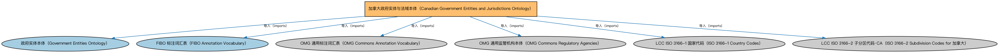

# 加拿大政府实体与法域本体（Canadian Government Entities and Jurisdictions Ontology）说明

本文档对应 `CAGovernmentEntitiesAndJurisdictions.rdf` / `CAGovernmentEntitiesAndJurisdictions.ttl`。

## 1. 本文件是什么

收录加拿大的政体、联邦与省政府、法域个体。

从机制上说，这是一个个体（individuals）文件：它本身不定义任何新的类或属性，装的全是命名个体（owl:NamedIndividual）——也就是一条条真实存在的实例数据（如具体的货币、市场、监管机构、法域）。它的 `owl:imports` 引入的是这些个体所属的类定义所在的本体。应用需要实例级参考数据时加载这类文件。

## 2. 个体构成（共 42 个）

按个体所属类型统计（类型名为中文（English）对照）：

| 类型（Class） | 个体数量 |
|---|---|
| 管辖权（Jurisdiction） | 14 |
| 地区政府（RegionalGovernment） | 13 |
| 地区主权体（RegionalSovereignty） | 13 |
| 联邦主权体（FederatedSovereignty） | 1 |
| 联邦政府（FederalGovernment） | 1 |

个体数量较多，仅举前 10 个示例，完整清单见同名 `.ttl` 文件：

| 个体（示例） | 类型 |
|---|---|
| Canadian entity | 联邦主权体（FederatedSovereignty） |
| Canadian jurisdiction | 管辖权（Jurisdiction） |
| Government of Canada | 联邦政府（FederalGovernment） |
| Northwest Territories entity | 地区主权体（RegionalSovereignty） |
| Northwest Territories jurisdiction | 管辖权（Jurisdiction） |
| Nunavut entity | 地区主权体（RegionalSovereignty） |
| Nunavut jurisdiction | 管辖权（Jurisdiction） |
| Province of Alberta entity | 地区主权体（RegionalSovereignty） |
| Province of British Columbia entity | 地区主权体（RegionalSovereignty） |
| Province of Manitoba entity | 地区主权体（RegionalSovereignty） |

## 3. 依赖的本体（owl:imports，6 个）

以下导入提供个体所属的类定义与相关参考数据：

| 导入本体 | 中文名称 | 简介 |
|---|---|---|
| `BE/GovernmentEntities/GovernmentEntities.rdf` | 政府实体本体（Government Entities Ontology） | 定义政府、政体（polity）、法域（jurisdiction）及政府实体的核心概念，是各区域政府实体本体的共同基础。 |
| `FND/Utilities/AnnotationVocabulary.rdf` | FIBO 标注词汇表（FIBO Annotation Vocabulary） | 定义 FIBO 专用的标注属性（如释义来源、成熟度等级），用于本体自身的元数据标注。 |
| `https://www.omg.org/spec/Commons/AnnotationVocabulary/` | OMG 通用标注词汇表（OMG Commons Annotation Vocabulary） | OMG 通用本体库（Commons）中的标注词汇表，提供概念映射等标注属性，FIBO 用它标注术语与外部标准的对应关系。 |
| `https://www.omg.org/spec/Commons/RegulatoryAgencies/` | OMG 通用监管机构本体（OMG Commons Regulatory Agencies） | Commons 库中的监管机构本体，定义监管机构及其监管职权的通用概念。 |
| `https://www.omg.org/spec/LCC/Countries/ISO3166-1-CountryCodes/` | LCC ISO 3166-1 国家代码（ISO 3166-1 Country Codes） | LCC 中 ISO 3166-1 标准的国家/地区代码个体集（如 CN、US、MX），供法域与地址建模引用。 |
| `https://www.omg.org/spec/LCC/Countries/Regions/ISO3166-2-SubdivisionCodes-CA/` | LCC ISO 3166-2 子分区代码·CA（ISO 3166-2 Subdivision Codes for 加拿大） | LCC 中 ISO 3166-2 标准下加拿大的省/州级行政区代码个体集。 |

## 4. 文件

- 官方 RDF/XML：`CAGovernmentEntitiesAndJurisdictions.rdf`
- 中文 Turtle：`CAGovernmentEntitiesAndJurisdictions.ttl`
- 结构图：`CAGovernmentEntitiesAndJurisdictions-structure.png` / `CAGovernmentEntitiesAndJurisdictions-structure.svg`