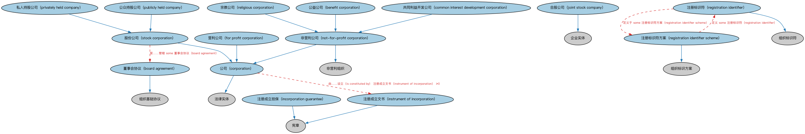

# 法人团体本体（Corporate Bodies Ontology）结构与公理说明

本文档对应 `CorporateBodies.rdf` / `CorporateBodies.ttl`，说明该本体的类、继承关系、属性和公理约定。结构图见 `CorporateBodies-structure.png`（`CorporateBodies-structure.svg` 为可缩放版本）。

## 1. 本体概述

定义法人团体（corporate body）：依法设立、具有独立法律人格的组织，是股份有限公司等具体法人类型的上位概念。

**在体系中的位置**：BE 法律实体模块的中间层，上承法律主体，下接公司、私人有限公司等具体形态。

**上下游关系**：上游依赖法律主体与 FND 组织本体；下游被公司本体及各类具体法人形态本体继承。

**与相近概念的差别**：与法律主体的差别——法律主体包括自然人和法人，法人团体仅指组织型法人；与正式商业组织的差别——法人团体强调法律人格，可以是非营利组织，正式商业组织强调营利目的。

## 2. 类（Class）

| 类（Class） | 定义（Definition） |
|---|---|
| 公益公司（benefit corporation） | 依特定州立法设立的非营利公司，通常旨在提供某种社会利益，无最大化股东价值的义务。 |
| 董事会协议（board agreement） | 组织董事会成员之间正式的、具有法律约束力的协议。 |
| 共同利益开发公司（common interest development corporation） | 依特定州立法为业主协会设立的非营利公司型企业实体。 |
| 公司（corporation） | 作为法律实体（拟制人）、区别于其所有者、依州或国家法律管辖区设立的正式组织。 |
| 营利公司（for profit corporation） | 以赚钱为目标的公司，即确保实现财务利益，使业务收入超过支出。 |
| 注册成立担保（incorporation guarantee） | 构成某法律实体注册成立之财务基础一部分的担保。 |
| 注册成立文书（instrument of incorporation） | 据以设立某法律实体的组织章程大纲及章程细则。 |
| 合股公司（joint stock company） | 营利性、非法人企业，兼有公司与合伙的特征，所有权权益以股份表示。 |
| 非营利公司（not-for-profit corporation） | 经辖区监管与税务机关批准、为教育、慈善、社会、宗教、公民或人道目的运营的公司。 |
| 私人持股公司（privately held company） | 已发行股份全部由家族或少数投资者团体持有、公众无法购买的公司。 |
| 公众持股公司（publicly held company） | 股份公开交易并持有的公司。 |
| 注册标识符（registration identifier） | 组织注册时（通常在其组建所在管辖区）官方分配的标识符。 |
| 注册标识符方案（registration identifier scheme） | 按签发注册机构规定注册标识符的方案。 |
| 宗教公司（religious corporation） | 目标特定于某套基本信仰与实践的非营利公司。 |
| 股份公司（stock corporation） | 拥有股东的公司，每位股东通过股票获得公司部分所有权。 |

### 2.1 继承关系（Inheritance）

- 公益公司（benefit corporation） ⊑ 非营利公司（not-for-profit corporation）
- 董事会协议（board agreement） ⊑ 组织基础协议
- 共同利益开发公司（common interest development corporation） ⊑ 非营利公司（not-for-profit corporation）
- 公司（corporation） ⊑ 法律实体
- 营利公司（for profit corporation） ⊑ 公司（corporation）
- 注册成立担保（incorporation guarantee） ⊑ 宪章
- 注册成立文书（instrument of incorporation） ⊑ 宪章
- 合股公司（joint stock company） ⊑ 企业实体
- 非营利公司（not-for-profit corporation） ⊑ 公司（corporation）
- 非营利公司（not-for-profit corporation） ⊑ 非营利组织
- 私人持股公司（privately held company） ⊑ 股份公司（stock corporation）
- 公众持股公司（publicly held company） ⊑ 股份公司（stock corporation）
- 注册标识符（registration identifier） ⊑ 组织标识符
- 注册标识符方案（registration identifier scheme） ⊑ 组织标识方案
- 宗教公司（religious corporation） ⊑ 非营利公司（not-for-profit corporation）
- 股份公司（stock corporation） ⊑ 公司（corporation）

## 3. 对象属性（Object Property）

| 属性（Property） | 中文（English） | 定义（Definition） | 说明 |
|---|---|---|---|
| fibo-be-le-cb:hasDateOfIncorporation | 具有注册成立日期（has date of incorporation） | 标识申报文件中所载的正式注册成立日期。 | 值域（range）：显式日期；子属性（subPropertyOf）：具有显式日期 |
| fibo-be-le-cb:hasDateOfRegistration | 具有登记日期（has date of registration） | 标识公司为监管和/或税务目的在某管辖区登记的日期。 | 值域（range）：显式日期；子属性（subPropertyOf）：具有显式日期 |
| fibo-be-le-cb:hasIssuedCapital | 具有已发行资本（has issued capital） | 标识股东所持全部股份的总价值。 | 值域（range）：货币数量；子属性（subPropertyOf）：具有货币数量 |
| fibo-be-le-cb:isConstitutedBy | 由……设立（is constituted by） | 实体据以注册成立的文书。 | 定义域（domain）：公司（corporation）；值域（range）：宪章 |
| fibo-be-le-cb:isIncorporatedIn | 注册成立于（is incorporated in） | 法律实体注册成立所在的法律管辖区。 | 定义域（domain）：公司（corporation）；值域（range）：管辖权；子属性（subPropertyOf）：组建于 |

## 4. 数据属性（Datatype Property）

| 属性（Property） | 中文（English） | 定义（Definition） |
|---|---|---|
| fibo-be-le-cb:hasSharesAuthorized | 具有授权股份数（has shares authorized） | 标识董事会确定的可发行股份的最大数量。 |

## 5. 公理约定（Axioms）

- 公司（corporation）：由……设立（is constituted by） 注册成立文书（instrument of incorporation） ≥0
- 公司（corporation）：注册成立于（is incorporated in） 管辖权 =1
- 公司（corporation）：具有法定名称 some xsd:string
- 营利公司（for profit corporation）：具有目标 盈利目标 ≥0
- 营利公司（for profit corporation） 与 非营利公司（not-for-profit corporation） 互斥（disjointWith）
- 注册成立担保（incorporation guarantee）：restriction
- 注册成立担保（incorporation guarantee）：具有名义金额 货币数量 =1
- 注册成立文书（instrument of incorporation）：受……管辖 管辖权 =1
- 注册标识符（registration identifier）：受……管辖 管辖权 ≥0
- 注册标识符（registration identifier）：标识 正式组织 =1
- 注册标识符（registration identifier）：定义于 some 注册标识符方案（registration identifier scheme）
- 注册标识符方案（registration identifier scheme）：定义 some 注册标识符（registration identifier）
- 宗教公司（religious corporation）：具有目标 some 宗教目标
- 股份公司（stock corporation）：具有登记日期（has date of registration） 显式日期 ≥0
- 股份公司（stock corporation）：具有已发行资本（has issued capital） 货币数量 =1
- 股份公司（stock corporation）：具有注册成立日期（has date of incorporation） 显式日期 =1
- 股份公司（stock corporation）：受……管辖 some 董事会协议（board agreement）

## 6. 依赖（owl:imports，13 个）

本本体通过 `owl:imports` 引入以下本体，各项的中文名称与简介如下：

| 导入本体 | 中文名称 | 简介 |
|---|---|---|
| `BE/LegalEntities/FormalBusinessOrganizations.rdf` | 正式商业组织本体（Formal Business Organizations Ontology） | 定义以营利为目的、依法注册的正式商业组织，连接法律实体与其商业功能。 |
| `BE/LegalEntities/LegalPersons.rdf` | 法律主体本体（Legal Persons Ontology） | 定义法律主体（legal person）与法定实体（legal entity）的核心概念：能持有权利义务、可起诉与被诉的主体。 |
| `FND/Accounting/CurrencyAmount.rdf` | 货币金额本体（Currency Amount Ontology） | 定义「金额＋币种」的货币金额（currency amount）表示，是 FIBO 中表达价格、债务金额、付款额等一切带币种数值的基础构件。 |
| `FND/GoalsAndObjectives/Objectives.rdf` | 目标本体（Objectives Ontology） | 定义目标（objective）及其与组织、计划的关系，用于表达机构的经营目标与投资目标。 |
| `FND/Law/LegalCore.rdf` | 法律核心本体（Legal Core Ontology） | 定义法域（jurisdiction）、法律、法规等核心法律概念，为监管主体与适用法律建模。 |
| `FND/Relations/Relations.rdf` | 关系本体（Relations Ontology） | FIBO 最底层的基础本体，定义参考（reference）、分类（classify）等通用关系与抽象概念，全库普遍依赖。 |
| `FND/Utilities/AnnotationVocabulary.rdf` | FIBO 标注词汇表（FIBO Annotation Vocabulary） | 定义 FIBO 专用的标注属性（如释义来源、成熟度等级），用于本体自身的元数据标注。 |
| `https://www.omg.org/spec/Commons/AnnotationVocabulary/` | OMG 通用标注词汇表（OMG Commons Annotation Vocabulary） | OMG 通用本体库（Commons）中的标注词汇表，提供概念映射等标注属性，FIBO 用它标注术语与外部标准的对应关系。 |
| `https://www.omg.org/spec/Commons/DatesAndTimes/` | OMG 通用日期与时间本体（OMG Commons Dates and Times） | Commons 库中的日期时间本体，定义日期、期间、时间点等通用时间概念。 |
| `https://www.omg.org/spec/Commons/Designators/` | OMG 通用指称符本体（OMG Commons Designators） | Commons 库中的指称符本体，定义名称、标识符等「指代某物的符号」的通用概念。 |
| `https://www.omg.org/spec/Commons/Identifiers/` | OMG 通用标识符本体（OMG Commons Identifiers） | Commons 库中的标识符本体，定义标识符及其编码方案的通用概念。 |
| `https://www.omg.org/spec/Commons/Organizations/` | OMG 通用组织本体（OMG Commons Organizations） | Commons 库中的组织本体，定义组织、组织成员与组织结构的通用概念。 |
| `https://www.omg.org/spec/Commons/RegulatoryAgencies/` | OMG 通用监管机构本体（OMG Commons Regulatory Agencies） | Commons 库中的监管机构本体，定义监管机构及其监管职权的通用概念。 |

## 7. 文件

- 官方 RDF/XML：`CorporateBodies.rdf`
- 中文 Turtle：`CorporateBodies.ttl`
- 结构图：`CorporateBodies-structure.png` / `CorporateBodies-structure.svg`