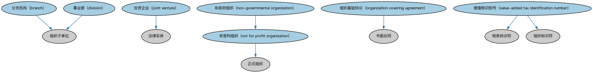

# 正式商业组织本体（Formal Business Organizations Ontology）结构与公理说明

本文档对应 `FormalBusinessOrganizations.rdf` / `FormalBusinessOrganizations.ttl`，说明该本体的类、继承关系、属性和公理约定。结构图见 `FormalBusinessOrganizations-structure.png`（`FormalBusinessOrganizations-structure.svg` 为可缩放版本）。

## 1. 本体概述

定义正式商业组织：以营利为目的、依法注册并持续经营的组织。

**在体系中的位置**：BE 法律实体模块中连接「法律形式」与「商业功能」的一层。

**上下游关系**：上游依赖法人团体、法律主体与 FND 正式组织本体；下游被公司、合伙等具体商业组织形态引用。

**与相近概念的差别**：与法人团体的差别——法人团体强调独立法律人格，正式商业组织强调商业经营目的；一个非营利法人团体是前者但不是后者。

本本体中类与类的核心关系如下（完整细节见各类小节）：

- **分支机构（branch）** 继承 **组织子单位（OrganizationalSubUnit）**
- **事业部（division）** 继承 **组织子单位（OrganizationalSubUnit）**
- **合资企业（joint venture）** 继承 **法律实体（LegalEntity）**
- **非政府组织（non-governmental organization）** 继承 **非营利组织（not for profit organization）**
- **非营利组织（not for profit organization）** 继承 **正式组织（FormalOrganization）**
- **组织基础协议（organization covering agreement）** 继承 **书面合同（WrittenContract）**
- **增值税识别号（value-added tax identification number）** 继承 **税务标识符（TaxIdentifier）**
- **增值税识别号（value-added tax identification number）** 继承 **组织标识符（OrganizationIdentifier）**

## 2. 类（Class）

| 类（Class） | 定义（Definition） |
|---|---|
| 分支机构（branch） | 较大组织的组成部分，可能不与其同地办公。 part of a larger organization that might not be co-located with it |
| 事业部（division） | 组织的组成部分，如一条业务线，可能有单独的会计与报告要求。 part of an organization, such as a line of business, that may have separate accounting and reporting requirements |
| 合资企业（joint venture） | 各方为完成特定任务而汇集资源、但此外各自保持独立的法律实体。 legal entity that is formed between parties that pool their resources for the purpose of accomplishing a specific task but otherwise retain their distinct identities |
| 非政府组织（non-governmental organization） | 独立于政府运作的非营利组织。 not-for-profit organization that functions independently of government |
| 非营利组织（not for profit organization） | 将盈余收入用于进一步实现其宗旨、而非分配给组织所有者的组织。 organization that uses its surplus revenues to further achieve its purpose rather than distributing its surplus income to the organization's owners (directors, investors, and equivalents) as profit / dividends |
| 组织基础协议（organization covering agreement） | 正式组织各主事人之间的合同，规定主事人之间以及主事人与实体之间的关系。 contract between the principals in a formal organization that specifies the relationship between the principals, and between the principals and the entity |
| 增值税识别号（value-added tax identification number） | 为按增量征收的消费税识别应税人（企业）或非应税法律实体的税务标识符。 tax identifier that identifies a taxable person (business) or non-taxable legal entity for a consumption tax that is assessed incrementally, levied on the price of a product or service at each stage of production, distribution, and sale to the end consumer |

以下按类逐个展开：每个类给出继承关系、相关属性与公理约定；子类在父类之下降一级编号。

### 2.1 分支机构（branch）

定义：较大组织的组成部分，可能不与其同地办公。

- 父类：**组织子单位（OrganizationalSubUnit）**

### 2.2 事业部（division）

定义：组织的组成部分，如一条业务线，可能有单独的会计与报告要求。

- 父类：**组织子单位（OrganizationalSubUnit）**

### 2.3 合资企业（joint venture）

定义：各方为完成特定任务而汇集资源、但此外各自保持独立的法律实体。

- 父类：**法律实体（LegalEntity）**

### 2.4 非营利组织（not for profit organization）

定义：将盈余收入用于进一步实现其宗旨、而非分配给组织所有者的组织。

- 父类：**正式组织（FormalOrganization）**
- 直接子类：**非政府组织（non-governmental organization）**

属性：

| 属性 | 定义 | 说明 |
|---|---|---|
| **具有目标（hasObjective）** | — | — |

公理：

- **具有目标（hasObjective）**可以有 0 个或多个**非营利目标（NotForProfitObjective）**。

#### 2.4.1 非政府组织（non-governmental organization）

定义：独立于政府运作的非营利组织。

- 父类：**非营利组织（not for profit organization）**

属性：

| 属性 | 定义 | 说明 |
|---|---|---|
| **具有目标（hasObjective）** | — | — |

公理：

- **具有目标（hasObjective）**可以有 0 个或多个**公共宗旨（PublicPurpose）**。

### 2.5 组织基础协议（organization covering agreement）

定义：正式组织各主事人之间的合同，规定主事人之间以及主事人与实体之间的关系。

- 父类：**书面合同（WrittenContract）**

### 2.6 增值税识别号（value-added tax identification number）

定义：为按增量征收的消费税识别应税人（企业）或非应税法律实体的税务标识符。

- 父类：**税务标识符（TaxIdentifier）**、**组织标识符（OrganizationIdentifier）**

## 3. 其他属性

以下属性未绑定到本体的具体类（定义域在外部本体或未声明）：

对象属性（Object Property）：

| 属性 | 定义 | 说明 |
|---|---|---|
| **具有权益（has equity）** | 标识与实体关联的所有者权益。 indicates owners' equity associated with the entity | 值域：所有者权益；子属性：具有表达式 |
| **具有总部地址（has headquarters address）** | 标识组织可送达通信的主要地址。 indicates the main address at which communications may be delivered for the organization | 值域：物理地址；子属性：具有经营地址（has operating address） |
| **具有经营地址（has operating address）** | 标识组织开展经营活动的地址。 indicates an address at which an organization carries out operations | 值域：物理地址；子属性：具有地址 |
| **具有注册地址（has registered address）** | 标识在某政府机关正式登记、可送达法律文书的地址。 identifies an address that is officially recorded with some government authority and at which legal papers may be served | 值域：常规街道地址；子属性：具有地址 |

## 4. 依赖（owl:imports，15 个）

本本体通过 `owl:imports` 引入以下本体，各项的中文名称与简介如下：

| 导入本体 | 中文名称 | 简介 |
|---|---|---|
| `BE/LegalEntities/LegalPersons.rdf` | 法律主体本体（Legal Persons Ontology） | 定义法律主体（legal person）与法定实体（legal entity）的核心概念：能持有权利义务、可起诉与被诉的主体。 |
| `FND/AgentsAndPeople/People.rdf` | 人员本体（People Ontology） | 定义自然人（person）的核心属性：姓名、出生日期、国籍、身份标识与联系方式，为雇员、客户、签署人等角色提供「人」的基础模型。 |
| `FND/Agreements/Contracts.rdf` | 合同本体（Contracts Ontology） | 在协议之上定义具有法律约束力的合同（contract）：合同当事方、合同条款、义务与权利，是金融工具与交易合同建模的基石。 |
| `FND/Arrangements/ClassificationSchemes.rdf` | 分类方案本体（Classification Schemes Ontology） | 定义分类方案（classification scheme）、类别及「将事物归入类别」的关系，支撑证券分类、行业分类等具体分类体系。 |
| `FND/GoalsAndObjectives/Objectives.rdf` | 目标本体（Objectives Ontology） | 定义目标（objective）及其与组织、计划的关系，用于表达机构的经营目标与投资目标。 |
| `FND/OwnershipAndControl/Ownership.rdf` | 所有权本体（Ownership Ontology） | 定义「拥有」关系：所有者、被拥有资产及所有权份额。 |
| `FND/Parties/Parties.rdf` | 参与方本体（Parties Ontology） | 定义参与方（party）、独立主体（autonomous agent）与「角色扮演」（party in role），是 FIBO 全库使用最广的基础本体之一。 |
| `FND/Places/Addresses.rdf` | 地址本体（Addresses Ontology） | 定义邮政地址及其组成部分，为机构注册地、通讯地址建模。 |
| `FND/Utilities/AnnotationVocabulary.rdf` | FIBO 标注词汇表（FIBO Annotation Vocabulary） | 定义 FIBO 专用的标注属性（如释义来源、成熟度等级），用于本体自身的元数据标注。 |
| `https://www.omg.org/spec/Commons/AnnotationVocabulary/` | OMG 通用标注词汇表（OMG Commons Annotation Vocabulary） | OMG 通用本体库（Commons）中的标注词汇表，提供概念映射等标注属性，FIBO 用它标注术语与外部标准的对应关系。 |
| `https://www.omg.org/spec/Commons/Classifiers/` | OMG 通用分类器本体（OMG Commons Classifiers） | OMG 通用本体库（Commons）中的分类器本体，定义分类方案、类别与归类关系的通用概念，FIBO 的分类建模建立在其上。 |
| `https://www.omg.org/spec/Commons/Organizations/` | OMG 通用组织本体（OMG Commons Organizations） | Commons 库中的组织本体，定义组织、组织成员与组织结构的通用概念。 |
| `https://www.omg.org/spec/Commons/PartiesAndSituations/` | OMG 通用参与方与情境本体（OMG Commons Parties and Situations） | Commons 库中的参与方本体，定义独立主体、参与方及其角色扮演的通用概念，是 FIBO 参与方模型的上游。 |
| `https://www.omg.org/spec/Commons/QuantitiesAndUnits/` | OMG 通用量与单位本体（OMG Commons Quantities and Units） | Commons 库中的量与单位本体，定义数量、度量单位、量纲的通用概念，支撑金额、比率等数值表达。 |
| `https://www.omg.org/spec/Commons/RegulatoryAgencies/` | OMG 通用监管机构本体（OMG Commons Regulatory Agencies） | Commons 库中的监管机构本体，定义监管机构及其监管职权的通用概念。 |

## 5. 文件

- 官方 RDF/XML：`FormalBusinessOrganizations.rdf`
- 中文 Turtle：`FormalBusinessOrganizations.ttl`
- 结构图：`FormalBusinessOrganizations-structure.png` / `FormalBusinessOrganizations-structure.svg`