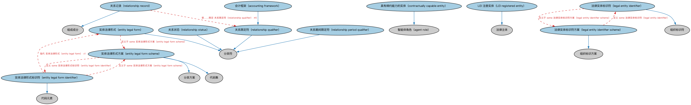

# LEI 法人实体本体（Legal Entity Identifier Entities Ontology）结构与公理说明

本文档对应 `LEIEntities.rdf` / `LEIEntities.ttl`，说明该本体的类、继承关系、属性和公理约定。结构图见 `LEIEntities-structure.png`（`LEIEntities-structure.svg` 为可缩放版本）。

## 1. 本体概述

定义持有全球法人识别编码（LEI，ISO 17442）的法人实体，对接 GLEIF（全球法人识别编码基金会）的 LEI 体系。

**在体系中的位置**：BE 法律实体模块中负责「实体身份识别」的本体，是监管报送与交易对手识别的基础。

**上下游关系**：上游依赖法律主体与 FND 标识符本体；下游被需要 LEI 标识的监管报告、交易对手档案等场景引用。

**与相近概念的差别**：LEI 实体强调「被 LEI 标识」这一身份属性，区别于一般法人概念——LEI 是金融监管语境下法人的「身份证号」，只有参与受监管金融交易的实体才需要。

本本体中类与类的核心关系如下（完整细节见各类小节）：

- **LEI 注册实体（LEI registered entity）** 继承 **法律主体（LegalPerson）**
- **会计框架（accounting framework）** 继承 **关系限定符（relationship qualifier）**
- **具有缔约能力的实体（contractually capable entity）** 继承 **智能体角色（agent role）**
- **实体法律形式（entity legal form）** 继承 **分类符（Classifier）**
- **实体法律形式标识符（entity legal form identifier）** 继承 **代码元素（CodeElement）**
- **实体法律形式方案（entity legal form scheme）** 继承 **分类方案（ClassificationScheme）**
- **实体法律形式方案（entity legal form scheme）** 继承 **代码集（CodeSet）**
- **法律实体标识符（legal entity identifier）** 继承 **组织标识符（OrganizationIdentifier）**
- **法律实体标识符方案（legal entity identifier scheme）** 继承 **组织标识方案（OrganizationIdentificationScheme）**
- **关系期间限定符（relationship period qualifier）** 继承 **分类符（Classifier）**
- **关系限定符（relationship qualifier）** 继承 **分类符（Classifier）**
- **关系记录（relationship record）** 继承 **组成成分（Constituent）**
- 其余 1 条关系从略。

## 2. 类（Class）

| 类（Class） | 定义（Definition） |
|---|---|
| LEI 注册实体（LEI registered entity） | 已注册并以法律实体标识符（LEI）标识的法律主体。 |
| 会计框架（accounting framework） | 用于计量、确认、列报和披露实体财务信息的框架，包括政策、方法、规则和流程。 |
| 具有缔约能力的实体（contractually capable entity） | 对金融交易之履行承担法律或财务责任、或在其管辖区具有缔约法律权利的唯一实体。 |
| 实体法律形式（entity legal form） | 从法律或监管角度表明实体在其注册管辖区内之性质的法律实体分类符。 |
| 实体法律形式标识符（entity legal form identifier） | 按 ISO 20275 定义表示实体法律形式的代码。 |
| 实体法律形式方案（entity legal form scheme） | 规定实体法律形式代码之要素的方案，如 ISO 20275 所定义。 |
| 法律实体标识符（legal entity identifier） | 按 ISO 17442 定义唯一标识法律主体的组织标识符。 |
| 法律实体标识符方案（legal entity identifier scheme） | 规定无歧义 LEI 方案之要素、以标识与任何金融交易相关的法律实体的方案。 |
| 关系期间限定符（relationship period qualifier） | 对报告期间某方面加以限定的分类符，如该日期区间反映的是会计期间或文件申报期间。 |
| 关系限定符（relationship qualifier） | 对报告期间内合并实体之间关系的某方面加以限定的分类符，如所用会计框架。 |
| 关系记录（relationship record） | 描述法律实体之间关系的记录。 |
| 关系状态（relationship status） | 指明报告期间内合并实体之间关系状态（活跃或不活跃）的分类符。 |

以下按类逐个展开：每个类给出继承关系、相关属性与公理约定；子类在父类之下降一级编号。

### 2.1 LEI 注册实体（LEI registered entity）

定义：已注册并以法律实体标识符（LEI）标识的法律主体。

- 父类：**法律主体（LegalPerson）**

### 2.2 具有缔约能力的实体（contractually capable entity）

定义：对金融交易之履行承担法律或财务责任、或在其管辖区具有缔约法律权利的唯一实体。

- 父类：**智能体角色（agent role）**

属性：

| 属性 | 定义 | 说明 |
|---|---|---|
| **由…扮演（is played by）** | — | — |

公理：

- **由…扮演（is played by）**恰好有 1 个**法律实体（LegalEntity）**。

### 2.3 实体法律形式（entity legal form）

定义：从法律或监管角度表明实体在其注册管辖区内之性质的法律实体分类符。

- 父类：**分类符（Classifier）**

属性：

| 属性 | 定义 | 说明 |
|---|---|---|
| **具有法律形式缩写（has legal form abbreviation）** | 实体在其注册管辖区所定义法律形式的精确缩写，如 LLC、LLP、Ltd、PLC、Corp。 | 子属性：具有文本值 |
| **具有转写法律形式缩写（has transliterated legal form abbreviation）** | 实体法律形式缩写的转写（即拉丁化或罗马化 ASCII）表示。 | 子属性：具有文本值 |
| **具有转写名称（has transliterated name）** | 实体名称的转写（即拉丁化或罗马化 ASCII）表示。 | 子属性：具有文本名称 |
| **分类（classifies）** | — | — |
| **适用于情境（isApplicableIn）** | — | — |
| **具有文本名称（hasTextualName）** | — | — |
| **定义于（isDefinedIn）** | — | — |

公理：

- **具有文本名称（hasTextualName）**存在取值约束。
- **具有法律形式缩写（has legal form abbreviation）**存在取值约束。
- **具有转写名称（has transliterated name）**存在取值约束。
- **具有转写法律形式缩写（has transliterated legal form abbreviation）**存在取值约束。
- **分类（classifies）**至少有一个取值，类型是**法律主体（LegalPerson）**。
- **定义于（isDefinedIn）**至少有一个取值，类型是**实体法律形式方案（entity legal form scheme）**。
- **适用于情境（isApplicableIn）**至少有一个取值，类型是**管辖权（Jurisdiction）**。

### 2.4 实体法律形式标识符（entity legal form identifier）

定义：按 ISO 20275 定义表示实体法律形式的代码。

- 父类：**代码元素（CodeElement）**

属性：

| 属性 | 定义 | 说明 |
|---|---|---|
| **指代（denotes）** | — | — |
| **定义于（isDefinedIn）** | — | — |

公理：

- **定义于（isDefinedIn）**至少有一个取值，类型是**实体法律形式方案（entity legal form scheme）**。
- **指代（denotes）**恰好有 1 个**实体法律形式（entity legal form）**。

### 2.5 实体法律形式方案（entity legal form scheme）

定义：规定实体法律形式代码之要素的方案，如 ISO 20275 所定义。

- 父类：**分类方案（ClassificationScheme）**、**代码集（CodeSet）**

属性：

| 属性 | 定义 | 说明 |
|---|---|---|
| **定义（defines）** | — | — |

公理：

- **定义（defines）**至少有一个取值，类型是**实体法律形式标识符（entity legal form identifier）**。

### 2.6 法律实体标识符（legal entity identifier）

定义：按 ISO 17442 定义唯一标识法律主体的组织标识符。

- 父类：**组织标识符（OrganizationIdentifier）**

属性：

| 属性 | 定义 | 说明 |
|---|---|---|
| **定义于（isDefinedIn）** | — | — |
| **标识（identifies）** | — | — |

公理：

- **定义于（isDefinedIn）**至少有一个取值，类型是**法律实体标识符方案（legal entity identifier scheme）**。
- **标识（identifies）**恰好有 1 个**法律主体（LegalPerson）**。

### 2.7 法律实体标识符方案（legal entity identifier scheme）

定义：规定无歧义 LEI 方案之要素、以标识与任何金融交易相关的法律实体的方案。

- 父类：**组织标识方案（OrganizationIdentificationScheme）**

属性：

| 属性 | 定义 | 说明 |
|---|---|---|
| **定义（defines）** | — | — |

公理：

- **定义（defines）**至少有一个取值，类型是**法律实体标识符（legal entity identifier）**。

### 2.8 关系期间限定符（relationship period qualifier）

定义：对报告期间某方面加以限定的分类符，如该日期区间反映的是会计期间或文件申报期间。

- 父类：**分类符（Classifier）**

### 2.9 关系限定符（relationship qualifier）

定义：对报告期间内合并实体之间关系的某方面加以限定的分类符，如所用会计框架。

- 父类：**分类符（Classifier）**
- 直接子类：**会计框架（accounting framework）**

#### 2.9.1 会计框架（accounting framework）

定义：用于计量、确认、列报和披露实体财务信息的框架，包括政策、方法、规则和流程。

- 父类：**关系限定符（relationship qualifier）**

### 2.10 关系记录（relationship record）

定义：描述法律实体之间关系的记录。

- 父类：**组成成分（Constituent）**

属性：

| 属性 | 定义 | 说明 |
|---|---|---|
| **由……量化（is quantified by）** | 表明某事物受某个比率或其他统计值限定或以之为条件。 | 值域：xsd:decimal |
| **受……限定（isQualifiedBy）** | — | — |

公理：

- **受……限定（isQualifiedBy）**可以有 0 个或多个**关系限定符（relationship qualifier）**。
- **由……量化（is quantified by）**存在取值约束。

### 2.11 关系状态（relationship status）

定义：指明报告期间内合并实体之间关系状态（活跃或不活跃）的分类符。

- 父类：**分类符（Classifier）**

## 3. 其他属性

以下属性未绑定到本体的具体类（定义域在外部本体或未声明）：

对象属性（Object Property）：

| 属性 | 定义 | 说明 |
|---|---|---|
| **具有法定地址（has legal address）** | 标识实体在其设立管辖区内用于注册目的的法定地址。 | 值域：常规街道地址；子属性：具有注册地址 |
| **具有法律形式（has legal form）** | 标识在给定管辖区内从法律或监管角度定义的实体性质。 | 值域：实体法律形式（entity legal form）；子属性：由……分类 |
| **是……的国际分支（is an international branch of）** | 标识「起始节点」（子公司）是「末端节点」（母公司）的国际分支。 | 值域：法律实体；子属性：由……合并（is consolidated by） |
| **由……合并（is consolidated by）** | 从 ISO 17442 角度标识被视为「末端节点」或合并实体（母公司）的实体。 | 值域：法律实体 |
| **是……的合并对象（is consolidation of）** | 从 ISO 17442 角度标识被视为「起始节点」或被合并实体的实体。 | 值域：法律实体；子属性：包含 |
| **由……直接合并（is directly consolidated by）** | 标识「末端节点」（母公司）对「起始节点」（子公司）的会计进行直接完全合并。 | 值域：法律实体；子属性：由……合并（is consolidated by） |
| **由……最终合并（is ultimately consolidated by）** | 标识「末端节点」（母公司）对「起始节点」（子公司）的会计进行最终完全合并。 | 值域：法律实体；子属性：由……合并（is consolidated by） |

数据属性（Datatype Property）：

| 属性 | 定义 |
|---|---|
| **具有所有权百分比（has ownership percentage）** | 拥有实体在被拥有实体中拥有的所有权权益百分比（如已知）。 |

## 4. 依赖（owl:imports，16 个）

本本体通过 `owl:imports` 引入以下本体，各项的中文名称与简介如下：

| 导入本体 | 中文名称 | 简介 |
|---|---|---|
| `BE/LegalEntities/FormalBusinessOrganizations.rdf` | 正式商业组织本体（Formal Business Organizations Ontology） | 定义以营利为目的、依法注册的正式商业组织，连接法律实体与其商业功能。 |
| `FND/Agreements/Contracts.rdf` | 合同本体（Contracts Ontology） | 在协议之上定义具有法律约束力的合同（contract）：合同当事方、合同条款、义务与权利，是金融工具与交易合同建模的基石。 |
| `FND/Places/Addresses.rdf` | 地址本体（Addresses Ontology） | 定义邮政地址及其组成部分，为机构注册地、通讯地址建模。 |
| `FND/Utilities/AnnotationVocabulary.rdf` | FIBO 标注词汇表（FIBO Annotation Vocabulary） | 定义 FIBO 专用的标注属性（如释义来源、成熟度等级），用于本体自身的元数据标注。 |
| `https://www.omg.org/spec/Commons/AnnotationVocabulary/` | OMG 通用标注词汇表（OMG Commons Annotation Vocabulary） | OMG 通用本体库（Commons）中的标注词汇表，提供概念映射等标注属性，FIBO 用它标注术语与外部标准的对应关系。 |
| `https://www.omg.org/spec/Commons/Classifiers/` | OMG 通用分类器本体（OMG Commons Classifiers） | OMG 通用本体库（Commons）中的分类器本体，定义分类方案、类别与归类关系的通用概念，FIBO 的分类建模建立在其上。 |
| `https://www.omg.org/spec/Commons/CodesAndCodeSets/` | OMG 通用代码与代码集本体（OMG Commons Codes and Code Sets） | Commons 库中的代码本体，定义代码、代码集及其维护方的通用概念，是 ISO 4217、ISO 3166 等编码体系建模的基础。 |
| `https://www.omg.org/spec/Commons/Collections/` | OMG 通用集合本体（OMG Commons Collections） | Commons 库中的集合本体，定义集合、成员等通用概念。 |
| `https://www.omg.org/spec/Commons/ContextualDesignators/` | OMG 通用语境指称本体（OMG Commons Contextual Designators） | Commons 库中的语境指称本体，定义「在某个语境下指代某物的名称/符号」，是地址、账户号码等语境相关标识的基础。 |
| `https://www.omg.org/spec/Commons/Designators/` | OMG 通用指称符本体（OMG Commons Designators） | Commons 库中的指称符本体，定义名称、标识符等「指代某物的符号」的通用概念。 |
| `https://www.omg.org/spec/Commons/Identifiers/` | OMG 通用标识符本体（OMG Commons Identifiers） | Commons 库中的标识符本体，定义标识符及其编码方案的通用概念。 |
| `https://www.omg.org/spec/Commons/Organizations/` | OMG 通用组织本体（OMG Commons Organizations） | Commons 库中的组织本体，定义组织、组织成员与组织结构的通用概念。 |
| `https://www.omg.org/spec/Commons/PartiesAndSituations/` | OMG 通用参与方与情境本体（OMG Commons Parties and Situations） | Commons 库中的参与方本体，定义独立主体、参与方及其角色扮演的通用概念，是 FIBO 参与方模型的上游。 |
| `https://www.omg.org/spec/Commons/RegulatoryAgencies/` | OMG 通用监管机构本体（OMG Commons Regulatory Agencies） | Commons 库中的监管机构本体，定义监管机构及其监管职权的通用概念。 |
| `https://www.omg.org/spec/Commons/RolesAndCompositions/` | OMG 通用角色与构成本体（OMG Commons Roles and Compositions） | Commons 库中的角色本体，定义角色及整体—部分构成关系的通用概念。 |
| `https://www.omg.org/spec/Commons/TextDatatype/` | OMG 通用文本数据类型（OMG Commons Text Datatype） | Commons 库中的文本数据类型定义，提供带语言标记的文本等基础数据类型。 |

## 5. 文件

- 官方 RDF/XML：`LEIEntities.rdf`
- 中文 Turtle：`LEIEntities.ttl`
- 结构图：`LEIEntities-structure.png` / `LEIEntities-structure.svg`