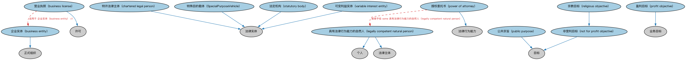

# 法律主体本体（Legal Persons Ontology）结构与公理说明

本文档对应 `LegalPersons.rdf` / `LegalPersons.ttl`，说明该本体的类、继承关系、属性和公理约定。结构图见 `LegalPersons-structure.png`（`LegalPersons-structure.svg` 为可缩放版本）。

## 1. 本体概述

定义法律主体（legal person）与法定实体（legal entity）：能够持有权利与义务、可以起诉与被诉的主体。

**在体系中的位置**：BE 法律实体模块的根基，是法人团体、公司、LEI 实体等一切「实体」概念的上位抽象。

**上下游关系**：上游依赖 FND 的法律能力、正式组织、参与方本体；下游被 BE 全部法律实体本体以及全库需要「实体」概念的模块引用。

**与相近概念的差别**：法律主体不等于自然人——自然人在 FND/AgentsAndPeople/People 建模；法律主体是法律拟制的「人」，包括自然人和法人两类。

本本体中类与类的核心关系如下（完整细节见各类小节）：

- **特殊目的载体（SpecialPurposeVehicle）** 继承 **法律实体（LegalEntity）**
- **企业实体（business entity）** 继承 **正式组织（FormalOrganization）**
- **营业执照（business license）** 继承 **许可（License）**
- **特许法律主体（chartered legal person）** 继承 **法律实体（LegalEntity）**
- **具有法律行为能力的自然人（legally competent natural person）** 继承 **个人（Person）**
- **具有法律行为能力的自然人（legally competent natural person）** 继承 **法律主体（LegalPerson）**
- **非营利目标（not for profit objective）** 继承 **目标（Objective）**
- **授权委托书（power of attorney）** 继承 **法律行为能力（LegalCapacity）**
- **盈利目标（profit objective）** 继承 **业务目标（BusinessObjective）**
- **公共宗旨（public purpose）** 继承 **目标（Objective）**
- **宗教目标（religious objective）** 继承 **非营利目标（not for profit objective）**
- **法定机构（statutory body）** 继承 **法律实体（LegalEntity）**
- 其余 1 条关系从略。

## 2. 类（Class）

| 类（Class） | 定义（Definition） |
|---|---|
| 特殊目的载体（SpecialPurposeVehicle） | 为实现狭窄、特定且常为临时性目标而设立的法律实体。 legal entity created to fulfill narrow, specific, and frequently temporary objectives |
| 企业实体（business entity） | 按商法设立和管理、以从事商业活动的实体。 entity that is formed and administered as per commercial law in order to engage in business activities |
| 营业执照（business license） | 允许持有人在某管辖区内、在某段时期内经营业务或从事特定职业的许可。 license that allows the holder to conduct business or carry out a specific profession within some jurisdiction for some period of time |
| 特许法律主体（chartered legal person） | 由皇家特许状或法令设立的法律主体。 a legal person created by a royal charter or decree |
| 具有法律行为能力的自然人（legally competent natural person） | 在相关情形下被认为有能力订立合同、开展业务或参与其他通常产生法律义务之活动的人。 person who is considered competent, under the circumstances, to enter into a contract, conduct business, or participate in other activities that generally require the mental ability to understand problems and make decisions on his or her own behalf |
| 非营利目标（not for profit objective） | 反映组织慈善、教育、宗教、人道、公共服务或其他非营利宗旨的目标。 objective that reflects the charitable, educational, religious, humanitarian, public services, or other not for profit goals of an organization |
| 授权委托书（power of attorney） | 一方（委托人）授予另一方（代理人）代表委托人实施特定行为的法律授权。 legal authorization given by one party (the principal) to another (the agent or attorney-in-fact) to perform certain acts on the principal's behalf |
| 盈利目标（profit objective） | 反映对财务利益之追求的目标，该利益在业务收入超过支出时得以实现。 objective that reflects pursuit of a financial benefit that may be realized when the amount of revenue gained from a business activity exceeds the expenses, costs and taxes needed to sustain that activity |
| 公共宗旨（public purpose） | 反映普遍认为为全民共享、旨在惠及全体公众之价值观的目标。 objective that reflects values generally thought to be shared by and that is intended to benefit the populace as a whole |
| 宗教目标（religious objective） | 反映组织宗教宗旨的非营利目标。 not-for-profit objective that reflects the religious goals of an organization |
| 法定机构（statutory body） | 由政府设立、在某活动领域内审查证据并作出裁决的法律实体。 legal entity established by a government to consider evidence and make judgements in some field of activity |
| 可变利益实体（variable interest entity） | 股东通过私人合同有权获得某具名公司一定比例利润的法律实体。 legal entity whose shareholders are entitled to a percentage of a named company's profits via a private contract |

以下按类逐个展开：每个类给出继承关系、相关属性与公理约定；子类在父类之下降一级编号。

### 2.1 特殊目的载体（SpecialPurposeVehicle）

定义：为实现狭窄、特定且常为临时性目标而设立的法律实体。

- 父类：**法律实体（LegalEntity）**

属性：

| 属性 | 定义 | 说明 |
|---|---|---|
| **具有预定清算日期（has intended liquidation date）** | 将协议、合同或法律实体关联到其预定出售的日期。 links an agreement, contract, or legal entity to a date on which it is scheduled to be sold | 值域：日期；子属性：具有终止日 |

公理：

- **具有预定清算日期（has intended liquidation date）**可以有 0 个或多个**日期（Date）**。

### 2.2 企业实体（business entity）

定义：按商法设立和管理、以从事商业活动的实体。

- 父类：**正式组织（FormalOrganization）**

属性：

| 属性 | 定义 | 说明 |
|---|---|---|
| **具有目标（hasObjective）** | — | — |
| **持有（holds）** | — | — |

公理：

- **具有目标（hasObjective）**可以有 0 个或多个**业务目标（BusinessObjective）**。
- **持有（holds）**可以有 0 个或多个**许可（License）**。

### 2.3 营业执照（business license）

定义：允许持有人在某管辖区内、在某段时期内经营业务或从事特定职业的许可。

- 父类：**许可（License）**

属性：

| 属性 | 定义 | 说明 |
|---|---|---|
| **适用于（appliesTo）** | — | — |
| **获承认于（isRecognizedIn）** | — | — |

公理：

- **获承认于（isRecognizedIn）**至少有一个取值，类型是**管辖权（Jurisdiction）**。
- **适用于（appliesTo）**恰好有 1 个**企业实体（business entity）**。

### 2.4 特许法律主体（chartered legal person）

定义：由皇家特许状或法令设立的法律主体。

- 父类：**法律实体（LegalEntity）**

### 2.5 具有法律行为能力的自然人（legally competent natural person）

定义：在相关情形下被认为有能力订立合同、开展业务或参与其他通常产生法律义务之活动的人。

- 父类：**个人（Person）**、**法律主体（LegalPerson）**

公理：

- 与**无行为能力成年人（IncapacitatedAdult）**互斥：同一个体不能同时属于两者。

### 2.6 非营利目标（not for profit objective）

定义：反映组织慈善、教育、宗教、人道、公共服务或其他非营利宗旨的目标。

- 父类：**目标（Objective）**
- 直接子类：**宗教目标（religious objective）**

公理：

- 与**盈利目标（profit objective）**互斥：同一个体不能同时属于两者。

#### 2.6.1 宗教目标（religious objective）

定义：反映组织宗教宗旨的非营利目标。

- 父类：**非营利目标（not for profit objective）**

### 2.7 授权委托书（power of attorney）

定义：一方（委托人）授予另一方（代理人）代表委托人实施特定行为的法律授权。

- 父类：**法律行为能力（LegalCapacity）**

属性：

| 属性 | 定义 | 说明 |
|---|---|---|
| **具有生效日期（hasEffectiveDate）** | — | — |
| **被授予给（isConferredOn）** | — | — |

公理：

- **具有生效日期（hasEffectiveDate）**可以有 0 个或多个**日期（Date）**。
- **被授予给（isConferredOn）**至少有一个取值，类型是**具有法律行为能力的自然人（legally competent natural person）**。

### 2.8 盈利目标（profit objective）

定义：反映对财务利益之追求的目标，该利益在业务收入超过支出时得以实现。

- 父类：**业务目标（BusinessObjective）**

### 2.9 公共宗旨（public purpose）

定义：反映普遍认为为全民共享、旨在惠及全体公众之价值观的目标。

- 父类：**目标（Objective）**

### 2.10 法定机构（statutory body）

定义：由政府设立、在某活动领域内审查证据并作出裁决的法律实体。

- 父类：**法律实体（LegalEntity）**

### 2.11 可变利益实体（variable interest entity）

定义：股东通过私人合同有权获得某具名公司一定比例利润的法律实体。

- 父类：**法律实体（LegalEntity）**

## 3. 依赖（owl:imports，15 个）

本本体通过 `owl:imports` 引入以下本体，各项的中文名称与简介如下：

| 导入本体 | 中文名称 | 简介 |
|---|---|---|
| `FND/AgentsAndPeople/People.rdf` | 人员本体（People Ontology） | 定义自然人（person）的核心属性：姓名、出生日期、国籍、身份标识与联系方式，为雇员、客户、签署人等角色提供「人」的基础模型。 |
| `FND/Agreements/Agreements.rdf` | 协议本体（Agreements Ontology） | 定义两个或以上参与方之间协议（agreement）的通用概念：协议的当事方、条款、生效与终止，是合同等一切契约性安排的上位模型。 |
| `FND/Agreements/Contracts.rdf` | 合同本体（Contracts Ontology） | 在协议之上定义具有法律约束力的合同（contract）：合同当事方、合同条款、义务与权利，是金融工具与交易合同建模的基石。 |
| `FND/Arrangements/Documents.rdf` | 文档本体（Documents Ontology） | 定义文档、文档类型及文档与其所记载内容的关系，为合同文本、募集说明书等法律文书建模。 |
| `FND/GoalsAndObjectives/Objectives.rdf` | 目标本体（Objectives Ontology） | 定义目标（objective）及其与组织、计划的关系，用于表达机构的经营目标与投资目标。 |
| `FND/Law/LegalCapacity.rdf` | 法律能力本体（Legal Capacity Ontology） | 定义法律能力、缔约能力、签章权等概念，刻画主体从事法律行为的资格。 |
| `FND/Relations/Relations.rdf` | 关系本体（Relations Ontology） | FIBO 最底层的基础本体，定义参考（reference）、分类（classify）等通用关系与抽象概念，全库普遍依赖。 |
| `FND/Utilities/AnnotationVocabulary.rdf` | FIBO 标注词汇表（FIBO Annotation Vocabulary） | 定义 FIBO 专用的标注属性（如释义来源、成熟度等级），用于本体自身的元数据标注。 |
| `https://www.omg.org/spec/Commons/AnnotationVocabulary/` | OMG 通用标注词汇表（OMG Commons Annotation Vocabulary） | OMG 通用本体库（Commons）中的标注词汇表，提供概念映射等标注属性，FIBO 用它标注术语与外部标准的对应关系。 |
| `https://www.omg.org/spec/Commons/ContextualDesignators/` | OMG 通用语境指称本体（OMG Commons Contextual Designators） | Commons 库中的语境指称本体，定义「在某个语境下指代某物的名称/符号」，是地址、账户号码等语境相关标识的基础。 |
| `https://www.omg.org/spec/Commons/DatesAndTimes/` | OMG 通用日期与时间本体（OMG Commons Dates and Times） | Commons 库中的日期时间本体，定义日期、期间、时间点等通用时间概念。 |
| `https://www.omg.org/spec/Commons/Organizations/` | OMG 通用组织本体（OMG Commons Organizations） | Commons 库中的组织本体，定义组织、组织成员与组织结构的通用概念。 |
| `https://www.omg.org/spec/Commons/PartiesAndSituations/` | OMG 通用参与方与情境本体（OMG Commons Parties and Situations） | Commons 库中的参与方本体，定义独立主体、参与方及其角色扮演的通用概念，是 FIBO 参与方模型的上游。 |
| `https://www.omg.org/spec/Commons/RegulatoryAgencies/` | OMG 通用监管机构本体（OMG Commons Regulatory Agencies） | Commons 库中的监管机构本体，定义监管机构及其监管职权的通用概念。 |
| `https://www.omg.org/spec/Commons/RolesAndCompositions/` | OMG 通用角色与构成本体（OMG Commons Roles and Compositions） | Commons 库中的角色本体，定义角色及整体—部分构成关系的通用概念。 |

## 4. 文件

- 官方 RDF/XML：`LegalPersons.rdf`
- 中文 Turtle：`LegalPersons.ttl`
- 结构图：`LegalPersons-structure.png` / `LegalPersons-structure.svg`