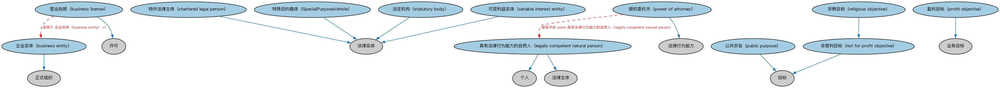

# 法律主体本体（Legal Persons Ontology）结构与公理说明

本文档对应 `LegalPersons.rdf` / `LegalPersons.ttl`，说明该本体的类、继承关系、属性和公理约定。结构图见 `LegalPersons-structure.png`（`LegalPersons-structure.svg` 为可缩放版本）。

## 1. 本体概述

定义法律主体（legal person）与法定实体（legal entity）：能够持有权利与义务、可以起诉与被诉的主体。

**在体系中的位置**：BE 法律实体模块的根基，是法人团体、公司、LEI 实体等一切「实体」概念的上位抽象。

**上下游关系**：上游依赖 FND 的法律能力、正式组织、参与方本体；下游被 BE 全部法律实体本体以及全库需要「实体」概念的模块引用。

**与相近概念的差别**：法律主体不等于自然人——自然人在 FND/AgentsAndPeople/People 建模；法律主体是法律拟制的「人」，包括自然人和法人两类。

## 2. 类（Class）

| 类（Class） | 定义（Definition） |
|---|---|
| 特殊目的载体（SpecialPurposeVehicle） | 为实现狭窄、特定且常为临时性目标而设立的法律实体。 |
| 企业实体（business entity） | 按商法设立和管理、以从事商业活动的实体。 |
| 营业执照（business license） | 允许持有人在某管辖区内、在某段时期内经营业务或从事特定职业的许可。 |
| 特许法律主体（chartered legal person） | 由皇家特许状或法令设立的法律主体。 |
| 具有法律行为能力的自然人（legally competent natural person） | 在相关情形下被认为有能力订立合同、开展业务或参与其他通常产生法律义务之活动的人。 |
| 非营利目标（not for profit objective） | 反映组织慈善、教育、宗教、人道、公共服务或其他非营利宗旨的目标。 |
| 授权委托书（power of attorney） | 一方（委托人）授予另一方（代理人）代表委托人实施特定行为的法律授权。 |
| 盈利目标（profit objective） | 反映对财务利益之追求的目标，该利益在业务收入超过支出时得以实现。 |
| 公共宗旨（public purpose） | 反映普遍认为为全民共享、旨在惠及全体公众之价值观的目标。 |
| 宗教目标（religious objective） | 反映组织宗教宗旨的非营利目标。 |
| 法定机构（statutory body） | 由政府设立、在某活动领域内审查证据并作出裁决的法律实体。 |
| 可变利益实体（variable interest entity） | 股东通过私人合同有权获得某具名公司一定比例利润的法律实体。 |

### 2.1 继承关系（Inheritance）

- 特殊目的载体（SpecialPurposeVehicle） ⊑ 法律实体
- 企业实体（business entity） ⊑ 正式组织
- 营业执照（business license） ⊑ 许可
- 特许法律主体（chartered legal person） ⊑ 法律实体
- 具有法律行为能力的自然人（legally competent natural person） ⊑ 个人
- 具有法律行为能力的自然人（legally competent natural person） ⊑ 法律主体
- 非营利目标（not for profit objective） ⊑ 目标
- 授权委托书（power of attorney） ⊑ 法律行为能力
- 盈利目标（profit objective） ⊑ 业务目标
- 公共宗旨（public purpose） ⊑ 目标
- 宗教目标（religious objective） ⊑ 非营利目标（not for profit objective）
- 法定机构（statutory body） ⊑ 法律实体
- 可变利益实体（variable interest entity） ⊑ 法律实体

## 3. 对象属性（Object Property）

| 属性（Property） | 中文（English） | 定义（Definition） | 说明 |
|---|---|---|---|
| fibo-be-le-lp:hasIntendedLiquidationDate | 具有预定清算日期（has intended liquidation date） | 将协议、合同或法律实体关联到其预定出售的日期。 | 值域（range）：日期；子属性（subPropertyOf）：具有终止日 |

## 5. 公理约定（Axioms）

- 特殊目的载体（SpecialPurposeVehicle）：具有预定清算日期（has intended liquidation date） 日期 ≥0
- 企业实体（business entity）：具有目标 业务目标 ≥0
- 企业实体（business entity）：持有 许可 ≥0
- 营业执照（business license）：适用于 企业实体（business entity） =1
- 营业执照（business license）：获承认于 some 管辖权
- 具有法律行为能力的自然人（legally competent natural person） 与 无行为能力成年人 互斥（disjointWith）
- 非营利目标（not for profit objective） 与 盈利目标（profit objective） 互斥（disjointWith）
- 授权委托书（power of attorney）：具有生效日期 日期 ≥0
- 授权委托书（power of attorney）：被授予给 some 具有法律行为能力的自然人（legally competent natural person）

## 6. 依赖（owl:imports，15 个）

本本体通过 `owl:imports` 引入以下本体，各项的中文名称与简介如下：

| 导入本体 | 中文名称 | 简介 |
|---|---|---|
| `FND/AgentsAndPeople/People.rdf` | 人员本体（People Ontology） | 定义自然人（person）的核心属性：姓名、出生日期、国籍、身份标识与联系方式，为雇员、客户、签署人等角色提供「人」的基础模型。 |
| `FND/Agreements/Agreements.rdf` | 协议本体（Agreements Ontology） | 定义两个或以上参与方之间协议（agreement）的通用概念：协议的当事方、条款、生效与终止，是合同等一切契约性安排的上位模型。 |
| `FND/Agreements/Contracts.rdf` | 合同本体（Contracts Ontology） | 在协议之上定义具有法律约束力的合同（contract）：合同当事方、合同条款、义务与权利，是金融工具与交易合同建模的基石。 |
| `FND/Arrangements/Documents.rdf` | 文档本体（Documents Ontology） | 定义文档、文档类型及文档与其所记载内容的关系，为合同文本、募集说明书等法律文书建模。 |
| `FND/GoalsAndObjectives/Objectives.rdf` | 目标本体（Objectives Ontology） | 定义目标（objective）及其与组织、计划的关系，用于表达机构的经营目标与投资目标。 |
| `FND/Law/LegalCapacity.rdf` | 法律能力本体（Legal Capacity Ontology） | 定义法律能力、缔约能力、签章权等概念，刻画主体从事法律行为的资格。 |
| `FND/Relations/Relations.rdf` | 关系本体（Relations Ontology） | FIBO 最底层的基础本体，定义参考（reference）、分类（classify）等通用关系与抽象概念，全库普遍依赖。 |
| `FND/Utilities/AnnotationVocabulary.rdf` | FIBO 标注词汇表（FIBO Annotation Vocabulary） | 定义 FIBO 专用的标注属性（如释义来源、成熟度等级），用于本体自身的元数据标注。 |
| `https://www.omg.org/spec/Commons/AnnotationVocabulary/` | OMG 通用标注词汇表（OMG Commons Annotation Vocabulary） | OMG 通用本体库（Commons）中的标注词汇表，提供概念映射等标注属性，FIBO 用它标注术语与外部标准的对应关系。 |
| `https://www.omg.org/spec/Commons/ContextualDesignators/` | OMG 通用语境指称本体（OMG Commons Contextual Designators） | Commons 库中的语境指称本体，定义「在某个语境下指代某物的名称/符号」，是地址、账户号码等语境相关标识的基础。 |
| `https://www.omg.org/spec/Commons/DatesAndTimes/` | OMG 通用日期与时间本体（OMG Commons Dates and Times） | Commons 库中的日期时间本体，定义日期、期间、时间点等通用时间概念。 |
| `https://www.omg.org/spec/Commons/Organizations/` | OMG 通用组织本体（OMG Commons Organizations） | Commons 库中的组织本体，定义组织、组织成员与组织结构的通用概念。 |
| `https://www.omg.org/spec/Commons/PartiesAndSituations/` | OMG 通用参与方与情境本体（OMG Commons Parties and Situations） | Commons 库中的参与方本体，定义独立主体、参与方及其角色扮演的通用概念，是 FIBO 参与方模型的上游。 |
| `https://www.omg.org/spec/Commons/RegulatoryAgencies/` | OMG 通用监管机构本体（OMG Commons Regulatory Agencies） | Commons 库中的监管机构本体，定义监管机构及其监管职权的通用概念。 |
| `https://www.omg.org/spec/Commons/RolesAndCompositions/` | OMG 通用角色与构成本体（OMG Commons Roles and Compositions） | Commons 库中的角色本体，定义角色及整体—部分构成关系的通用概念。 |

## 7. 文件

- 官方 RDF/XML：`LegalPersons.rdf`
- 中文 Turtle：`LegalPersons.ttl`
- 结构图：`LegalPersons-structure.png` / `LegalPersons-structure.svg`