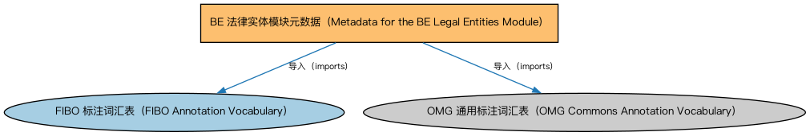

# BE 法律实体模块元数据（Metadata for the BE Legal Entities Module）说明

本文档对应 `MetadataBELegalEntities.rdf` / `MetadataBELegalEntities.ttl`。

## 1. 本文件是什么

声明法律实体（Legal Entities）模块由法律主体、法人团体、正式商业组织、LEI 法人实体四个本体构成，及版本信息。

从机制上说，这是一个元数据清单（metadata manifest）文件：它本身不定义任何类或属性，而是通过 `dct:hasPart` 声明一个域或模块由哪些本体构成，并携带版本 IRI、版权、许可与成熟度等发布管理信息。它回答的问题是「这个域/模块包含什么、当前是什么版本」，供发布工具和文档系统按模块组织内容；它的 `owl:imports` 只引入标注词汇表，不是用来加载业务本体的入口（加载入口是 `All*` 与 `About*` 聚合文件）。

## 2. 声明的构成（dct:hasPart，4 个）

| 构成项 | 中文名称 | 简介 |
|---|---|---|
| `BE/LegalEntities/CorporateBodies.rdf` | 法人团体本体（Corporate Bodies Ontology） | 定义依法设立、具有独立法律人格的法人团体（corporate body），是股份有限公司等具体法人类型的上位概念。 |
| `BE/LegalEntities/FormalBusinessOrganizations.rdf` | 正式商业组织本体（Formal Business Organizations Ontology） | 定义以营利为目的、依法注册的正式商业组织，连接法律实体与其商业功能。 |
| `BE/LegalEntities/LEIEntities.rdf` | LEI 法人实体本体（Legal Entity Identifier Entities Ontology） | 定义持有全球法人识别编码（LEI）的法人实体，对接 ISO 17442 标准的 LEI 体系。 |
| `BE/LegalEntities/LegalPersons.rdf` | 法律主体本体（Legal Persons Ontology） | 定义法律主体（legal person）与法定实体（legal entity）的核心概念：能持有权利义务、可起诉与被诉的主体。 |

## 3. 标注依赖（owl:imports，2 个）

以下导入仅用于支撑元数据标注本身（如成熟度等级、概念映射），不属于业务内容：

| 导入本体 | 中文名称 | 简介 |
|---|---|---|
| `FND/Utilities/AnnotationVocabulary.rdf` | FIBO 标注词汇表（FIBO Annotation Vocabulary） | 定义 FIBO 专用的标注属性（如释义来源、成熟度等级），用于本体自身的元数据标注。 |
| `https://www.omg.org/spec/Commons/AnnotationVocabulary/` | OMG 通用标注词汇表（OMG Commons Annotation Vocabulary） | OMG 通用本体库（Commons）中的标注词汇表，提供概念映射等标注属性，FIBO 用它标注术语与外部标准的对应关系。 |

## 4. 文件

- 官方 RDF/XML：`MetadataBELegalEntities.rdf`
- 中文 Turtle：`MetadataBELegalEntities.ttl`
- 结构图：`MetadataBELegalEntities-structure.png` / `MetadataBELegalEntities-structure.svg`