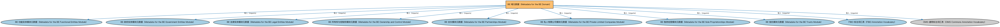

# BE 域元数据（Metadata for the BE Domain）说明

本文档对应 `MetadataBE.rdf` / `MetadataBE.ttl`。

## 1. 本文件是什么

声明商业实体（BE）域由 8 个模块构成：功能实体、政府实体、法律实体、所有权与控制权、合伙、私人有限公司、独资经营、信托。目录下另有公司（Corporations）模块的清单文件，但未被本清单列入构成，属于上游预留模块。

从机制上说，这是一个元数据清单（metadata manifest）文件：它本身不定义任何类或属性，而是通过 `dct:hasPart` 声明一个域或模块由哪些本体构成，并携带版本 IRI、版权、许可与成熟度等发布管理信息。它回答的问题是「这个域/模块包含什么、当前是什么版本」，供发布工具和文档系统按模块组织内容；它的 `owl:imports` 只引入标注词汇表，不是用来加载业务本体的入口（加载入口是 `All*` 与 `About*` 聚合文件）。

## 2. 声明的构成（dct:hasPart，8 个）

| 构成项 | 中文名称 | 简介 |
|---|---|---|
| `BE/FunctionalEntities/MetadataBEFunctionalEntities.rdf` | BE 功能实体模块元数据（Metadata for the BE Functional Entities Module） | 声明功能实体（Functional Entities）模块由功能实体本体与出版方本体构成，及版本信息。 |
| `BE/GovernmentEntities/MetadataBEGovernmentEntities.rdf` | BE 政府实体模块元数据（Metadata for the BE Government Entities Module） | 声明政府实体（Government Entities）模块的构成：政府实体核心本体加上全球各区域（亚洲五区、欧洲六区、拉美两区、北美四区）的政府实体与法域参考本体。 |
| `BE/LegalEntities/MetadataBELegalEntities.rdf` | BE 法律实体模块元数据（Metadata for the BE Legal Entities Module） | 声明法律实体（Legal Entities）模块由法律主体、法人团体、正式商业组织、LEI 法人实体四个本体构成，及版本信息。 |
| `BE/OwnershipAndControl/MetadataBEOwnershipAndControl.rdf` | BE 所有权与控制权模块元数据（Metadata for the BE Ownership and Control Module） | 声明所有权与控制权（Ownership and Control）模块由公司所有权、公司控制、所有权方、控制方、高管五个本体构成，及版本信息。 |
| `BE/Partnerships/MetadataBEPartnerships.rdf` | BE 合伙模块元数据（Metadata for the BE Partnerships Module） | 声明合伙（Partnerships）模块由合伙本体构成，及版本信息。 |
| `BE/PrivateLimitedCompanies/MetadataBEPrivateLimitedCompanies.rdf` | BE 私人有限公司模块元数据（Metadata for the BE Private Limited Companies Module） | 声明私人有限公司（Private Limited Companies）模块由私人有限公司本体构成，及版本信息。 |
| `BE/SoleProprietorships/MetadataBESoleProprietorships.rdf` | BE 独资经营模块元数据（Metadata for the BE Sole Proprietorships Module） | 声明独资经营（Sole Proprietorships）模块由独资经营本体构成，及版本信息。 |
| `BE/Trusts/MetadataBETrusts.rdf` | BE 信托模块元数据（Metadata for the BE Trusts Module） | 声明信托（Trusts）模块由信托本体构成，及版本信息。 |

## 3. 标注依赖（owl:imports，10 个）

以下导入仅用于支撑元数据标注本身（如成熟度等级、概念映射），不属于业务内容：

| 导入本体 | 中文名称 | 简介 |
|---|---|---|
| `BE/FunctionalEntities/MetadataBEFunctionalEntities.rdf` | BE 功能实体模块元数据（Metadata for the BE Functional Entities Module） | 声明功能实体（Functional Entities）模块由功能实体本体与出版方本体构成，及版本信息。 |
| `BE/GovernmentEntities/MetadataBEGovernmentEntities.rdf` | BE 政府实体模块元数据（Metadata for the BE Government Entities Module） | 声明政府实体（Government Entities）模块的构成：政府实体核心本体加上全球各区域（亚洲五区、欧洲六区、拉美两区、北美四区）的政府实体与法域参考本体。 |
| `BE/LegalEntities/MetadataBELegalEntities.rdf` | BE 法律实体模块元数据（Metadata for the BE Legal Entities Module） | 声明法律实体（Legal Entities）模块由法律主体、法人团体、正式商业组织、LEI 法人实体四个本体构成，及版本信息。 |
| `BE/OwnershipAndControl/MetadataBEOwnershipAndControl.rdf` | BE 所有权与控制权模块元数据（Metadata for the BE Ownership and Control Module） | 声明所有权与控制权（Ownership and Control）模块由公司所有权、公司控制、所有权方、控制方、高管五个本体构成，及版本信息。 |
| `BE/Partnerships/MetadataBEPartnerships.rdf` | BE 合伙模块元数据（Metadata for the BE Partnerships Module） | 声明合伙（Partnerships）模块由合伙本体构成，及版本信息。 |
| `BE/PrivateLimitedCompanies/MetadataBEPrivateLimitedCompanies.rdf` | BE 私人有限公司模块元数据（Metadata for the BE Private Limited Companies Module） | 声明私人有限公司（Private Limited Companies）模块由私人有限公司本体构成，及版本信息。 |
| `BE/SoleProprietorships/MetadataBESoleProprietorships.rdf` | BE 独资经营模块元数据（Metadata for the BE Sole Proprietorships Module） | 声明独资经营（Sole Proprietorships）模块由独资经营本体构成，及版本信息。 |
| `BE/Trusts/MetadataBETrusts.rdf` | BE 信托模块元数据（Metadata for the BE Trusts Module） | 声明信托（Trusts）模块由信托本体构成，及版本信息。 |
| `FND/Utilities/AnnotationVocabulary.rdf` | FIBO 标注词汇表（FIBO Annotation Vocabulary） | 定义 FIBO 专用的标注属性（如释义来源、成熟度等级），用于本体自身的元数据标注。 |
| `https://www.omg.org/spec/Commons/AnnotationVocabulary/` | OMG 通用标注词汇表（OMG Commons Annotation Vocabulary） | OMG 通用本体库（Commons）中的标注词汇表，提供概念映射等标注属性，FIBO 用它标注术语与外部标准的对应关系。 |

## 4. 文件

- 官方 RDF/XML：`MetadataBE.rdf`
- 中文 Turtle：`MetadataBE.ttl`
- 结构图：`MetadataBE-structure.png` / `MetadataBE-structure.svg`