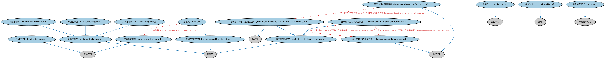

# 控制方本体（Control Parties Ontology）结构与公理说明

本文档对应 `ControlParties.rdf` / `ControlParties.ttl`，说明该本体的类、继承关系、属性和公理约定。结构图见 `ControlParties-structure.png`（`ControlParties-structure.svg` 为可缩放版本）。

## 1. 本体概述

定义控制关系中的各方角色：控制方、被控制方、实际控制人等。

**在体系中的位置**：BE 所有权与控制权模块中「控制」线索的角色层，与所有权方本体平行。

**上下游关系**：上游依赖 FND 的控制与参与方本体；下游被公司控制本体扩展为公司层面的具体控制角色。

**与相近概念的差别**：控制不等于拥有——通过协议、表决权安排也可以实现控制，控制方未必是多数股东；这正是它与所有权方角色的核心差别。

## 2. 类（Class）

| 类（Class） | 定义（Definition） |
|---|---|
| 合同性控制（contractual control） | 通过某合同的条款确立的控制。 |
| 受控方（controlled party） | 在某情形中被某参与方施以某种权力或影响的个人或组织。 |
| 控制联盟（controlling alliance） | 为共同对某实体实施控制而结成联盟的团体。 |
| 法院指定控制（court appointed control） | 由法院行为授予的控制，例如在接管情形下。 |
| 事实控制权益方（de facto controlling interest party） | 以非明示法律手段对某实体实施某种控制的参与方。 |
| 法律控制权益方（de jure controlling interest party） | 具有实施控制之法律权力的参与方。 |
| 实体控制方（entity controlling party） | 有权控制某法律实体的参与方。 |
| 基于影响力的事实控制（influence-based de facto control） | 涉及对某参与方之影响力的非正式控制。 |
| 基于影响力的事实控制方（influence-based de facto controlling party） | 对另一参与方持有基于影响力之控制的参与方。 |
| 基于投资的事实控制（investment-based de facto control） | 通过对某实体的投资（而非持有该实体的章程性股权）产生的控制。 |
| 基于投资的事实控制权益方（investment-based de facto controlling interest party） | 对另一参与方持有基于投资之控制的参与方。 |
| 共同控制方（joint controlling party） | 集体有权控制某企业组织事务的参与方。 |
| 多数控制方（majority controlling party） | 直接或间接拥有指挥或促使指挥某法律实体管理与政策之权力的控制方。 |
| 接管人（receiver） | 由法院指定、负责清算不再具有偿付能力之实体事务的参与方。 |
| 单独控制方（sole controlling party） | 对某法律实体拥有单独控制并指挥其事务的参与方。 |
| 完全所有者（total owner） | 对某法律实体拥有 100% 所有权的参与方。 |

### 2.1 继承关系（Inheritance）

- 合同性控制（contractual control） ⊑ 法律控制
- 受控方（controlled party） ⊑ 受控事物
- 控制联盟（controlling alliance） ⊑ 团体
- 法院指定控制（court appointed control） ⊑ 法律控制
- 事实控制权益方（de facto controlling interest party） ⊑ 控制方
- 法律控制权益方（de jure controlling interest party） ⊑ 控制方
- 实体控制方（entity controlling party） ⊑ 控制方
- 基于影响力的事实控制（influence-based de facto control） ⊑ 事实控制
- 基于影响力的事实控制方（influence-based de facto controlling party） ⊑ 事实控制权益方（de facto controlling interest party）
- 基于投资的事实控制（investment-based de facto control） ⊑ 事实控制
- 基于投资的事实控制权益方（investment-based de facto controlling interest party） ⊑ 事实控制权益方（de facto controlling interest party）
- 基于投资的事实控制权益方（investment-based de facto controlling interest party） ⊑ 投资者
- 共同控制方（joint controlling party） ⊑ 实体控制方（entity controlling party）
- 多数控制方（majority controlling party） ⊑ 实体控制方（entity controlling party）
- 接管人（receiver） ⊑ 法律控制权益方（de jure controlling interest party）
- 单独控制方（sole controlling party） ⊑ 实体控制方（entity controlling party）
- 完全所有者（total owner） ⊑ 章程性所有者

## 3. 对象属性（Object Property）

| 属性（Property） | 中文（English） | 定义（Definition） | 说明 |
|---|---|---|---|
| fibo-be-oac-cpty:advises | 提供咨询（advises） | 向……提供建议或指导。 | 定义域（domain）：控制方；值域（range）：受控方（controlled party）；逆属性（inverseOf）：具有顾问（has advisor）；子属性（subPropertyOf）：是控制方 |
| fibo-be-oac-cpty:isAdvisedBy | 具有顾问（has advisor） | 标识以顾问身份为受控方服务的参与方。 | 定义域（domain）：受控方（controlled party）；值域（range）：控制方；子属性（subPropertyOf）：具有控制方 |
| fibo-be-oac-cpty:hasControllingOrganizationMember | 具有控制性组织成员（has controlling organization member） | 将受控方关联到该组织的控制性成员。 | 定义域（domain）：受控方（controlled party）；值域（range）：组织成员；逆属性（inverseOf）：是……的控制性成员（is controlling member of）；子属性（subPropertyOf）：具有控制方 |
| fibo-be-oac-cpty:hasMajorityControllingParty | 具有多数控制方（has majority controlling party） | 标识拥有该实体控股权益（超过 50%）的参与方。 | 定义域（domain）：法律实体；值域（range）：多数控制方（majority controlling party）；子属性（subPropertyOf）：是……的受控方 |
| fibo-be-oac-cpty:isBasedOnInvestmentEquity | 基于投资权益（is based on investment equity） | 标识基于投资的事实控制，即基于某参与方持有某种投资权益。 | 定义域（domain）：基于投资的事实控制（investment-based de facto control）；值域（range）：投资权益；子属性（subPropertyOf）：由……授予 |
| fibo-be-oac-cpty:isControllingMemberOf | 是……的控制性成员（is controlling member of） | 标识该成员对其拥有一定程度控制的受控组织。 | 定义域（domain）：组织成员；值域（range）：受控方（controlled party）；子属性（subPropertyOf）：是控制方 |

## 5. 公理约定（Axioms）

- 合同性控制（contractual control）：由……授予 some 合同
- 受控方（controlled party）：由…扮演（is played by） 参与方（party） =1
- 法院指定控制（court appointed control）：由……授予 only 法院
- 事实控制权益方（de facto controlling interest party）：在……中为控制方 some 事实控制
- 法律控制权益方（de jure controlling interest party）：在……中为控制方 some 法律控制
- 实体控制方（entity controlling party）：是……的控制方 some 法律实体
- 基于影响力的事实控制（influence-based de facto control）：具有控制中参与方 some 基于影响力的事实控制方（influence-based de facto controlling party）
- 基于影响力的事实控制方（influence-based de facto controlling party）：在……中为控制方 some 基于影响力的事实控制（influence-based de facto control）
- 基于投资的事实控制（investment-based de facto control）：由……授予 only 投资权益
- 基于投资的事实控制（investment-based de facto control）：具有控制中参与方 some 基于投资的事实控制权益方（investment-based de facto controlling interest party）
- 基于投资的事实控制权益方（investment-based de facto controlling interest party）：在……中为控制方 only 基于投资的事实控制（investment-based de facto control）
- 共同控制方（joint controlling party）：由…扮演（is played by） only 控制联盟（controlling alliance）
- 共同控制方（joint controlling party） 与 单独控制方（sole controlling party） 互斥（disjointWith）
- 接管人（receiver）：在……中为控制方 some 法院指定控制（court appointed control）

## 6. 依赖（owl:imports，11 个）

本本体通过 `owl:imports` 引入以下本体，各项的中文名称与简介如下：

| 导入本体 | 中文名称 | 简介 |
|---|---|---|
| `BE/OwnershipAndControl/OwnershipParties.rdf` | 所有权方本体（Ownership Parties Ontology） | 定义所有权关系中的各方角色：所有者、受益所有人、名义持有人等。 |
| `FND/Agreements/Contracts.rdf` | 合同本体（Contracts Ontology） | 在协议之上定义具有法律约束力的合同（contract）：合同当事方、合同条款、义务与权利，是金融工具与交易合同建模的基石。 |
| `FND/Law/LegalCore.rdf` | 法律核心本体（Legal Core Ontology） | 定义法域（jurisdiction）、法律、法规等核心法律概念，为监管主体与适用法律建模。 |
| `FND/Organizations/FormalOrganizations.rdf` | 正式组织本体（Formal Organizations Ontology） | 定义正式组织、组织成员与组织内部角色，是公司、政府机构等组织形态建模的基础。 |
| `FND/OwnershipAndControl/Control.rdf` | 控制本体（Control Ontology） | 定义「控制」关系：控制方、被控制方与控制程度，用于公司治理与合并报表判断。 |
| `FND/Relations/Relations.rdf` | 关系本体（Relations Ontology） | FIBO 最底层的基础本体，定义参考（reference）、分类（classify）等通用关系与抽象概念，全库普遍依赖。 |
| `FND/Utilities/AnnotationVocabulary.rdf` | FIBO 标注词汇表（FIBO Annotation Vocabulary） | 定义 FIBO 专用的标注属性（如释义来源、成熟度等级），用于本体自身的元数据标注。 |
| `https://www.omg.org/spec/Commons/AnnotationVocabulary/` | OMG 通用标注词汇表（OMG Commons Annotation Vocabulary） | OMG 通用本体库（Commons）中的标注词汇表，提供概念映射等标注属性，FIBO 用它标注术语与外部标准的对应关系。 |
| `https://www.omg.org/spec/Commons/Organizations/` | OMG 通用组织本体（OMG Commons Organizations） | Commons 库中的组织本体，定义组织、组织成员与组织结构的通用概念。 |
| `https://www.omg.org/spec/Commons/PartiesAndSituations/` | OMG 通用参与方与情境本体（OMG Commons Parties and Situations） | Commons 库中的参与方本体，定义独立主体、参与方及其角色扮演的通用概念，是 FIBO 参与方模型的上游。 |
| `https://www.omg.org/spec/Commons/RolesAndCompositions/` | OMG 通用角色与构成本体（OMG Commons Roles and Compositions） | Commons 库中的角色本体，定义角色及整体—部分构成关系的通用概念。 |

## 7. 文件

- 官方 RDF/XML：`ControlParties.rdf`
- 中文 Turtle：`ControlParties.ttl`
- 结构图：`ControlParties-structure.png` / `ControlParties-structure.svg`