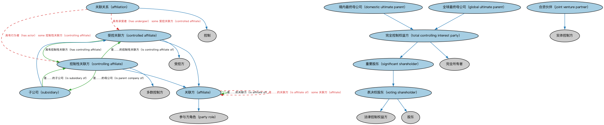

# 公司控制本体（Corporate Control Ontology）结构与公理说明

本文档对应 `CorporateControl.rdf` / `CorporateControl.ttl`，说明该本体的类、继承关系、属性和公理约定。结构图见 `CorporateControl-structure.png`（`CorporateControl-structure.svg` 为可缩放版本）。

## 1. 本体概述

定义公司层面的控制关系：控股股东、表决权控制、多数控制与少数控制等。

**在体系中的位置**：BE 所有权与控制权模块中落在「公司」上的控制本体。

**上下游关系**：上游依赖控制方角色本体与 FND 控制本体；下游支撑受益所有权分析、合并报表判断与监管披露。

**与相近概念的差别**：与公司所有权本体互补——一个回答「谁说了算」，一个回答「谁拥有份额」；拥有 30% 股份但掌握董事会多数的一方是控制方而非多数所有者。

本本体中类与类的核心关系如下（完整细节见各类小节）：

- **关联方（affiliate）** 继承 **参与方角色（party role）**
- **关联关系（affiliation）** 继承 **控制（Control）**
- **受控关联方（controlled affiliate）** 继承 **受控方（ControlledParty）**
- **受控关联方（controlled affiliate）** 继承 **关联方（affiliate）**
- **控制性关联方（controlling affiliate）** 继承 **多数控制方（MajorityControllingParty）**
- **控制性关联方（controlling affiliate）** 继承 **关联方（affiliate）**
- **境内最终母公司（domestic ultimate parent）** 继承 **完全控制权益方（total controlling interest party）**
- **全球最终母公司（global ultimate parent）** 继承 **完全控制权益方（total controlling interest party）**
- **合资伙伴（joint venture partner）** 继承 **实体控制方（EntityControllingParty）**
- **重要股东（significant shareholder）** 继承 **表决权股东（voting shareholder）**
- **子公司（subsidiary）** 继承 **受控关联方（controlled affiliate）**
- **完全控制权益方（total controlling interest party）** 继承 **完全所有者（TotalOwner）**
- 其余 8 条关系从略。

## 2. 类（Class）

| 类（Class） | 定义（Definition） |
|---|---|
| 关联方（affiliate） | 与某法律实体相关联（直接或通过一个或多个中间方间接）、控制该实体、被其控制或与其同受控制的参与方。 |
| 关联关系（affiliation） | 受控方在某段时期内与控制方相关联的情形。 |
| 受控关联方（controlled affiliate） | 关联关系情形中的受控方。 |
| 控制性关联方（controlling affiliate） | 关联关系情形中的控制方。 |
| 境内最终母公司（domestic ultimate parent） | 在注册成立国或管辖区内被认定为某组织最终母公司的参与方。 |
| 全球最终母公司（global ultimate parent） | 在全球范围内被认定为某组织最终母公司的参与方。 |
| 合资伙伴（joint venture partner） | 在共同控制下分担某实体的资本、技术、人力资源、风险与收益的参与方。 |
| 重要股东（significant shareholder） | 拥有某组织低于 50% 但高于某门槛的重要表决权股份的参与方。 |
| 子公司（subsidiary） | 被另一法律实体全部或多数拥有并控制的法律实体。 |
| 完全控制权益方（total controlling interest party） | 拥有某法律实体 100% 表决权股份的表决权股东。 |
| 表决权股东（voting shareholder） | 股份赋予其在公司选举中表决权（含在年度或特别会议上选举董事的权利）的股东。 |

以下按类逐个展开：每个类给出继承关系、相关属性与公理约定；子类在父类之下降一级编号。

### 2.1 关联方（affiliate）

定义：与某法律实体相关联（直接或通过一个或多个中间方间接）、控制该实体、被其控制或与其同受控制的参与方。

- 父类：**参与方角色（party role）**
- 直接子类：**受控关联方（controlled affiliate）**、**控制性关联方（controlling affiliate）**

属性：

| 属性 | 定义 | 说明 |
|---|---|---|
| **是……的关联方（is affiliate of）** | 将直接或通过一个或多个中间方间接控制、被控制或同受控制的参与方关联到另一参与方。 | 值域：关联方（affiliate） |

公理：

- **是……的关联方（is affiliate of）**至少有一个取值，类型是**关联方（affiliate）**。

#### 2.1.1 受控关联方（controlled affiliate）

定义：关联关系情形中的受控方。

- 父类：**受控方（ControlledParty）**、**关联方（affiliate）**
- 直接子类：**子公司（subsidiary）**

属性：

| 属性 | 定义 | 说明 |
|---|---|---|
| **具有控制性关联方（has controlling affiliate）** | 被一个直接或通过一个或多个中间方间接控制它的参与方所控制。 | 值域：控制性关联方（controlling affiliate）；子属性：是……的关联方（is affiliate of） |
| **由…扮演（is played by）** | — | — |

公理：

- **由…扮演（is played by）**的所有取值只能是**法律实体（LegalEntity）**。

##### 2.1.1.1 子公司（subsidiary）

定义：被另一法律实体全部或多数拥有并控制的法律实体。

- 父类：**受控关联方（controlled affiliate）**

属性：

| 属性 | 定义 | 说明 |
|---|---|---|
| **是……的子公司（is subsidiary of）** | 被……直接或通过一个或多个中间方间接控制并至少拥有 50%。 | 值域：控制性关联方（controlling affiliate）；子属性：具有控制性关联方（has controlling affiliate） |

#### 2.1.2 控制性关联方（controlling affiliate）

定义：关联关系情形中的控制方。

- 父类：**多数控制方（MajorityControllingParty）**、**关联方（affiliate）**

属性：

| 属性 | 定义 | 说明 |
|---|---|---|
| **是……的控制性关联方（is controlling affiliate of）** | 直接或通过一个或多个中间方间接控制。 | 值域：受控关联方（controlled affiliate）；逆属性：具有控制性关联方（has controlling affiliate）；子属性：是……的关联方（is affiliate of） |
| **是……的母公司（is parent company of）** | 标识其至少拥有 50% 的受控关联方。 | 值域：子公司（subsidiary）；逆属性：是……的子公司（is subsidiary of）；子属性：是……的控制性关联方（is controlling affiliate of） |

### 2.2 关联关系（affiliation）

定义：受控方在某段时期内与控制方相关联的情形。

- 父类：**控制（Control）**

属性：

| 属性 | 定义 | 说明 |
|---|---|---|
| **具有行为者（has actor）** | — | — |
| **具有承受者（has undergoer）** | — | — |

公理：

- **具有承受者（has undergoer）**至少有一个取值，类型是**受控关联方（controlled affiliate）**。
- **具有行为者（has actor）**至少有一个取值，类型是**控制性关联方（controlling affiliate）**。

### 2.3 合资伙伴（joint venture partner）

定义：在共同控制下分担某实体的资本、技术、人力资源、风险与收益的参与方。

- 父类：**实体控制方（EntityControllingParty）**

属性：

| 属性 | 定义 | 说明 |
|---|---|---|
| **是……的控制方（isControllingPartyOf）** | — | — |

公理：

- **是……的控制方（isControllingPartyOf）**至少有一个取值，类型是**合资企业（JointVenture）**。

### 2.4 表决权股东（voting shareholder）

定义：股份赋予其在公司选举中表决权（含在年度或特别会议上选举董事的权利）的股东。

- 父类：**法律控制权益方（DeJureControllingInterestParty）**、**股东（Shareholder）**
- 直接子类：**重要股东（significant shareholder）**

#### 2.4.1 重要股东（significant shareholder）

定义：拥有某组织低于 50% 但高于某门槛的重要表决权股份的参与方。

- 父类：**表决权股东（voting shareholder）**
- 直接子类：**完全控制权益方（total controlling interest party）**

##### 2.4.1.1 完全控制权益方（total controlling interest party）

定义：拥有某法律实体 100% 表决权股份的表决权股东。

- 父类：**完全所有者（TotalOwner）**、**重要股东（significant shareholder）**
- 直接子类：**境内最终母公司（domestic ultimate parent）**、**全球最终母公司（global ultimate parent）**

###### 2.4.1.1.1 境内最终母公司（domestic ultimate parent）

定义：在注册成立国或管辖区内被认定为某组织最终母公司的参与方。

- 父类：**完全控制权益方（total controlling interest party）**

###### 2.4.1.1.2 全球最终母公司（global ultimate parent）

定义：在全球范围内被认定为某组织最终母公司的参与方。

- 父类：**完全控制权益方（total controlling interest party）**

## 3. 其他属性

以下属性未绑定到本体的具体类（定义域在外部本体或未声明）：

对象属性（Object Property）：

| 属性 | 定义 | 说明 |
|---|---|---|
| **具有关联方（has affiliate）** | 具有一个直接或通过一个或多个中间方间接控制该公司、被其控制或与其同受控制的参与方。 | 值域：关联方（affiliate）；子属性：是……的受控方 |
| **具有境内最终母公司（has domestic ultimate parent）** | 将组织关联到在其注册成立国或管辖区内被认定为其最终母公司的组织（如有）。 | 值域：境内最终母公司（domestic ultimate parent）；子属性：具有多数控制方 |
| **具有全球最终母公司（has global ultimate parent）** | 将组织关联到被认定为其最终母公司的组织（如有）。 | 值域：全球最终母公司（global ultimate parent）；子属性：具有多数控制方 |
| **具有子公司（has subsidiary）** | 将法律实体关联到其至少拥有 50% 的另一组织。 | 值域：子公司（subsidiary） |
| **由……全资拥有（is wholly owned by）** | 将法律实体关联到对其拥有 100% 所有权与控制权的参与方。 | 值域：完全控制权益方（total controlling interest party） |

## 4. 依赖（owl:imports，10 个）

本本体通过 `owl:imports` 引入以下本体，各项的中文名称与简介如下：

| 导入本体 | 中文名称 | 简介 |
|---|---|---|
| `BE/LegalEntities/FormalBusinessOrganizations.rdf` | 正式商业组织本体（Formal Business Organizations Ontology） | 定义以营利为目的、依法注册的正式商业组织，连接法律实体与其商业功能。 |
| `BE/OwnershipAndControl/ControlParties.rdf` | 控制方本体（Control Parties Ontology） | 定义处于控制关系中的各方角色：控制方、被控制方、实际控制人等。 |
| `BE/OwnershipAndControl/CorporateOwnership.rdf` | 公司所有权本体（Corporate Ownership Ontology） | 定义公司层面的所有权关系：股东、股份持有与受益所有权。 |
| `BE/OwnershipAndControl/OwnershipParties.rdf` | 所有权方本体（Ownership Parties Ontology） | 定义所有权关系中的各方角色：所有者、受益所有人、名义持有人等。 |
| `FND/OwnershipAndControl/Control.rdf` | 控制本体（Control Ontology） | 定义「控制」关系：控制方、被控制方与控制程度，用于公司治理与合并报表判断。 |
| `FND/Utilities/AnnotationVocabulary.rdf` | FIBO 标注词汇表（FIBO Annotation Vocabulary） | 定义 FIBO 专用的标注属性（如释义来源、成熟度等级），用于本体自身的元数据标注。 |
| `https://www.omg.org/spec/Commons/AnnotationVocabulary/` | OMG 通用标注词汇表（OMG Commons Annotation Vocabulary） | OMG 通用本体库（Commons）中的标注词汇表，提供概念映射等标注属性，FIBO 用它标注术语与外部标准的对应关系。 |
| `https://www.omg.org/spec/Commons/Organizations/` | OMG 通用组织本体（OMG Commons Organizations） | Commons 库中的组织本体，定义组织、组织成员与组织结构的通用概念。 |
| `https://www.omg.org/spec/Commons/PartiesAndSituations/` | OMG 通用参与方与情境本体（OMG Commons Parties and Situations） | Commons 库中的参与方本体，定义独立主体、参与方及其角色扮演的通用概念，是 FIBO 参与方模型的上游。 |
| `https://www.omg.org/spec/Commons/RolesAndCompositions/` | OMG 通用角色与构成本体（OMG Commons Roles and Compositions） | Commons 库中的角色本体，定义角色及整体—部分构成关系的通用概念。 |

## 5. 文件

- 官方 RDF/XML：`CorporateControl.rdf`
- 中文 Turtle：`CorporateControl.ttl`
- 结构图：`CorporateControl-structure.png` / `CorporateControl-structure.svg`