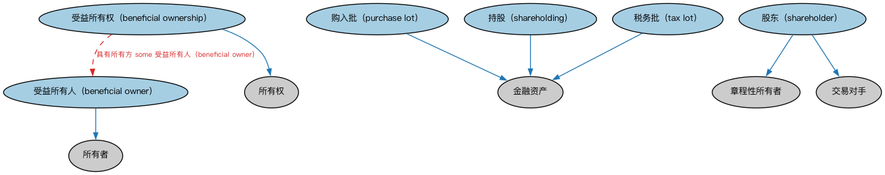

# 公司所有权本体（Corporate Ownership Ontology）结构与公理说明

本文档对应 `CorporateOwnership.rdf` / `CorporateOwnership.ttl`，说明该本体的类、继承关系、属性和公理约定。结构图见 `CorporateOwnership-structure.png`（`CorporateOwnership-structure.svg` 为可缩放版本）。

## 1. 本体概述

定义公司层面的所有权关系：股东、股份持有与受益所有权。

**在体系中的位置**：BE 所有权与控制权模块中落在「公司」上的所有权本体。

**上下游关系**：上游依赖所有权方角色本体与 FND 所有权本体；下游被 SEC、FBC 中涉及股东结构的建模引用。

**与相近概念的差别**：受益所有权不等于名义持有——登记在册的股东可能只是代持人，真正享有经济利益的是受益所有人，这是反洗钱监管关注的重点。

## 2. 类（Class）

| 类（Class） | 定义（Definition） |
|---|---|
| 受益所有人（beneficial owner） | 即使某物的所有权（名义）可能登记在他人名下，仍享有其所有权利益（如获得收入）的参与方。 |
| 受益所有权（beneficial ownership） | 将享有所有权利益（如获得收入）的参与方与名义所有权可能在他人名下之事物相关联的情形。 |
| 购入批（purchase lot） | 在给定日期以特定价格一次性买入的一批证券或其他金融资产。 |
| 股东（shareholder） | 拥有某资产股份、并以投资换取相应权利与责任的参与方。 |
| 持股（shareholding） | 以赋予财务权利和治理特权的股份所代表的对公司股权的所有权权益。 |
| 税务批（tax lot） | 为税务申报目的具有独立成本基础的一批证券或其他金融资产。 |

### 2.1 继承关系（Inheritance）

- 受益所有人（beneficial owner） ⊑ 所有者
- 受益所有权（beneficial ownership） ⊑ 所有权
- 购入批（purchase lot） ⊑ 金融资产
- 股东（shareholder） ⊑ 章程性所有者
- 股东（shareholder） ⊑ 交易对手
- 持股（shareholding） ⊑ 金融资产
- 税务批（tax lot） ⊑ 金融资产

## 3. 对象属性（Object Property）

| 属性（Property） | 中文（English） | 定义（Definition） | 说明 |
|---|---|---|---|
| fibo-be-oac-cown:hasBeneficialOwner | 具有受益所有人（has beneficial owner） | 标识在受益所有权情形中保留其所拥资产之权利的参与方。 | 定义域（domain）：资产；值域（range）：受益所有人（beneficial owner）；子属性（subPropertyOf）：是……的资产 |
| fibo-be-oac-cown:isBeneficialOwnerOf | 是……的受益所有人（is beneficial owner of） | 标识受益所有人在受益所有权情形中持有权利（通常为表决权、管理权等）的资产。 | 定义域（domain）：受益所有人（beneficial owner）；值域（range）：资产；逆属性（inverseOf）：具有受益所有人（has beneficial owner）；子属性（subPropertyOf）：拥有资产 |

## 4. 数据属性（Datatype Property）

| 属性（Property） | 中文（English） | 定义（Definition） |
|---|---|---|
| fibo-be-oac-cown:consistsOfNumberOfUnits | 由……单位组成（consists of number of units） | 标识……的单位数量。 |

## 5. 公理约定（Axioms）

- 受益所有人（beneficial owner）：由…扮演（is played by） 具有法律行为能力的自然人 =1
- 受益所有人（beneficial owner）：是……的受益所有人（is beneficial owner of） some 资产
- 受益所有权（beneficial ownership）：具有自有资产 some 资产
- 受益所有权（beneficial ownership）：具有所有方 some 受益所有人（beneficial owner）
- 受益所有权（beneficial ownership）：由……注册 some（restriction）
- 购入批（purchase lot）：restriction
- 持股（shareholding）：restriction
- 税务批（tax lot）：restriction

## 6. 依赖（owl:imports，11 个）

本本体通过 `owl:imports` 引入以下本体，各项的中文名称与简介如下：

| 导入本体 | 中文名称 | 简介 |
|---|---|---|
| `BE/LegalEntities/CorporateBodies.rdf` | 法人团体本体（Corporate Bodies Ontology） | 定义依法设立、具有独立法律人格的法人团体（corporate body），是股份有限公司等具体法人类型的上位概念。 |
| `BE/LegalEntities/LegalPersons.rdf` | 法律主体本体（Legal Persons Ontology） | 定义法律主体（legal person）与法定实体（legal entity）的核心概念：能持有权利义务、可起诉与被诉的主体。 |
| `BE/OwnershipAndControl/OwnershipParties.rdf` | 所有权方本体（Ownership Parties Ontology） | 定义所有权关系中的各方角色：所有者、受益所有人、名义持有人等。 |
| `FND/Accounting/CurrencyAmount.rdf` | 货币金额本体（Currency Amount Ontology） | 定义「金额＋币种」的货币金额（currency amount）表示，是 FIBO 中表达价格、债务金额、付款额等一切带币种数值的基础构件。 |
| `FND/Agreements/Contracts.rdf` | 合同本体（Contracts Ontology） | 在协议之上定义具有法律约束力的合同（contract）：合同当事方、合同条款、义务与权利，是金融工具与交易合同建模的基石。 |
| `FND/OwnershipAndControl/Ownership.rdf` | 所有权本体（Ownership Ontology） | 定义「拥有」关系：所有者、被拥有资产及所有权份额。 |
| `FND/Relations/Relations.rdf` | 关系本体（Relations Ontology） | FIBO 最底层的基础本体，定义参考（reference）、分类（classify）等通用关系与抽象概念，全库普遍依赖。 |
| `FND/Utilities/AnnotationVocabulary.rdf` | FIBO 标注词汇表（FIBO Annotation Vocabulary） | 定义 FIBO 专用的标注属性（如释义来源、成熟度等级），用于本体自身的元数据标注。 |
| `https://www.omg.org/spec/Commons/AnnotationVocabulary/` | OMG 通用标注词汇表（OMG Commons Annotation Vocabulary） | OMG 通用本体库（Commons）中的标注词汇表，提供概念映射等标注属性，FIBO 用它标注术语与外部标准的对应关系。 |
| `https://www.omg.org/spec/Commons/RegistrationAuthorities/` | OMG 通用登记主管机构本体（OMG Commons Registration Authorities） | Commons 库中的登记主管机构本体，定义负责登记注册的主管机构及其登记行为的通用概念。 |
| `https://www.omg.org/spec/Commons/RolesAndCompositions/` | OMG 通用角色与构成本体（OMG Commons Roles and Compositions） | Commons 库中的角色本体，定义角色及整体—部分构成关系的通用概念。 |

## 7. 文件

- 官方 RDF/XML：`CorporateOwnership.rdf`
- 中文 Turtle：`CorporateOwnership.ttl`
- 结构图：`CorporateOwnership-structure.png` / `CorporateOwnership-structure.svg`