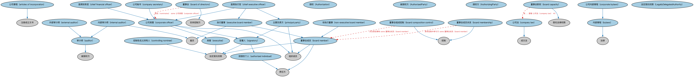

# 高管本体（Executives Ontology）结构与公理说明

本文档对应 `Executives.rdf` / `Executives.ttl`，说明该本体的类、继承关系、属性和公理约定。结构图见 `Executives-structure.png`（`Executives-structure.svg` 为可缩放版本）。

## 1. 本体概述

定义公司高管（executive）、董事会成员及其职务角色，刻画「谁在管理公司」。

**在体系中的位置**：BE 所有权与控制权模块中关于「人」的角色本体。

**上下游关系**：上游依赖 FND 人员与正式组织本体；下游被 EXMP 示例（如道指公司高管）和公司治理分析引用。

**与相近概念的差别**：高管是组织内的角色（party in role），不是自然人本身——同一个人可以同时是高管、股东和董事；与所有权/控制角色的差别在于高管是经营者而非所有者。

本本体中类与类的核心关系如下（完整细节见各类小节）：

- **公司章程（articles of incorporation）** 继承 **注册成立文书（InstrumentOfIncorporation）**
- **审计师（auditor）** 继承 **被授权方（AuthorizedParty）**
- **获授权个人（authorized individual）** 继承 **责任方（ResponsibleParty）**
- **董事会职权（board capacity）** 继承 **受托法律权限（DelegatedLegalAuthority）**
- **董事会组成控制（board composition control）** 继承 **控制（Control）**
- **董事会成员（board member）** 继承 **法定受托权限（LegallyDelegatedAuthority）**
- **董事会成员（board member）** 继承 **责任方（ResponsibleParty）**
- **董事会成员（board member）** 继承 **组织成员（OrganizationMember）**
- **董事会成员关系（board membership）** 继承 **控制（Control）**
- **董事会（board of directors）** 继承 **实体控制方（EntityControllingParty）**
- **内部章程（bylaws）** 继承 **法律（Law）**
- **首席执行官（chief executive officer）** 继承 **公司高管（corporate officer）**
- 其余 21 条关系从略。

## 2. 类（Class）

| 类（Class） | 定义（Definition） |
|---|---|
| 授权（Authorization） | 一方授权他人在特定条件下、特定时期内代表其行事或具备特定能力的情形。 |
| 被授权方（AuthorizedParty） | 在一定规则下、一定时期内被赋予代表他方行事能力或特定能力的参与方。 |
| 授权方（AuthorizingParty） | 将某个角色、权限或控制权委托给他方的参与方。 |
| 法定受托权限（LegallyDelegatedAuthority） | 被赋予一定法律控制权及相应责任的被授权方。 |
| 公司章程（articles of incorporation） | 设立新公司、或（修订时）调整公司法律基础的合同，列明公司的基本信息。 |
| 审计师（auditor） | 有资格并经授权审查和核实财务记录准确性、确保公司遵守税法的参与方。 |
| 获授权个人（authorized individual） | 在一套规则下被赋予代表另一参与方行事之责任的个人的角色。 |
| 董事会职权（board capacity） | 以受托身份为组织行事的权力，包括但不限于制定和执行公司政策。 |
| 董事会组成控制（board composition control） | 表决权股东、实体所有者或其他参与方（非营利组织情形）任命和/或提名董事会成员的情形。 |
| 董事会成员（board member） | 对组织负有受托责任的参与方，包括但不限于制定和执行公司政策。 |
| 董事会成员关系（board membership） | 将董事会个人成员关联到组织的情形。 |
| 董事会（board of directors） | 构成组织治理机构、有权制定组织战略与政策以及选任高管的人员团体。 |
| 内部章程（bylaws） | 公司、协会、合伙或任何组织的行为成文规则。 |
| 首席执行官（chief executive officer） | 负责组织整体运营与绩效的最高公司高管。 |
| 首席财务官（chief financial officer） | 负责组织或项目财务控制与规划的最高级公司高管。 |
| 公司法（company law） | 据以管理和控制公司的设立、注册或登记成立、治理与解散的立法。 |
| 公司秘书（company secretary） | 由组织董事任命的公司高管，负责确保遵守与公司治理相关的法律义务。 |
| 控制性名义持有人（controlling nominee） | 代表受益所有人持有资产（如股票、债券或财产）法定所有权的参与方。 |
| 公司内部章程（corporate bylaws） | 由董事会通过的公司行为成文规则。 |
| 公司高管（corporate officer） | 由董事会或企业主聘用、被赋予特定职责的公司或其他组织的高级管理人员。 |
| 高管（executive） | 被任命并赋予管理组织事务之责任、在指定角色权限内作出决策之权力的人。 |
| 执行董事（executive board member） | 同时是该组织雇员的董事会成员。 |
| 外部审计师（external auditor） | 有资格并经授权检查和报告财务记录准确性、确保公司遵守税法的独立参与方。 |
| 内部审计师（internal auditor） | 有资格并经授权审查和核实财务记录准确性、评估内部控制与合规情况的雇员。 |
| 非执行董事（non-executive board member） | 对组织运营不承担执行职责的董事会成员。 |
| 主要负责方（principal party） | 负责组织日常业务运营管理的控制方。 |
| 签署人（signatory） | 经授权代表自己、他人或组织签署协议的责任方。 |

以下按类逐个展开：每个类给出继承关系、相关属性与公理约定；子类在父类之下降一级编号。

### 2.1 授权（Authorization）

定义：一方授权他人在特定条件下、特定时期内代表其行事或具备特定能力的情形。

### 2.2 被授权方（AuthorizedParty）

定义：在一定规则下、一定时期内被赋予代表他方行事能力或特定能力的参与方。

### 2.3 授权方（AuthorizingParty）

定义：将某个角色、权限或控制权委托给他方的参与方。

### 2.4 法定受托权限（LegallyDelegatedAuthority）

定义：被赋予一定法律控制权及相应责任的被授权方。

### 2.5 公司章程（articles of incorporation）

定义：设立新公司、或（修订时）调整公司法律基础的合同，列明公司的基本信息。

- 父类：**注册成立文书（InstrumentOfIncorporation）**

### 2.6 审计师（auditor）

定义：有资格并经授权审查和核实财务记录准确性、确保公司遵守税法的参与方。

- 父类：**被授权方（AuthorizedParty）**
- 直接子类：**外部审计师（external auditor）**、**内部审计师（internal auditor）**

#### 2.6.1 外部审计师（external auditor）

定义：有资格并经授权检查和报告财务记录准确性、确保公司遵守税法的独立参与方。

- 父类：**审计师（auditor）**

#### 2.6.2 内部审计师（internal auditor）

定义：有资格并经授权审查和核实财务记录准确性、评估内部控制与合规情况的雇员。

- 父类：**审计师（auditor）**、**雇员（Employee）**

公理：

- 与**外部审计师（external auditor）**互斥：同一个体不能同时属于两者。

### 2.7 获授权个人（authorized individual）

定义：在一套规则下被赋予代表另一参与方行事之责任的个人的角色。

- 父类：**责任方（ResponsibleParty）**
- 直接子类：**签署人（signatory）**

属性：

| 属性 | 定义 | 说明 |
|---|---|---|
| **由…扮演（is played by）** | — | — |

公理：

- **由…扮演（is played by）**恰好有 1 个**具有法律行为能力的自然人（LegallyCompetentNaturalPerson）**。

#### 2.7.1 签署人（signatory）

定义：经授权代表自己、他人或组织签署协议的责任方。

- 父类：**获授权个人（authorized individual）**、**法定受托权限（LegallyDelegatedAuthority）**
- 直接子类：**公司高管（corporate officer）**、**主要负责方（principal party）**

属性：

| 属性 | 定义 | 说明 |
|---|---|---|
| **对……具有签署权（has signing authority for）** | 标识签署人有权为之签署协议、访问账户并执行相关任务的参与方。 | 逆属性：指定签署人（designates signatory）；子属性：由……授权 |
| **由…扮演（is played by）** | — | — |

公理：

- **由…扮演（is played by）**至少有一个取值，该取值满足：**具有能力方（hasCapacity）**至少有一个取值，类型是**签署能力（SignatoryCapacity）**。

##### 2.7.1.1 公司高管（corporate officer）

定义：由董事会或企业主聘用、被赋予特定职责的公司或其他组织的高级管理人员。

- 父类：**高管（executive）**、**签署人（signatory）**、**组织成员（OrganizationMember）**
- 直接子类：**首席执行官（chief executive officer）**、**首席财务官（chief financial officer）**、**公司秘书（company secretary）**

属性：

| 属性 | 定义 | 说明 |
|---|---|---|
| **是……的高管（is officer of）** | 标识该人对其拥有一定权力并负有管理责任的组织。 | 值域：受控方；逆属性：具有公司高管（has corporate officer）；子属性：是控制方 |

###### 2.7.1.1.1 首席执行官（chief executive officer）

定义：负责组织整体运营与绩效的最高公司高管。

- 父类：**公司高管（corporate officer）**、**执行董事（executive board member）**、**主要负责方（principal party）**

属性：

| 属性 | 定义 | 说明 |
|---|---|---|
| **管理（manages）** | — | — |

公理：

- **管理（manages）**至少有一个取值，该取值满足：该属性存在取值约束。

###### 2.7.1.1.2 首席财务官（chief financial officer）

定义：负责组织或项目财务控制与规划的最高级公司高管。

- 父类：**公司高管（corporate officer）**

###### 2.7.1.1.3 公司秘书（company secretary）

定义：由组织董事任命的公司高管，负责确保遵守与公司治理相关的法律义务。

- 父类：**公司高管（corporate officer）**

##### 2.7.1.2 主要负责方（principal party）

定义：负责组织日常业务运营管理的控制方。

- 父类：**签署人（signatory）**、**组织成员（OrganizationMember）**
- 直接子类：**首席执行官（chief executive officer）**

属性：

| 属性 | 定义 | 说明 |
|---|---|---|
| **是……的主要负责方（is principal party of）** | 标识主要负责方对其拥有一定程度控制的法律实体（受控方）。 | 值域：受控方；子属性：是……的控制性成员 |

### 2.8 董事会职权（board capacity）

定义：以受托身份为组织行事的权力，包括但不限于制定和执行公司政策。

- 父类：**受托法律权限（DelegatedLegalAuthority）**

属性：

| 属性 | 定义 | 说明 |
|---|---|---|
| **被授予给（isConferredOn）** | — | — |
| **由……授予（isConferredBy）** | — | — |
| **受……管辖（isGovernedBy）** | — | — |

公理：

- **受……管辖（isGovernedBy）**可以有 0 个或多个**公司法（company law）**。
- **由……授予（isConferredBy）**至少有一个取值，该取值满足：该属性存在取值约束。
- **被授予给（isConferredOn）**至少有一个取值，该取值满足：**扮演角色（plays role）**至少有一个取值，类型是**董事会成员（board member）**。

### 2.9 董事会组成控制（board composition control）

定义：表决权股东、实体所有者或其他参与方（非营利组织情形）任命和/或提名董事会成员的情形。

- 父类：**控制（Control）**

属性：

| 属性 | 定义 | 说明 |
|---|---|---|
| **具有控制中参与方（hasPartyInControl）** | — | — |
| **涉及受控事物（involvesControlledThing）** | — | — |

公理：

- **具有控制中参与方（hasPartyInControl）**可以有 0 个或多个**N13a7592a762946b9b5713f952995ddd8**。
- **涉及受控事物（involvesControlledThing）**至少有一个取值，类型是**董事会成员（board member）**。

### 2.10 董事会成员（board member）

定义：对组织负有受托责任的参与方，包括但不限于制定和执行公司政策。

- 父类：**法定受托权限（LegallyDelegatedAuthority）**、**责任方（ResponsibleParty）**、**组织成员（OrganizationMember）**
- 直接子类：**执行董事（executive board member）**、**非执行董事（non-executive board member）**

属性：

| 属性 | 定义 | 说明 |
|---|---|---|
| **是……的董事（is director of）** | 标识该董事会成员所监督的组织。 | 值域：受控方；逆属性：具有董事（has director）；子属性：是控制方 |
| **由…扮演（is played by）** | — | — |

公理：

- **由…扮演（is played by）**至少有一个取值，该取值满足：**是……的成员（isMemberOf）**至少有一个取值，该取值满足：**扮演角色（plays role）**至少有一个取值，类型是**董事会（board of directors）**。
- **由…扮演（is played by）**至少有一个取值，该取值满足：**是…的参与方（is a party to）**至少有一个取值，类型是**董事会协议（BoardAgreement）**。

#### 2.10.1 执行董事（executive board member）

定义：同时是该组织雇员的董事会成员。

- 父类：**董事会成员（board member）**、**雇员（Employee）**
- 直接子类：**首席执行官（chief executive officer）**

#### 2.10.2 非执行董事（non-executive board member）

定义：对组织运营不承担执行职责的董事会成员。

- 父类：**董事会成员（board member）**

公理：

- 与**执行董事（executive board member）**互斥：同一个体不能同时属于两者。

### 2.11 董事会成员关系（board membership）

定义：将董事会个人成员关联到组织的情形。

- 父类：**控制（Control）**

属性：

| 属性 | 定义 | 说明 |
|---|---|---|
| **具有控制中参与方（hasPartyInControl）** | — | — |
| **涉及受控事物（involvesControlledThing）** | — | — |

公理：

- **具有控制中参与方（hasPartyInControl）**至少有一个取值，类型是**董事会成员（board member）**。
- **涉及受控事物（involvesControlledThing）**至少有一个取值，类型是**受控方（ControlledParty）**。

### 2.12 董事会（board of directors）

定义：构成组织治理机构、有权制定组织战略与政策以及选任高管的人员团体。

- 父类：**实体控制方（EntityControllingParty）**

属性：

| 属性 | 定义 | 说明 |
|---|---|---|
| **提名（nominates）** | 任命或提议任命某人担任职务或职位。 | 值域：参与方角色（party role） |
| **由…扮演（is played by）** | — | — |

公理：

- **提名（nominates）**至少有一个取值，类型是**公司高管（corporate officer）**。
- **由…扮演（is played by）**至少有一个取值，该取值满足：**具有成员（hasMember）**至少有一个取值，该取值满足：**扮演角色（plays role）**至少有一个取值，类型是**董事会成员（board member）**。
- **由…扮演（is played by）**至少有一个取值，该取值满足：**具有能力方（hasCapacity）**至少有一个取值，类型是**董事会职权（board capacity）**。

### 2.13 内部章程（bylaws）

定义：公司、协会、合伙或任何组织的行为成文规则。

- 父类：**法律（Law）**
- 直接子类：**公司内部章程（corporate bylaws）**

#### 2.13.1 公司内部章程（corporate bylaws）

定义：由董事会通过的公司行为成文规则。

- 父类：**内部章程（bylaws）**

属性：

| 属性 | 定义 | 说明 |
|---|---|---|
| **具有授权股份数（hasSharesAuthorized）** | — | — |

公理：

- **具有授权股份数（hasSharesAuthorized）**至少有一个取值，类型是**xsd:nonNegativeInteger（nonNegativeInteger）**。

### 2.14 公司法（company law）

定义：据以管理和控制公司的设立、注册或登记成立、治理与解散的立法。

- 父类：**成文法（StatuteLaw）**

### 2.15 控制性名义持有人（controlling nominee）

定义：代表受益所有人持有资产（如股票、债券或财产）法定所有权的参与方。

- 父类：**法定受托权限（LegallyDelegatedAuthority）**

属性：

| 属性 | 定义 | 说明 |
|---|---|---|
| **受托控制（hasDelegatedControlOf）** | — | — |

公理：

- **受托控制（hasDelegatedControlOf）**至少有一个取值，类型是**资产（Asset）**。

### 2.16 高管（executive）

定义：被任命并赋予管理组织事务之责任、在指定角色权限内作出决策之权力的人。

- 父类：**法定受托权限（LegallyDelegatedAuthority）**
- 直接子类：**公司高管（corporate officer）**

属性：

| 属性 | 定义 | 说明 |
|---|---|---|
| **由…扮演（is played by）** | — | — |

公理：

- **由…扮演（is played by）**恰好有 1 个**具有法律行为能力的自然人（LegallyCompetentNaturalPerson）**。

## 3. 其他属性

以下属性未绑定到本体的具体类（定义域在外部本体或未声明）：

对象属性（Object Property）：

| 属性 | 定义 | 说明 |
|---|---|---|
| **授权（authorizes）** | 认可、使能、赋权或给予许可。 | — |
| **通过……授权（authorizesThrough）** | 标识促成授权方为某目的指定被授权方的情形。 | — |
| **将控制权委托给（delegatesControlTo）** | 标识授权方已将某些权限或控制权委托给的参与方。 | — |
| **指定签署人（designates signatory）** | 授权签署协议、访问账户和/或执行其他类似任务。 | 值域：签署人（signatory）；子属性：授权 |
| **选举（elects）** | 通过投票选出某人或一群人担任职务或其他职位。 | 值域：参与方角色（party role） |
| **具有公司高管（has corporate officer）** | 标识组织的高管。 | 值域：公司高管（corporate officer）；子属性：具有控制方 |
| **具有董事（has director）** | 标识组织董事会的成员。 | 值域：董事会成员（board member）；子属性：具有控制方 |
| **具有主要管理方（has principal managing party）** | 标识负责组织日常业务运营管理的控制方。 | 值域：主要负责方（principal party）；逆属性：是……的主要负责方（is principal party of）；子属性：具有控制性组织成员 |
| **具有责任（has responsibility）** | 指明独立参与方所负的承诺或义务。 | 值域：责任；子属性：具有能力方 |
| **被授予权力（has vested in it）** | 通过委托被赋予权力。 | 值域：受托法律权限 |
| **具有被授权方（hasAuthorizedParty）** | 标识在该情形中被认可、使能、赋权或许可行事的参与方（角色）。 | — |
| **具有授权方（hasAuthorizingParty）** | 标识在该情形中给予认可、使能、赋权或许可的参与方（角色）。 | — |
| **受托控制（hasDelegatedControlOf）** | 标识通过委托而被控制的某事物或某参与方。 | — |
| **具有责任方（hasResponsibleParty）** | 标识对某情形或组织负有任务、承诺或义务的参与方。 | — |
| **由……授权（isAuthorizedBy）** | 由……认可、使能、赋权或许可。 | — |
| **通过……被授权（isAuthorizedThrough）** | 标识促成被授权方为某目的获得认可的情形。 | — |

## 4. 依赖（owl:imports，20 个）

本本体通过 `owl:imports` 引入以下本体，各项的中文名称与简介如下：

| 导入本体 | 中文名称 | 简介 |
|---|---|---|
| `BE/LegalEntities/CorporateBodies.rdf` | 法人团体本体（Corporate Bodies Ontology） | 定义依法设立、具有独立法律人格的法人团体（corporate body），是股份有限公司等具体法人类型的上位概念。 |
| `BE/LegalEntities/LegalPersons.rdf` | 法律主体本体（Legal Persons Ontology） | 定义法律主体（legal person）与法定实体（legal entity）的核心概念：能持有权利义务、可起诉与被诉的主体。 |
| `BE/OwnershipAndControl/ControlParties.rdf` | 控制方本体（Control Parties Ontology） | 定义处于控制关系中的各方角色：控制方、被控制方、实际控制人等。 |
| `BE/OwnershipAndControl/CorporateControl.rdf` | 公司控制本体（Corporate Control Ontology） | 定义公司层面的控制关系：控股股东、多数/少数控制、表决权控制等。 |
| `BE/OwnershipAndControl/CorporateOwnership.rdf` | 公司所有权本体（Corporate Ownership Ontology） | 定义公司层面的所有权关系：股东、股份持有与受益所有权。 |
| `BE/OwnershipAndControl/OwnershipParties.rdf` | 所有权方本体（Ownership Parties Ontology） | 定义所有权关系中的各方角色：所有者、受益所有人、名义持有人等。 |
| `FND/Law/LegalCapacity.rdf` | 法律能力本体（Legal Capacity Ontology） | 定义法律能力、缔约能力、签章权等概念，刻画主体从事法律行为的资格。 |
| `FND/Law/LegalCore.rdf` | 法律核心本体（Legal Core Ontology） | 定义法域（jurisdiction）、法律、法规等核心法律概念，为监管主体与适用法律建模。 |
| `FND/Organizations/FormalOrganizations.rdf` | 正式组织本体（Formal Organizations Ontology） | 定义正式组织、组织成员与组织内部角色，是公司、政府机构等组织形态建模的基础。 |
| `FND/OwnershipAndControl/Control.rdf` | 控制本体（Control Ontology） | 定义「控制」关系：控制方、被控制方与控制程度，用于公司治理与合并报表判断。 |
| `FND/OwnershipAndControl/Ownership.rdf` | 所有权本体（Ownership Ontology） | 定义「拥有」关系：所有者、被拥有资产及所有权份额。 |
| `FND/Relations/Relations.rdf` | 关系本体（Relations Ontology） | FIBO 最底层的基础本体，定义参考（reference）、分类（classify）等通用关系与抽象概念，全库普遍依赖。 |
| `FND/Utilities/AnnotationVocabulary.rdf` | FIBO 标注词汇表（FIBO Annotation Vocabulary） | 定义 FIBO 专用的标注属性（如释义来源、成熟度等级），用于本体自身的元数据标注。 |
| `https://www.omg.org/spec/Commons/AnnotationVocabulary/` | OMG 通用标注词汇表（OMG Commons Annotation Vocabulary） | OMG 通用本体库（Commons）中的标注词汇表，提供概念映射等标注属性，FIBO 用它标注术语与外部标准的对应关系。 |
| `https://www.omg.org/spec/Commons/BusinessAuthorizations/` | OMG 通用商业授权本体（OMG Commons Business Authorizations） | OMG 通用本体库（Commons）中的商业授权本体，定义授权、签章与代理权限的通用概念。 |
| `https://www.omg.org/spec/Commons/Collections/` | OMG 通用集合本体（OMG Commons Collections） | Commons 库中的集合本体，定义集合、成员等通用概念。 |
| `https://www.omg.org/spec/Commons/Organizations/` | OMG 通用组织本体（OMG Commons Organizations） | Commons 库中的组织本体，定义组织、组织成员与组织结构的通用概念。 |
| `https://www.omg.org/spec/Commons/PartiesAndSituations/` | OMG 通用参与方与情境本体（OMG Commons Parties and Situations） | Commons 库中的参与方本体，定义独立主体、参与方及其角色扮演的通用概念，是 FIBO 参与方模型的上游。 |
| `https://www.omg.org/spec/Commons/RegulatoryAgencies/` | OMG 通用监管机构本体（OMG Commons Regulatory Agencies） | Commons 库中的监管机构本体，定义监管机构及其监管职权的通用概念。 |
| `https://www.omg.org/spec/Commons/RolesAndCompositions/` | OMG 通用角色与构成本体（OMG Commons Roles and Compositions） | Commons 库中的角色本体，定义角色及整体—部分构成关系的通用概念。 |

## 5. 文件

- 官方 RDF/XML：`Executives.rdf`
- 中文 Turtle：`Executives.ttl`
- 结构图：`Executives-structure.png` / `Executives-structure.svg`