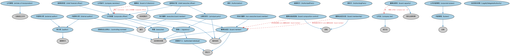

# 高管本体（Executives Ontology）结构与公理说明

本文档对应 `Executives.rdf` / `Executives.ttl`，说明该本体的类、继承关系、属性和公理约定。结构图见 `Executives-structure.png`（`Executives-structure.svg` 为可缩放版本）。

## 1. 本体概述

定义公司高管（executive）、董事会成员及其职务角色，刻画「谁在管理公司」。

**在体系中的位置**：BE 所有权与控制权模块中关于「人」的角色本体。

**上下游关系**：上游依赖 FND 人员与正式组织本体；下游被 EXMP 示例（如道指公司高管）和公司治理分析引用。

**与相近概念的差别**：高管是组织内的角色（party in role），不是自然人本身——同一个人可以同时是高管、股东和董事；与所有权/控制角色的差别在于高管是经营者而非所有者。

## 2. 类（Class）

| 类（Class） | 定义（Definition） |
|---|---|
| 授权（Authorization） | 一方授权他人在特定条件下、特定时期内代表其行事或具备特定能力的情形。 |
| 被授权方（AuthorizedParty） | 在一定规则下、一定时期内被赋予代表他方行事能力或特定能力的参与方。 |
| 授权方（AuthorizingParty） | 将某个角色、权限或控制权委托给他方的参与方。 |
| 法定受托权限（LegallyDelegatedAuthority） | 被赋予一定法律控制权及相应责任的被授权方。 |
| 公司章程（articles of incorporation） | 设立新公司、或（修订时）调整公司法律基础的合同，列明公司的基本信息。 |
| 审计师（auditor） | 有资格并经授权审查和核实财务记录准确性、确保公司遵守税法的参与方。 |
| 获授权个人（authorized individual） | 在一套规则下被赋予代表另一参与方行事之责任的个人的角色。 |
| 董事会职权（board capacity） | 以受托身份为组织行事的权力，包括但不限于制定和执行公司政策。 |
| 董事会组成控制（board composition control） | 表决权股东、实体所有者或其他参与方（非营利组织情形）任命和/或提名董事会成员的情形。 |
| 董事会成员（board member） | 对组织负有受托责任的参与方，包括但不限于制定和执行公司政策。 |
| 董事会成员关系（board membership） | 将董事会个人成员关联到组织的情形。 |
| 董事会（board of directors） | 构成组织治理机构、有权制定组织战略与政策以及选任高管的人员团体。 |
| 内部章程（bylaws） | 公司、协会、合伙或任何组织的行为成文规则。 |
| 首席执行官（chief executive officer） | 负责组织整体运营与绩效的最高公司高管。 |
| 首席财务官（chief financial officer） | 负责组织或项目财务控制与规划的最高级公司高管。 |
| 公司法（company law） | 据以管理和控制公司的设立、注册或登记成立、治理与解散的立法。 |
| 公司秘书（company secretary） | 由组织董事任命的公司高管，负责确保遵守与公司治理相关的法律义务。 |
| 控制性名义持有人（controlling nominee） | 代表受益所有人持有资产（如股票、债券或财产）法定所有权的参与方。 |
| 公司内部章程（corporate bylaws） | 由董事会通过的公司行为成文规则。 |
| 公司高管（corporate officer） | 由董事会或企业主聘用、被赋予特定职责的公司或其他组织的高级管理人员。 |
| 高管（executive） | 被任命并赋予管理组织事务之责任、在指定角色权限内作出决策之权力的人。 |
| 执行董事（executive board member） | 同时是该组织雇员的董事会成员。 |
| 外部审计师（external auditor） | 有资格并经授权检查和报告财务记录准确性、确保公司遵守税法的独立参与方。 |
| 内部审计师（internal auditor） | 有资格并经授权审查和核实财务记录准确性、评估内部控制与合规情况的雇员。 |
| 非执行董事（non-executive board member） | 对组织运营不承担执行职责的董事会成员。 |
| 主要负责方（principal party） | 负责组织日常业务运营管理的控制方。 |
| 签署人（signatory） | 经授权代表自己、他人或组织签署协议的责任方。 |

### 2.1 继承关系（Inheritance）

- 公司章程（articles of incorporation） ⊑ 注册成立文书
- 审计师（auditor） ⊑ 被授权方
- 获授权个人（authorized individual） ⊑ 责任方
- 董事会职权（board capacity） ⊑ 受托法律权限
- 董事会组成控制（board composition control） ⊑ 控制
- 董事会成员（board member） ⊑ 法定受托权限
- 董事会成员（board member） ⊑ 责任方
- 董事会成员（board member） ⊑ 组织成员
- 董事会成员关系（board membership） ⊑ 控制
- 董事会（board of directors） ⊑ 实体控制方
- 内部章程（bylaws） ⊑ 法律
- 首席执行官（chief executive officer） ⊑ 公司高管（corporate officer）
- 首席执行官（chief executive officer） ⊑ 执行董事（executive board member）
- 首席执行官（chief executive officer） ⊑ 主要负责方（principal party）
- 首席财务官（chief financial officer） ⊑ 公司高管（corporate officer）
- 公司法（company law） ⊑ 成文法
- 公司秘书（company secretary） ⊑ 公司高管（corporate officer）
- 控制性名义持有人（controlling nominee） ⊑ 法定受托权限
- 公司内部章程（corporate bylaws） ⊑ 内部章程（bylaws）
- 公司高管（corporate officer） ⊑ 高管（executive）
- 公司高管（corporate officer） ⊑ 签署人（signatory）
- 公司高管（corporate officer） ⊑ 组织成员
- 高管（executive） ⊑ 法定受托权限
- 执行董事（executive board member） ⊑ 董事会成员（board member）
- 执行董事（executive board member） ⊑ 雇员
- 外部审计师（external auditor） ⊑ 审计师（auditor）
- 内部审计师（internal auditor） ⊑ 审计师（auditor）
- 内部审计师（internal auditor） ⊑ 雇员
- 非执行董事（non-executive board member） ⊑ 董事会成员（board member）
- 主要负责方（principal party） ⊑ 签署人（signatory）
- 主要负责方（principal party） ⊑ 组织成员
- 签署人（signatory） ⊑ 获授权个人（authorized individual）
- 签署人（signatory） ⊑ 法定受托权限

## 3. 对象属性（Object Property）

| 属性（Property） | 中文（English） | 定义（Definition） | 说明 |
|---|---|---|---|
| fibo-be-oac-exec:authorizes | 授权（authorizes） | 认可、使能、赋权或给予许可。 | — |
| fibo-be-oac-exec:authorizesThrough | 通过……授权（authorizesThrough） | 标识促成授权方为某目的指定被授权方的情形。 | — |
| fibo-be-oac-exec:delegatesControlTo | 将控制权委托给（delegatesControlTo） | 标识授权方已将某些权限或控制权委托给的参与方。 | — |
| fibo-be-oac-exec:designatesSignatory | 指定签署人（designates signatory） | 授权签署协议、访问账户和/或执行其他类似任务。 | 值域（range）：签署人（signatory）；子属性（subPropertyOf）：授权 |
| fibo-be-oac-exec:elects | 选举（elects） | 通过投票选出某人或一群人担任职务或其他职位。 | 定义域（domain）：参与方角色（party role）；值域（range）：参与方角色（party role） |
| fibo-be-oac-exec:hasCorporateOfficer | 具有公司高管（has corporate officer） | 标识组织的高管。 | 定义域（domain）：受控方；值域（range）：公司高管（corporate officer）；子属性（subPropertyOf）：具有控制方 |
| fibo-be-oac-exec:hasDirector | 具有董事（has director） | 标识组织董事会的成员。 | 定义域（domain）：受控方；值域（range）：董事会成员（board member）；子属性（subPropertyOf）：具有控制方 |
| fibo-be-oac-exec:hasPrincipalManagingParty | 具有主要管理方（has principal managing party） | 标识负责组织日常业务运营管理的控制方。 | 定义域（domain）：受控方；值域（range）：主要负责方（principal party）；逆属性（inverseOf）：是……的主要负责方（is principal party of）；子属性（subPropertyOf）：具有控制性组织成员 |
| fibo-be-oac-exec:hasResponsibility | 具有责任（has responsibility） | 指明独立参与方所负的承诺或义务。 | 定义域（domain）：参与方（party）；值域（range）：责任；子属性（subPropertyOf）：具有能力方 |
| fibo-be-oac-exec:hasSigningAuthorityFor | 对……具有签署权（has signing authority for） | 标识签署人有权为之签署协议、访问账户并执行相关任务的参与方。 | 定义域（domain）：签署人（signatory）；逆属性（inverseOf）：指定签署人（designates signatory）；子属性（subPropertyOf）：由……授权 |
| fibo-be-oac-exec:hasVestedInIt | 被授予权力（has vested in it） | 通过委托被赋予权力。 | 定义域（domain）：法定受托权限；值域（range）：受托法律权限 |
| fibo-be-oac-exec:hasAuthorizedParty | 具有被授权方（hasAuthorizedParty） | 标识在该情形中被认可、使能、赋权或许可行事的参与方（角色）。 | — |
| fibo-be-oac-exec:hasAuthorizingParty | 具有授权方（hasAuthorizingParty） | 标识在该情形中给予认可、使能、赋权或许可的参与方（角色）。 | — |
| fibo-be-oac-exec:hasDelegatedControlOf | 受托控制（hasDelegatedControlOf） | 标识通过委托而被控制的某事物或某参与方。 | — |
| fibo-be-oac-exec:hasResponsibleParty | 具有责任方（hasResponsibleParty） | 标识对某情形或组织负有任务、承诺或义务的参与方。 | — |
| fibo-be-oac-exec:isDirectorOf | 是……的董事（is director of） | 标识该董事会成员所监督的组织。 | 定义域（domain）：董事会成员（board member）；值域（range）：受控方；逆属性（inverseOf）：具有董事（has director）；子属性（subPropertyOf）：是控制方 |
| fibo-be-oac-exec:isOfficerOf | 是……的高管（is officer of） | 标识该人对其拥有一定权力并负有管理责任的组织。 | 定义域（domain）：公司高管（corporate officer）；值域（range）：受控方；逆属性（inverseOf）：具有公司高管（has corporate officer）；子属性（subPropertyOf）：是控制方 |
| fibo-be-oac-exec:isPrincipalPartyOf | 是……的主要负责方（is principal party of） | 标识主要负责方对其拥有一定程度控制的法律实体（受控方）。 | 定义域（domain）：主要负责方（principal party）；值域（range）：受控方；子属性（subPropertyOf）：是……的控制性成员 |
| fibo-be-oac-exec:isAuthorizedBy | 由……授权（isAuthorizedBy） | 由……认可、使能、赋权或许可。 | — |
| fibo-be-oac-exec:isAuthorizedThrough | 通过……被授权（isAuthorizedThrough） | 标识促成被授权方为某目的获得认可的情形。 | — |
| fibo-be-oac-exec:nominates | 提名（nominates） | 任命或提议任命某人担任职务或职位。 | 定义域（domain）：参与方角色（party role）；值域（range）：参与方角色（party role） |

## 5. 公理约定（Axioms）

- 获授权个人（authorized individual）：由…扮演（is played by） 具有法律行为能力的自然人 =1
- 董事会职权（board capacity）：受……管辖 公司法（company law） ≥0
- 董事会职权（board capacity）：被授予给 some（扮演角色（plays role） some 董事会成员（board member））
- 董事会职权（board capacity）：由……授予 some（restriction）
- 董事会组成控制（board composition control）：具有控制中参与方 N283faaf30d834e839847cde8ab9db1fa ≥0
- 董事会组成控制（board composition control）：涉及受控事物 some 董事会成员（board member）
- 董事会成员（board member）：由…扮演（is played by） some（是……的成员 some（扮演角色（plays role） some 董事会（board of directors）））
- 董事会成员（board member）：由…扮演（is played by） some（是…的参与方（is a party to） some 董事会协议）
- 董事会成员关系（board membership）：具有控制中参与方 some 董事会成员（board member）
- 董事会成员关系（board membership）：涉及受控事物 some 受控方
- 董事会（board of directors）：提名（nominates） some 公司高管（corporate officer）
- 董事会（board of directors）：由…扮演（is played by） some（具有能力方 some 董事会职权（board capacity））
- 董事会（board of directors）：由…扮演（is played by） some（具有成员 some（扮演角色（plays role） some 董事会成员（board member）））
- 首席执行官（chief executive officer）：管理 some（restriction）
- 控制性名义持有人（controlling nominee）：受托控制 some 资产
- 公司内部章程（corporate bylaws）：具有授权股份数 some xsd:nonNegativeInteger
- 高管（executive）：由…扮演（is played by） 具有法律行为能力的自然人 =1
- 内部审计师（internal auditor） 与 外部审计师（external auditor） 互斥（disjointWith）
- 非执行董事（non-executive board member） 与 执行董事（executive board member） 互斥（disjointWith）
- 签署人（signatory）：由…扮演（is played by） some（具有能力方 some 签署能力）

## 6. 依赖（owl:imports，20 个）

本本体通过 `owl:imports` 引入以下本体，各项的中文名称与简介如下：

| 导入本体 | 中文名称 | 简介 |
|---|---|---|
| `BE/LegalEntities/CorporateBodies.rdf` | 法人团体本体（Corporate Bodies Ontology） | 定义依法设立、具有独立法律人格的法人团体（corporate body），是股份有限公司等具体法人类型的上位概念。 |
| `BE/LegalEntities/LegalPersons.rdf` | 法律主体本体（Legal Persons Ontology） | 定义法律主体（legal person）与法定实体（legal entity）的核心概念：能持有权利义务、可起诉与被诉的主体。 |
| `BE/OwnershipAndControl/ControlParties.rdf` | 控制方本体（Control Parties Ontology） | 定义处于控制关系中的各方角色：控制方、被控制方、实际控制人等。 |
| `BE/OwnershipAndControl/CorporateControl.rdf` | 公司控制本体（Corporate Control Ontology） | 定义公司层面的控制关系：控股股东、多数/少数控制、表决权控制等。 |
| `BE/OwnershipAndControl/CorporateOwnership.rdf` | 公司所有权本体（Corporate Ownership Ontology） | 定义公司层面的所有权关系：股东、股份持有与受益所有权。 |
| `BE/OwnershipAndControl/OwnershipParties.rdf` | 所有权方本体（Ownership Parties Ontology） | 定义所有权关系中的各方角色：所有者、受益所有人、名义持有人等。 |
| `FND/Law/LegalCapacity.rdf` | 法律能力本体（Legal Capacity Ontology） | 定义法律能力、缔约能力、签章权等概念，刻画主体从事法律行为的资格。 |
| `FND/Law/LegalCore.rdf` | 法律核心本体（Legal Core Ontology） | 定义法域（jurisdiction）、法律、法规等核心法律概念，为监管主体与适用法律建模。 |
| `FND/Organizations/FormalOrganizations.rdf` | 正式组织本体（Formal Organizations Ontology） | 定义正式组织、组织成员与组织内部角色，是公司、政府机构等组织形态建模的基础。 |
| `FND/OwnershipAndControl/Control.rdf` | 控制本体（Control Ontology） | 定义「控制」关系：控制方、被控制方与控制程度，用于公司治理与合并报表判断。 |
| `FND/OwnershipAndControl/Ownership.rdf` | 所有权本体（Ownership Ontology） | 定义「拥有」关系：所有者、被拥有资产及所有权份额。 |
| `FND/Relations/Relations.rdf` | 关系本体（Relations Ontology） | FIBO 最底层的基础本体，定义参考（reference）、分类（classify）等通用关系与抽象概念，全库普遍依赖。 |
| `FND/Utilities/AnnotationVocabulary.rdf` | FIBO 标注词汇表（FIBO Annotation Vocabulary） | 定义 FIBO 专用的标注属性（如释义来源、成熟度等级），用于本体自身的元数据标注。 |
| `https://www.omg.org/spec/Commons/AnnotationVocabulary/` | OMG 通用标注词汇表（OMG Commons Annotation Vocabulary） | OMG 通用本体库（Commons）中的标注词汇表，提供概念映射等标注属性，FIBO 用它标注术语与外部标准的对应关系。 |
| `https://www.omg.org/spec/Commons/BusinessAuthorizations/` | OMG 通用商业授权本体（OMG Commons Business Authorizations） | OMG 通用本体库（Commons）中的商业授权本体，定义授权、签章与代理权限的通用概念。 |
| `https://www.omg.org/spec/Commons/Collections/` | OMG 通用集合本体（OMG Commons Collections） | Commons 库中的集合本体，定义集合、成员等通用概念。 |
| `https://www.omg.org/spec/Commons/Organizations/` | OMG 通用组织本体（OMG Commons Organizations） | Commons 库中的组织本体，定义组织、组织成员与组织结构的通用概念。 |
| `https://www.omg.org/spec/Commons/PartiesAndSituations/` | OMG 通用参与方与情境本体（OMG Commons Parties and Situations） | Commons 库中的参与方本体，定义独立主体、参与方及其角色扮演的通用概念，是 FIBO 参与方模型的上游。 |
| `https://www.omg.org/spec/Commons/RegulatoryAgencies/` | OMG 通用监管机构本体（OMG Commons Regulatory Agencies） | Commons 库中的监管机构本体，定义监管机构及其监管职权的通用概念。 |
| `https://www.omg.org/spec/Commons/RolesAndCompositions/` | OMG 通用角色与构成本体（OMG Commons Roles and Compositions） | Commons 库中的角色本体，定义角色及整体—部分构成关系的通用概念。 |

## 7. 文件

- 官方 RDF/XML：`Executives.rdf`
- 中文 Turtle：`Executives.ttl`
- 结构图：`Executives-structure.png` / `Executives-structure.svg`