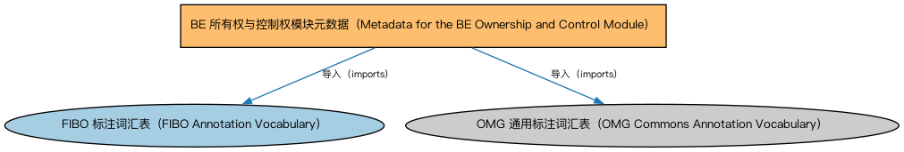

# BE 所有权与控制权模块元数据（Metadata for the BE Ownership and Control Module）说明

本文档对应 `MetadataBEOwnershipAndControl.rdf` / `MetadataBEOwnershipAndControl.ttl`。

## 1. 本文件是什么

声明所有权与控制权（Ownership and Control）模块由公司所有权、公司控制、所有权方、控制方、高管五个本体构成，及版本信息。

从机制上说，这是一个元数据清单（metadata manifest）文件：它本身不定义任何类或属性，而是通过 `dct:hasPart` 声明一个域或模块由哪些本体构成，并携带版本 IRI、版权、许可与成熟度等发布管理信息。它回答的问题是「这个域/模块包含什么、当前是什么版本」，供发布工具和文档系统按模块组织内容；它的 `owl:imports` 只引入标注词汇表，不是用来加载业务本体的入口（加载入口是 `All*` 与 `About*` 聚合文件）。

## 2. 声明的构成（dct:hasPart，5 个）

| 构成项 | 中文名称 | 简介 |
|---|---|---|
| `BE/OwnershipAndControl/ControlParties.rdf` | 控制方本体（Control Parties Ontology） | 定义处于控制关系中的各方角色：控制方、被控制方、实际控制人等。 |
| `BE/OwnershipAndControl/CorporateControl.rdf` | 公司控制本体（Corporate Control Ontology） | 定义公司层面的控制关系：控股股东、多数/少数控制、表决权控制等。 |
| `BE/OwnershipAndControl/CorporateOwnership.rdf` | 公司所有权本体（Corporate Ownership Ontology） | 定义公司层面的所有权关系：股东、股份持有与受益所有权。 |
| `BE/OwnershipAndControl/Executives.rdf` | 高管本体（Executives Ontology） | 定义公司高管（executive）、董事会成员及其职务角色，刻画「谁在管理公司」。 |
| `BE/OwnershipAndControl/OwnershipParties.rdf` | 所有权方本体（Ownership Parties Ontology） | 定义所有权关系中的各方角色：所有者、受益所有人、名义持有人等。 |

## 3. 标注依赖（owl:imports，2 个）

以下导入仅用于支撑元数据标注本身（如成熟度等级、概念映射），不属于业务内容：

| 导入本体 | 中文名称 | 简介 |
|---|---|---|
| `FND/Utilities/AnnotationVocabulary.rdf` | FIBO 标注词汇表（FIBO Annotation Vocabulary） | 定义 FIBO 专用的标注属性（如释义来源、成熟度等级），用于本体自身的元数据标注。 |
| `https://www.omg.org/spec/Commons/AnnotationVocabulary/` | OMG 通用标注词汇表（OMG Commons Annotation Vocabulary） | OMG 通用本体库（Commons）中的标注词汇表，提供概念映射等标注属性，FIBO 用它标注术语与外部标准的对应关系。 |

## 4. 文件

- 官方 RDF/XML：`MetadataBEOwnershipAndControl.rdf`
- 中文 Turtle：`MetadataBEOwnershipAndControl.ttl`
- 结构图：`MetadataBEOwnershipAndControl-structure.png` / `MetadataBEOwnershipAndControl-structure.svg`