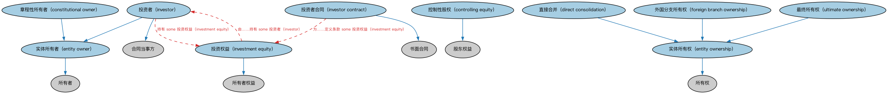

# 所有权方本体（Ownership Parties Ontology）结构与公理说明

本文档对应 `OwnershipParties.rdf` / `OwnershipParties.ttl`，说明该本体的类、继承关系、属性和公理约定。结构图见 `OwnershipParties-structure.png`（`OwnershipParties-structure.svg` 为可缩放版本）。

## 1. 本体概述

定义所有权关系中的各方角色：所有者、受益所有人、名义持有人等。

**在体系中的位置**：BE 所有权与控制权模块中「所有权」线索的角色层，与控制方本体平行。

**上下游关系**：上游依赖 FND 所有权与参与方本体；下游被公司所有权本体扩展。

**与相近概念的差别**：受益所有人与名义持有人的区分是核心——名义持有人只是登记在册，受益所有人才享有实际经济利益；这套区分直接服务反洗钱与透明度监管。

本本体中类与类的核心关系如下（完整细节见各类小节）：

- **章程性所有者（constitutional owner）** 继承 **实体所有者（entity owner）**
- **控制性股权（controlling equity）** 继承 **股东权益（ShareholdersEquity）**
- **直接合并（direct consolidation）** 继承 **实体所有权（entity ownership）**
- **实体所有者（entity owner）** 继承 **所有者（Owner）**
- **实体所有权（entity ownership）** 继承 **所有权（Ownership）**
- **外国分支所有权（foreign branch ownership）** 继承 **实体所有权（entity ownership）**
- **投资权益（investment equity）** 继承 **所有者权益（OwnersEquity）**
- **投资者（investor）** 继承 **实体所有者（entity owner）**
- **投资者（investor）** 继承 **合同当事方（ContractParty）**
- **投资者合同（investor contract）** 继承 **书面合同（WrittenContract）**
- **最终所有权（ultimate ownership）** 继承 **实体所有权（entity ownership）**

## 2. 类（Class）

| 类（Class） | 定义（Definition） |
|---|---|
| 章程性所有者（constitutional owner） | 以股东权益形式持有该实体股权的实体所有者。 |
| 控制性股权（controlling equity） | 依法或在相应股权工具中明示、正式赋予对实体之控制权的股东权益。 |
| 直接合并（direct consolidation） | 以会计合并方式记录的对实体的直接所有权。 |
| 实体所有者（entity owner） | 拥有正式企业组织或持有其所有权权益的所有者（个人、群体或其他企业实体）。 |
| 实体所有权（entity ownership） | 某参与方对某非政府正式组织之权益的所有权。 |
| 外国分支所有权（foreign branch ownership） | 某参与方对作为外国关联方且在法律上属于拥有实体一部分的正式组织或组织子单位的所有权。 |
| 投资权益（investment equity） | 代表对某实体之所有权权益的权益，可能以股东权益形式存在，也可能不是。 |
| 投资者（investor） | 通过投资拥有某组织一定份额的参与方。 |
| 投资者合同（investor contract） | 规定投资者向实体投资之条款、并规定赋予该投资者之权利的合同。 |
| 最终所有权（ultimate ownership） | 以会计合并为证的、某参与方对另一法律实体的最高层（顶端、末端）祖先级所有权。 |

以下按类逐个展开：每个类给出继承关系、相关属性与公理约定；子类在父类之下降一级编号。

### 2.1 控制性股权（controlling equity）

定义：依法或在相应股权工具中明示、正式赋予对实体之控制权的股东权益。

- 父类：**股东权益（ShareholdersEquity）**

属性：

| 属性 | 定义 | 说明 |
|---|---|---|
| **授予（confers）** | — | — |

公理：

- **授予（confers）**的所有取值只能是**法律控制（DeJureControl）**。

### 2.2 实体所有者（entity owner）

定义：拥有正式企业组织或持有其所有权权益的所有者（个人、群体或其他企业实体）。

- 父类：**所有者（Owner）**
- 直接子类：**章程性所有者（constitutional owner）**、**投资者（investor）**

属性：

| 属性 | 定义 | 说明 |
|---|---|---|
| **持有（holds）** | — | — |

公理：

- **持有（holds）**至少有一个取值，类型是**所有者权益（OwnersEquity）**。

#### 2.2.1 章程性所有者（constitutional owner）

定义：以股东权益形式持有该实体股权的实体所有者。

- 父类：**实体所有者（entity owner）**

属性：

| 属性 | 定义 | 说明 |
|---|---|---|
| **持有（holds）** | — | — |

公理：

- **持有（holds）**至少有一个取值，类型是**股东权益（ShareholdersEquity）**。

#### 2.2.2 投资者（investor）

定义：通过投资拥有某组织一定份额的参与方。

- 父类：**实体所有者（entity owner）**、**合同当事方（ContractParty）**

属性：

| 属性 | 定义 | 说明 |
|---|---|---|
| **持有（holds）** | — | — |

公理：

- **持有（holds）**至少有一个取值，类型是**投资权益（investment equity）**。

### 2.3 实体所有权（entity ownership）

定义：某参与方对某非政府正式组织之权益的所有权。

- 父类：**所有权（Ownership）**
- 直接子类：**直接合并（direct consolidation）**、**外国分支所有权（foreign branch ownership）**、**最终所有权（ultimate ownership）**

属性：

| 属性 | 定义 | 说明 |
|---|---|---|
| **具有所有权百分比（hasOwnershipPercentage）** | — | — |
| **具有被拥有实体（has owned entity）** | 标识被法律主体拥有的正式组织，可能包括独资企业。 | 值域：Ncefb00438ecc420e8132406b6ddb17f4；子属性：被…经历（is experienced by） |
| **具有拥有实体（has owning entity）** | 标识拥有正式组织的参与方。 | 值域：法律主体；子属性：具有主动参与方（has active party） |
| **受……限定（isQualifiedBy）** | — | — |
| **由……授予（isConferredBy）** | — | — |
| **由……分类（isClassifiedBy）** | — | — |

公理：

- **具有所有权百分比（hasOwnershipPercentage）**存在取值约束。
- **具有拥有实体（has owning entity）**至少有一个取值，类型是**法律主体（LegalPerson）**。
- **具有被拥有实体（has owned entity）**至少有一个取值，该取值满足：该属性存在取值约束。
- **受……限定（isQualifiedBy）**可以有 0 个或多个**关系限定符（RelationshipQualifier）**。
- **由……分类（isClassifiedBy）**恰好有 1 个**关系状态（RelationshipStatus）**。
- **由……授予（isConferredBy）**可以有 0 个或多个**N5553f1254f1a46838df6cb5ccddbb9a4**。

#### 2.3.1 直接合并（direct consolidation）

定义：以会计合并方式记录的对实体的直接所有权。

- 父类：**实体所有权（entity ownership）**

#### 2.3.2 外国分支所有权（foreign branch ownership）

定义：某参与方对作为外国关联方且在法律上属于拥有实体一部分的正式组织或组织子单位的所有权。

- 父类：**实体所有权（entity ownership）**

#### 2.3.3 最终所有权（ultimate ownership）

定义：以会计合并为证的、某参与方对另一法律实体的最高层（顶端、末端）祖先级所有权。

- 父类：**实体所有权（entity ownership）**

### 2.4 投资权益（investment equity）

定义：代表对某实体之所有权权益的权益，可能以股东权益形式存在，也可能不是。

- 父类：**所有者权益（OwnersEquity）**

属性：

| 属性 | 定义 | 说明 |
|---|---|---|
| **由……持有（isHeldBy）** | — | — |

公理：

- **由……持有（isHeldBy）**至少有一个取值，类型是**投资者（investor）**。

### 2.5 投资者合同（investor contract）

定义：规定投资者向实体投资之条款、并规定赋予该投资者之权利的合同。

- 父类：**书面合同（WrittenContract）**

属性：

| 属性 | 定义 | 说明 |
|---|---|---|
| **为……定义条款（definesTermsFor）** | — | — |

公理：

- **为……定义条款（definesTermsFor）**至少有一个取值，类型是**投资权益（investment equity）**。

## 3. 其他属性

以下属性未绑定到本体的具体类（定义域在外部本体或未声明）：

对象属性（Object Property）：

| 属性 | 定义 | 说明 |
|---|---|---|
| **担保（guarantees）** | 提供正式的保证或承诺，尤指与产品、服务或交易相关的某些条件将得到满足。 | — |
| **具有直接所有权（has direct ownership）** | 将正式组织关联到其被另一实体直接拥有的情形。 | 值域：实体所有权（entity ownership）；逆属性：具有被拥有实体（has owned entity）；子属性：经历（experiences） |
| **具有直接拥有实体（has direct owning entity）** | 将正式组织关联到直接的法律主体/所有者。 | — |
| **具有投资实体（has investment entity）** | 将法律主体关联到其直接拥有的正式组织或子公司，视所有权百分比而定。 | — |
| **具有投资所有权（has investment ownership）** | 将法律主体关联到其拥有正式组织的情境。 | 值域：实体所有权（entity ownership）；逆属性：具有拥有实体（has owning entity）；子属性：在…中扮演主动角色（plays active role in） |

## 4. 依赖（owl:imports，13 个）

本本体通过 `owl:imports` 引入以下本体，各项的中文名称与简介如下：

| 导入本体 | 中文名称 | 简介 |
|---|---|---|
| `BE/LegalEntities/FormalBusinessOrganizations.rdf` | 正式商业组织本体（Formal Business Organizations Ontology） | 定义以营利为目的、依法注册的正式商业组织，连接法律实体与其商业功能。 |
| `BE/LegalEntities/LEIEntities.rdf` | LEI 法人实体本体（Legal Entity Identifier Entities Ontology） | 定义持有全球法人识别编码（LEI）的法人实体，对接 ISO 17442 标准的 LEI 体系。 |
| `BE/LegalEntities/LegalPersons.rdf` | 法律主体本体（Legal Persons Ontology） | 定义法律主体（legal person）与法定实体（legal entity）的核心概念：能持有权利义务、可起诉与被诉的主体。 |
| `FND/Agreements/Contracts.rdf` | 合同本体（Contracts Ontology） | 在协议之上定义具有法律约束力的合同（contract）：合同当事方、合同条款、义务与权利，是金融工具与交易合同建模的基石。 |
| `FND/OwnershipAndControl/Control.rdf` | 控制本体（Control Ontology） | 定义「控制」关系：控制方、被控制方与控制程度，用于公司治理与合并报表判断。 |
| `FND/OwnershipAndControl/Ownership.rdf` | 所有权本体（Ownership Ontology） | 定义「拥有」关系：所有者、被拥有资产及所有权份额。 |
| `FND/Relations/Relations.rdf` | 关系本体（Relations Ontology） | FIBO 最底层的基础本体，定义参考（reference）、分类（classify）等通用关系与抽象概念，全库普遍依赖。 |
| `FND/Utilities/AnnotationVocabulary.rdf` | FIBO 标注词汇表（FIBO Annotation Vocabulary） | 定义 FIBO 专用的标注属性（如释义来源、成熟度等级），用于本体自身的元数据标注。 |
| `https://www.omg.org/spec/Commons/AnnotationVocabulary/` | OMG 通用标注词汇表（OMG Commons Annotation Vocabulary） | OMG 通用本体库（Commons）中的标注词汇表，提供概念映射等标注属性，FIBO 用它标注术语与外部标准的对应关系。 |
| `https://www.omg.org/spec/Commons/Classifiers/` | OMG 通用分类器本体（OMG Commons Classifiers） | OMG 通用本体库（Commons）中的分类器本体，定义分类方案、类别与归类关系的通用概念，FIBO 的分类建模建立在其上。 |
| `https://www.omg.org/spec/Commons/Documents/` | OMG 通用文档本体（OMG Commons Documents） | Commons 库中的文档本体，定义文档及其组成部分的通用概念。 |
| `https://www.omg.org/spec/Commons/Organizations/` | OMG 通用组织本体（OMG Commons Organizations） | Commons 库中的组织本体，定义组织、组织成员与组织结构的通用概念。 |
| `https://www.omg.org/spec/Commons/PartiesAndSituations/` | OMG 通用参与方与情境本体（OMG Commons Parties and Situations） | Commons 库中的参与方本体，定义独立主体、参与方及其角色扮演的通用概念，是 FIBO 参与方模型的上游。 |

## 5. 文件

- 官方 RDF/XML：`OwnershipParties.rdf`
- 中文 Turtle：`OwnershipParties.ttl`
- 结构图：`OwnershipParties-structure.png` / `OwnershipParties-structure.svg`