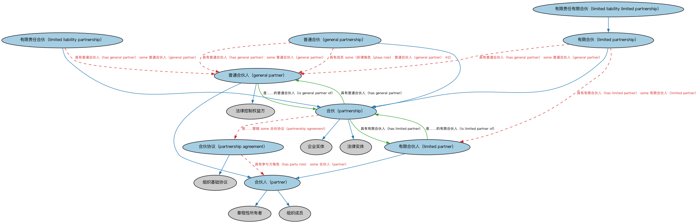

# 合伙本体（Partnerships Ontology）结构与公理说明

本文档对应 `Partnerships.rdf` / `Partnerships.ttl`，说明该本体的类、继承关系、属性和公理约定。结构图见 `Partnerships-structure.png`（`Partnerships-structure.svg` 为可缩放版本）。

## 1. 本体概述

定义合伙企业（partnership）及普通合伙、有限合伙等形态，刻画合伙人之间的权利义务。

**在体系中的位置**：BE 域法律实体形态本体之一，与公司、信托、独资经营并列。

**上下游关系**：上游依赖 BE 法律实体与 FND 协议、参与方本体；下游被私募基金结构（GP/LP 架构）等建模引用。

**与相近概念的差别**：与公司的差别——普通合伙人承担无限连带责任，且合伙在多数法域不具有完全独立的法人资格；与信托的差别——合伙是共同经营关系，信托是财产委托关系。

## 2. 类（Class）

| 类（Class） | 定义（Definition） |
|---|---|
| 普通合伙人（general partner） | 负责合伙日常运营管理的合伙人兼共同所有人，可能对合伙债务承担连带责任。 |
| 普通合伙（general partnership） | 至少有两名普通合伙人、同意共享企业全部资产、利润以及财务与法律责任的合伙。 |
| 有限责任有限合伙（limited liability limited partnership） | 由一名或多名对实体债务承担责任的普通合伙人与一名或多名受保护的有限合伙人组成的有限合伙。 |
| 有限责任合伙（limited liability partnership） | 设有普通合伙人、但为各合伙人提供针对特定合伙债务之个人责任保护的合伙。 |
| 有限合伙人（limited partner） | 责任以其出资或担保额为限、不参与合伙日常运营的合伙人。 |
| 有限合伙（limited partnership） | 至少有一名普通合伙人和一名有限合伙人的合伙。 |
| 合伙人（partner） | 合伙的共同所有人、成员和代理，其参与程度（包括按比例承担的责任和盈亏份额）由合伙协议确定。 |
| 合伙（partnership） | 两个或两个以上法律主体为盈利而作为共同所有人经营业务的联合。 |
| 合伙协议（partnership agreement） | 合伙人之间确立合伙关系条款与条件的合同。 |

### 2.1 继承关系（Inheritance）

- 普通合伙人（general partner） ⊑ 法律控制权益方
- 普通合伙人（general partner） ⊑ 合伙人（partner）
- 普通合伙（general partnership） ⊑ 合伙（partnership）
- 有限责任有限合伙（limited liability limited partnership） ⊑ 有限合伙（limited partnership）
- 有限责任合伙（limited liability partnership） ⊑ 合伙（partnership）
- 有限合伙人（limited partner） ⊑ 合伙人（partner）
- 有限合伙（limited partnership） ⊑ 合伙（partnership）
- 合伙人（partner） ⊑ 章程性所有者
- 合伙人（partner） ⊑ 组织成员
- 合伙（partnership） ⊑ 企业实体
- 合伙（partnership） ⊑ 法律实体
- 合伙协议（partnership agreement） ⊑ 组织基础协议

## 3. 对象属性（Object Property）

| 属性（Property） | 中文（English） | 定义（Definition） | 说明 |
|---|---|---|---|
| fibo-be-ptr-ptr:hasGeneralPartner | 具有普通合伙人（has general partner） | 标识对合伙拥有一定程度控制的行为体。 | 定义域（domain）：合伙（partnership）；值域（range）：普通合伙人（general partner）；子属性（subPropertyOf）：受…影响（is affected by） |
| fibo-be-ptr-ptr:hasLimitedPartner | 具有有限合伙人（has limited partner） | 标识对合伙可能拥有一定程度影响力的行为体。 | 定义域（domain）：合伙（partnership）；值域（range）：有限合伙人（limited partner）；子属性（subPropertyOf）：受…影响（is affected by） |
| fibo-be-ptr-ptr:isGeneralPartnerOf | 是……的普通合伙人（is general partner of） | 标识该普通合伙人所管理的组织。 | 定义域（domain）：普通合伙人（general partner）；值域（range）：合伙（partnership）；逆属性（inverseOf）：具有普通合伙人（has general partner）；子属性（subPropertyOf）：对…采取行动（acts on） |
| fibo-be-ptr-ptr:isLimitedPartnerOf | 是……的有限合伙人（is limited partner of） | 标识该有限合伙人所参与的组织。 | 定义域（domain）：有限合伙人（limited partner）；值域（range）：合伙（partnership）；逆属性（inverseOf）：具有有限合伙人（has limited partner）；子属性（subPropertyOf）：对…采取行动（acts on） |

## 5. 公理约定（Axioms）

- 普通合伙人（general partner）：由…扮演（is played by） some（具有能力方 some 应诉能力）
- 普通合伙（general partnership）：具有普通合伙人（has general partner） some 普通合伙人（general partner）
- 普通合伙（general partnership）：具有成员 some（扮演角色（plays role） 普通合伙人（general partner） ≥2）
- 有限责任合伙（limited liability partnership）：具有普通合伙人（has general partner） some 普通合伙人（general partner）
- 有限责任合伙（limited liability partnership） 与 有限合伙（limited partnership） 互斥（disjointWith）
- 有限合伙人（limited partner） 与 普通合伙人（general partner） 互斥（disjointWith）
- 有限合伙（limited partnership）：具有普通合伙人（has general partner） some 普通合伙人（general partner）
- 有限合伙（limited partnership）：具有有限合伙人（has limited partner） some 有限合伙人（limited partner）
- 合伙人（partner）：由…扮演（is played by） 法律主体 =1
- 合伙人（partner）：由…扮演（is played by） some（是……的成员 some 合伙（partnership））
- 合伙人（partner）：由…扮演（is played by） some（是…的参与方（is a party to） some 合伙协议（partnership agreement））
- 合伙（partnership）：具有目标 盈利目标 ≥0
- 合伙（partnership）：具有成员 some（扮演角色（plays role） some 合伙人（partner））
- 合伙（partnership）：受……管辖 some 合伙协议（partnership agreement）
- 合伙协议（partnership agreement）：具有参与方角色（has party role） some 合伙人（partner）

## 6. 依赖（owl:imports，13 个）

本本体通过 `owl:imports` 引入以下本体，各项的中文名称与简介如下：

| 导入本体 | 中文名称 | 简介 |
|---|---|---|
| `BE/LegalEntities/FormalBusinessOrganizations.rdf` | 正式商业组织本体（Formal Business Organizations Ontology） | 定义以营利为目的、依法注册的正式商业组织，连接法律实体与其商业功能。 |
| `BE/LegalEntities/LegalPersons.rdf` | 法律主体本体（Legal Persons Ontology） | 定义法律主体（legal person）与法定实体（legal entity）的核心概念：能持有权利义务、可起诉与被诉的主体。 |
| `BE/OwnershipAndControl/ControlParties.rdf` | 控制方本体（Control Parties Ontology） | 定义处于控制关系中的各方角色：控制方、被控制方、实际控制人等。 |
| `BE/OwnershipAndControl/OwnershipParties.rdf` | 所有权方本体（Ownership Parties Ontology） | 定义所有权关系中的各方角色：所有者、受益所有人、名义持有人等。 |
| `FND/GoalsAndObjectives/Objectives.rdf` | 目标本体（Objectives Ontology） | 定义目标（objective）及其与组织、计划的关系，用于表达机构的经营目标与投资目标。 |
| `FND/Law/LegalCapacity.rdf` | 法律能力本体（Legal Capacity Ontology） | 定义法律能力、缔约能力、签章权等概念，刻画主体从事法律行为的资格。 |
| `FND/Utilities/AnnotationVocabulary.rdf` | FIBO 标注词汇表（FIBO Annotation Vocabulary） | 定义 FIBO 专用的标注属性（如释义来源、成熟度等级），用于本体自身的元数据标注。 |
| `https://www.omg.org/spec/Commons/AnnotationVocabulary/` | OMG 通用标注词汇表（OMG Commons Annotation Vocabulary） | OMG 通用本体库（Commons）中的标注词汇表，提供概念映射等标注属性，FIBO 用它标注术语与外部标准的对应关系。 |
| `https://www.omg.org/spec/Commons/Collections/` | OMG 通用集合本体（OMG Commons Collections） | Commons 库中的集合本体，定义集合、成员等通用概念。 |
| `https://www.omg.org/spec/Commons/Organizations/` | OMG 通用组织本体（OMG Commons Organizations） | Commons 库中的组织本体，定义组织、组织成员与组织结构的通用概念。 |
| `https://www.omg.org/spec/Commons/PartiesAndSituations/` | OMG 通用参与方与情境本体（OMG Commons Parties and Situations） | Commons 库中的参与方本体，定义独立主体、参与方及其角色扮演的通用概念，是 FIBO 参与方模型的上游。 |
| `https://www.omg.org/spec/Commons/RegulatoryAgencies/` | OMG 通用监管机构本体（OMG Commons Regulatory Agencies） | Commons 库中的监管机构本体，定义监管机构及其监管职权的通用概念。 |
| `https://www.omg.org/spec/Commons/RolesAndCompositions/` | OMG 通用角色与构成本体（OMG Commons Roles and Compositions） | Commons 库中的角色本体，定义角色及整体—部分构成关系的通用概念。 |

## 7. 文件

- 官方 RDF/XML：`Partnerships.rdf`
- 中文 Turtle：`Partnerships.ttl`
- 结构图：`Partnerships-structure.png` / `Partnerships-structure.svg`