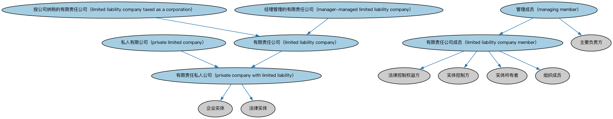

# 私人有限公司本体（Private Limited Companies Ontology）结构与公理说明

本文档对应 `PrivateLimitedCompanies.rdf` / `PrivateLimitedCompanies.ttl`，说明该本体的类、继承关系、属性和公理约定。结构图见 `PrivateLimitedCompanies-structure.png`（`PrivateLimitedCompanies-structure.svg` 为可缩放版本）。

## 1. 本体概述

定义私人有限公司（private limited company）：不公开募股、股权转让受限的有限责任公司形态。

**在体系中的位置**：BE 域法律实体形态本体之一，是公司本体的重要子类分支。

**上下游关系**：上游依赖公司与法人团体本体；下游被各国公司形态建模引用。

**与相近概念的差别**：与公众公司的差别——不能向公众募股、股份转让通常受限；与合伙的差别——股东承担有限责任且公司具有独立法人资格。

## 2. 类（Class）

| 类（Class） | 定义（Definition） |
|---|---|
| 有限责任公司（limited liability company） | 将独资或合伙的穿透征税与公司的有限责任相结合的私人有限公司。 |
| 有限责任公司成员（limited liability company member） | 有限责任公司权益的所有者。 |
| 按公司纳税的有限责任公司（limited liability company taxed as a corporation） | 已选择公司纳税身份的有限责任公司。 |
| 经理管理的有限责任公司（manager-managed limited liability company） | 成员任命一名或多名经理处理日常运营与行政职责的有限责任公司。 |
| 管理成员（managing member） | 同时经营日常业务的有限责任公司权益所有者。 |
| 有限责任私人公司（private company with limited liability） | 兼具公司与合伙或独资（视所有者数量而定）特征的混合型企业实体。 |
| 私人有限公司（private limited company） | 股东责任以其最初投入资本为限的私人有限公司。 |

### 2.1 继承关系（Inheritance）

- 有限责任公司（limited liability company） ⊑ 有限责任私人公司（private company with limited liability）
- 有限责任公司成员（limited liability company member） ⊑ 法律控制权益方
- 有限责任公司成员（limited liability company member） ⊑ 实体控制方
- 有限责任公司成员（limited liability company member） ⊑ 实体所有者
- 有限责任公司成员（limited liability company member） ⊑ 组织成员
- 按公司纳税的有限责任公司（limited liability company taxed as a corporation） ⊑ 有限责任公司（limited liability company）
- 经理管理的有限责任公司（manager-managed limited liability company） ⊑ 有限责任公司（limited liability company）
- 管理成员（managing member） ⊑ 主要负责方
- 管理成员（managing member） ⊑ 有限责任公司成员（limited liability company member）
- 有限责任私人公司（private company with limited liability） ⊑ 企业实体
- 有限责任私人公司（private company with limited liability） ⊑ 法律实体
- 私人有限公司（private limited company） ⊑ 有限责任私人公司（private company with limited liability）

## 3. 对象属性（Object Property）

| 属性（Property） | 中文（English） | 定义（Definition） | 说明 |
|---|---|---|---|
| fibo-be-plc-plc:hasManagingMember | 具有管理成员（has managing member） | 标识在有限责任公司中处于控制角色、负责日常业务运营的管理成员。 | 值域（range）：管理成员（managing member）；子属性（subPropertyOf）：具有控制性组织成员 |
| fibo-be-plc-plc:isManagingMemberOf | 是……的管理成员（is managing member of） | 标识该管理成员所经营的受控有限责任公司。 | 定义域（domain）：管理成员（managing member）；逆属性（inverseOf）：具有管理成员（has managing member）；子属性（subPropertyOf）：是……的控制性成员 |

## 5. 公理约定（Axioms）

- 有限责任公司（limited liability company）：扮演角色（plays role） Nfa32cd111d524e38a01b16b12f53a5f3 ≥0
- 有限责任公司（limited liability company）：扮演角色（plays role） some（具有控制性组织成员 some 有限责任公司成员（limited liability company member））
- 有限责任公司成员（limited liability company member）：是……的控制性成员 N24864ec19be04b43987891972763fa0e ≥0
- 有限责任公司成员（limited liability company member）：由…扮演（is played by） 具有法律行为能力的自然人 =1
- 有限责任公司成员（limited liability company member）：由…扮演（is played by） some（是……的成员 some 有限责任公司（limited liability company））
- 管理成员（managing member）：是……的管理成员（is managing member of） some（由…扮演（is played by） some 有限责任公司（limited liability company））

## 6. 依赖（owl:imports，9 个）

本本体通过 `owl:imports` 引入以下本体，各项的中文名称与简介如下：

| 导入本体 | 中文名称 | 简介 |
|---|---|---|
| `BE/LegalEntities/LegalPersons.rdf` | 法律主体本体（Legal Persons Ontology） | 定义法律主体（legal person）与法定实体（legal entity）的核心概念：能持有权利义务、可起诉与被诉的主体。 |
| `BE/OwnershipAndControl/ControlParties.rdf` | 控制方本体（Control Parties Ontology） | 定义处于控制关系中的各方角色：控制方、被控制方、实际控制人等。 |
| `BE/OwnershipAndControl/Executives.rdf` | 高管本体（Executives Ontology） | 定义公司高管（executive）、董事会成员及其职务角色，刻画「谁在管理公司」。 |
| `BE/OwnershipAndControl/OwnershipParties.rdf` | 所有权方本体（Ownership Parties Ontology） | 定义所有权关系中的各方角色：所有者、受益所有人、名义持有人等。 |
| `FND/Utilities/AnnotationVocabulary.rdf` | FIBO 标注词汇表（FIBO Annotation Vocabulary） | 定义 FIBO 专用的标注属性（如释义来源、成熟度等级），用于本体自身的元数据标注。 |
| `https://www.omg.org/spec/Commons/AnnotationVocabulary/` | OMG 通用标注词汇表（OMG Commons Annotation Vocabulary） | OMG 通用本体库（Commons）中的标注词汇表，提供概念映射等标注属性，FIBO 用它标注术语与外部标准的对应关系。 |
| `https://www.omg.org/spec/Commons/Collections/` | OMG 通用集合本体（OMG Commons Collections） | Commons 库中的集合本体，定义集合、成员等通用概念。 |
| `https://www.omg.org/spec/Commons/Organizations/` | OMG 通用组织本体（OMG Commons Organizations） | Commons 库中的组织本体，定义组织、组织成员与组织结构的通用概念。 |
| `https://www.omg.org/spec/Commons/RolesAndCompositions/` | OMG 通用角色与构成本体（OMG Commons Roles and Compositions） | Commons 库中的角色本体，定义角色及整体—部分构成关系的通用概念。 |

## 7. 文件

- 官方 RDF/XML：`PrivateLimitedCompanies.rdf`
- 中文 Turtle：`PrivateLimitedCompanies.ttl`
- 结构图：`PrivateLimitedCompanies-structure.png` / `PrivateLimitedCompanies-structure.svg`