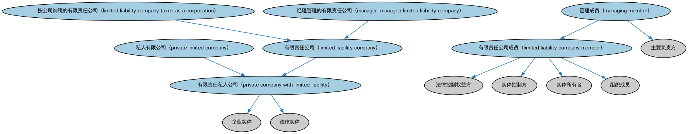

# 私人有限公司本体（Private Limited Companies Ontology）结构与公理说明

本文档对应 `PrivateLimitedCompanies.rdf` / `PrivateLimitedCompanies.ttl`，说明该本体的类、继承关系、属性和公理约定。结构图见 `PrivateLimitedCompanies-structure.png`（`PrivateLimitedCompanies-structure.svg` 为可缩放版本）。

## 1. 本体概述

定义私人有限公司（private limited company）：不公开募股、股权转让受限的有限责任公司形态。

**在体系中的位置**：BE 域法律实体形态本体之一，是公司本体的重要子类分支。

**上下游关系**：上游依赖公司与法人团体本体；下游被各国公司形态建模引用。

**与相近概念的差别**：与公众公司的差别——不能向公众募股、股份转让通常受限；与合伙的差别——股东承担有限责任且公司具有独立法人资格。

本本体中类与类的核心关系如下（完整细节见各类小节）：

- **有限责任公司（limited liability company）** 继承 **有限责任私人公司（private company with limited liability）**
- **有限责任公司成员（limited liability company member）** 继承 **法律控制权益方（DeJureControllingInterestParty）**
- **有限责任公司成员（limited liability company member）** 继承 **实体控制方（EntityControllingParty）**
- **有限责任公司成员（limited liability company member）** 继承 **实体所有者（EntityOwner）**
- **有限责任公司成员（limited liability company member）** 继承 **组织成员（OrganizationMember）**
- **按公司纳税的有限责任公司（limited liability company taxed as a corporation）** 继承 **有限责任公司（limited liability company）**
- **经理管理的有限责任公司（manager-managed limited liability company）** 继承 **有限责任公司（limited liability company）**
- **管理成员（managing member）** 继承 **主要负责方（PrincipalParty）**
- **管理成员（managing member）** 继承 **有限责任公司成员（limited liability company member）**
- **有限责任私人公司（private company with limited liability）** 继承 **企业实体（BusinessEntity）**
- **有限责任私人公司（private company with limited liability）** 继承 **法律实体（LegalEntity）**
- **私人有限公司（private limited company）** 继承 **有限责任私人公司（private company with limited liability）**

## 2. 类（Class）

| 类（Class） | 定义（Definition） |
|---|---|
| 有限责任公司（limited liability company） | 将独资或合伙的穿透征税与公司的有限责任相结合的私人有限公司。 private limited company that combines the pass through taxation of a sole proprietorship or partnership with the limited liability of a corporation |
| 有限责任公司成员（limited liability company member） | 有限责任公司权益的所有者。 owner of an interest in a limited liability company |
| 按公司纳税的有限责任公司（limited liability company taxed as a corporation） | 已选择公司纳税身份的有限责任公司。 limited liability company that has elected to have corporate tax status |
| 经理管理的有限责任公司（manager-managed limited liability company） | 成员任命一名或多名经理处理日常运营与行政职责的有限责任公司。 limited liability company in which the members appoint one or more managers to handle the daily operations and administrative responsibilities of the organization |
| 管理成员（managing member） | 同时经营日常业务的有限责任公司权益所有者。 owner of an interest in a limited liability company who also runs the day-to-day business operations |
| 有限责任私人公司（private company with limited liability） | 兼具公司与合伙或独资（视所有者数量而定）特征的混合型企业实体。 hybrid business entity having characteristics of both a corporation and a partnership or sole proprietorship (depending on how many owners there are) |
| 私人有限公司（private limited company） | 股东责任以其最初投入资本为限的私人有限公司。 private limited company whose shareholders' liability is limited to the capital they originally invested |

以下按类逐个展开：每个类给出继承关系、相关属性与公理约定；子类在父类之下降一级编号。

### 2.1 有限责任公司成员（limited liability company member）

定义：有限责任公司权益的所有者。

- 父类：**法律控制权益方（DeJureControllingInterestParty）**、**实体控制方（EntityControllingParty）**、**实体所有者（EntityOwner）**、**组织成员（OrganizationMember）**
- 直接子类：**管理成员（managing member）**

属性：

| 属性 | 定义 | 说明 |
|---|---|---|
| **是……的控制性成员（isControllingMemberOf）** | — | — |
| **由…扮演（is played by）** | — | — |

公理：

- **是……的控制性成员（isControllingMemberOf）**可以有 0 个或多个**N3236a2c571f84a4da03eb0c9d1064b40**。
- **由…扮演（is played by）**恰好有 1 个**具有法律行为能力的自然人（LegallyCompetentNaturalPerson）**。
- **由…扮演（is played by）**至少有一个取值，该取值满足：**是……的成员（isMemberOf）**至少有一个取值，类型是**有限责任公司（limited liability company）**。

#### 2.1.1 管理成员（managing member）

定义：同时经营日常业务的有限责任公司权益所有者。

- 父类：**主要负责方（PrincipalParty）**、**有限责任公司成员（limited liability company member）**

属性：

| 属性 | 定义 | 说明 |
|---|---|---|
| **是……的管理成员（is managing member of）** | 标识该管理成员所经营的受控有限责任公司。 indicates the controlled limited liability company that the managing member runs | 逆属性：具有管理成员（has managing member）；子属性：是……的控制性成员 |

公理：

- **是……的管理成员（is managing member of）**至少有一个取值，该取值满足：**由…扮演（is played by）**至少有一个取值，类型是**有限责任公司（limited liability company）**。

### 2.2 有限责任私人公司（private company with limited liability）

定义：兼具公司与合伙或独资（视所有者数量而定）特征的混合型企业实体。

- 父类：**企业实体（BusinessEntity）**、**法律实体（LegalEntity）**
- 直接子类：**有限责任公司（limited liability company）**、**私人有限公司（private limited company）**

#### 2.2.1 有限责任公司（limited liability company）

定义：将独资或合伙的穿透征税与公司的有限责任相结合的私人有限公司。

- 父类：**有限责任私人公司（private company with limited liability）**
- 直接子类：**按公司纳税的有限责任公司（limited liability company taxed as a corporation）**、**经理管理的有限责任公司（manager-managed limited liability company）**

属性：

| 属性 | 定义 | 说明 |
|---|---|---|
| **扮演角色（plays role）** | — | — |

公理：

- **扮演角色（plays role）**可以有 0 个或多个**N3cfe3bcf5b5e4def9272dd2b08ac770f**。
- **扮演角色（plays role）**至少有一个取值，该取值满足：**具有控制性组织成员（hasControllingOrganizationMember）**至少有一个取值，类型是**有限责任公司成员（limited liability company member）**。

##### 2.2.1.1 按公司纳税的有限责任公司（limited liability company taxed as a corporation）

定义：已选择公司纳税身份的有限责任公司。

- 父类：**有限责任公司（limited liability company）**

##### 2.2.1.2 经理管理的有限责任公司（manager-managed limited liability company）

定义：成员任命一名或多名经理处理日常运营与行政职责的有限责任公司。

- 父类：**有限责任公司（limited liability company）**

#### 2.2.2 私人有限公司（private limited company）

定义：股东责任以其最初投入资本为限的私人有限公司。

- 父类：**有限责任私人公司（private company with limited liability）**

## 3. 其他属性

以下属性未绑定到本体的具体类（定义域在外部本体或未声明）：

对象属性（Object Property）：

| 属性 | 定义 | 说明 |
|---|---|---|
| **具有管理成员（has managing member）** | 标识在有限责任公司中处于控制角色、负责日常业务运营的管理成员。 indicates a managing member in a controlling role of a limited liability company that has responsibility for the day-to-day business operations | 值域：管理成员（managing member）；子属性：具有控制性组织成员 |

## 4. 依赖（owl:imports，9 个）

本本体通过 `owl:imports` 引入以下本体，各项的中文名称与简介如下：

| 导入本体 | 中文名称 | 简介 |
|---|---|---|
| `BE/LegalEntities/LegalPersons.rdf` | 法律主体本体（Legal Persons Ontology） | 定义法律主体（legal person）与法定实体（legal entity）的核心概念：能持有权利义务、可起诉与被诉的主体。 |
| `BE/OwnershipAndControl/ControlParties.rdf` | 控制方本体（Control Parties Ontology） | 定义处于控制关系中的各方角色：控制方、被控制方、实际控制人等。 |
| `BE/OwnershipAndControl/Executives.rdf` | 高管本体（Executives Ontology） | 定义公司高管（executive）、董事会成员及其职务角色，刻画「谁在管理公司」。 |
| `BE/OwnershipAndControl/OwnershipParties.rdf` | 所有权方本体（Ownership Parties Ontology） | 定义所有权关系中的各方角色：所有者、受益所有人、名义持有人等。 |
| `FND/Utilities/AnnotationVocabulary.rdf` | FIBO 标注词汇表（FIBO Annotation Vocabulary） | 定义 FIBO 专用的标注属性（如释义来源、成熟度等级），用于本体自身的元数据标注。 |
| `https://www.omg.org/spec/Commons/AnnotationVocabulary/` | OMG 通用标注词汇表（OMG Commons Annotation Vocabulary） | OMG 通用本体库（Commons）中的标注词汇表，提供概念映射等标注属性，FIBO 用它标注术语与外部标准的对应关系。 |
| `https://www.omg.org/spec/Commons/Collections/` | OMG 通用集合本体（OMG Commons Collections） | Commons 库中的集合本体，定义集合、成员等通用概念。 |
| `https://www.omg.org/spec/Commons/Organizations/` | OMG 通用组织本体（OMG Commons Organizations） | Commons 库中的组织本体，定义组织、组织成员与组织结构的通用概念。 |
| `https://www.omg.org/spec/Commons/RolesAndCompositions/` | OMG 通用角色与构成本体（OMG Commons Roles and Compositions） | Commons 库中的角色本体，定义角色及整体—部分构成关系的通用概念。 |

## 5. 文件

- 官方 RDF/XML：`PrivateLimitedCompanies.rdf`
- 中文 Turtle：`PrivateLimitedCompanies.ttl`
- 结构图：`PrivateLimitedCompanies-structure.png` / `PrivateLimitedCompanies-structure.svg`