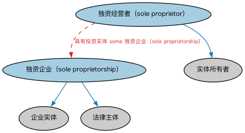

# 独资经营本体（Sole Proprietorships Ontology）结构与公理说明

本文档对应 `SoleProprietorships.rdf` / `SoleProprietorships.ttl`，说明该本体的类、继承关系、属性和公理约定。结构图见 `SoleProprietorships-structure.png`（`SoleProprietorships-structure.svg` 为可缩放版本）。

## 1. 本体概述

定义独资经营（sole proprietorship）：由单一自然人拥有并经营的企业形态。

**在体系中的位置**：BE 域法律实体形态本体之一，是最简单的商业组织形式。

**上下游关系**：上游依赖 BE 法律实体与 FND 人员、组织本体；下游较少，主要用于小微企业与个体经营建模。

**与相近概念的差别**：与公司、合伙的根本差别——独资经营没有独立法人资格，业主对企业债务承担无限责任，企业与业主个人在法律上不完全分离。

## 2. 类（Class）

| 类（Class） | 定义（Definition） |
|---|---|
| 独资经营者（sole proprietor） | 拥有某企业、享有该企业全部利润、并与该企业被视为单一实体（非法人）的参与方。 |
| 独资企业（sole proprietorship） | 由单人拥有的非法人企业。 |

### 2.1 继承关系（Inheritance）

- 独资经营者（sole proprietor） ⊑ 实体所有者
- 独资企业（sole proprietorship） ⊑ 企业实体
- 独资企业（sole proprietorship） ⊑ 法律主体

## 5. 公理约定（Axioms）

- 独资经营者（sole proprietor）：由…扮演（is played by） 具有法律行为能力的自然人 =1
- 独资经营者（sole proprietor）：具有投资实体 some 独资企业（sole proprietorship）
- 独资经营者（sole proprietor）：由…扮演（is played by） some（拥有并控制 some 独资企业（sole proprietorship））
- 独资企业（sole proprietorship）：由…拥有并控制 具有法律行为能力的自然人 =1
- 独资企业（sole proprietorship）：具有能力方 some 应诉能力

## 6. 依赖（owl:imports，8 个）

本本体通过 `owl:imports` 引入以下本体，各项的中文名称与简介如下：

| 导入本体 | 中文名称 | 简介 |
|---|---|---|
| `BE/LegalEntities/LegalPersons.rdf` | 法律主体本体（Legal Persons Ontology） | 定义法律主体（legal person）与法定实体（legal entity）的核心概念：能持有权利义务、可起诉与被诉的主体。 |
| `BE/OwnershipAndControl/OwnershipParties.rdf` | 所有权方本体（Ownership Parties Ontology） | 定义所有权关系中的各方角色：所有者、受益所有人、名义持有人等。 |
| `FND/Law/LegalCapacity.rdf` | 法律能力本体（Legal Capacity Ontology） | 定义法律能力、缔约能力、签章权等概念，刻画主体从事法律行为的资格。 |
| `FND/OwnershipAndControl/OwnershipAndControl.rdf` | 所有权与控制本体（Ownership and Control Ontology） | 综合所有权与控制关系，刻画「谁拥有、谁控制」的基本格局。 |
| `FND/Utilities/AnnotationVocabulary.rdf` | FIBO 标注词汇表（FIBO Annotation Vocabulary） | 定义 FIBO 专用的标注属性（如释义来源、成熟度等级），用于本体自身的元数据标注。 |
| `https://www.omg.org/spec/Commons/AnnotationVocabulary/` | OMG 通用标注词汇表（OMG Commons Annotation Vocabulary） | OMG 通用本体库（Commons）中的标注词汇表，提供概念映射等标注属性，FIBO 用它标注术语与外部标准的对应关系。 |
| `https://www.omg.org/spec/Commons/Organizations/` | OMG 通用组织本体（OMG Commons Organizations） | Commons 库中的组织本体，定义组织、组织成员与组织结构的通用概念。 |
| `https://www.omg.org/spec/Commons/RolesAndCompositions/` | OMG 通用角色与构成本体（OMG Commons Roles and Compositions） | Commons 库中的角色本体，定义角色及整体—部分构成关系的通用概念。 |

## 7. 文件

- 官方 RDF/XML：`SoleProprietorships.rdf`
- 中文 Turtle：`SoleProprietorships.ttl`
- 结构图：`SoleProprietorships-structure.png` / `SoleProprietorships-structure.svg`