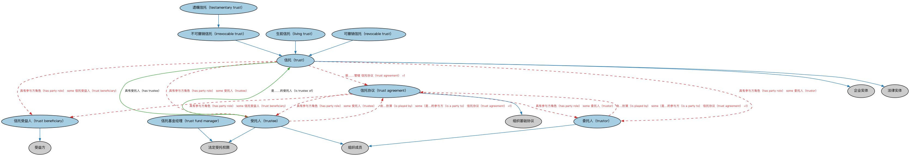

# 信托本体（Trusts Ontology）结构与公理说明

本文档对应 `Trusts.rdf` / `Trusts.ttl`，说明该本体的类、继承关系、属性和公理约定。结构图见 `Trusts-structure.png`（`Trusts-structure.svg` 为可缩放版本）。

## 1. 本体概述

定义信托（trust）及委托人（settlor）、受托人（trustee）、受益人（beneficiary）三方信托关系。

**在体系中的位置**：BE 域法律安排形态本体之一，与公司、合伙并列。

**上下游关系**：上游依赖 BE 法律实体与 FND 协议、参与方、所有权本体；下游被基金结构、资产证券化（SPV 信托）等建模引用。

**与相近概念的差别**：信托是财产委托管理关系而非经营组织——受托人持有并管理财产，受益人享有利益；与基金的差别——基金可以采用信托结构设立，但基金强调集合投资功能，信托强调财产隔离与受托责任。

## 2. 类（Class）

| 类（Class） | 定义（Definition） |
|---|---|
| 不可撤销信托（irrevocable trust） | 除特定法律情形外不得修改、修订或终止的信托，通常须经授予人同意。 |
| 生前信托（living trust） | 在个人生前设立的信托，由指定受托人负责为该个人利益管理其资产。 |
| 可撤销信托（revocable trust） | 信托财产的法定所有权转移给受托人、但委托人保留全部撤销、修改或修订权力的信托。 |
| 遗嘱信托（testamentary trust） | 按照遗嘱中的指示设立的信托。 |
| 信托（trust） | 一种受托关系和法律实体：委托人授予受托人为受益人利益持有并管理财产所有权的权利。 |
| 信托协议（trust agreement） | 设立信托的正式协议，委托人据此将持有和管理资产的责任赋予受托人，以为受益人谋利。 |
| 信托受益人（trust beneficiary） | 年金、转让（如信用证）、合同、保险单、判决、承诺、信托、遗嘱等为其利益而设的参与方。 |
| 信托基金经理（trust fund manager） | 获授权代表受托人管理信托资产的参与方。 |
| 受托人（trustee） | 为他人利益持有并管理资产的参与方。 |
| 委托人（trustor） | 设立信托、并将财产置于一名或多名受托人的保护与管理之下以为至少一名受益人谋利的参与方。 |

### 2.1 继承关系（Inheritance）

- 不可撤销信托（irrevocable trust） ⊑ 信托（trust）
- 生前信托（living trust） ⊑ 信托（trust）
- 可撤销信托（revocable trust） ⊑ 信托（trust）
- 遗嘱信托（testamentary trust） ⊑ 不可撤销信托（irrevocable trust）
- 信托（trust） ⊑ 企业实体
- 信托（trust） ⊑ 法律实体
- 信托协议（trust agreement） ⊑ 组织基础协议
- 信托受益人（trust beneficiary） ⊑ 受益方
- 信托基金经理（trust fund manager） ⊑ 法定受托权限
- 受托人（trustee） ⊑ 法定受托权限
- 受托人（trustee） ⊑ 组织成员
- 委托人（trustor） ⊑ 组织成员

## 3. 对象属性（Object Property）

| 属性（Property） | 中文（English） | 定义（Definition） | 说明 |
|---|---|---|---|
| fibo-be-tr-tr:hasTrustee | 具有受托人（has trustee） | 将信托关联到具名受托人。 | 定义域（domain）：信托（trust）；值域（range）：受托人（trustee）；逆属性（inverseOf）：是……的受托人（is trustee of）；子属性（subPropertyOf）：受…影响（is affected by） |
| fibo-be-tr-tr:isTrusteeOf | 是……的受托人（is trustee of） | 标识受托人对其拥有一定程度控制的信托。 | 定义域（domain）：受托人（trustee）；值域（range）：信托（trust）；子属性（subPropertyOf）：对…采取行动（acts on） |

## 5. 公理约定（Axioms）

- 可撤销信托（revocable trust） 与 不可撤销信托（irrevocable trust） 互斥（disjointWith）
- 信托（trust）：受……管辖 信托协议（trust agreement） =1
- 信托（trust）：具有参与方角色（has party role） some 信托受益人（trust beneficiary）
- 信托（trust）：具有参与方角色（has party role） some 受托人（trustee）
- 信托（trust）：具有参与方角色（has party role） some 委托人（trustor）
- 信托协议（trust agreement）：具有参与方角色（has party role） some 信托受益人（trust beneficiary）
- 信托协议（trust agreement）：具有参与方角色（has party role） some 受托人（trustee）
- 信托协议（trust agreement）：具有参与方角色（has party role） some 委托人（trustor）
- 信托受益人（trust beneficiary）：由…扮演（is played by） some（是…的参与方（is a party to） only 信托协议（trust agreement））
- 信托基金经理（trust fund manager）：由…扮演（is played by） some（管理 only 信托（trust））
- 受托人（trustee）：由…扮演（is played by） some（是……的成员 only 信托（trust））
- 受托人（trustee）：由…扮演（is played by） some（管理 only 信托（trust））
- 受托人（trustee）：由…扮演（is played by） some（是…的参与方（is a party to） 信托协议（trust agreement） =1）
- 委托人（trustor）：由…扮演（is played by） only 参与方（party）
- 委托人（trustor）：由…扮演（is played by） some（是…的参与方（is a party to） 信托协议（trust agreement） =1）

## 6. 依赖（owl:imports，12 个）

本本体通过 `owl:imports` 引入以下本体，各项的中文名称与简介如下：

| 导入本体 | 中文名称 | 简介 |
|---|---|---|
| `BE/LegalEntities/FormalBusinessOrganizations.rdf` | 正式商业组织本体（Formal Business Organizations Ontology） | 定义以营利为目的、依法注册的正式商业组织，连接法律实体与其商业功能。 |
| `BE/LegalEntities/LegalPersons.rdf` | 法律主体本体（Legal Persons Ontology） | 定义法律主体（legal person）与法定实体（legal entity）的核心概念：能持有权利义务、可起诉与被诉的主体。 |
| `FND/Agreements/Agreements.rdf` | 协议本体（Agreements Ontology） | 定义两个或以上参与方之间协议（agreement）的通用概念：协议的当事方、条款、生效与终止，是合同等一切契约性安排的上位模型。 |
| `FND/Agreements/Contracts.rdf` | 合同本体（Contracts Ontology） | 在协议之上定义具有法律约束力的合同（contract）：合同当事方、合同条款、义务与权利，是金融工具与交易合同建模的基石。 |
| `FND/Utilities/AnnotationVocabulary.rdf` | FIBO 标注词汇表（FIBO Annotation Vocabulary） | 定义 FIBO 专用的标注属性（如释义来源、成熟度等级），用于本体自身的元数据标注。 |
| `https://www.omg.org/spec/Commons/AnnotationVocabulary/` | OMG 通用标注词汇表（OMG Commons Annotation Vocabulary） | OMG 通用本体库（Commons）中的标注词汇表，提供概念映射等标注属性，FIBO 用它标注术语与外部标准的对应关系。 |
| `https://www.omg.org/spec/Commons/BusinessAuthorizations/` | OMG 通用商业授权本体（OMG Commons Business Authorizations） | OMG 通用本体库（Commons）中的商业授权本体，定义授权、签章与代理权限的通用概念。 |
| `https://www.omg.org/spec/Commons/Collections/` | OMG 通用集合本体（OMG Commons Collections） | Commons 库中的集合本体，定义集合、成员等通用概念。 |
| `https://www.omg.org/spec/Commons/Organizations/` | OMG 通用组织本体（OMG Commons Organizations） | Commons 库中的组织本体，定义组织、组织成员与组织结构的通用概念。 |
| `https://www.omg.org/spec/Commons/PartiesAndSituations/` | OMG 通用参与方与情境本体（OMG Commons Parties and Situations） | Commons 库中的参与方本体，定义独立主体、参与方及其角色扮演的通用概念，是 FIBO 参与方模型的上游。 |
| `https://www.omg.org/spec/Commons/RegulatoryAgencies/` | OMG 通用监管机构本体（OMG Commons Regulatory Agencies） | Commons 库中的监管机构本体，定义监管机构及其监管职权的通用概念。 |
| `https://www.omg.org/spec/Commons/RolesAndCompositions/` | OMG 通用角色与构成本体（OMG Commons Roles and Compositions） | Commons 库中的角色本体，定义角色及整体—部分构成关系的通用概念。 |

## 7. 文件

- 官方 RDF/XML：`Trusts.rdf`
- 中文 Turtle：`Trusts.ttl`
- 结构图：`Trusts-structure.png` / `Trusts-structure.svg`