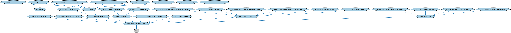

# 金融语境与流程本体（Financial Context and Process Ontology）结构与公理说明

本文档对应 `FinancialContextAndProcess.rdf` / `FinancialContextAndProcess.ttl`，说明该本体的类、继承关系、属性和公理约定。结构图见 `FinancialContextAndProcess-structure.png`（`FinancialContextAndProcess-structure.svg` 为可缩放版本）。

## 1. 本体概述

定义金融业务语境下的流程（process）、流程阶段与参与者，提供描述「业务如何一步步推进」的通用框架。

**在体系中的位置**：BP（业务流程）域流程模块的核心本体，是证券发行各流程本体的共同基础。

**上下游关系**：上游依赖 FND 的参与方、安排、日期本体；下游被 BP 证券发行模块的全部本体（IPO、债务、MBS、市政债发行）继承。

**与相近概念的差别**：BP 域建模的是「过程」——事情按什么步骤发生，与建模「物」的本体（证券、金融工具）互补；与 FND 生命周期本体的差别——生命周期描述一个对象自身的状态演化，流程描述多方协作的业务步骤。

本本体中类与类的核心关系如下（完整细节见各类小节）：

- **清算（clearing）** 继承 **清算与结算（clearing and settlement）**
- **清算与结算（clearing and settlement）** 继承 **金融行业情境（financial industry context）**
- **金融行业情境（financial industry context）** 继承 **情境（Context）**
- **金融市场监管（financial markets regulation）** 继承 **金融行业情境（financial industry context）**
- **投资管理（investment management）** 继承 **金融行业情境（financial industry context）**
- **市场数据提供（market data provision）** 继承 **交易前（pre trade）**
- **组合管理（portfolio management）** 继承 **投资管理（investment management）**
- **交易前（pre trade）** 继承 **投资管理（investment management）**
- **交易前报价（pretrade quotes）** 继承 **交易前（pre trade）**
- **交易前参考数据提供（pretrade reference data provision）** 继承 **交易前（pre trade）**
- **一级市场（primary market）** 继承 **金融行业情境（financial industry context）**
- **一级市场收盘（primary market closing）** 继承 **一级市场（primary market）**
- 其余 18 条关系从略。

## 2. 类（Class）

| 类（Class） | 定义（Definition） |
|---|---|
| 清算（clearing） | 证券交易被清算的过程。 The process by which securities trades are cleared. |
| 清算与结算（clearing and settlement） | 证券清算与结算的业务流程或服务领域。 The business process or service area of securities clearing and settlement. |
| 金融行业情境（financial industry context） | 金融行业内业务活动发生的情境，即投资管理、批发金融市场交易等。 The context in which business activites take place within the financial industry, i.e. investment management, wholesale financial markets trading and so on. |
| 金融市场监管（financial markets regulation） | 对金融市场进行监管的活动与规则体系。 |
| 投资管理（investment management） | 对投资组合进行专业化管理、以实现投资目标的业务活动。 |
| 市场数据提供（market data provision） | 向市场参与者提供行情与参考数据的业务活动。 |
| 组合管理（portfolio management） | 对证券组合进行选择、监测与调整的业务活动。 |
| 交易前（pre trade） | 交易执行之前的阶段，包括询价、报价与参考数据准备。 |
| 交易前报价（pretrade quotes） | 交易执行之前提供的报价信息。 |
| 交易前参考数据提供（pretrade reference data provision） | 在交易执行前提供证券参考数据的活动。 |
| 一级市场（primary market） | 新交易金融工具的发行与一级市场交易。 Issuance and primary market trading of new Traded Financial Instruments |
| 一级市场收盘（primary market closing） | 一级市场发行完成、头寸划转到位的收尾环节。 |
| 一级市场兴趣表示（primary market indications of interest） | 投资者在一级市场发行前表达认购兴趣的环节。 |
| 二级市场交易情境（secondary market trading context） | 已发行证券在二级市场进行交易的情境。 |
| 证券托管（securities custody） | 为客户保管证券并处理相关事务的服务。 |
| 证券交易后（securities post trade） | 证券交易执行之后的处理阶段。 |
| 证券交易后头寸管理（securities post trade position management） | 交易执行后对证券头寸进行管理的环节。 |
| 证券交易（securities trade） | 证券买卖双方达成并执行的交易。 |
| 证券交易分配（securities trade allocation） | 将成交的交易分配到具体账户的环节。 |
| 证券交易捕获与核验（securities trade capture and validation） | 将交易录入系统并核验其要素的环节。 |
| 证券交易确认与核实（securities trade confirmation affirmation） | 交易双方确认并核实交易细节的环节。 |
| 交易日期寸报告（securities trade date position reporting） | 按交易日对证券头寸进行报告的环节。 |
| 证券交易执行（securities trade execution） | 证券交易在市场上实际成交的环节。 |
| 证券交易订单路由（securities trade order routing） | 将交易订单发送到适当交易场所的环节。 |
| 证券交易匹配（securities trades matching） | 在场外交易证券市场上对交易主张进行匹配、以识别已确认交易的环节。 Matching of trade allegations to identify confirmed trades, on an Over the Counter market in Traded Securities. |
| 证券交易报告（securities trades reporting） | 对证券交易进行报告的环节。 |
| 证券注销（security retirement） | 证券到期或被赎回后退出流通的环节。 |
| 卖空寻券（short sale locate） | 卖空前确认可借入证券的环节。 |
| 交易广告（trade advertisements） | 对交易或发行信息进行公告宣传的活动。 |
| 交易证券生命周期（traded security lifecycle） | 可交易证券从发行到注销的完整生命周期。 |
| 交易参考数据提供（trades reference data provision） | 为交易活动提供参考数据的活动。 |
| 预发行交易（when issued trading） | 在证券正式发行前以「预发行」方式进行的交易。 |

以下按类逐个展开：每个类给出继承关系、相关属性与公理约定；子类在父类之下降一级编号。

### 2.1 金融行业情境（financial industry context）

定义：金融行业内业务活动发生的情境，即投资管理、批发金融市场交易等。

- 父类：**情境（Context）**
- 直接子类：**清算与结算（clearing and settlement）**、**金融市场监管（financial markets regulation）**、**投资管理（investment management）**、**一级市场（primary market）**、**二级市场交易情境（secondary market trading context）**、**证券托管（securities custody）**、**证券交易后（securities post trade）**、**证券交易（securities trade）**

#### 2.1.1 清算与结算（clearing and settlement）

定义：证券清算与结算的业务流程或服务领域。

- 父类：**金融行业情境（financial industry context）**
- 直接子类：**清算（clearing）**

##### 2.1.1.1 清算（clearing）

定义：证券交易被清算的过程。

- 父类：**清算与结算（clearing and settlement）**

#### 2.1.2 金融市场监管（financial markets regulation）

定义：对金融市场进行监管的活动与规则体系。

- 父类：**金融行业情境（financial industry context）**

#### 2.1.3 投资管理（investment management）

定义：对投资组合进行专业化管理、以实现投资目标的业务活动。

- 父类：**金融行业情境（financial industry context）**
- 直接子类：**组合管理（portfolio management）**、**交易前（pre trade）**

##### 2.1.3.1 组合管理（portfolio management）

定义：对证券组合进行选择、监测与调整的业务活动。

- 父类：**投资管理（investment management）**

##### 2.1.3.2 交易前（pre trade）

定义：交易执行之前的阶段，包括询价、报价与参考数据准备。

- 父类：**投资管理（investment management）**
- 直接子类：**市场数据提供（market data provision）**、**交易前报价（pretrade quotes）**、**交易前参考数据提供（pretrade reference data provision）**、**一级市场兴趣表示（primary market indications of interest）**、**卖空寻券（short sale locate）**、**交易广告（trade advertisements）**

###### 2.1.3.2.1 市场数据提供（market data provision）

定义：向市场参与者提供行情与参考数据的业务活动。

- 父类：**交易前（pre trade）**

###### 2.1.3.2.2 交易前报价（pretrade quotes）

定义：交易执行之前提供的报价信息。

- 父类：**交易前（pre trade）**

###### 2.1.3.2.3 交易前参考数据提供（pretrade reference data provision）

定义：在交易执行前提供证券参考数据的活动。

- 父类：**交易前（pre trade）**

###### 2.1.3.2.4 一级市场兴趣表示（primary market indications of interest）

定义：投资者在一级市场发行前表达认购兴趣的环节。

- 父类：**交易前（pre trade）**

###### 2.1.3.2.5 卖空寻券（short sale locate）

定义：卖空前确认可借入证券的环节。

- 父类：**交易前（pre trade）**

###### 2.1.3.2.6 交易广告（trade advertisements）

定义：对交易或发行信息进行公告宣传的活动。

- 父类：**交易前（pre trade）**

#### 2.1.4 一级市场（primary market）

定义：新交易金融工具的发行与一级市场交易。

- 父类：**金融行业情境（financial industry context）**
- 直接子类：**一级市场收盘（primary market closing）**、**预发行交易（when issued trading）**

##### 2.1.4.1 一级市场收盘（primary market closing）

定义：一级市场发行完成、头寸划转到位的收尾环节。

- 父类：**一级市场（primary market）**

##### 2.1.4.2 预发行交易（when issued trading）

定义：在证券正式发行前以「预发行」方式进行的交易。

- 父类：**一级市场（primary market）**

#### 2.1.5 二级市场交易情境（secondary market trading context）

定义：已发行证券在二级市场进行交易的情境。

- 父类：**金融行业情境（financial industry context）**

#### 2.1.6 证券托管（securities custody）

定义：为客户保管证券并处理相关事务的服务。

- 父类：**金融行业情境（financial industry context）**

#### 2.1.7 证券交易后（securities post trade）

定义：证券交易执行之后的处理阶段。

- 父类：**金融行业情境（financial industry context）**
- 直接子类：**证券交易后头寸管理（securities post trade position management）**、**证券交易分配（securities trade allocation）**、**证券交易捕获与核验（securities trade capture and validation）**、**证券交易确认与核实（securities trade confirmation affirmation）**、**证券交易匹配（securities trades matching）**、**证券交易报告（securities trades reporting）**

##### 2.1.7.1 证券交易后头寸管理（securities post trade position management）

定义：交易执行后对证券头寸进行管理的环节。

- 父类：**证券交易后（securities post trade）**

##### 2.1.7.2 证券交易分配（securities trade allocation）

定义：将成交的交易分配到具体账户的环节。

- 父类：**证券交易后（securities post trade）**

##### 2.1.7.3 证券交易捕获与核验（securities trade capture and validation）

定义：将交易录入系统并核验其要素的环节。

- 父类：**证券交易后（securities post trade）**

##### 2.1.7.4 证券交易确认与核实（securities trade confirmation affirmation）

定义：交易双方确认并核实交易细节的环节。

- 父类：**证券交易后（securities post trade）**

##### 2.1.7.5 证券交易匹配（securities trades matching）

定义：在场外交易证券市场上对交易主张进行匹配、以识别已确认交易的环节。

- 父类：**证券交易后（securities post trade）**

##### 2.1.7.6 证券交易报告（securities trades reporting）

定义：对证券交易进行报告的环节。

- 父类：**证券交易后（securities post trade）**

#### 2.1.8 证券交易（securities trade）

定义：证券买卖双方达成并执行的交易。

- 父类：**金融行业情境（financial industry context）**
- 直接子类：**交易日期寸报告（securities trade date position reporting）**、**证券交易执行（securities trade execution）**、**证券交易订单路由（securities trade order routing）**、**交易参考数据提供（trades reference data provision）**

##### 2.1.8.1 交易日期寸报告（securities trade date position reporting）

定义：按交易日对证券头寸进行报告的环节。

- 父类：**证券交易（securities trade）**

##### 2.1.8.2 证券交易执行（securities trade execution）

定义：证券交易在市场上实际成交的环节。

- 父类：**证券交易（securities trade）**

##### 2.1.8.3 证券交易订单路由（securities trade order routing）

定义：将交易订单发送到适当交易场所的环节。

- 父类：**证券交易（securities trade）**

##### 2.1.8.4 交易参考数据提供（trades reference data provision）

定义：为交易活动提供参考数据的活动。

- 父类：**证券交易（securities trade）**

### 2.2 证券注销（security retirement）

定义：证券到期或被赎回后退出流通的环节。

属性：

| 属性 | 定义 | 说明 |
|---|---|---|
| **是……的注销（is retirement of）** | 标识被注销的证券。 | 值域：证券 |

公理：

- **是……的注销（is retirement of）**至少有一个取值，类型是**证券（Security）**。

### 2.3 交易证券生命周期（traded security lifecycle）

定义：可交易证券从发行到注销的完整生命周期。

## 3. 依赖（owl:imports，4 个）

本本体通过 `owl:imports` 引入以下本体，各项的中文名称与简介如下：

| 导入本体 | 中文名称 | 简介 |
|---|---|---|
| `FBC/FinancialInstruments/FinancialInstruments.rdf` | 金融工具本体（Financial Instruments Ontology） | FIBO 核心本体之一，定义金融工具（financial instrument）的通用概念：可交易、代表某种权利义务的合同工具，是证券、衍生品等具体工具的共同基础。 |
| `FND/Utilities/AnnotationVocabulary.rdf` | FIBO 标注词汇表（FIBO Annotation Vocabulary） | 定义 FIBO 专用的标注属性（如释义来源、成熟度等级），用于本体自身的元数据标注。 |
| `https://www.omg.org/spec/Commons/AnnotationVocabulary/` | OMG 通用标注词汇表（OMG Commons Annotation Vocabulary） | OMG 通用本体库（Commons）中的标注词汇表，提供概念映射等标注属性，FIBO 用它标注术语与外部标准的对应关系。 |
| `https://www.omg.org/spec/Commons/ContextualDesignators/` | OMG 通用语境指称本体（OMG Commons Contextual Designators） | Commons 库中的语境指称本体，定义「在某个语境下指代某物的名称/符号」，是地址、账户号码等语境相关标识的基础。 |

## 4. 文件

- 官方 RDF/XML：`FinancialContextAndProcess.rdf`
- 中文 Turtle：`FinancialContextAndProcess.ttl`
- 结构图：`FinancialContextAndProcess-structure.png` / `FinancialContextAndProcess-structure.svg`