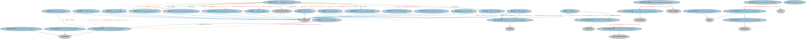

# 机构 MBS 发行本体（Agency MBS Issuance Ontology）结构与公理说明

本文档对应 `AgencyMBSIssuance.rdf` / `AgencyMBSIssuance.ttl`，说明该本体的类、继承关系、属性和公理约定。结构图见 `AgencyMBSIssuance-structure.png`（`AgencyMBSIssuance-structure.svg` 为可缩放版本）。

## 1. 本体概述

定义机构抵押贷款支持证券（agency MBS）的发行流程：由政府支持机构（如房利美、房地美）收购贷款、组建资产池并发行。

**在体系中的位置**：BP 证券发行模块中 MBS 发行的两个子类之一。

**上下游关系**：上游继承 MBS 发行本体；下游关联 SEC 抵押贷款支持证券本体。

**与相近概念的差别**：与私人品牌 MBS 发行的差别——发行主体是政府支持机构，证券带有机构担保，信用风险结构完全不同；这是美国住房金融体系的特有分类。

本本体中类与类的核心关系如下（完整细节见各类小节）：

- **获取抵押贷款（acquire mortgage）** 继承 **发行流程活动（IssuanceProcessActivity）**
- **将抵押贷款加入池中（add mortgage to pool）** 继承 **发行流程活动（IssuanceProcessActivity）**
- **机构抵押贷款池创建流程（agency mortgage pool creation process）** 继承 **零售资产池创建流程（RetailAssetPoolCreationProcess）**
- **分配主标识符（allocate primary identifier）** 继承 **发行流程活动（IssuanceProcessActivity）**
- **评估池的发行适用性（assess pool suitablility for issuance）** 继承 **发行流程活动（IssuanceProcessActivity）**
- **分类抵押贷款（classify mortgage）** 继承 **发行流程活动（IssuanceProcessActivity）**
- **定义抵押贷款池（define mortgage pool）** 继承 **发行流程活动（IssuanceProcessActivity）**
- **起草过手证券条款清单（draft pass through termsheet）** 继承 **条款清单（TermSheet）**
- **拟定发行备忘录（draw up offering memorandum）** 继承 **发行流程活动（IssuanceProcessActivity）**
- **拟定条款清单（draw up termsheet）** 继承 **发行流程活动（IssuanceProcessActivity）**
- **定稿池内容（finalize pool content）** 继承 **发行流程活动（IssuanceProcessActivity）**
- **定稿招募说明书（finalize prospectus）** 继承 **发行流程活动（IssuanceProcessActivity）**
- 其余 27 条关系从略。

## 2. 类（Class）

| 类（Class） | 定义（Definition） |
|---|---|
| 获取抵押贷款（acquire mortgage） | 购入或以其他方式取得抵押贷款，作为入池资产。 |
| 将抵押贷款加入池中（add mortgage to pool） | 把一笔抵押贷款加入抵押贷款池。 |
| 机构抵押贷款池创建流程（agency mortgage pool creation process） | 机构发行方为证券化而创建抵押贷款池的过程。 |
| 分配主标识符（allocate primary identifier） | 为证券分配主要标识符。 |
| 评估池的发行适用性（assess pool suitablility for issuance） | 评估抵押贷款池是否适合用于发行。 |
| 分类抵押贷款（classify mortgage） | 按类别对抵押贷款进行归类。 |
| 定义抵押贷款池（define mortgage pool） | 确定抵押贷款池的构成标准与内容。 |
| 起草过手证券条款清单（draft pass through termsheet） | 起草定义过手证券条款的信息集，最终将成为该工具的合同条款。 Draft of set of information defining the pass thorugh security terms. These will eventually become the contractual terms of the instrument. Term origin:MBS PoC Reviews |
| 拟定发行备忘录（draw up offering memorandum） | 拟定载明未来发行基本信息、供潜在投资者参考的发行备忘录。 |
| 拟定条款清单（draw up termsheet） | 拟定载明发行条款的条款清单。 |
| 定稿池内容（finalize pool content） | 最终确定抵押贷款池的构成内容。 |
| 定稿招募说明书（finalize prospectus） | 最终确定发行的招募说明书。 |
| 识别合格抵押贷款（identify conforming mortgage） | 识别符合该发行人总体要求的抵押贷款。 Identify mortgage conforming to overall requirements for this issuer. |
| 确定承销商（identify underwriter） | 确定本次发行的承销商。 |
| 组建中机构抵押贷款池（in assembly agency mortgage pool） | 尚在组建、内容未定的机构抵押贷款池。 |
| 发行中机构抵押贷款池（in issuance agency mortgage pool） | 正在发行过程中的机构抵押贷款池。 |
| 使证券进入市场（make securities availabe in market） | 使所发行证券可在市场上获得。 |
| 营销发行（market issue） | 对本次发行进行市场营销。 |
| 未发行机构抵押贷款池（not yet issued agency mortgage pool） | 已组建但尚未发行的机构抵押贷款池。 |
| 过手发行招募说明书部分（pass through issue prospectus part） | 过手 MBS 发行招募说明书的一个部分或章节。 A part or section of a prospectus for a pass through MBS issue. Term origin:MBS PoC Reviews |
| 过手 MBS 招募说明书草案（pass through m b s draft prospectus） | 发行机构在营销发行前确定的过手抵押贷款支持证券发行招募说明书草案。 The draft prospectus for a pass through Mortgage Backed Securities issue, as determined by the issuing agency prior to marketing the issue. Certain terms in the draft prospectus will be finalized later in the issuance process to become the actual Prospectus. Term origin:MBS PoC Reviews |
| 过手 MBS 最终招募说明书（pass through m b s final prospectus） | 过手 MBS 发行的最终招募说明书。 Term origin:MBS PoC Reviews |
| 过手 MBS 最终条款清单（pass through m b s final termsheet） | 过手 MBS 发行的最终条款清单，定义 MBS 合同本身的条款。 The final termsheet for the pass through MBS issue. This defines the terms for the MBS contract itself. Term origin:MBS PoC Reviews |
| 过手 MBS 证券化流程（pass through m b s securitization process） | 过手型抵押贷款支持证券的证券化过程。 |
| 过手发行备忘录（pass through offering memorandum） | 过手 MBS 发行的发行备忘录，载明未来发行的基本信息，供潜在投资者参考。 The offering memorandum for a pass through MBS issue, setting out basic information about a future issue, for the information of prospective investors and their agents. Term origin:MBS PoC Reviews |
| 池合格标准（pool conformance criteria） | 抵押贷款须满足方可入池的标准。 |
| 潜在机构 MBS 发行人（potential agency m b s issuer） | 将成为过手 MBS 发行发行方的实体，是发行中大多数活动的主要行为体。 The entity which will become the issuing party for the pass through MBS Issue. This entity is the principal actor in most of the activities involved in the issue. Term origin:MBS PoC Reviews |
| 潜在过手发行承销商（potential pass through issuance underwriter） | 将成为过手 MBS 发行承销商的实体。 The entity which will become the underwriter for the pass through MBS issue. Term origin:MBS PoC Reviews |
| 注册证券（register security） | 交易完成后将证券在注册机构正式注册。 |
| 适合发行（suitable for issue） | 经评估适合用于发行的状态。 |
| 验证合格性（validate conformance） | 自动验证抵押贷款是否符合其拟入池的要求。 The mortgage is automatically validated for conformance to the requirements of the pool in which it is to be included. |

以下按类逐个展开：每个类给出继承关系、相关属性与公理约定；子类在父类之下降一级编号。

### 2.1 获取抵押贷款（acquire mortgage）

定义：购入或以其他方式取得抵押贷款，作为入池资产。

- 父类：**发行流程活动（IssuanceProcessActivity）**

属性：

| 属性 | 定义 | 说明 |
|---|---|---|
| **购买（purchase）** | 购入某项资产。 | 值域：房地产担保贷款 |

公理：

- **购买（purchase）**至少有一个取值，类型是**房地产担保贷款（LoanSecuredByRealEstate）**。

### 2.2 将抵押贷款加入池中（add mortgage to pool）

定义：把一笔抵押贷款加入抵押贷款池。

- 父类：**发行流程活动（IssuanceProcessActivity）**

属性：

| 属性 | 定义 | 说明 |
|---|---|---|
| **加入池中（adds to pool）** | 将某资产加入资产池。 | 值域：房地产担保贷款 |

公理：

- **加入池中（adds to pool）**至少有一个取值，类型是**房地产担保贷款（LoanSecuredByRealEstate）**。

### 2.3 机构抵押贷款池创建流程（agency mortgage pool creation process）

定义：机构发行方为证券化而创建抵押贷款池的过程。

- 父类：**零售资产池创建流程（RetailAssetPoolCreationProcess）**

属性：

| 属性 | 定义 | 说明 |
|---|---|---|
| **具有结束日期（hasEndDate）** | — | — |
| **具有起始日期（hasStartDate）** | — | — |
| **先于（precedes）** | — | — |

公理：

- **先于（precedes）**至少有一个取值，类型是**过手 MBS 证券化流程（pass through m b s securitization process）**。
- **具有结束日期（hasEndDate）**至少有一个取值，类型是**日期（Date）**。
- **具有起始日期（hasStartDate）**至少有一个取值，类型是**日期（Date）**。
- 与**非机构池创建流程（NonAgencyPoolCreationProcess）**互斥：同一个体不能同时属于两者。

### 2.4 分配主标识符（allocate primary identifier）

定义：为证券分配主要标识符。

- 父类：**发行流程活动（IssuanceProcessActivity）**

### 2.5 评估池的发行适用性（assess pool suitablility for issuance）

定义：评估抵押贷款池是否适合用于发行。

- 父类：**发行流程活动（IssuanceProcessActivity）**

### 2.6 分类抵押贷款（classify mortgage）

定义：按类别对抵押贷款进行归类。

- 父类：**发行流程活动（IssuanceProcessActivity）**

属性：

| 属性 | 定义 | 说明 |
|---|---|---|
| **是……的评估（is assessment of）** | 标识评估所针对的对象。 | 值域：房地产担保贷款 |

公理：

- **是……的评估（is assessment of）**至少有一个取值，类型是**房地产担保贷款（LoanSecuredByRealEstate）**。

### 2.7 定义抵押贷款池（define mortgage pool）

定义：确定抵押贷款池的构成标准与内容。

- 父类：**发行流程活动（IssuanceProcessActivity）**

属性：

| 属性 | 定义 | 说明 |
|---|---|---|
| **是……的定义（is defining of）** | 标识该定义所针对的对象。 | 值域：未发行机构抵押贷款池（not yet issued agency mortgage pool） |

公理：

- **是……的定义（is defining of）**至少有一个取值，类型是**未发行机构抵押贷款池（not yet issued agency mortgage pool）**。

### 2.8 起草过手证券条款清单（draft pass through termsheet）

定义：起草定义过手证券条款的信息集，最终将成为该工具的合同条款。

- 父类：**条款清单（TermSheet）**

### 2.9 拟定发行备忘录（draw up offering memorandum）

定义：拟定载明未来发行基本信息、供潜在投资者参考的发行备忘录。

- 父类：**发行流程活动（IssuanceProcessActivity）**

### 2.10 拟定条款清单（draw up termsheet）

定义：拟定载明发行条款的条款清单。

- 父类：**发行流程活动（IssuanceProcessActivity）**

### 2.11 定稿池内容（finalize pool content）

定义：最终确定抵押贷款池的构成内容。

- 父类：**发行流程活动（IssuanceProcessActivity）**

### 2.12 定稿招募说明书（finalize prospectus）

定义：最终确定发行的招募说明书。

- 父类：**发行流程活动（IssuanceProcessActivity）**

### 2.13 识别合格抵押贷款（identify conforming mortgage）

定义：识别符合该发行人总体要求的抵押贷款。

- 父类：**发行流程活动（IssuanceProcessActivity）**

属性：

| 属性 | 定义 | 说明 |
|---|---|---|
| **引用（refersTo）** | — | — |

公理：

- **引用（refersTo）**至少有一个取值，类型是**房地产担保贷款（LoanSecuredByRealEstate）**。

### 2.14 确定承销商（identify underwriter）

定义：确定本次发行的承销商。

- 父类：**发行流程活动（IssuanceProcessActivity）**

属性：

| 属性 | 定义 | 说明 |
|---|---|---|
| **导致任命（results in appointment of）** | 其结果是任命某参与方担任某角色。 | 值域：潜在过手发行承销商（potential pass through issuance underwriter） |

公理：

- **导致任命（results in appointment of）**至少有一个取值，类型是**潜在过手发行承销商（potential pass through issuance underwriter）**。

### 2.15 组建中机构抵押贷款池（in assembly agency mortgage pool）

定义：尚在组建、内容未定的机构抵押贷款池。

- 父类：**机构抵押贷款池（AgencyMortgagePool）**

属性：

| 属性 | 定义 | 说明 |
|---|---|---|
| **具有阶段（hasStage）** | — | — |

公理：

- **具有阶段（hasStage）**至少有一个取值，类型是**组建中（InAssembly）**。

### 2.16 发行中机构抵押贷款池（in issuance agency mortgage pool）

定义：正在发行过程中的机构抵押贷款池。

- 父类：**机构抵押贷款池（AgencyMortgagePool）**

属性：

| 属性 | 定义 | 说明 |
|---|---|---|
| **具有阶段（hasStage）** | — | — |

公理：

- **具有阶段（hasStage）**至少有一个取值，类型是**发行中（InIssuance）**。

### 2.17 使证券进入市场（make securities availabe in market）

定义：使所发行证券可在市场上获得。

- 父类：**发行流程活动（IssuanceProcessActivity）**

### 2.18 营销发行（market issue）

定义：对本次发行进行市场营销。

- 父类：**发行流程活动（IssuanceProcessActivity）**

属性：

| 属性 | 定义 | 说明 |
|---|---|---|
| **具有资源（has resource）** | 标识某过程或活动所使用的资源。 | 值域：过手 MBS 招募说明书草案（pass through m b s draft prospectus） |

公理：

- **具有资源（has resource）**至少有一个取值，类型是**过手 MBS 招募说明书草案（pass through m b s draft prospectus）**。

### 2.19 未发行机构抵押贷款池（not yet issued agency mortgage pool）

定义：已组建但尚未发行的机构抵押贷款池。

- 父类：**机构抵押贷款池（AgencyMortgagePool）**

属性：

| 属性 | 定义 | 说明 |
|---|---|---|
| **具有阶段（hasStage）** | — | — |

公理：

- **具有阶段（hasStage）**至少有一个取值，类型是**尚未发行（NotYetIssued）**。

### 2.20 过手发行招募说明书部分（pass through issue prospectus part）

定义：过手 MBS 发行招募说明书的一个部分或章节。

- 父类：**招募说明书部分（ProspectusPart）**
- 直接子类：**过手 MBS 最终条款清单（pass through m b s final termsheet）**

#### 2.20.1 过手 MBS 最终条款清单（pass through m b s final termsheet）

定义：过手 MBS 发行的最终条款清单，定义 MBS 合同本身的条款。

- 父类：**过手发行招募说明书部分（pass through issue prospectus part）**、**条款清单（TermSheet）**

属性：

| 属性 | 定义 | 说明 |
|---|---|---|
| **具有合同要素（hasContractualElement）** | — | — |

公理：

- **具有合同要素（hasContractualElement）**至少有一个取值，类型是**债券摊销支付条款（BondAmortizationPaymentTerms）**。
- **具有合同要素（hasContractualElement）**至少有一个取值，类型是**票息支付条款（CouponPaymentTerms）**。

### 2.21 过手 MBS 招募说明书草案（pass through m b s draft prospectus）

定义：发行机构在营销发行前确定的过手抵押贷款支持证券发行招募说明书草案。

- 父类：**初步招募说明书（PreliminaryProspectus）**

属性：

| 属性 | 定义 | 说明 |
|---|---|---|
| **先于（precedes）** | — | — |

公理：

- **先于（precedes）**至少有一个取值，类型是**过手 MBS 最终招募说明书（pass through m b s final prospectus）**。

### 2.22 过手 MBS 最终招募说明书（pass through m b s final prospectus）

定义：过手 MBS 发行的最终招募说明书。

- 父类：**抵押支持证券发行招募说明书（MortgageBackedSecurityOfferingProspectus）**

### 2.23 过手 MBS 证券化流程（pass through m b s securitization process）

定义：过手型抵押贷款支持证券的证券化过程。

- 父类：**MBS 证券化流程（MBSSecuritizationProcess）**

属性：

| 属性 | 定义 | 说明 |
|---|---|---|
| **具有结束日期（hasEndDate）** | — | — |
| **具有起始日期（hasStartDate）** | — | — |

公理：

- **具有结束日期（hasEndDate）**至少有一个取值，类型是**日期（Date）**。
- **具有起始日期（hasStartDate）**至少有一个取值，类型是**日期（Date）**。
- 与**分层 MBS 证券化流程（TranchedMBSSecuritizationProcess）**互斥：同一个体不能同时属于两者。

### 2.24 过手发行备忘录（pass through offering memorandum）

定义：过手 MBS 发行的发行备忘录，载明未来发行的基本信息，供潜在投资者参考。

- 父类：**发行文件（OfferingDocument）**

属性：

| 属性 | 定义 | 说明 |
|---|---|---|
| **包含……的细节（includesDetailsAbout）** | — | — |

公理：

- **包含……的细节（includesDetailsAbout）**至少有一个取值，类型是**过手 MBS 最终条款清单（pass through m b s final termsheet）**。

### 2.25 池合格标准（pool conformance criteria）

定义：抵押贷款须满足方可入池的标准。

属性：

| 属性 | 定义 | 说明 |
|---|---|---|
| **为……定义标准（defines criteria for）** | 为某事物定义标准。 | 值域：未发行机构抵押贷款池（not yet issued agency mortgage pool） |
| **最大贷款余额（maximum loan balance）** | 入池贷款允许的最大余额。 | 值域：货币数量 |
| **最低评级（minimum rating）** | 入池或发行所要求的最低评级。 | 值域：投资信用评级 |

公理：

- **为……定义标准（defines criteria for）**至少有一个取值，类型是**未发行机构抵押贷款池（not yet issued agency mortgage pool）**。

### 2.26 潜在机构 MBS 发行人（potential agency m b s issuer）

定义：将成为过手 MBS 发行发行方的实体，是发行中大多数活动的主要行为体。

- 父类：**池支持证券证券化流程参与者（PoolBackedSecuritySecuritizationProcessActor）**

属性：

| 属性 | 定义 | 说明 |
|---|---|---|
| **添加（adds）** | 将某物加入另一事物。 | 值域：将抵押贷款加入池中（add mortgage to pool） |
| **定稿（finalizes）** | 最终确定某事物。 | 值域：定稿池内容（finalize pool content） |
| **标识（identifies）** | 在某情境内识别或确立身份。 | 值域：识别合格抵押贷款（identify conforming mortgage） |
| **购入（purchases）** | 购买某项资产。 | 值域：获取抵押贷款（acquire mortgage） |
| **验证（validates）** | 核验某事物是否符合要求。 | 值域：验证合格性（validate conformance） |
| **评估（evaluates）** | — | — |

公理：

- **定稿（finalizes）**至少有一个取值，类型是**定稿池内容（finalize pool content）**。
- **标识（identifies）**至少有一个取值，类型是**识别合格抵押贷款（identify conforming mortgage）**。
- **添加（adds）**至少有一个取值，类型是**将抵押贷款加入池中（add mortgage to pool）**。
- **评估（evaluates）**至少有一个取值，类型是**分类抵押贷款（classify mortgage）**。
- **评估（evaluates）**至少有一个取值，类型是**评估池的发行适用性（assess pool suitablility for issuance）**。
- **购入（purchases）**至少有一个取值，类型是**获取抵押贷款（acquire mortgage）**。
- **验证（validates）**至少有一个取值，类型是**验证合格性（validate conformance）**。

### 2.27 潜在过手发行承销商（potential pass through issuance underwriter）

定义：将成为过手 MBS 发行承销商的实体。

- 父类：**潜在承销商（PotentialUnderwriter）**

### 2.28 注册证券（register security）

定义：交易完成后将证券在注册机构正式注册。

- 父类：**发行流程活动（IssuanceProcessActivity）**

### 2.29 适合发行（suitable for issue）

定义：经评估适合用于发行的状态。

### 2.30 验证合格性（validate conformance）

定义：自动验证抵押贷款是否符合其拟入池的要求。

- 父类：**发行流程活动（IssuanceProcessActivity）**

属性：

| 属性 | 定义 | 说明 |
|---|---|---|
| **引用（refersTo）** | — | — |

公理：

- **引用（refersTo）**至少有一个取值，类型是**池合格标准（pool conformance criteria）**。

## 3. 其他属性

以下属性未绑定到本体的具体类（定义域在外部本体或未声明）：

对象属性（Object Property）：

| 属性 | 定义 | 说明 |
|---|---|---|
| **分配标识符（allocates identifier）** | 为某事物分配标识符。 | — |

## 4. 依赖（owl:imports，20 个）

本本体通过 `owl:imports` 引入以下本体，各项的中文名称与简介如下：

| 导入本体 | 中文名称 | 简介 |
|---|---|---|
| `BP/SecuritiesIssuance/DebtIssuance.rdf` | 债务发行本体（Debt Issuance Ontology） | 定义债券等债务工具的发行流程与参与方。 |
| `BP/SecuritiesIssuance/IssuanceDocuments.rdf` | 发行文件本体（Issuance Documents Ontology） | 定义证券发行过程中使用的法律文件：募集说明书、条款清单等。 |
| `BP/SecuritiesIssuance/IssuanceProcess.rdf` | 发行流程本体（Issuance Process Ontology） | 定义证券发行的通用流程框架：从筹划、定价到配售的各阶段。 |
| `BP/SecuritiesIssuance/MBSIssuance.rdf` | MBS 发行本体（MBS Issuance Ontology） | 定义抵押贷款支持证券（MBS）发行的通用流程：资产池组建、分层与发售。 |
| `BP/SecuritiesIssuance/PrivateLabelMBSIssuance.rdf` | 私人品牌 MBS 发行本体（Private Label MBS Issuance Ontology） | 定义私人机构（非政府机构）发行抵押贷款支持证券的流程。 |
| `FBC/DebtAndEquities/CreditRatings.rdf` | 信用评级本体（Credit Ratings Ontology） | 定义信用评级、评级机构与评级结果，刻画债务人与债务工具的信用水平。 |
| `FND/Accounting/CurrencyAmount.rdf` | 货币金额本体（Currency Amount Ontology） | 定义「金额＋币种」的货币金额（currency amount）表示，是 FIBO 中表达价格、债务金额、付款额等一切带币种数值的基础构件。 |
| `FND/Agreements/Contracts.rdf` | 合同本体（Contracts Ontology） | 在协议之上定义具有法律约束力的合同（contract）：合同当事方、合同条款、义务与权利，是金融工具与交易合同建模的基石。 |
| `FND/Arrangements/Lifecycles.rdf` | 生命周期本体（Lifecycles Ontology） | 定义生命周期、生命周期阶段与状态转移，用于描述合同、金融工具、机构从创设到终止的演化过程。 |
| `FND/Parties/Parties.rdf` | 参与方本体（Parties Ontology） | 定义参与方（party）、独立主体（autonomous agent）与「角色扮演」（party in role），是 FIBO 全库使用最广的基础本体之一。 |
| `FND/Relations/Relations.rdf` | 关系本体（Relations Ontology） | FIBO 最底层的基础本体，定义参考（reference）、分类（classify）等通用关系与抽象概念，全库普遍依赖。 |
| `FND/Utilities/AnnotationVocabulary.rdf` | FIBO 标注词汇表（FIBO Annotation Vocabulary） | 定义 FIBO 专用的标注属性（如释义来源、成熟度等级），用于本体自身的元数据标注。 |
| `LOAN/RealEstateLoans/Mortgages.rdf` | 抵押贷款本体（Mortgages Ontology） | 定义以不动产为抵押的贷款：抵押物、抵押登记与止赎。 |
| `SEC/Debt/Bonds.rdf` | 债券本体（Bonds Ontology） | 定义债券（bond）：期限、票面利率、付息方式与偿还结构。 |
| `SEC/Debt/MortgageBackedSecurities.rdf` | 抵押贷款支持证券本体（Mortgage-backed Securities Ontology） | 定义抵押贷款支持证券（MBS）：以抵押贷款池为支持的证券。 |
| `SEC/Debt/PoolBackedSecurities.rdf` | 池支持证券本体（Pool-backed Securities Ontology） | 定义以资产池为支持的证券的通用结构：资产池、分层（tranche）与过手安排。 |
| `SEC/Securities/SecuritiesIssuance.rdf` | 证券发行本体（Securities Issuance Ontology） | 定义证券发行（issuance）：发行人、发行条款与发行结果。 |
| `https://www.omg.org/spec/Commons/AnnotationVocabulary/` | OMG 通用标注词汇表（OMG Commons Annotation Vocabulary） | OMG 通用本体库（Commons）中的标注词汇表，提供概念映射等标注属性，FIBO 用它标注术语与外部标准的对应关系。 |
| `https://www.omg.org/spec/Commons/DatesAndTimes/` | OMG 通用日期与时间本体（OMG Commons Dates and Times） | Commons 库中的日期时间本体，定义日期、期间、时间点等通用时间概念。 |
| `https://www.omg.org/spec/Commons/Documents/` | OMG 通用文档本体（OMG Commons Documents） | Commons 库中的文档本体，定义文档及其组成部分的通用概念。 |

## 5. 文件

- 官方 RDF/XML：`AgencyMBSIssuance.rdf`
- 中文 Turtle：`AgencyMBSIssuance.ttl`
- 结构图：`AgencyMBSIssuance-structure.png` / `AgencyMBSIssuance-structure.svg`