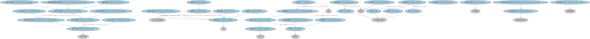

# 债务发行本体（Debt Issuance Ontology）结构与公理说明

本文档对应 `DebtIssuance.rdf` / `DebtIssuance.ttl`，说明该本体的类、继承关系、属性和公理约定。结构图见 `DebtIssuance-structure.png`（`DebtIssuance-structure.svg` 为可缩放版本）。

## 1. 本体概述

定义债券等债务工具的发行流程：承销团组建、簿记建档、定价与分配。

**在体系中的位置**：BP 证券发行模块的品种特化本体之一。

**上下游关系**：上游继承发行流程本体；下游关联 SEC/Debt 各债务工具本体（发行的对象）。

**与相近概念的差别**：与 IPO 发行的差别——债务发行以利率定价和承销团簿记为中心，IPO 以股权估值和路演为中心；与 MBS 发行的差别——普通债务发行没有资产池组建环节。

## 2. 类（Class）

| 类（Class） | 定义（Definition） |
|---|---|
| ABS 证券化流程（a b s securitization process） | 资产支持证券的证券化过程。 |
| 提前再融资（advance refunding） | 以低于存量债券利率发行新债券进行再融资的债券发行。 |
| 资产池创建流程（asset pool creation process） | 创建资产池的过程，资产池随后可作为证券发行的基础资产。 |
| 债券发行计划（bond issuance programme） | 一种债务发行计划，实体可不时按基础招募说明书载明的条款发行债券。 |
| 债券发行（bond offering） | 作为发行计划全部或一部分的一只或多只债券的债务发行。 |
| 附认股权证债券发行（bond offering with warrant） | 发行中附带回股权证的债券发行（ISO 10962 CFI：与一份或多份认股权证一起发行的债券）。 |
| CDO 证券化流程（c d o securitization process） | 债务担保凭证的证券化过程。 |
| 已完成债务池（completed debts pool） | 内容已定稿、可用于发行的债务池。 |
| 信用卡池创建流程（credit card pool creation process） | 创建信用卡应收款资产池的过程。 |
| 债务工具池创建流程（debt instrument pool creation process） | 创建债务工具池的过程。 |
| 债务发行流程信息（debt issuance process information） | 债务证券发行特有的信息。 |
| 债务发行计划（debt issuance programme） | 一段时间内的一系列债务证券发行。 |
| 债务发行目的（debt issuance purpose） | 债务证券发行的目的；在某些情形下也规定须遵循的流程。 |
| 债务证券化流程（debt securitization process） | 将债务资产打包证券化的过程。 |
| 房屋净值信用额度池创建流程（home equity line of credit pool creation process） | 创建房屋净值信用额度（HELOC）资产池的过程。 |
| 组建中（in assembly） | 池或发行处于组建阶段的状态。 |
| 组建中债务池（in assembly debts pool） | 尚在组建、内容未定的债务池。 |
| 发行中（in issuance） | 池或证券处于发行阶段的状态。 |
| 发行流程活动（issuance process activity） | 证券发行流程中的一项活动。 |
| 发布日期（issued） | — |
| 贷款池创建流程（loan pool creation process） | 创建贷款资产池的过程。 |
| MTN 注册（m t n registration） | 中期票据发行计划在相关机构的注册。 |
| 中期票据发行计划（medium term note issuance programme） | 一系列中期票据发行的计划；在其余条款向相关机构注册后再确定到期日的一组发行。 |
| 中期票据发行（medium term note offering） | 中期票据的单次发行。 |
| 市政债发行承销商（muni issue underwriter） | 同意买入投资者未认购之全部债券的参与方。 |
| 新增资金目的（new money purpose） | 为新项目或新用途筹集资金而发行证券。 |
| 尚未发行（not yet issued） | 池或证券尚未进入发行阶段的状态。 |
| 未发行债务池（not yet issued debts pool） | 已组建但尚未发行的债务池。 |
| 池支持证券证券化流程（pool backed security securitization process） | 以资产池为基础发行证券的证券化过程。 |
| 池支持证券证券化流程参与者（pool backed security securitization process actor） | 池支持证券证券化流程中的参与者。 |
| 再融资目的（refunding purpose） | 发行人通过发行新债券对存量债券进行再融资的程序。 |
| 再营销目的（remarketing purpose） | 将原持有人回售的证券重新向公众销售的过程。 |
| 零售资产池创建流程（retail asset pool creation process） | 创建资产池的过程，资产池随后可用作以其为基础资产之证券的发行。 |
| 证券化流程参与者（securitization process actor） | 证券化流程中的参与者。 |
| 承销商承销量（债务）（underwriter takedown for debt） | 承销商经手的债务证券承销数量信息（将记入 DTC）。 |

### 2.1 继承关系（Inheritance）

- ABS 证券化流程（a b s securitization process） ⊑ 池支持证券证券化流程（pool backed security securitization process）
- 提前再融资（advance refunding） ⊑ 再融资目的（refunding purpose）
- 债券发行计划（bond issuance programme） ⊑ 债务发行计划（debt issuance programme）
- 债券发行（bond offering） ⊑ 债务发行
- 附认股权证债券发行（bond offering with warrant） ⊑ 债券发行（bond offering）
- CDO 证券化流程（c d o securitization process） ⊑ 债务证券化流程（debt securitization process）
- 已完成债务池（completed debts pool） ⊑ 债务池
- 信用卡池创建流程（credit card pool creation process） ⊑ 零售资产池创建流程（retail asset pool creation process）
- 债务工具池创建流程（debt instrument pool creation process） ⊑ 资产池创建流程（asset pool creation process）
- 债务发行流程信息（debt issuance process information） ⊑ 交易工具发行流程信息
- 债务发行计划（debt issuance programme） ⊑ 发行计划
- 债务发行目的（debt issuance purpose） ⊑ 目标
- 债务证券化流程（debt securitization process） ⊑ 证券发行流程
- 房屋净值信用额度池创建流程（home equity line of credit pool creation process） ⊑ 零售资产池创建流程（retail asset pool creation process）
- 组建中（in assembly） ⊑ 池生命周期状态选择
- 组建中债务池（in assembly debts pool） ⊑ 债务池
- 发行中（in issuance） ⊑ 池生命周期状态选择
- 发布日期（issued） ⊑ 池生命周期状态选择
- 贷款池创建流程（loan pool creation process） ⊑ 零售资产池创建流程（retail asset pool creation process）
- MTN 注册（m t n registration） ⊑ 注册
- 中期票据发行计划（medium term note issuance programme） ⊑ 债券发行计划（bond issuance programme）
- 中期票据发行（medium term note offering） ⊑ 债券发行（bond offering）
- 市政债发行承销商（muni issue underwriter） ⊑ 证券承销商
- 新增资金目的（new money purpose） ⊑ 债务发行目的（debt issuance purpose）
- 尚未发行（not yet issued） ⊑ 池生命周期状态选择
- 未发行债务池（not yet issued debts pool） ⊑ 债务池
- 池支持证券证券化流程（pool backed security securitization process） ⊑ 债务证券化流程（debt securitization process）
- 池支持证券证券化流程参与者（pool backed security securitization process actor） ⊑ 证券化流程参与者（securitization process actor）
- 再融资目的（refunding purpose） ⊑ 债务发行目的（debt issuance purpose）
- 再营销目的（remarketing purpose） ⊑ 债务发行目的（debt issuance purpose）
- 零售资产池创建流程（retail asset pool creation process） ⊑ 资产池创建流程（asset pool creation process）
- 证券化流程参与者（securitization process actor） ⊑ 证券发行流程参与者
- 承销商承销量（债务）（underwriter takedown for debt） ⊑ 承销商承销量

## 3. 对象属性（Object Property）

| 属性（Property） | 中文（English） | 定义（Definition） | 说明 |
|---|---|---|---|
| fibo-bp-iss-dbti:announces | 公告（announces） | 该公告所涉及的一只或多只证券的发行。 | — |
| fibo-bp-iss-dbti:hasDebtIssuancePurpose | 具有债务发行目的（has debt issuance purpose） | 标识债务证券发行的目的。 | 定义域（domain）：债务发行流程信息（debt issuance process information）；值域（range）：债务发行目的（debt issuance purpose） |
| fibo-bp-iss-dbti:hasOriginalIssueDiscount | 具有原始发行折让（has original issue discount） | 债券或其他债务工具发行时相对于面值的折让。 | 定义域（domain）：债券发行（bond offering）；值域（range）：百分比 |
| fibo-bp-iss-dbti:resultsIn | 导致（results in） | 产生某个结果。 | 值域（range）：潜在分层发行承销商 |
| fibo-bp-iss-dbti:underwriterTakedownAmount | 承销商承销金额（underwriter takedown amount） | 承销商经手的证券承销金额（将记入 DTC）。 | 定义域（domain）：承销商承销量（债务）（underwriter takedown for debt）；值域（range）：货币数量 |

## 4. 数据属性（Datatype Property）

| 属性（Property） | 中文（English） | 定义（Definition） |
|---|---|---|
| fibo-bp-iss-dbti:isBankQualified | 银行合格（is bank qualified） | 发行人在合理预期其在该发行日历年内的发行不超过规定额度时，给予公共目的债券发行的指定。 |

## 5. 公理约定（Axioms）

- 资产池创建流程（asset pool creation process）：先于 some 债务证券化流程（debt securitization process）
- 债券发行计划（bond issuance programme）：包含 some 债券发行（bond offering）
- 附认股权证债券发行（bond offering with warrant）：适用于 some（restriction）
- 附认股权证债券发行（bond offering with warrant） 与 中期票据发行（medium term note offering） 互斥（disjointWith）
- 已完成债务池（completed debts pool）：具有阶段 some 发行中（in issuance）
- 债务发行流程信息（debt issuance process information）：具有债务发行目的（has debt issuance purpose） some 债务发行目的（debt issuance purpose）
- 债务发行计划（debt issuance programme）：包含 some 债务发行
- 债务证券化流程（debt securitization process） 与 债务拍卖流程 互斥（disjointWith）
- 债务证券化流程（debt securitization process） 与 证券承销发行流程 互斥（disjointWith）
- 组建中债务池（in assembly debts pool）：具有阶段 some 组建中（in assembly）
- MTN 注册（m t n registration）：关于 some 中期票据发行计划（medium term note issuance programme）
- 中期票据发行计划（medium term note issuance programme）：包含 some 中期票据发行（medium term note offering）
- 未发行债务池（not yet issued debts pool）：具有阶段 some 尚未发行（not yet issued）
- 池支持证券证券化流程参与者（pool backed security securitization process actor）：评估 some 发行流程活动
- 零售资产池创建流程（retail asset pool creation process）：由……生产 some 债务池
- 零售资产池创建流程（retail asset pool creation process）：先于 some 池支持证券证券化流程（pool backed security securitization process）

## 6. 依赖（owl:imports，22 个）

本本体通过 `owl:imports` 引入以下本体，各项的中文名称与简介如下：

| 导入本体 | 中文名称 | 简介 |
|---|---|---|
| `BP/SecuritiesIssuance/IssuanceProcess.rdf` | 发行流程本体（Issuance Process Ontology） | 定义证券发行的通用流程框架：从筹划、定价到配售的各阶段。 |
| `BP/SecuritiesIssuance/MuniIssuance.rdf` | 市政债发行本体（Municipal Issuance Ontology） | 定义美国市政债券（municipal bond）的发行流程。 |
| `BP/SecuritiesIssuance/PrivateLabelMBSIssuance.rdf` | 私人品牌 MBS 发行本体（Private Label MBS Issuance Ontology） | 定义私人机构（非政府机构）发行抵押贷款支持证券的流程。 |
| `DER/DerivativesContracts/RightsAndWarrants.rdf` | 权利与权证本体（Rights and Warrants Ontology） | 定义认股权证（warrant）、配股权（rights）等赋予持有人购买权利的证券。 |
| `FBC/ProductsAndServices/FinancialProductsAndServices.rdf` | 金融产品与服务本体（Financial Products and Services Ontology） | 定义金融产品（financial product）与金融服务（financial service）及其提供、购买关系。 |
| `FND/Accounting/CurrencyAmount.rdf` | 货币金额本体（Currency Amount Ontology） | 定义「金额＋币种」的货币金额（currency amount）表示，是 FIBO 中表达价格、债务金额、付款额等一切带币种数值的基础构件。 |
| `FND/Agreements/Contracts.rdf` | 合同本体（Contracts Ontology） | 在协议之上定义具有法律约束力的合同（contract）：合同当事方、合同条款、义务与权利，是金融工具与交易合同建模的基石。 |
| `FND/Arrangements/Lifecycles.rdf` | 生命周期本体（Lifecycles Ontology） | 定义生命周期、生命周期阶段与状态转移，用于描述合同、金融工具、机构从创设到终止的演化过程。 |
| `FND/GoalsAndObjectives/Objectives.rdf` | 目标本体（Objectives Ontology） | 定义目标（objective）及其与组织、计划的关系，用于表达机构的经营目标与投资目标。 |
| `FND/Relations/Relations.rdf` | 关系本体（Relations Ontology） | FIBO 最底层的基础本体，定义参考（reference）、分类（classify）等通用关系与抽象概念，全库普遍依赖。 |
| `FND/Utilities/AnnotationVocabulary.rdf` | FIBO 标注词汇表（FIBO Annotation Vocabulary） | 定义 FIBO 专用的标注属性（如释义来源、成熟度等级），用于本体自身的元数据标注。 |
| `SEC/Debt/Bonds.rdf` | 债券本体（Bonds Ontology） | 定义债券（bond）：期限、票面利率、付息方式与偿还结构。 |
| `SEC/Debt/DebtInstruments.rdf` | 债务工具本体（Debt Instruments Ontology） | 定义债务工具（debt instrument）的通用概念：可交易的债权凭证，是债券、票据等的上位模型。 |
| `SEC/Debt/PoolBackedSecurities.rdf` | 池支持证券本体（Pool-backed Securities Ontology） | 定义以资产池为支持的证券的通用结构：资产池、分层（tranche）与过手安排。 |
| `SEC/Securities/Pools.rdf` | 证券池本体（Securities Pools Ontology） | 定义证券池（pool）：归集起来作为证券化基础的一组资产。 |
| `SEC/Securities/SecuritiesIssuance.rdf` | 证券发行本体（Securities Issuance Ontology） | 定义证券发行（issuance）：发行人、发行条款与发行结果。 |
| `https://www.omg.org/spec/Commons/AnnotationVocabulary/` | OMG 通用标注词汇表（OMG Commons Annotation Vocabulary） | OMG 通用本体库（Commons）中的标注词汇表，提供概念映射等标注属性，FIBO 用它标注术语与外部标准的对应关系。 |
| `https://www.omg.org/spec/Commons/Collections/` | OMG 通用集合本体（OMG Commons Collections） | Commons 库中的集合本体，定义集合、成员等通用概念。 |
| `https://www.omg.org/spec/Commons/ContextualDesignators/` | OMG 通用语境指称本体（OMG Commons Contextual Designators） | Commons 库中的语境指称本体，定义「在某个语境下指代某物的名称/符号」，是地址、账户号码等语境相关标识的基础。 |
| `https://www.omg.org/spec/Commons/DatesAndTimes/` | OMG 通用日期与时间本体（OMG Commons Dates and Times） | Commons 库中的日期时间本体，定义日期、期间、时间点等通用时间概念。 |
| `https://www.omg.org/spec/Commons/Documents/` | OMG 通用文档本体（OMG Commons Documents） | Commons 库中的文档本体，定义文档及其组成部分的通用概念。 |
| `https://www.omg.org/spec/Commons/QuantitiesAndUnits/` | OMG 通用量与单位本体（OMG Commons Quantities and Units） | Commons 库中的量与单位本体，定义数量、度量单位、量纲的通用概念，支撑金额、比率等数值表达。 |

## 7. 文件

- 官方 RDF/XML：`DebtIssuance.rdf`
- 中文 Turtle：`DebtIssuance.ttl`
- 结构图：`DebtIssuance-structure.png` / `DebtIssuance-structure.svg`