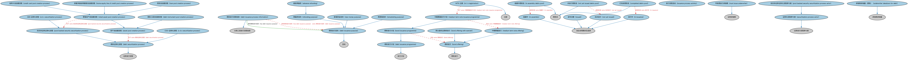

# 债务发行本体（Debt Issuance Ontology）结构与公理说明

本文档对应 `DebtIssuance.rdf` / `DebtIssuance.ttl`，说明该本体的类、继承关系、属性和公理约定。结构图见 `DebtIssuance-structure.png`（`DebtIssuance-structure.svg` 为可缩放版本）。

## 1. 本体概述

定义债券等债务工具的发行流程：承销团组建、簿记建档、定价与分配。

**在体系中的位置**：BP 证券发行模块的品种特化本体之一。

**上下游关系**：上游继承发行流程本体；下游关联 SEC/Debt 各债务工具本体（发行的对象）。

**与相近概念的差别**：与 IPO 发行的差别——债务发行以利率定价和承销团簿记为中心，IPO 以股权估值和路演为中心；与 MBS 发行的差别——普通债务发行没有资产池组建环节。

本本体中类与类的核心关系如下（完整细节见各类小节）：

- **ABS 证券化流程（a b s securitization process）** 继承 **池支持证券证券化流程（pool backed security securitization process）**
- **提前再融资（advance refunding）** 继承 **再融资目的（refunding purpose）**
- **债券发行计划（bond issuance programme）** 继承 **债务发行计划（debt issuance programme）**
- **债券发行（bond offering）** 继承 **债务发行（DebtOffering）**
- **附认股权证债券发行（bond offering with warrant）** 继承 **债券发行（bond offering）**
- **CDO 证券化流程（c d o securitization process）** 继承 **债务证券化流程（debt securitization process）**
- **已完成债务池（completed debts pool）** 继承 **债务池（DebtPool）**
- **信用卡池创建流程（credit card pool creation process）** 继承 **零售资产池创建流程（retail asset pool creation process）**
- **债务工具池创建流程（debt instrument pool creation process）** 继承 **资产池创建流程（asset pool creation process）**
- **债务发行流程信息（debt issuance process information）** 继承 **交易工具发行流程信息（TradedInstrumentIssuanceProcessInformation）**
- **债务发行计划（debt issuance programme）** 继承 **发行计划（IssuanceProgramme）**
- **债务发行目的（debt issuance purpose）** 继承 **目标（Objective）**
- 其余 22 条关系从略。

## 2. 类（Class）

| 类（Class） | 定义（Definition） |
|---|---|
| ABS 证券化流程（a b s securitization process） | 资产支持证券的证券化过程。 |
| 提前再融资（advance refunding） | 以低于存量债券利率发行新债券进行再融资的债券发行。 refunding in which bond issuance in which new bonds are sold at a lower rate than outstanding ones |
| 资产池创建流程（asset pool creation process） | 创建资产池的过程，资产池随后可作为证券发行的基础资产。 |
| 债券发行计划（bond issuance programme） | 一种债务发行计划，实体可不时按基础招募说明书载明的条款发行债券。 a debt issuance programe under which an entity may, from time to time, issue bonds under the terms and conditions specified in the base prospectus for that programme |
| 债券发行（bond offering） | 作为发行计划全部或一部分的一只或多只债券的债务发行。 a debt offering of one or more bonds, as all or part of an issuance programme |
| 附认股权证债券发行（bond offering with warrant） | 发行中附带回股权证的债券发行（ISO 10962 CFI：与一份或多份认股权证一起发行的债券）。 a bond offering where the issue includes a warrant; Further notes: ISO 10962 CFI definition is A bond that is issued together with one or more warrant(s) attached as part of the offer, the warrant(s) granting the holder the right to purchase a designated security, often the common stock of the issuer of the debt, at a specified price. Review notes: This need not be any specific type of bond. The warrant is used as a sweetener to encourage people to subscribe to a new bond issue. The Bond and the Warrant trade together as a unit (called "Bond Unit"). |
| CDO 证券化流程（c d o securitization process） | 债务担保凭证的证券化过程。 |
| 已完成债务池（completed debts pool） | 内容已定稿、可用于发行的债务池。 |
| 信用卡池创建流程（credit card pool creation process） | 创建信用卡应收款资产池的过程。 |
| 债务工具池创建流程（debt instrument pool creation process） | 创建债务工具池的过程。 |
| 债务发行流程信息（debt issuance process information） | 债务证券发行特有的信息。 information specific to the issuance of a debt security |
| 债务发行计划（debt issuance programme） | 一段时间内的一系列债务证券发行。 a series of debt security issuances over time |
| 债务发行目的（debt issuance purpose） | 债务证券发行的目的；在某些情形下也规定须遵循的流程。 purpose for the issuance of a debt security; also defines processes to be followed in some instances |
| 债务证券化流程（debt securitization process） | 将债务资产打包证券化的过程。 |
| 房屋净值信用额度池创建流程（home equity line of credit pool creation process） | 创建房屋净值信用额度（HELOC）资产池的过程。 |
| 组建中（in assembly） | 池或发行处于组建阶段的状态。 |
| 组建中债务池（in assembly debts pool） | 尚在组建、内容未定的债务池。 |
| 发行中（in issuance） | 池或证券处于发行阶段的状态。 |
| 发行流程活动（issuance process activity） | 证券发行流程中的一项活动。 An activity within the process of securities issuance. |
| 发布日期（issued） | — |
| 贷款池创建流程（loan pool creation process） | 创建贷款资产池的过程。 |
| MTN 注册（m t n registration） | 中期票据发行计划在相关机构的注册。 |
| 中期票据发行计划（medium term note issuance programme） | 一系列中期票据发行的计划；在其余条款向相关机构注册后再确定到期日的一组发行。 a program of offerings of medium term notes; a set of issues where the maturity is defined after the rest of the terms have been registered with some authority; these are registered up front so that then the company wants to borrow more money they don't have to go through the registration period but have the facility up front to issue another security. |
| 中期票据发行（medium term note offering） | 中期票据的单次发行。 |
| 市政债发行承销商（muni issue underwriter） | 同意买入投资者未认购之全部债券的参与方。 The party which agrees to buy any certificates that are not bought by investors Term origin:DTCC |
| 新增资金目的（new money purpose） | 为新项目或新用途筹集资金而发行证券。 securities issued to raise funds for a new project or purpose |
| 尚未发行（not yet issued） | 池或证券尚未进入发行阶段的状态。 |
| 未发行债务池（not yet issued debts pool） | 已组建但尚未发行的债务池。 |
| 池支持证券证券化流程（pool backed security securitization process） | 以资产池为基础发行证券的证券化过程。 |
| 池支持证券证券化流程参与者（pool backed security securitization process actor） | 池支持证券证券化流程中的参与者。 |
| 再融资目的（refunding purpose） | 发行人通过发行新债券对存量债券进行再融资的程序。 a procedure whereby an issuer refinances outstanding bonds by issuing new bonds |
| 再营销目的（remarketing purpose） | 将原持有人回售的证券重新向公众销售的过程。 the process of reselling securities to the public that have been tendered for purchase by the previous owners thereof |
| 零售资产池创建流程（retail asset pool creation process） | 创建资产池的过程，资产池随后可用作以其为基础资产之证券的发行。 The process by which pools of assets are created. These may then be used in the issue of securities based on those asset pools as underlying. |
| 证券化流程参与者（securitization process actor） | 证券化流程中的参与者。 |
| 承销商承销量（债务）（underwriter takedown for debt） | 承销商经手的债务证券承销数量信息（将记入 DTC）。 information on takedown quantity of the debt security handled by the underwriter (that will be brought into DTC) |

以下按类逐个展开：每个类给出继承关系、相关属性与公理约定；子类在父类之下降一级编号。

### 2.1 资产池创建流程（asset pool creation process）

定义：创建资产池的过程，资产池随后可作为证券发行的基础资产。

- 直接子类：**债务工具池创建流程（debt instrument pool creation process）**、**零售资产池创建流程（retail asset pool creation process）**

属性：

| 属性 | 定义 | 说明 |
|---|---|---|
| **先于（precedes）** | — | — |

公理：

- **先于（precedes）**至少有一个取值，类型是**债务证券化流程（debt securitization process）**。

#### 2.1.1 债务工具池创建流程（debt instrument pool creation process）

定义：创建债务工具池的过程。

- 父类：**资产池创建流程（asset pool creation process）**

#### 2.1.2 零售资产池创建流程（retail asset pool creation process）

定义：创建资产池的过程，资产池随后可用作以其为基础资产之证券的发行。

- 父类：**资产池创建流程（asset pool creation process）**
- 直接子类：**信用卡池创建流程（credit card pool creation process）**、**房屋净值信用额度池创建流程（home equity line of credit pool creation process）**、**贷款池创建流程（loan pool creation process）**

属性：

| 属性 | 定义 | 说明 |
|---|---|---|
| **由……生产（isProducedBy）** | — | — |
| **先于（precedes）** | — | — |

公理：

- **先于（precedes）**至少有一个取值，类型是**池支持证券证券化流程（pool backed security securitization process）**。
- **由……生产（isProducedBy）**至少有一个取值，类型是**债务池（DebtPool）**。

##### 2.1.2.1 信用卡池创建流程（credit card pool creation process）

定义：创建信用卡应收款资产池的过程。

- 父类：**零售资产池创建流程（retail asset pool creation process）**

##### 2.1.2.2 房屋净值信用额度池创建流程（home equity line of credit pool creation process）

定义：创建房屋净值信用额度（HELOC）资产池的过程。

- 父类：**零售资产池创建流程（retail asset pool creation process）**

##### 2.1.2.3 贷款池创建流程（loan pool creation process）

定义：创建贷款资产池的过程。

- 父类：**零售资产池创建流程（retail asset pool creation process）**

### 2.2 债券发行（bond offering）

定义：作为发行计划全部或一部分的一只或多只债券的债务发行。

- 父类：**债务发行（DebtOffering）**
- 直接子类：**附认股权证债券发行（bond offering with warrant）**、**中期票据发行（medium term note offering）**

属性：

| 属性 | 定义 | 说明 |
|---|---|---|
| **具有原始发行折让（has original issue discount）** | 债券或其他债务工具发行时相对于面值的折让。 discount from par value at the time a bond or other debt instrument is issued | 值域：百分比 |
| **银行合格（is bank qualified）** | 发行人在合理预期其在该发行日历年内的发行不超过规定额度时，给予公共目的债券发行的指定。 designation given to a public purpose bond offering by the issuer if it reasonably expects to issue in the calendar year of such offering no more than $10 million par amount of bonds of the type required to be included in making such calculation under the Internal Revenue Code.  When purchased by a commercial bank for its portfolio, the bank may receive an 80% tax deduction for the interest cost of carry for the issue.  A bond that is bank qualified is also known as a qualified tax-exempt obligation. | 值域：xsd:boolean |

#### 2.2.1 附认股权证债券发行（bond offering with warrant）

定义：发行中附带回股权证的债券发行（ISO 10962 CFI：与一份或多份认股权证一起发行的债券）。

- 父类：**债券发行（bond offering）**

属性：

| 属性 | 定义 | 说明 |
|---|---|---|
| **适用于（appliesTo）** | — | — |

公理：

- **适用于（appliesTo）**至少有一个取值，该取值满足：该属性存在取值约束。
- 与**中期票据发行（medium term note offering）**互斥：同一个体不能同时属于两者。

#### 2.2.2 中期票据发行（medium term note offering）

定义：中期票据的单次发行。

- 父类：**债券发行（bond offering）**

### 2.3 已完成债务池（completed debts pool）

定义：内容已定稿、可用于发行的债务池。

- 父类：**债务池（DebtPool）**

属性：

| 属性 | 定义 | 说明 |
|---|---|---|
| **具有阶段（hasStage）** | — | — |

公理：

- **具有阶段（hasStage）**至少有一个取值，类型是**发行中（in issuance）**。

### 2.4 债务发行流程信息（debt issuance process information）

定义：债务证券发行特有的信息。

- 父类：**交易工具发行流程信息（TradedInstrumentIssuanceProcessInformation）**

属性：

| 属性 | 定义 | 说明 |
|---|---|---|
| **具有债务发行目的（has debt issuance purpose）** | 标识债务证券发行的目的。 | 值域：债务发行目的（debt issuance purpose） |

公理：

- **具有债务发行目的（has debt issuance purpose）**至少有一个取值，类型是**债务发行目的（debt issuance purpose）**。

### 2.5 债务发行计划（debt issuance programme）

定义：一段时间内的一系列债务证券发行。

- 父类：**发行计划（IssuanceProgramme）**
- 直接子类：**债券发行计划（bond issuance programme）**

属性：

| 属性 | 定义 | 说明 |
|---|---|---|
| **包含（comprises）** | — | — |

公理：

- **包含（comprises）**至少有一个取值，类型是**债务发行（DebtOffering）**。

#### 2.5.1 债券发行计划（bond issuance programme）

定义：一种债务发行计划，实体可不时按基础招募说明书载明的条款发行债券。

- 父类：**债务发行计划（debt issuance programme）**
- 直接子类：**中期票据发行计划（medium term note issuance programme）**

属性：

| 属性 | 定义 | 说明 |
|---|---|---|
| **包含（comprises）** | — | — |

公理：

- **包含（comprises）**至少有一个取值，类型是**债券发行（bond offering）**。

##### 2.5.1.1 中期票据发行计划（medium term note issuance programme）

定义：一系列中期票据发行的计划；在其余条款向相关机构注册后再确定到期日的一组发行。

- 父类：**债券发行计划（bond issuance programme）**

属性：

| 属性 | 定义 | 说明 |
|---|---|---|
| **包含（comprises）** | — | — |

公理：

- **包含（comprises）**至少有一个取值，类型是**中期票据发行（medium term note offering）**。

### 2.6 债务发行目的（debt issuance purpose）

定义：债务证券发行的目的；在某些情形下也规定须遵循的流程。

- 父类：**目标（Objective）**
- 直接子类：**新增资金目的（new money purpose）**、**再融资目的（refunding purpose）**、**再营销目的（remarketing purpose）**

#### 2.6.1 新增资金目的（new money purpose）

定义：为新项目或新用途筹集资金而发行证券。

- 父类：**债务发行目的（debt issuance purpose）**

#### 2.6.2 再融资目的（refunding purpose）

定义：发行人通过发行新债券对存量债券进行再融资的程序。

- 父类：**债务发行目的（debt issuance purpose）**
- 直接子类：**提前再融资（advance refunding）**

##### 2.6.2.1 提前再融资（advance refunding）

定义：以低于存量债券利率发行新债券进行再融资的债券发行。

- 父类：**再融资目的（refunding purpose）**

#### 2.6.3 再营销目的（remarketing purpose）

定义：将原持有人回售的证券重新向公众销售的过程。

- 父类：**债务发行目的（debt issuance purpose）**

### 2.7 债务证券化流程（debt securitization process）

定义：将债务资产打包证券化的过程。

- 父类：**证券发行流程（SecuritiesIssuanceProcess）**
- 直接子类：**CDO 证券化流程（c d o securitization process）**、**池支持证券证券化流程（pool backed security securitization process）**

公理：

- 与**债务拍卖流程（DebtAuctionProcess）**互斥：同一个体不能同时属于两者。
- 与**证券承销发行流程（SecuritiesUnderwritingIssuanceProcess）**互斥：同一个体不能同时属于两者。

#### 2.7.1 CDO 证券化流程（c d o securitization process）

定义：债务担保凭证的证券化过程。

- 父类：**债务证券化流程（debt securitization process）**

#### 2.7.2 池支持证券证券化流程（pool backed security securitization process）

定义：以资产池为基础发行证券的证券化过程。

- 父类：**债务证券化流程（debt securitization process）**
- 直接子类：**ABS 证券化流程（a b s securitization process）**

##### 2.7.2.1 ABS 证券化流程（a b s securitization process）

定义：资产支持证券的证券化过程。

- 父类：**池支持证券证券化流程（pool backed security securitization process）**

### 2.8 组建中（in assembly）

定义：池或发行处于组建阶段的状态。

- 父类：**池生命周期状态选择（PoolLifecycleStateSelection）**

### 2.9 组建中债务池（in assembly debts pool）

定义：尚在组建、内容未定的债务池。

- 父类：**债务池（DebtPool）**

属性：

| 属性 | 定义 | 说明 |
|---|---|---|
| **具有阶段（hasStage）** | — | — |

公理：

- **具有阶段（hasStage）**至少有一个取值，类型是**组建中（in assembly）**。

### 2.10 发行中（in issuance）

定义：池或证券处于发行阶段的状态。

- 父类：**池生命周期状态选择（PoolLifecycleStateSelection）**

### 2.11 发行流程活动（issuance process activity）

定义：证券发行流程中的一项活动。

### 2.12 发布日期（issued）

- 父类：**池生命周期状态选择（PoolLifecycleStateSelection）**

### 2.13 MTN 注册（m t n registration）

定义：中期票据发行计划在相关机构的注册。

- 父类：**注册（Registration）**

属性：

| 属性 | 定义 | 说明 |
|---|---|---|
| **关于（isAbout）** | — | — |

公理：

- **关于（isAbout）**至少有一个取值，类型是**中期票据发行计划（medium term note issuance programme）**。

### 2.14 市政债发行承销商（muni issue underwriter）

定义：同意买入投资者未认购之全部债券的参与方。

- 父类：**证券承销商（SecurityUnderwriter）**

### 2.15 尚未发行（not yet issued）

定义：池或证券尚未进入发行阶段的状态。

- 父类：**池生命周期状态选择（PoolLifecycleStateSelection）**

### 2.16 未发行债务池（not yet issued debts pool）

定义：已组建但尚未发行的债务池。

- 父类：**债务池（DebtPool）**

属性：

| 属性 | 定义 | 说明 |
|---|---|---|
| **具有阶段（hasStage）** | — | — |

公理：

- **具有阶段（hasStage）**至少有一个取值，类型是**尚未发行（not yet issued）**。

### 2.17 证券化流程参与者（securitization process actor）

定义：证券化流程中的参与者。

- 父类：**证券发行流程参与者（SecuritiesIssuanceProcessActor）**
- 直接子类：**池支持证券证券化流程参与者（pool backed security securitization process actor）**

#### 2.17.1 池支持证券证券化流程参与者（pool backed security securitization process actor）

定义：池支持证券证券化流程中的参与者。

- 父类：**证券化流程参与者（securitization process actor）**

属性：

| 属性 | 定义 | 说明 |
|---|---|---|
| **评估（evaluates）** | — | — |

公理：

- **评估（evaluates）**至少有一个取值，类型是**发行流程活动（IssuanceProcessActivity）**。

### 2.18 承销商承销量（债务）（underwriter takedown for debt）

定义：承销商经手的债务证券承销数量信息（将记入 DTC）。

- 父类：**承销商承销量（UnderwriterTakedown）**

属性：

| 属性 | 定义 | 说明 |
|---|---|---|
| **承销商承销金额（underwriter takedown amount）** | 承销商经手的证券承销金额（将记入 DTC）。 Takedown amount of the security handled by the underwriter(that will be brought into DTC). | 值域：货币数量 |

## 3. 其他属性

以下属性未绑定到本体的具体类（定义域在外部本体或未声明）：

对象属性（Object Property）：

| 属性 | 定义 | 说明 |
|---|---|---|
| **公告（announces）** | 该公告所涉及的一只或多只证券的发行。 The issue of one or more securities that the announcement pertains to. | — |
| **导致（results in）** | 产生某个结果。 | 值域：潜在分层发行承销商 |

## 4. 依赖（owl:imports，22 个）

本本体通过 `owl:imports` 引入以下本体，各项的中文名称与简介如下：

| 导入本体 | 中文名称 | 简介 |
|---|---|---|
| `BP/SecuritiesIssuance/IssuanceProcess.rdf` | 发行流程本体（Issuance Process Ontology） | 定义证券发行的通用流程框架：从筹划、定价到配售的各阶段。 |
| `BP/SecuritiesIssuance/MuniIssuance.rdf` | 市政债发行本体（Municipal Issuance Ontology） | 定义美国市政债券（municipal bond）的发行流程。 |
| `BP/SecuritiesIssuance/PrivateLabelMBSIssuance.rdf` | 私人品牌 MBS 发行本体（Private Label MBS Issuance Ontology） | 定义私人机构（非政府机构）发行抵押贷款支持证券的流程。 |
| `DER/DerivativesContracts/RightsAndWarrants.rdf` | 权利与权证本体（Rights and Warrants Ontology） | 定义认股权证（warrant）、配股权（rights）等赋予持有人购买权利的证券。 |
| `FBC/ProductsAndServices/FinancialProductsAndServices.rdf` | 金融产品与服务本体（Financial Products and Services Ontology） | 定义金融产品（financial product）与金融服务（financial service）及其提供、购买关系。 |
| `FND/Accounting/CurrencyAmount.rdf` | 货币金额本体（Currency Amount Ontology） | 定义「金额＋币种」的货币金额（currency amount）表示，是 FIBO 中表达价格、债务金额、付款额等一切带币种数值的基础构件。 |
| `FND/Agreements/Contracts.rdf` | 合同本体（Contracts Ontology） | 在协议之上定义具有法律约束力的合同（contract）：合同当事方、合同条款、义务与权利，是金融工具与交易合同建模的基石。 |
| `FND/Arrangements/Lifecycles.rdf` | 生命周期本体（Lifecycles Ontology） | 定义生命周期、生命周期阶段与状态转移，用于描述合同、金融工具、机构从创设到终止的演化过程。 |
| `FND/GoalsAndObjectives/Objectives.rdf` | 目标本体（Objectives Ontology） | 定义目标（objective）及其与组织、计划的关系，用于表达机构的经营目标与投资目标。 |
| `FND/Relations/Relations.rdf` | 关系本体（Relations Ontology） | FIBO 最底层的基础本体，定义参考（reference）、分类（classify）等通用关系与抽象概念，全库普遍依赖。 |
| `FND/Utilities/AnnotationVocabulary.rdf` | FIBO 标注词汇表（FIBO Annotation Vocabulary） | 定义 FIBO 专用的标注属性（如释义来源、成熟度等级），用于本体自身的元数据标注。 |
| `SEC/Debt/Bonds.rdf` | 债券本体（Bonds Ontology） | 定义债券（bond）：期限、票面利率、付息方式与偿还结构。 |
| `SEC/Debt/DebtInstruments.rdf` | 债务工具本体（Debt Instruments Ontology） | 定义债务工具（debt instrument）的通用概念：可交易的债权凭证，是债券、票据等的上位模型。 |
| `SEC/Debt/PoolBackedSecurities.rdf` | 池支持证券本体（Pool-backed Securities Ontology） | 定义以资产池为支持的证券的通用结构：资产池、分层（tranche）与过手安排。 |
| `SEC/Securities/Pools.rdf` | 证券池本体（Securities Pools Ontology） | 定义证券池（pool）：归集起来作为证券化基础的一组资产。 |
| `SEC/Securities/SecuritiesIssuance.rdf` | 证券发行本体（Securities Issuance Ontology） | 定义证券发行（issuance）：发行人、发行条款与发行结果。 |
| `https://www.omg.org/spec/Commons/AnnotationVocabulary/` | OMG 通用标注词汇表（OMG Commons Annotation Vocabulary） | OMG 通用本体库（Commons）中的标注词汇表，提供概念映射等标注属性，FIBO 用它标注术语与外部标准的对应关系。 |
| `https://www.omg.org/spec/Commons/Collections/` | OMG 通用集合本体（OMG Commons Collections） | Commons 库中的集合本体，定义集合、成员等通用概念。 |
| `https://www.omg.org/spec/Commons/ContextualDesignators/` | OMG 通用语境指称本体（OMG Commons Contextual Designators） | Commons 库中的语境指称本体，定义「在某个语境下指代某物的名称/符号」，是地址、账户号码等语境相关标识的基础。 |
| `https://www.omg.org/spec/Commons/DatesAndTimes/` | OMG 通用日期与时间本体（OMG Commons Dates and Times） | Commons 库中的日期时间本体，定义日期、期间、时间点等通用时间概念。 |
| `https://www.omg.org/spec/Commons/Documents/` | OMG 通用文档本体（OMG Commons Documents） | Commons 库中的文档本体，定义文档及其组成部分的通用概念。 |
| `https://www.omg.org/spec/Commons/QuantitiesAndUnits/` | OMG 通用量与单位本体（OMG Commons Quantities and Units） | Commons 库中的量与单位本体，定义数量、度量单位、量纲的通用概念，支撑金额、比率等数值表达。 |

## 5. 文件

- 官方 RDF/XML：`DebtIssuance.rdf`
- 中文 Turtle：`DebtIssuance.ttl`
- 结构图：`DebtIssuance-structure.png` / `DebtIssuance-structure.svg`