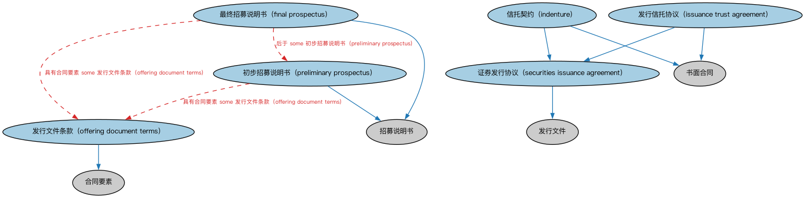

# 发行文件本体（Issuance Documents Ontology）结构与公理说明

本文档对应 `IssuanceDocuments.rdf` / `IssuanceDocuments.ttl`，说明该本体的类、继承关系、属性和公理约定。结构图见 `IssuanceDocuments-structure.png`（`IssuanceDocuments-structure.svg` 为可缩放版本）。

## 1. 本体概述

定义证券发行过程中使用的法律文件：募集说明书（prospectus）、条款清单（term sheet）、发行公告等。

**在体系中的位置**：BP 证券发行模块的文书配套本体。

**上下游关系**：上游依赖 FND 文档本体与发行流程本体；下游被各品种发行本体引用（每种发行都有其必备文件）。

**与相近概念的差别**：与 FND/Arrangements/Documents 的差别——FND 定义文档的通用概念，本本体专指证券发行场景的具体文书类型及其在流程中的作用。

本本体中类与类的核心关系如下（完整细节见各类小节）：

- **最终招募说明书（final prospectus）** 继承 **招募说明书（Prospectus）**
- **信托契约（indenture）** 继承 **证券发行协议（securities issuance agreement）**
- **信托契约（indenture）** 继承 **书面合同（WrittenContract）**
- **发行信托协议（issuance trust agreement）** 继承 **证券发行协议（securities issuance agreement）**
- **发行信托协议（issuance trust agreement）** 继承 **书面合同（WrittenContract）**
- **发行文件条款（offering document terms）** 继承 **合同要素（ContractualElement）**
- **初步招募说明书（preliminary prospectus）** 继承 **招募说明书（Prospectus）**
- **证券发行协议（securities issuance agreement）** 继承 **发行文件（OfferingDocument）**

## 2. 类（Class）

| 类（Class） | 定义（Definition） |
|---|---|
| 最终招募说明书（final prospectus） | 描述发行事项的最终招募说明书，包括发行本身的事实（如截止日期）及已知的相关事实。 The final Prospectus for an issue describes the Offer Issue, including facts about the issue itself such as closing dates, and known facts about the securities that will form part of that issue. |
| 信托契约（indenture） | 债券与信用债券据以发行的书面合同，又称「信托契据」，载明到期日、利率、赎回条款等。 A written contract, also known as a "Deed of Trust", under which bonds and debentures are issued, setting forth maturity date, interest rate, redemption rights, call privileges and other terms. Under the rules of the Trust Indenture Act of 1939, the contract is executed by the issuer and a trustee who acts on behalf of the bondholders. |
| 发行信托协议（issuance trust agreement） | 就某次证券发行设立的信托协议。 |
| 发行文件条款（offering document terms） | 发行文件中包含的、在发行时产生法律约束力的条款。 terms included in an offering document that become legally binding at issue |
| 初步招募说明书（preliminary prospectus） | 发行营销前确定的招募说明书草案，其中某些条款将在发行后续阶段定稿。 The draft prospectus for the issue, as determined prior to marketing the issue. Certain terms in the draft prospectus will be finalized later in the issuance process to become the actual Prospectus. Term origin:DTCC issuance Reviews |
| 证券发行协议（securities issuance agreement） | 就某次拟议证券发行订立的正式协议、契据或合同。 A formal agreement, deed or contract in respect of some intended securities issuance. |

以下按类逐个展开：每个类给出继承关系、相关属性与公理约定；子类在父类之下降一级编号。

### 2.1 最终招募说明书（final prospectus）

定义：描述发行事项的最终招募说明书，包括发行本身的事实（如截止日期）及已知的相关事实。

- 父类：**招募说明书（Prospectus）**

属性：

| 属性 | 定义 | 说明 |
|---|---|---|
| **具有合同要素（hasContractualElement）** | — | — |
| **后于（succeeds）** | — | — |

公理：

- **具有合同要素（hasContractualElement）**至少有一个取值，类型是**发行文件条款（offering document terms）**。
- **后于（succeeds）**至少有一个取值，类型是**初步招募说明书（preliminary prospectus）**。

### 2.2 发行文件条款（offering document terms）

定义：发行文件中包含的、在发行时产生法律约束力的条款。

- 父类：**合同要素（ContractualElement）**

### 2.3 初步招募说明书（preliminary prospectus）

定义：发行营销前确定的招募说明书草案，其中某些条款将在发行后续阶段定稿。

- 父类：**招募说明书（Prospectus）**

属性：

| 属性 | 定义 | 说明 |
|---|---|---|
| **具有合同要素（hasContractualElement）** | — | — |

公理：

- **具有合同要素（hasContractualElement）**至少有一个取值，类型是**发行文件条款（offering document terms）**。

### 2.4 证券发行协议（securities issuance agreement）

定义：就某次拟议证券发行订立的正式协议、契据或合同。

- 父类：**发行文件（OfferingDocument）**
- 直接子类：**信托契约（indenture）**、**发行信托协议（issuance trust agreement）**

#### 2.4.1 信托契约（indenture）

定义：债券与信用债券据以发行的书面合同，又称「信托契据」，载明到期日、利率、赎回条款等。

- 父类：**证券发行协议（securities issuance agreement）**、**书面合同（WrittenContract）**

#### 2.4.2 发行信托协议（issuance trust agreement）

定义：就某次证券发行设立的信托协议。

- 父类：**证券发行协议（securities issuance agreement）**、**书面合同（WrittenContract）**

## 3. 依赖（owl:imports，6 个）

本本体通过 `owl:imports` 引入以下本体，各项的中文名称与简介如下：

| 导入本体 | 中文名称 | 简介 |
|---|---|---|
| `FND/Agreements/Contracts.rdf` | 合同本体（Contracts Ontology） | 在协议之上定义具有法律约束力的合同（contract）：合同当事方、合同条款、义务与权利，是金融工具与交易合同建模的基石。 |
| `FND/Law/LegalCore.rdf` | 法律核心本体（Legal Core Ontology） | 定义法域（jurisdiction）、法律、法规等核心法律概念，为监管主体与适用法律建模。 |
| `FND/Utilities/AnnotationVocabulary.rdf` | FIBO 标注词汇表（FIBO Annotation Vocabulary） | 定义 FIBO 专用的标注属性（如释义来源、成熟度等级），用于本体自身的元数据标注。 |
| `SEC/Securities/SecuritiesIssuance.rdf` | 证券发行本体（Securities Issuance Ontology） | 定义证券发行（issuance）：发行人、发行条款与发行结果。 |
| `https://www.omg.org/spec/Commons/AnnotationVocabulary/` | OMG 通用标注词汇表（OMG Commons Annotation Vocabulary） | OMG 通用本体库（Commons）中的标注词汇表，提供概念映射等标注属性，FIBO 用它标注术语与外部标准的对应关系。 |
| `https://www.omg.org/spec/Commons/DatesAndTimes/` | OMG 通用日期与时间本体（OMG Commons Dates and Times） | Commons 库中的日期时间本体，定义日期、期间、时间点等通用时间概念。 |

## 4. 文件

- 官方 RDF/XML：`IssuanceDocuments.rdf`
- 中文 Turtle：`IssuanceDocuments.ttl`
- 结构图：`IssuanceDocuments-structure.png` / `IssuanceDocuments-structure.svg`