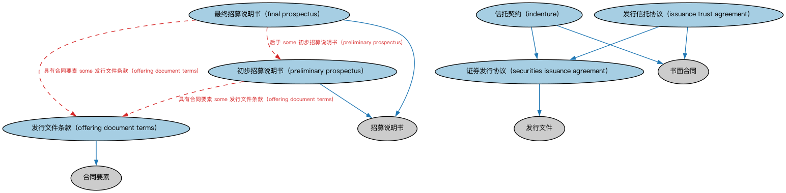

# 发行文件本体（Issuance Documents Ontology）结构与公理说明

本文档对应 `IssuanceDocuments.rdf` / `IssuanceDocuments.ttl`，说明该本体的类、继承关系、属性和公理约定。结构图见 `IssuanceDocuments-structure.png`（`IssuanceDocuments-structure.svg` 为可缩放版本）。

## 1. 本体概述

定义证券发行过程中使用的法律文件：募集说明书（prospectus）、条款清单（term sheet）、发行公告等。

**在体系中的位置**：BP 证券发行模块的文书配套本体。

**上下游关系**：上游依赖 FND 文档本体与发行流程本体；下游被各品种发行本体引用（每种发行都有其必备文件）。

**与相近概念的差别**：与 FND/Arrangements/Documents 的差别——FND 定义文档的通用概念，本本体专指证券发行场景的具体文书类型及其在流程中的作用。

## 2. 类（Class）

| 类（Class） | 定义（Definition） |
|---|---|
| 最终招募说明书（final prospectus） | 描述发行事项的最终招募说明书，包括发行本身的事实（如截止日期）及已知的相关事实。 |
| 信托契约（indenture） | 债券与信用债券据以发行的书面合同，又称「信托契据」，载明到期日、利率、赎回条款等。 |
| 发行信托协议（issuance trust agreement） | 就某次证券发行设立的信托协议。 |
| 发行文件条款（offering document terms） | 发行文件中包含的、在发行时产生法律约束力的条款。 |
| 初步招募说明书（preliminary prospectus） | 发行营销前确定的招募说明书草案，其中某些条款将在发行后续阶段定稿。 |
| 证券发行协议（securities issuance agreement） | 就某次拟议证券发行订立的正式协议、契据或合同。 |

### 2.1 继承关系（Inheritance）

- 最终招募说明书（final prospectus） ⊑ 招募说明书
- 信托契约（indenture） ⊑ 证券发行协议（securities issuance agreement）
- 信托契约（indenture） ⊑ 书面合同
- 发行信托协议（issuance trust agreement） ⊑ 证券发行协议（securities issuance agreement）
- 发行信托协议（issuance trust agreement） ⊑ 书面合同
- 发行文件条款（offering document terms） ⊑ 合同要素
- 初步招募说明书（preliminary prospectus） ⊑ 招募说明书
- 证券发行协议（securities issuance agreement） ⊑ 发行文件

## 5. 公理约定（Axioms）

- 最终招募说明书（final prospectus）：具有合同要素 some 发行文件条款（offering document terms）
- 最终招募说明书（final prospectus）：后于 some 初步招募说明书（preliminary prospectus）
- 初步招募说明书（preliminary prospectus）：具有合同要素 some 发行文件条款（offering document terms）

## 6. 依赖（owl:imports，6 个）

本本体通过 `owl:imports` 引入以下本体，各项的中文名称与简介如下：

| 导入本体 | 中文名称 | 简介 |
|---|---|---|
| `FND/Agreements/Contracts.rdf` | 合同本体（Contracts Ontology） | 在协议之上定义具有法律约束力的合同（contract）：合同当事方、合同条款、义务与权利，是金融工具与交易合同建模的基石。 |
| `FND/Law/LegalCore.rdf` | 法律核心本体（Legal Core Ontology） | 定义法域（jurisdiction）、法律、法规等核心法律概念，为监管主体与适用法律建模。 |
| `FND/Utilities/AnnotationVocabulary.rdf` | FIBO 标注词汇表（FIBO Annotation Vocabulary） | 定义 FIBO 专用的标注属性（如释义来源、成熟度等级），用于本体自身的元数据标注。 |
| `SEC/Securities/SecuritiesIssuance.rdf` | 证券发行本体（Securities Issuance Ontology） | 定义证券发行（issuance）：发行人、发行条款与发行结果。 |
| `https://www.omg.org/spec/Commons/AnnotationVocabulary/` | OMG 通用标注词汇表（OMG Commons Annotation Vocabulary） | OMG 通用本体库（Commons）中的标注词汇表，提供概念映射等标注属性，FIBO 用它标注术语与外部标准的对应关系。 |
| `https://www.omg.org/spec/Commons/DatesAndTimes/` | OMG 通用日期与时间本体（OMG Commons Dates and Times） | Commons 库中的日期时间本体，定义日期、期间、时间点等通用时间概念。 |

## 7. 文件

- 官方 RDF/XML：`IssuanceDocuments.rdf`
- 中文 Turtle：`IssuanceDocuments.ttl`
- 结构图：`IssuanceDocuments-structure.png` / `IssuanceDocuments-structure.svg`