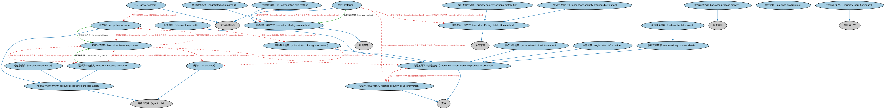

# 发行流程本体（Issuance Process Ontology）结构与公理说明

本文档对应 `IssuanceProcess.rdf` / `IssuanceProcess.ttl`，说明该本体的类、继承关系、属性和公理约定。结构图见 `IssuanceProcess-structure.png`（`IssuanceProcess-structure.svg` 为可缩放版本）。

## 1. 本体概述

定义证券发行的通用流程框架：从筹划、监管申报、定价到配售的各阶段及其参与方。

**在体系中的位置**：BP 证券发行模块的框架本体，各品种发行本体（债务、IPO、MBS、市政债）都在它的基础上特化。

**上下游关系**：上游依赖金融语境与流程本体及 SEC 证券发行本体；下游被各品种发行流程本体继承。

**与相近概念的差别**：与 SEC/Securities/SecuritiesIssuance 的差别——SEC 本体建模发行的「结果与条款」（发行了什么、条件如何），本本体建模发行的「过程」（怎么走流程）；一静一动，互相引用。

## 2. 类（Class）

| 类（Class） | 定义（Definition） |
|---|---|
| 配售信息（allotment information） | 关于向不同认购人配售发行数量的信息，关联单笔工具配售与认购。 |
| 公告（announcement） | 关于发行的公告。 |
| 竞争性销售方式（competitive sale method） | 通过竞标方式销售新发行证券的方式。 |
| 发行流程活动（issuance process activity） | 证券发行流程中的一项活动。 |
| 发行计划（issuance programme） | 一段时间内的一系列发行。 |
| 发行认购信息（issue subscription information） | 与本次发行认购相关的信息。 |
| 已发行证券发行信息（issued security issue information） | 与发行准备/推向市场（即一级市场或 IPO 发行）直至发行完成相关的要素。 |
| 协议销售方式（negotiated sale method） | 通过与承销商协商方式销售新发行证券的方式。 |
| 发行（offering） | 将证券提供发行的流程步骤，即通过承销使新证券发行可得。 |
| 潜在发行人（potential issuer） | 将成为发行人的实体。 |
| 潜在承销商（potential underwriter） | 将成为本次发行承销商的实体。 |
| 主标识符签发方（primary identifier issuer） | 正式向证券签发主要证券标识符的参与方。 |
| 一级证券发行分销（primary security offering distribution） | 公司证券的原始销售，销售收入直接归公司所有。 |
| 注册信息（registration information） | 与注册制证券的注册相关的信息。 |
| 二级证券发行分销（secondary security offering distribution） | 对先前已发行证券的发行分销。 |
| 证券发行流程（securities issuance process） | 金融证券发行的过程。 |
| 证券发行流程参与者（securities issuance process actor） | 证券发行流程中的参与者。 |
| 证券发行担保人（security issuance guarantor） | 为证券发行提供担保的参与方。 |
| 证券发行分销方式（security offering distribution method） | 证券发行的分销类型。 |
| 证券发行销售方式（security offering sale method） | 新证券发行的销售方式。 |
| 认购人（subscriber） | 认购发行证券的参与方。 |
| 认购截止信息（subscription closing information） | 与认购截止相关的信息。 |
| 交易工具发行流程信息（traded instrument issuance process information） | 由发行流程产生的、关于一次证券发行的信息。注意：一个发行流程（发行）可对应多次发行。 |
| 承销商承销量（underwriter takedown） | 承销商经手的证券承销数量信息（将记入 DTC）。 |
| 承销流程细节（underwriting process details） | 本次发行承销特有的信息。 |

### 2.1 继承关系（Inheritance）

- 配售信息（allotment information） ⊑ 交易工具发行流程信息（traded instrument issuance process information）
- 公告（announcement） ⊑ 发行流程活动
- 竞争性销售方式（competitive sale method） ⊑ 证券发行销售方式（security offering sale method）
- 发行流程活动（issuance process activity） ⊑ 发生类别
- 发行认购信息（issue subscription information） ⊑ 交易工具发行流程信息（traded instrument issuance process information）
- 已发行证券发行信息（issued security issue information） ⊑ 文件
- 协议销售方式（negotiated sale method） ⊑ 证券发行销售方式（security offering sale method）
- 发行（offering） ⊑ 发行流程活动
- 潜在发行人（potential issuer） ⊑ 证券发行流程参与者（securities issuance process actor）
- 潜在承销商（potential underwriter） ⊑ 证券发行流程参与者（securities issuance process actor）
- 主标识符签发方（primary identifier issuer） ⊑ 合同第三方
- 一级证券发行分销（primary security offering distribution） ⊑ 证券发行分销方式（security offering distribution method）
- 注册信息（registration information） ⊑ 交易工具发行流程信息（traded instrument issuance process information）
- 二级证券发行分销（secondary security offering distribution） ⊑ 证券发行分销方式（security offering distribution method）
- 证券发行流程参与者（securities issuance process actor） ⊑ 智能体角色（agent role）
- 证券发行担保人（security issuance guarantor） ⊑ 证券发行流程参与者（securities issuance process actor）
- 证券发行分销方式（security offering distribution method） ⊑ 分配策略
- 证券发行销售方式（security offering sale method） ⊑ 销售策略
- 认购人（subscriber） ⊑ 智能体角色（agent role）
- 认购截止信息（subscription closing information） ⊑ 交易工具发行流程信息（traded instrument issuance process information）
- 交易工具发行流程信息（traded instrument issuance process information） ⊑ 文件
- 承销商承销量（underwriter takedown） ⊑ 承销流程细节（underwriting process details）
- 承销流程细节（underwriting process details） ⊑ 交易工具发行流程信息（traded instrument issuance process information）

## 3. 对象属性（Object Property）

| 属性（Property） | 中文（English） | 定义（Definition） | 说明 |
|---|---|---|---|
| fibo-bp-iss-prc:actualClosingDate | 实际截止日（actual closing date） | 证券承销商完成收尾的日期。 | 定义域（domain）：已发行证券发行信息（issued security issue information）；值域（range）：日期 |
| fibo-bp-iss-prc:announcementDate | 公告日期（announcement date） | 发行人公告的证券拟发行并随后实际发行的日期时间。 | 定义域（domain）：已发行证券发行信息（issued security issue information）；值域（range）：日期 |
| fibo-bp-iss-prc:describesAllotmentOf | 描述……的配售（describes allotment of） | 描述某证券的配售情况。 | 定义域（domain）：配售信息（allotment information）；值域（range）：证券；子属性（subPropertyOf）：关于 |
| fibo-bp-iss-prc:expectedClosingDate | 预期截止日（expected closing date） | 预期向承销商划转头寸的日期，由承销商在公告中提供。 | 定义域（domain）：发行（offering）；值域（range）：日期 |
| fibo-bp-iss-prc:finalStateDescribedIn | 最终状态描述于（final state described in） | 标识描述某过程最终状态的文件。 | 定义域（domain）：证券发行；值域（range）：最终招募说明书 |
| fibo-bp-iss-prc:firstTradeDate | 首个交易日（first trade date） | 该证券在二级市场上首次交易的日期。 | 定义域（domain）：已发行证券发行信息（issued security issue information）；值域（range）：日期 |
| fibo-bp-iss-prc:firstTradeDateAndTime | 首次交易日期时间（first trade date and time） | 该证券可执行首笔交易的日期时间，均以东部时区为准。 | 定义域（domain）：发行（offering）；值域（range）：日期时间 |
| fibo-bp-iss-prc:firstTradeSettlementDate | 首次交易结算日（first trade settlement date） | 发行人与承销商就债券进行资金交收的日期。 | 定义域（domain）：已发行证券发行信息（issued security issue information）；值域（range）：日期 |
| fibo-bp-iss-prc:formalAwardDateAndTime | 正式授标日期时间（formal award date and time） | 发行人正式接受竞标（竞争性发行）或签署债券购买协议（协议发行）的日期时间。 | 定义域（domain）：发行（offering）；值域（range）：日期时间 |
| fibo-bp-iss-prc:hasDistributionType | 具有分销类型（has distribution type） | 标识证券发行的分销类型。 | — |
| fibo-bp-iss-prc:hasPartiallyPaidIssuanceSchedule | 具有分期缴付发行进度表（has partially paid issuance schedule） | 分期缴付发行：分期付款及日期的进度表。 | 定义域（domain）：已发行证券发行信息（issued security issue information）；值域（range）：支付进度表 |
| fibo-bp-iss-prc:hasSaleMethod | 具有销售方式（has sale method） | 标识证券的销售方式。 | 定义域（domain）：发行（offering）；值域（range）：证券发行销售方式（security offering sale method） |
| fibo-bp-iss-prc:isIssuanceGuarantor | 是发行担保人（is issuance guarantor） | 标识为发行提供担保的参与方。 | 定义域（domain）：证券发行担保人（security issuance guarantor）；值域（range）：证券发行流程（securities issuance process） |
| fibo-bp-iss-prc:isPotentialIssuer | 是潜在发行人（is potential issuer） | 标识潜在的发行参与方。 | 定义域（domain）：潜在发行人（potential issuer）；值域（range）：证券发行流程（securities issuance process） |
| fibo-bp-iss-prc:requiredToMakeEligible | 使合格所需（required to make eligible） | 使证券达到合格条件所要求的事项。 | 定义域（domain）：发行（offering）；值域（range）：发行文件 |
| fibo-bp-iss-prc:subscriptionPeriod | 认购期间（subscription period） | 证券可被认购的期间。 | 定义域（domain）：发行认购信息（issue subscription information）；值域（range）：日期区间 |
| fibo-bp-iss-prc:takenDownBy | 由……承销（taken down by） | 标识承销该证券的承销商。 | 定义域（domain）：承销商承销量（underwriter takedown）；值域（range）：市政债发行承销商 |

## 4. 数据属性（Datatype Property）

| 属性（Property） | 中文（English） | 定义（Definition） |
|---|---|---|
| fibo-bp-iss-prc:issueNominalNumberOfUnits | 发行名义单位数（issue nominal number of units） | 发行证券的原始总数量。 |
| fibo-bp-iss-prc:issueOfferingUnits | 发行发售单位数（issue offering units） | 股票或公司债券发行中发售的全部证券数量。 |
| fibo-bp-iss-prc:minimumIssueSubscription | 最低发行认购额（minimum issue subscription） | 证券转让或所有权变更所需的最低或增量面额。 |
| fibo-bp-iss-prc:overAlloted | 超额配售（over alloted） | 认购人是否被超额配售了所请求的单位数。 |
| fibo-bp-iss-prc:offerIssueSeries | 系列（series） | 一次发行中具有相同预期截止日、唯一标识的证券集合；或单个交易金融证券的系列标识。 |
| fibo-bp-iss-prc:series | 系列（series） | 一次发行中具有相同预期截止日、唯一标识的证券集合；或单个交易金融证券的系列标识。 |
| fibo-bp-iss-prc:subscriptionAmount | 认购数量（subscription amount） | 单个认购人获配的发行单位数。 |
| fibo-bp-iss-prc:underwriterTakedownShares | 承销商承销股数（underwriter takedown shares） | 承销商经手的证券承销数量（将记入 DTC）。 |

## 5. 公理约定（Axioms）

- 配售信息（allotment information）：描述……的配售（describes allotment of） some 证券
- 配售信息（allotment information）：包含 some 认购截止信息（subscription closing information）
- 公告（announcement）：发行请求方 some 潜在发行人（potential issuer）
- 发行计划（issuance programme）：包含 some 证券发行
- 已发行证券发行信息（issued security issue information）：具有分期缴付发行进度表（has partially paid issuance schedule） only 支付进度表
- 已发行证券发行信息（issued security issue information）：关于 some 证券
- 发行（offering）：具有分销类型（has distribution type） some 证券发行分销方式（security offering distribution method）
- 发行（offering）：具有销售方式（has sale method） some 证券发行销售方式（security offering sale method）
- 发行（offering）：使合格所需（required to make eligible） some 发行文件
- 发行（offering）：fibo-bp-iss-muni:givesRiseTo some 已发行证券发行信息（issued security issue information）
- 潜在发行人（potential issuer）：是潜在发行人（is potential issuer） some 证券发行流程（securities issuance process）
- 证券发行流程（securities issuance process）：具有发行担保人 some 证券发行担保人（security issuance guarantor）
- 证券发行流程（securities issuance process）：具有潜在发行人 some 潜在发行人（potential issuer）
- 证券发行流程（securities issuance process）：fibo-bp-iss-muni:subscriber.1 some 认购人（subscriber）
- 证券发行流程（securities issuance process）：生产 some 交易工具发行流程信息（traded instrument issuance process information）
- 证券发行担保人（security issuance guarantor）：是发行担保人（is issuance guarantor） some 证券发行流程（securities issuance process）
- 认购人（subscriber）：认购 some 证券承销发行流程
- 认购截止信息（subscription closing information）：适用于 some 认购人（subscriber）
- 交易工具发行流程信息（traded instrument issuance process information）：是……的部分 some 已发行证券发行信息（issued security issue information）
- 承销商承销量（underwriter takedown）：restriction
- 承销商承销量（underwriter takedown）：由……承销（taken down by） some 市政债发行承销商

## 6. 依赖（owl:imports，19 个）

本本体通过 `owl:imports` 引入以下本体，各项的中文名称与简介如下：

| 导入本体 | 中文名称 | 简介 |
|---|---|---|
| `BP/SecuritiesIssuance/DebtIssuance.rdf` | 债务发行本体（Debt Issuance Ontology） | 定义债券等债务工具的发行流程与参与方。 |
| `BP/SecuritiesIssuance/IssuanceDocuments.rdf` | 发行文件本体（Issuance Documents Ontology） | 定义证券发行过程中使用的法律文件：募集说明书、条款清单等。 |
| `BP/SecuritiesIssuance/MuniIssuance.rdf` | 市政债发行本体（Municipal Issuance Ontology） | 定义美国市政债券（municipal bond）的发行流程。 |
| `FBC/FinancialInstruments/FinancialInstruments.rdf` | 金融工具本体（Financial Instruments Ontology） | FIBO 核心本体之一，定义金融工具（financial instrument）的通用概念：可交易、代表某种权利义务的合同工具，是证券、衍生品等具体工具的共同基础。 |
| `FND/Accounting/CurrencyAmount.rdf` | 货币金额本体（Currency Amount Ontology） | 定义「金额＋币种」的货币金额（currency amount）表示，是 FIBO 中表达价格、债务金额、付款额等一切带币种数值的基础构件。 |
| `FND/Agreements/Contracts.rdf` | 合同本体（Contracts Ontology） | 在协议之上定义具有法律约束力的合同（contract）：合同当事方、合同条款、义务与权利，是金融工具与交易合同建模的基石。 |
| `FND/DatesAndTimes/Occurrences.rdf` | 事件与发生本体（Occurrences Ontology） | 定义「发生」（occurrence）、事件与触发条件，用于表达企业行动、信用事件等「发生了什么」。 |
| `FND/GoalsAndObjectives/Objectives.rdf` | 目标本体（Objectives Ontology） | 定义目标（objective）及其与组织、计划的关系，用于表达机构的经营目标与投资目标。 |
| `FND/ProductsAndServices/PaymentsAndSchedules.rdf` | 付款与计划表本体（Payments and Schedules Ontology） | 定义付款、付款计划表（payment schedule）及其日期与金额结构，是贷款还款、债券付息建模的基础。 |
| `FND/Relations/Relations.rdf` | 关系本体（Relations Ontology） | FIBO 最底层的基础本体，定义参考（reference）、分类（classify）等通用关系与抽象概念，全库普遍依赖。 |
| `FND/Utilities/AnnotationVocabulary.rdf` | FIBO 标注词汇表（FIBO Annotation Vocabulary） | 定义 FIBO 专用的标注属性（如释义来源、成熟度等级），用于本体自身的元数据标注。 |
| `SEC/Securities/SecuritiesIssuance.rdf` | 证券发行本体（Securities Issuance Ontology） | 定义证券发行（issuance）：发行人、发行条款与发行结果。 |
| `https://www.omg.org/spec/Commons/AnnotationVocabulary/` | OMG 通用标注词汇表（OMG Commons Annotation Vocabulary） | OMG 通用本体库（Commons）中的标注词汇表，提供概念映射等标注属性，FIBO 用它标注术语与外部标准的对应关系。 |
| `https://www.omg.org/spec/Commons/Collections/` | OMG 通用集合本体（OMG Commons Collections） | Commons 库中的集合本体，定义集合、成员等通用概念。 |
| `https://www.omg.org/spec/Commons/ContextualDesignators/` | OMG 通用语境指称本体（OMG Commons Contextual Designators） | Commons 库中的语境指称本体，定义「在某个语境下指代某物的名称/符号」，是地址、账户号码等语境相关标识的基础。 |
| `https://www.omg.org/spec/Commons/DatesAndTimes/` | OMG 通用日期与时间本体（OMG Commons Dates and Times） | Commons 库中的日期时间本体，定义日期、期间、时间点等通用时间概念。 |
| `https://www.omg.org/spec/Commons/Documents/` | OMG 通用文档本体（OMG Commons Documents） | Commons 库中的文档本体，定义文档及其组成部分的通用概念。 |
| `https://www.omg.org/spec/Commons/Identifiers/` | OMG 通用标识符本体（OMG Commons Identifiers） | Commons 库中的标识符本体，定义标识符及其编码方案的通用概念。 |
| `https://www.omg.org/spec/Commons/PartiesAndSituations/` | OMG 通用参与方与情境本体（OMG Commons Parties and Situations） | Commons 库中的参与方本体，定义独立主体、参与方及其角色扮演的通用概念，是 FIBO 参与方模型的上游。 |

## 7. 文件

- 官方 RDF/XML：`IssuanceProcess.rdf`
- 中文 Turtle：`IssuanceProcess.ttl`
- 结构图：`IssuanceProcess-structure.png` / `IssuanceProcess-structure.svg`