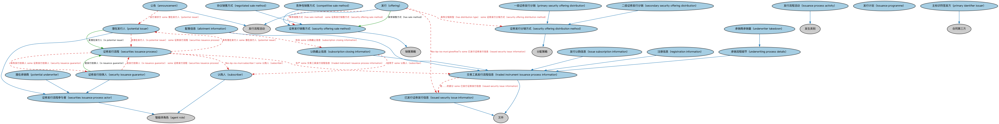

# 发行流程本体（Issuance Process Ontology）结构与公理说明

本文档对应 `IssuanceProcess.rdf` / `IssuanceProcess.ttl`，说明该本体的类、继承关系、属性和公理约定。结构图见 `IssuanceProcess-structure.png`（`IssuanceProcess-structure.svg` 为可缩放版本）。

## 1. 本体概述

定义证券发行的通用流程框架：从筹划、监管申报、定价到配售的各阶段及其参与方。

**在体系中的位置**：BP 证券发行模块的框架本体，各品种发行本体（债务、IPO、MBS、市政债）都在它的基础上特化。

**上下游关系**：上游依赖金融语境与流程本体及 SEC 证券发行本体；下游被各品种发行流程本体继承。

**与相近概念的差别**：与 SEC/Securities/SecuritiesIssuance 的差别——SEC 本体建模发行的「结果与条款」（发行了什么、条件如何），本本体建模发行的「过程」（怎么走流程）；一静一动，互相引用。

本本体中类与类的核心关系如下（完整细节见各类小节）：

- **配售信息（allotment information）** 继承 **交易工具发行流程信息（traded instrument issuance process information）**
- **公告（announcement）** 继承 **发行流程活动（IssuanceProcessActivity）**
- **竞争性销售方式（competitive sale method）** 继承 **证券发行销售方式（security offering sale method）**
- **发行流程活动（issuance process activity）** 继承 **发生类别（OccurrenceKind）**
- **发行认购信息（issue subscription information）** 继承 **交易工具发行流程信息（traded instrument issuance process information）**
- **已发行证券发行信息（issued security issue information）** 继承 **文件（Document）**
- **协议销售方式（negotiated sale method）** 继承 **证券发行销售方式（security offering sale method）**
- **发行（offering）** 继承 **发行流程活动（IssuanceProcessActivity）**
- **潜在发行人（potential issuer）** 继承 **证券发行流程参与者（securities issuance process actor）**
- **潜在承销商（potential underwriter）** 继承 **证券发行流程参与者（securities issuance process actor）**
- **主标识符签发方（primary identifier issuer）** 继承 **合同第三方（ContractThirdParty）**
- **一级证券发行分销（primary security offering distribution）** 继承 **证券发行分销方式（security offering distribution method）**
- 其余 14 条关系从略。

## 2. 类（Class）

| 类（Class） | 定义（Definition） |
|---|---|
| 配售信息（allotment information） | 关于向不同认购人配售发行数量的信息，关联单笔工具配售与认购。 Information about the allotment of quantities of the issue to different subscribers. This relates a single instrument allotment against the subscription amounts allotted to each Subscriber. |
| 公告（announcement） | 关于发行的公告。 |
| 竞争性销售方式（competitive sale method） | 通过竞标方式销售新发行证券的方式。 No definition |
| 发行流程活动（issuance process activity） | 证券发行流程中的一项活动。 |
| 发行计划（issuance programme） | 一段时间内的一系列发行。 A series of issuances over time. |
| 发行认购信息（issue subscription information） | 与本次发行认购相关的信息。 Information relating to the subscription of the issue. |
| 已发行证券发行信息（issued security issue information） | 与发行准备/推向市场（即一级市场或 IPO 发行）直至发行完成相关的要素。 FIBIM: "Elements relating to issue preparation/bringing to market (also known as primary market or Initial Public Offering (IPO) issuance) through to issue date." |
| 协议销售方式（negotiated sale method） | 通过与承销商协商方式销售新发行证券的方式。 No definition |
| 发行（offering） | 将证券提供发行的流程步骤，即通过承销使新证券发行可得。 The process step of offering a security for issue. This is the making available of a new securities issue through an underwriting. |
| 潜在发行人（potential issuer） | 将成为发行人的实体。 |
| 潜在承销商（potential underwriter） | 将成为本次发行承销商的实体。 The entity which will become the underwriter for an issue. Term origin:MBS PoC Reviews |
| 主标识符签发方（primary identifier issuer） | 正式向证券签发主要证券标识符的参与方。 The party which formally issues the primary security identifier to the security. Term origin:MBS PoC Reviews |
| 一级证券发行分销（primary security offering distribution） | 公司证券的原始销售，销售收入直接归公司所有。 The original sale of a company's securities, in which the proceeds from the sale are received directly by the company. |
| 注册信息（registration information） | 与注册制证券的注册相关的信息。 Information relating to the registration of a registered security. |
| 二级证券发行分销（secondary security offering distribution） | 对先前已发行证券的发行分销。 An Offering of a security which has been previously issued. |
| 证券发行流程（securities issuance process） | 金融证券发行的过程。 The process by which a financial security is issued. |
| 证券发行流程参与者（securities issuance process actor） | 证券发行流程中的参与者。 |
| 证券发行担保人（security issuance guarantor） | 为证券发行提供担保的参与方。 |
| 证券发行分销方式（security offering distribution method） | 证券发行的分销类型。 The distribution type of a securities Offering. |
| 证券发行销售方式（security offering sale method） | 新证券发行的销售方式。 Method for sale of a new security offering. |
| 认购人（subscriber） | 认购发行证券的参与方。 |
| 认购截止信息（subscription closing information） | 与认购截止相关的信息。 |
| 交易工具发行流程信息（traded instrument issuance process information） | 由发行流程产生的、关于一次证券发行的信息。注意：一个发行流程（发行）可对应多次发行。 Information on one Security issue, arising from the Issuance Process. Note that one Issuance Process (Offering) may relate to more than on Issue, which itself may be the issue of more than one Traded Security. |
| 承销商承销量（underwriter takedown） | 承销商经手的证券承销数量信息（将记入 DTC）。 Infomation on Takedown quantity of the security handled by the underwriter (that will be brought into DTC). |
| 承销流程细节（underwriting process details） | 本次发行承销特有的信息。 Information specific to the Underwriting of the Issue. |

以下按类逐个展开：每个类给出继承关系、相关属性与公理约定；子类在父类之下降一级编号。

### 2.1 公告（announcement）

定义：关于发行的公告。

- 父类：**发行流程活动（IssuanceProcessActivity）**

属性：

| 属性 | 定义 | 说明 |
|---|---|---|
| **发行请求方（offeringRequestor）** | — | — |

公理：

- **发行请求方（offeringRequestor）**至少有一个取值，类型是**潜在发行人（potential issuer）**。

### 2.2 发行流程活动（issuance process activity）

定义：证券发行流程中的一项活动。

- 父类：**发生类别（OccurrenceKind）**

### 2.3 发行计划（issuance programme）

定义：一段时间内的一系列发行。

属性：

| 属性 | 定义 | 说明 |
|---|---|---|
| **包含（comprises）** | — | — |

公理：

- **包含（comprises）**至少有一个取值，类型是**证券发行（SecuritiesOffering）**。

### 2.4 已发行证券发行信息（issued security issue information）

定义：与发行准备/推向市场（即一级市场或 IPO 发行）直至发行完成相关的要素。

- 父类：**文件（Document）**

属性：

| 属性 | 定义 | 说明 |
|---|---|---|
| **实际截止日（actual closing date）** | 证券承销商完成收尾的日期。 The Closing Date for the Issue, recorded after the event. | 值域：日期 |
| **公告日期（announcement date）** | 发行人公告的证券拟发行并随后实际发行的日期时间。 Date/time, as announced by the issuer, at which the securities were to be issued and subsequently were issued. | 值域：日期 |
| **首个交易日（first trade date）** | 该证券在二级市场上首次交易的日期。 The date of the first trade of the security in the secondary market. | 值域：日期 |
| **首次交易结算日（first trade settlement date）** | 发行人与承销商就债券进行资金交收的日期。 The date the Issuer and Underwriter exchange money for bonds. | 值域：日期 |
| **具有分期缴付发行进度表（has partially paid issuance schedule）** | 分期缴付发行：分期付款及日期的进度表。 Partially paid issue: Schedule of partial payments and dates. | 值域：支付进度表 |
| **发行名义单位数（issue nominal number of units）** | 发行证券的原始总数量。 Total original quantity of securities issued. | 值域：xsd:integer |
| **系列（series）** | 一次发行中具有相同预期截止日、唯一标识的证券集合；或单个交易金融证券的系列标识。 Series identification for the individual Traded Financial Security. | 值域：xsd:string |
| **关于（isAbout）** | — | — |

公理：

- **关于（isAbout）**至少有一个取值，类型是**证券（Security）**。
- **具有分期缴付发行进度表（has partially paid issuance schedule）**的所有取值只能是**支付进度表（PaymentSchedule）**。

### 2.5 发行（offering）

定义：将证券提供发行的流程步骤，即通过承销使新证券发行可得。

- 父类：**发行流程活动（IssuanceProcessActivity）**

属性：

| 属性 | 定义 | 说明 |
|---|---|---|
| **预期截止日（expected closing date）** | 预期向承销商划转头寸的日期，由承销商在公告中提供。 The date on which the transfer of positions to underwriters is expected to take place. This date is provided by underwriters as part of an announcement. | 值域：日期 |
| **首次交易日期时间（first trade date and time）** | 该证券可执行首笔交易的日期时间，均以东部时区为准。 First Date and Time a trade may be executed for this security. All times in Eastern Time Zone only. NOTE: This is a date in the future tense at the time of the Offering. | 值域：日期时间 |
| **正式授标日期时间（formal award date and time）** | 发行人正式接受竞标（竞争性发行）或签署债券购买协议（协议发行）的日期时间。 Date and time the issuer formally accepts a bid for Competitive Issues or, the Date and Time the Bond Purchase Agreement is executed for Negotiated Issues. Time Zone: Include in date/time data or add a term for it? | 值域：日期时间 |
| **具有分销类型（has distribution type）** | 标识证券发行的分销类型。 | — |
| **具有销售方式（has sale method）** | 标识证券的销售方式。 Sale Method of the security. | 值域：证券发行销售方式（security offering sale method） |
| **使合格所需（required to make eligible）** | 使证券达到合格条件所要求的事项。 | 值域：发行文件 |
| **fibo-bp-iss-muni:givesRiseTo（givesRiseTo）** | — | — |

公理：

- **fibo-bp-iss-muni:givesRiseTo（givesRiseTo）**至少有一个取值，类型是**已发行证券发行信息（issued security issue information）**。
- **使合格所需（required to make eligible）**至少有一个取值，类型是**发行文件（OfferingDocument）**。
- **具有分销类型（has distribution type）**至少有一个取值，类型是**证券发行分销方式（security offering distribution method）**。
- **具有销售方式（has sale method）**至少有一个取值，类型是**证券发行销售方式（security offering sale method）**。

### 2.6 主标识符签发方（primary identifier issuer）

定义：正式向证券签发主要证券标识符的参与方。

- 父类：**合同第三方（ContractThirdParty）**

### 2.7 证券发行流程（securities issuance process）

定义：金融证券发行的过程。

属性：

| 属性 | 定义 | 说明 |
|---|---|---|
| **具有发行担保人（hasIssuanceGuarantor）** | — | — |
| **具有潜在发行人（hasPotentialIssuer）** | — | — |
| **fibo-bp-iss-muni:subscriber.1（subscriber.1）** | — | — |
| **生产（produces）** | — | — |

公理：

- **fibo-bp-iss-muni:subscriber.1（subscriber.1）**至少有一个取值，类型是**认购人（subscriber）**。
- **具有发行担保人（hasIssuanceGuarantor）**至少有一个取值，类型是**证券发行担保人（security issuance guarantor）**。
- **具有潜在发行人（hasPotentialIssuer）**至少有一个取值，类型是**潜在发行人（potential issuer）**。
- **生产（produces）**至少有一个取值，类型是**交易工具发行流程信息（traded instrument issuance process information）**。

### 2.8 证券发行流程参与者（securities issuance process actor）

定义：证券发行流程中的参与者。

- 父类：**智能体角色（agent role）**
- 直接子类：**潜在发行人（potential issuer）**、**潜在承销商（potential underwriter）**、**证券发行担保人（security issuance guarantor）**

#### 2.8.1 潜在发行人（potential issuer）

定义：将成为发行人的实体。

- 父类：**证券发行流程参与者（securities issuance process actor）**

属性：

| 属性 | 定义 | 说明 |
|---|---|---|
| **是潜在发行人（is potential issuer）** | 标识潜在的发行参与方。 | 值域：证券发行流程（securities issuance process） |

公理：

- **是潜在发行人（is potential issuer）**至少有一个取值，类型是**证券发行流程（securities issuance process）**。

#### 2.8.2 潜在承销商（potential underwriter）

定义：将成为本次发行承销商的实体。

- 父类：**证券发行流程参与者（securities issuance process actor）**

#### 2.8.3 证券发行担保人（security issuance guarantor）

定义：为证券发行提供担保的参与方。

- 父类：**证券发行流程参与者（securities issuance process actor）**

属性：

| 属性 | 定义 | 说明 |
|---|---|---|
| **是发行担保人（is issuance guarantor）** | 标识为发行提供担保的参与方。 | 值域：证券发行流程（securities issuance process） |

公理：

- **是发行担保人（is issuance guarantor）**至少有一个取值，类型是**证券发行流程（securities issuance process）**。

### 2.9 证券发行分销方式（security offering distribution method）

定义：证券发行的分销类型。

- 父类：**分配策略（DistributionStrategy）**
- 直接子类：**一级证券发行分销（primary security offering distribution）**、**二级证券发行分销（secondary security offering distribution）**

#### 2.9.1 一级证券发行分销（primary security offering distribution）

定义：公司证券的原始销售，销售收入直接归公司所有。

- 父类：**证券发行分销方式（security offering distribution method）**

#### 2.9.2 二级证券发行分销（secondary security offering distribution）

定义：对先前已发行证券的发行分销。

- 父类：**证券发行分销方式（security offering distribution method）**

### 2.10 证券发行销售方式（security offering sale method）

定义：新证券发行的销售方式。

- 父类：**销售策略（SalesStrategy）**
- 直接子类：**竞争性销售方式（competitive sale method）**、**协议销售方式（negotiated sale method）**

#### 2.10.1 竞争性销售方式（competitive sale method）

定义：通过竞标方式销售新发行证券的方式。

- 父类：**证券发行销售方式（security offering sale method）**

#### 2.10.2 协议销售方式（negotiated sale method）

定义：通过与承销商协商方式销售新发行证券的方式。

- 父类：**证券发行销售方式（security offering sale method）**

### 2.11 认购人（subscriber）

定义：认购发行证券的参与方。

- 父类：**智能体角色（agent role）**

属性：

| 属性 | 定义 | 说明 |
|---|---|---|
| **认购（subscribesTo）** | — | — |

公理：

- **认购（subscribesTo）**至少有一个取值，类型是**证券承销发行流程（SecuritiesUnderwritingIssuanceProcess）**。

### 2.12 交易工具发行流程信息（traded instrument issuance process information）

定义：由发行流程产生的、关于一次证券发行的信息。注意：一个发行流程（发行）可对应多次发行。

- 父类：**文件（Document）**
- 直接子类：**配售信息（allotment information）**、**发行认购信息（issue subscription information）**、**注册信息（registration information）**、**认购截止信息（subscription closing information）**、**承销流程细节（underwriting process details）**

属性：

| 属性 | 定义 | 说明 |
|---|---|---|
| **是……的部分（isPartOf）** | — | — |

公理：

- **是……的部分（isPartOf）**至少有一个取值，类型是**已发行证券发行信息（issued security issue information）**。

#### 2.12.1 配售信息（allotment information）

定义：关于向不同认购人配售发行数量的信息，关联单笔工具配售与认购。

- 父类：**交易工具发行流程信息（traded instrument issuance process information）**

属性：

| 属性 | 定义 | 说明 |
|---|---|---|
| **描述……的配售（describes allotment of）** | 描述某证券的配售情况。 | 值域：证券；子属性：关于 |
| **包含（comprises）** | — | — |

公理：

- **包含（comprises）**至少有一个取值，类型是**认购截止信息（subscription closing information）**。
- **描述……的配售（describes allotment of）**至少有一个取值，类型是**证券（Security）**。

#### 2.12.2 发行认购信息（issue subscription information）

定义：与本次发行认购相关的信息。

- 父类：**交易工具发行流程信息（traded instrument issuance process information）**

属性：

| 属性 | 定义 | 说明 |
|---|---|---|
| **最低发行认购额（minimum issue subscription）** | 证券转让或所有权变更所需的最低或增量面额。 Minimum or incremental denomination required for the transfer or change of ownership of a security. | 值域：xsd:decimal |
| **认购期间（subscription period）** | 证券可被认购的期间。 Period during which the security can be subscribed to. | 值域：日期区间 |

#### 2.12.3 注册信息（registration information）

定义：与注册制证券的注册相关的信息。

- 父类：**交易工具发行流程信息（traded instrument issuance process information）**

#### 2.12.4 认购截止信息（subscription closing information）

定义：与认购截止相关的信息。

- 父类：**交易工具发行流程信息（traded instrument issuance process information）**

属性：

| 属性 | 定义 | 说明 |
|---|---|---|
| **超额配售（over alloted）** | 认购人是否被超额配售了所请求的单位数。 Whether the subscriber has been over-alloted the requested number of units. REVIEW: Not seen in data terms but implied elsewhere. | 值域：xsd:boolean |
| **认购数量（subscription amount）** | 单个认购人获配的发行单位数。 Number of units of the issue that an individual subscriber is allocated. | 值域：xsd:integer |
| **适用于（appliesTo）** | — | — |

公理：

- **适用于（appliesTo）**至少有一个取值，类型是**认购人（subscriber）**。

#### 2.12.5 承销流程细节（underwriting process details）

定义：本次发行承销特有的信息。

- 父类：**交易工具发行流程信息（traded instrument issuance process information）**
- 直接子类：**承销商承销量（underwriter takedown）**

##### 2.12.5.1 承销商承销量（underwriter takedown）

定义：承销商经手的证券承销数量信息（将记入 DTC）。

- 父类：**承销流程细节（underwriting process details）**

属性：

| 属性 | 定义 | 说明 |
|---|---|---|
| **由……承销（taken down by）** | 标识承销该证券的承销商。 | 值域：市政债发行承销商 |
| **承销商承销股数（underwriter takedown shares）** | 承销商经手的证券承销数量（将记入 DTC）。 Takedown quantity of the security handled by the underwriter (that will be brought into DTC). | 值域：xsd:integer |

公理：

- **承销商承销股数（underwriter takedown shares）**存在取值约束。
- **由……承销（taken down by）**至少有一个取值，类型是**市政债发行承销商（MuniIssueUnderwriter）**。

## 3. 其他属性

以下属性未绑定到本体的具体类（定义域在外部本体或未声明）：

对象属性（Object Property）：

| 属性 | 定义 | 说明 |
|---|---|---|
| **最终状态描述于（final state described in）** | 标识描述某过程最终状态的文件。 | 值域：最终招募说明书 |

数据属性（Datatype Property）：

| 属性 | 定义 |
|---|---|
| **发行发售单位数（issue offering units）** | 股票或公司债券发行中发售的全部证券数量。 Quantity of all securities that is offered in an equity or Corporate Bond issue. |
| **系列（series）** | 一次发行中具有相同预期截止日、唯一标识的证券集合；或单个交易金融证券的系列标识。 Uniquely identified collection of securities within an Issue with same Expected Closing Date. The text gives the Series Identifier within the Issuance process. There may be one or more Series within one Issue. |

## 4. 依赖（owl:imports，19 个）

本本体通过 `owl:imports` 引入以下本体，各项的中文名称与简介如下：

| 导入本体 | 中文名称 | 简介 |
|---|---|---|
| `BP/SecuritiesIssuance/DebtIssuance.rdf` | 债务发行本体（Debt Issuance Ontology） | 定义债券等债务工具的发行流程与参与方。 |
| `BP/SecuritiesIssuance/IssuanceDocuments.rdf` | 发行文件本体（Issuance Documents Ontology） | 定义证券发行过程中使用的法律文件：募集说明书、条款清单等。 |
| `BP/SecuritiesIssuance/MuniIssuance.rdf` | 市政债发行本体（Municipal Issuance Ontology） | 定义美国市政债券（municipal bond）的发行流程。 |
| `FBC/FinancialInstruments/FinancialInstruments.rdf` | 金融工具本体（Financial Instruments Ontology） | FIBO 核心本体之一，定义金融工具（financial instrument）的通用概念：可交易、代表某种权利义务的合同工具，是证券、衍生品等具体工具的共同基础。 |
| `FND/Accounting/CurrencyAmount.rdf` | 货币金额本体（Currency Amount Ontology） | 定义「金额＋币种」的货币金额（currency amount）表示，是 FIBO 中表达价格、债务金额、付款额等一切带币种数值的基础构件。 |
| `FND/Agreements/Contracts.rdf` | 合同本体（Contracts Ontology） | 在协议之上定义具有法律约束力的合同（contract）：合同当事方、合同条款、义务与权利，是金融工具与交易合同建模的基石。 |
| `FND/DatesAndTimes/Occurrences.rdf` | 事件与发生本体（Occurrences Ontology） | 定义「发生」（occurrence）、事件与触发条件，用于表达企业行动、信用事件等「发生了什么」。 |
| `FND/GoalsAndObjectives/Objectives.rdf` | 目标本体（Objectives Ontology） | 定义目标（objective）及其与组织、计划的关系，用于表达机构的经营目标与投资目标。 |
| `FND/ProductsAndServices/PaymentsAndSchedules.rdf` | 付款与计划表本体（Payments and Schedules Ontology） | 定义付款、付款计划表（payment schedule）及其日期与金额结构，是贷款还款、债券付息建模的基础。 |
| `FND/Relations/Relations.rdf` | 关系本体（Relations Ontology） | FIBO 最底层的基础本体，定义参考（reference）、分类（classify）等通用关系与抽象概念，全库普遍依赖。 |
| `FND/Utilities/AnnotationVocabulary.rdf` | FIBO 标注词汇表（FIBO Annotation Vocabulary） | 定义 FIBO 专用的标注属性（如释义来源、成熟度等级），用于本体自身的元数据标注。 |
| `SEC/Securities/SecuritiesIssuance.rdf` | 证券发行本体（Securities Issuance Ontology） | 定义证券发行（issuance）：发行人、发行条款与发行结果。 |
| `https://www.omg.org/spec/Commons/AnnotationVocabulary/` | OMG 通用标注词汇表（OMG Commons Annotation Vocabulary） | OMG 通用本体库（Commons）中的标注词汇表，提供概念映射等标注属性，FIBO 用它标注术语与外部标准的对应关系。 |
| `https://www.omg.org/spec/Commons/Collections/` | OMG 通用集合本体（OMG Commons Collections） | Commons 库中的集合本体，定义集合、成员等通用概念。 |
| `https://www.omg.org/spec/Commons/ContextualDesignators/` | OMG 通用语境指称本体（OMG Commons Contextual Designators） | Commons 库中的语境指称本体，定义「在某个语境下指代某物的名称/符号」，是地址、账户号码等语境相关标识的基础。 |
| `https://www.omg.org/spec/Commons/DatesAndTimes/` | OMG 通用日期与时间本体（OMG Commons Dates and Times） | Commons 库中的日期时间本体，定义日期、期间、时间点等通用时间概念。 |
| `https://www.omg.org/spec/Commons/Documents/` | OMG 通用文档本体（OMG Commons Documents） | Commons 库中的文档本体，定义文档及其组成部分的通用概念。 |
| `https://www.omg.org/spec/Commons/Identifiers/` | OMG 通用标识符本体（OMG Commons Identifiers） | Commons 库中的标识符本体，定义标识符及其编码方案的通用概念。 |
| `https://www.omg.org/spec/Commons/PartiesAndSituations/` | OMG 通用参与方与情境本体（OMG Commons Parties and Situations） | Commons 库中的参与方本体，定义独立主体、参与方及其角色扮演的通用概念，是 FIBO 参与方模型的上游。 |

## 5. 文件

- 官方 RDF/XML：`IssuanceProcess.rdf`
- 中文 Turtle：`IssuanceProcess.ttl`
- 结构图：`IssuanceProcess-structure.png` / `IssuanceProcess-structure.svg`