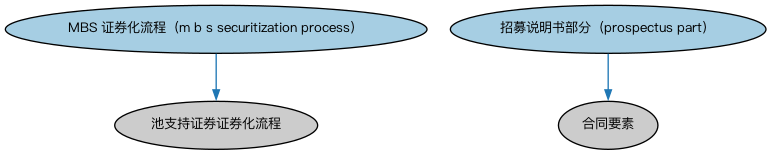

# MBS 发行本体（MBS Issuance Ontology）结构与公理说明

本文档对应 `MBSIssuance.rdf` / `MBSIssuance.ttl`，说明该本体的类、继承关系、属性和公理约定。结构图见 `MBSIssuance-structure.png`（`MBSIssuance-structure.svg` 为可缩放版本）。

## 1. 本体概述

定义抵押贷款支持证券（MBS）发行的通用流程：贷款资产池组建、信用增级、分层与发售。

**在体系中的位置**：BP 证券发行模块的品种特化本体，是机构 MBS 与私人品牌 MBS 两个更具体本体的共同基础。

**上下游关系**：上游继承发行流程本体；下游被机构 MBS 发行与私人品牌 MBS 发行本体继承，并关联 SEC/Debt/MortgageBackedSecurities。

**与相近概念的差别**：与普通债务发行的差别——MBS 发行多了「资产池」环节，现金流来自底层贷款而非发行人经营；机构与私人品牌两类子流程的差别在发行主体与担保机制。

## 2. 类（Class）

| 类（Class） | 定义（Definition） |
|---|---|
| MBS 证券化流程（m b s securitization process） | 抵押贷款支持证券的证券化过程。 |
| 招募说明书部分（prospectus part） | 证券发行招募说明书的一个部分或章节。 |

### 2.1 继承关系（Inheritance）

- MBS 证券化流程（m b s securitization process） ⊑ 池支持证券证券化流程
- 招募说明书部分（prospectus part） ⊑ 合同要素

## 3. 对象属性（Object Property）

| 属性（Property） | 中文（English） | 定义（Definition） | 说明 |
|---|---|---|---|
| fibo-bp-iss-mbs:includesDetailsAbout | 包含……的细节（includes details about） | 标识某文件所包含细节所关涉的对象。 | — |

## 6. 依赖（owl:imports，5 个）

本本体通过 `owl:imports` 引入以下本体，各项的中文名称与简介如下：

| 导入本体 | 中文名称 | 简介 |
|---|---|---|
| `BP/SecuritiesIssuance/DebtIssuance.rdf` | 债务发行本体（Debt Issuance Ontology） | 定义债券等债务工具的发行流程与参与方。 |
| `BP/SecuritiesIssuance/IssuanceDocuments.rdf` | 发行文件本体（Issuance Documents Ontology） | 定义证券发行过程中使用的法律文件：募集说明书、条款清单等。 |
| `FND/Agreements/Contracts.rdf` | 合同本体（Contracts Ontology） | 在协议之上定义具有法律约束力的合同（contract）：合同当事方、合同条款、义务与权利，是金融工具与交易合同建模的基石。 |
| `FND/Utilities/AnnotationVocabulary.rdf` | FIBO 标注词汇表（FIBO Annotation Vocabulary） | 定义 FIBO 专用的标注属性（如释义来源、成熟度等级），用于本体自身的元数据标注。 |
| `https://www.omg.org/spec/Commons/AnnotationVocabulary/` | OMG 通用标注词汇表（OMG Commons Annotation Vocabulary） | OMG 通用本体库（Commons）中的标注词汇表，提供概念映射等标注属性，FIBO 用它标注术语与外部标准的对应关系。 |

## 7. 文件

- 官方 RDF/XML：`MBSIssuance.rdf`
- 中文 Turtle：`MBSIssuance.ttl`
- 结构图：`MBSIssuance-structure.png` / `MBSIssuance-structure.svg`