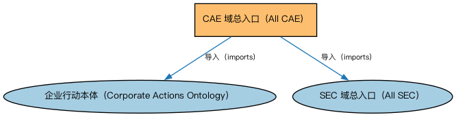

# CAE 域总入口（All CAE）聚合说明

本文档对应 `AllCAE.rdf` / `AllCAE.ttl`。

## 1. 本文件是什么

聚合企业行动事件（Corporate Action Events，CAE）域的全部本体：企业行动概念、证券相关企业行动及 GLEIF、ISO 15022 两套标准的事件代码个体。

从机制上说，这是一个聚合入口（load-all）文件：它本身不定义任何新的类或属性，只通过 `owl:imports` 把一组本体打包在一起。应用只要导入这一个文件，推理机就会把它列出的所有本体一次性加载进来，免去逐个声明的麻烦。因此它的价值不在「内容」，而在「组合」——组合方式本身就表达了发布方的意图（例如按域打包、按区域扩展打包、按是否含参考数据打包）。

## 2. 聚合的本地本体（2 个）

以下本体均可在本目录结构中找到同名 `.rdf` 文件及配套中文文档：

| 导入本体 | 中文名称 | 简介 |
|---|---|---|
| `CAE/CorporateEvents/CorporateActions.rdf` | 企业行动本体（Corporate Actions Ontology） | 定义企业行动（corporate action）：上市公司发起的、影响股东或证券的事件，如分红、拆股、并购。 |
| `SEC/AllSEC.rdf` | SEC 域总入口（All SEC） | 聚合证券（Securities，SEC）域的全部生产本体：债券、股票、基金、证券化产品、证券识别、分类、发行、上市与限制等，一次导入即获得 SEC 域完整模型。 |

## 3. 文件

- 官方 RDF/XML：`AllCAE.rdf`
- 中文 Turtle：`AllCAE.ttl`
- 结构图：`AllCAE-structure.png` / `AllCAE-structure.svg`