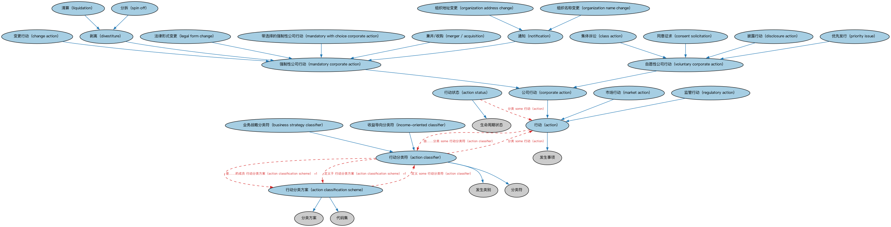

# 企业行动本体（Corporate Actions Ontology）结构与公理说明

本文档对应 `CorporateActions.rdf` / `CorporateActions.ttl`，说明该本体的类、继承关系、属性和公理约定。结构图见 `CorporateActions-structure.png`（`CorporateActions-structure.svg` 为可缩放版本）。

## 1. 本体概述

定义企业行动（corporate action）：由上市公司发起的、影响股东或证券的事件，如分红、拆股、并购、要约收购。

**在体系中的位置**：CAE（企业行动事件）域的核心本体，是证券相关企业行动与两套标准代码个体（GLEIF、ISO 15022）的共同基础。

**上下游关系**：上游依赖 FND 的事件与发生本体和 SEC 证券本体；下游被证券相关企业行动本体特化，并被 GLEIF、ISO 15022 个体本体给出标准代码。

**与相近概念的差别**：企业行动是「发生在证券身上的事件」，区别于证券本身；强制性（如并股）与自愿性（如要约）是重要分类轴；与信用事件的差别——信用事件关乎偿付能力，企业行动是公司治理行为。

本本体中类与类的核心关系如下（完整细节见各类小节）：

- **行动（action）** 继承 **发生事项（Occurrence）**
- **行动分类方案（action classification scheme）** 继承 **分类方案（ClassificationScheme）**
- **行动分类方案（action classification scheme）** 继承 **代码集（CodeSet）**
- **行动分类符（action classifier）** 继承 **发生类别（OccurrenceKind）**
- **行动分类符（action classifier）** 继承 **分类符（Classifier）**
- **行动状态（action status）** 继承 **生命周期状态（LifecycleStatus）**
- **业务战略分类符（business strategy classifier）** 继承 **行动分类符（action classifier）**
- **变更行动（change action）** 继承 **强制性公司行动（mandatory corporate action）**
- **集体诉讼（class action）** 继承 **自愿性公司行动（voluntary corporate action）**
- **同意征求（consent solicitation）** 继承 **自愿性公司行动（voluntary corporate action）**
- **公司行动（corporate action）** 继承 **行动（action）**
- **披露行动（disclosure action）** 继承 **自愿性公司行动（voluntary corporate action）**
- 其余 15 条关系从略。

## 2. 类（Class）

| 类（Class） | 定义（Definition） |
|---|---|
| 行动（action） | 由组织公告、发起或实施的、影响某法律实体或其发行证券、并可能对该实体利益相关方产生重大影响的事件。 event announced, initiated or carried out by an organization that affects a legal entity or the securities it issues and may have a material impact on that entity's stakeholders, such as shareholders and creditors |
| 行动分类方案（action classification scheme） | 对组织可能公告、发起或实施的各类行动与事件进行分类的方案。 scheme for classifying the kinds of actions and events that may be announced, initiated or carried out by an organization that affects a legal entity or the securities it issues |
| 行动分类符（action classifier） | 区分组织可能公告、发起或实施的各类行动与事件的分类符。 classifier that distinguishes the kinds of actions and events that may be announced, initiated or carried out by an organization that affects a legal entity or the securities it issues, such as income-oriented events |
| 行动状态（action status） | 某行动在某时点所处的状态。 state of some action at some point in time |
| 业务战略分类符（business strategy classifier） | 对涉及改善流动性或通过多元化、合并与分立改变组织整体结构的公司行动进行分类的分类符。 classifier of corporate actions that involve improving liquidity or changing the overall structure of the organization through diversification, combining and closing parts of the business, etc, to increase long-term profitability |
| 变更行动（change action） | 传播变更信息的公司行动，变更内容在公司行动细节中进一步说明。 corporate action to disseminate information regarding a change further described in the corporate action details |
| 集体诉讼（class action） | 涉及利益相关方就财务损失寻求赔偿之情形的事件（法律行动）。 corporate action involving a situation where interested parties seek restitution for financial loss |
| 同意征求（consent solicitation） | 旨在不召集会议的情况下取得持有人对发行人或第三方提案之同意的程序。 corporate action that is a procedure that aims to obtain consent of holder to a proposal by the issuer or a third party without convening a meeting |
| 公司行动（corporate action） | 由法律实体实施或与其直接相关、可能影响其发行证券并对其利益相关方（如股东）产生重大影响的行动。 action carried out by or specifically relating to a legal entity that may affect the securities it issues and may have a material impact on its stakeholders, such as shareholders and creditors |
| 披露行动（disclosure action） | 要求持有人或受益所有人向发行人披露其姓名、所在地及所持任何发行之持仓的公司行动。 corporate action involving a request for holders or beneficial owners to disclose their name, location and holdings of any issue to the issuer |
| 剥离（divestiture） | 涉及出售子公司业务权益或投资的公司行动。 corporate action involving the sales of subsidiary business interests or investments |
| 收益导向分类符（income-oriented classifier） | 对影响股东收益的公司行动进行分类的分类符。 classifier of corporate actions that impacts income to shareholders |
| 法律形式变更（legal form change） | 表明组织法律形式发生变更的公司行动。 corporate action indicating a modification of the legal form of the organization |
| 清算（liquidation） | 与企业结业相关的公司行动，包括但不限于分配现金、资产或两者。 corporate action related to winding up a business, including but not limited to distribution of cash, assets, or both |
| 强制性公司行动（mandatory corporate action） | 由公司董事会发起、影响全体股东的行动。 action initiated by the board of directors of a corporation that affects all shareholders |
| 带选择的强制性公司行动（mandatory with choice corporate action） | 股东可在多个选项中进行选择的强制性公司行动。 mandatory corporate action where shareholders are given an opportunity to choose among several options |
| 市场行动（market action） | 由市场（如证券交易所）发起的、影响某法律实体或其发行证券、并可能对其利益相关方产生重大影响的行动。 action that is initiated by a market, such as a securities exchange, that affects a legal entity or the securities it issues and may have a material impact on that entity's stakeholders, such as shareholders and creditors |
| 兼并/收购（merger / acquisition） | 涉及法律实体或资产合并的公司行动。 corporate action involving the consolidation of legal entities or assets |
| 通知（notification） | 发行人提供信息、对持有人无会计/财务影响的公司行动。 corporate action involving information provided by the issuer having no accounting/financial impact on the holder |
| 组织地址变更（organization address change） | 提供法律实体地址变更详情的信息行动。 information action that provides details of address changes for a legal entity |
| 组织名称变更（organization name change） | 提供法律实体名称变更详情的信息行动。 information action that provides details of name changes for a legal entity |
| 优先发行（priority issue） | 一种公开要约：由于可用证券数量有限，现有股东享有优先权的公司行动。 corporate action that is a public offer where, due to a limited amount of securities available, priority is given to existing shareholders |
| 监管行动（regulatory action） | 由监管机构发起的、影响某法律实体或其发行证券、并可能对其利益相关方产生重大影响的行动。 action initiated by a regulatory agency that affects a legal entity or the securities it issues and may have a material impact on that entity's stakeholders, such as shareholders and creditors |
| 分拆（spin off） | 向母公司股东分配子公司股票、且股东无须交出所持股份的公司行动。 corporate action involving the distribution of subsidiary stock to the shareholders of the parent company without a surrender of shares |
| 自愿性公司行动（voluntary corporate action） | 股东选择参与且必须作出回应、发行人才能处理该行动的事件。 event in which the shareholders elect to participate and must respond in order for the issuer to process the action |

以下按类逐个展开：每个类给出继承关系、相关属性与公理约定；子类在父类之下降一级编号。

### 2.1 行动（action）

定义：由组织公告、发起或实施的、影响某法律实体或其发行证券、并可能对该实体利益相关方产生重大影响的事件。

- 父类：**发生事项（Occurrence）**
- 直接子类：**公司行动（corporate action）**、**市场行动（market action）**、**监管行动（regulatory action）**

属性：

| 属性 | 定义 | 说明 |
|---|---|---|
| **由……分类（isClassifiedBy）** | — | — |
| **适用于（appliesTo）** | — | — |

公理：

- **由……分类（isClassifiedBy）**至少有一个取值，类型是**行动分类符（action classifier）**。
- **适用于（appliesTo）**至少有一个取值，该取值满足：该属性存在取值约束。

#### 2.1.1 公司行动（corporate action）

定义：由法律实体实施或与其直接相关、可能影响其发行证券并对其利益相关方（如股东）产生重大影响的行动。

- 父类：**行动（action）**
- 直接子类：**强制性公司行动（mandatory corporate action）**、**自愿性公司行动（voluntary corporate action）**

##### 2.1.1.1 强制性公司行动（mandatory corporate action）

定义：由公司董事会发起、影响全体股东的行动。

- 父类：**公司行动（corporate action）**
- 直接子类：**变更行动（change action）**、**剥离（divestiture）**、**法律形式变更（legal form change）**、**带选择的强制性公司行动（mandatory with choice corporate action）**、**兼并/收购（merger / acquisition）**、**通知（notification）**

###### 2.1.1.1.1 变更行动（change action）

定义：传播变更信息的公司行动，变更内容在公司行动细节中进一步说明。

- 父类：**强制性公司行动（mandatory corporate action）**

###### 2.1.1.1.2 剥离（divestiture）

定义：涉及出售子公司业务权益或投资的公司行动。

- 父类：**强制性公司行动（mandatory corporate action）**
- 直接子类：**清算（liquidation）**、**分拆（spin off）**

###### 2.1.1.1.2.1 清算（liquidation）

定义：与企业结业相关的公司行动，包括但不限于分配现金、资产或两者。

- 父类：**剥离（divestiture）**

###### 2.1.1.1.2.2 分拆（spin off）

定义：向母公司股东分配子公司股票、且股东无须交出所持股份的公司行动。

- 父类：**剥离（divestiture）**

###### 2.1.1.1.3 法律形式变更（legal form change）

定义：表明组织法律形式发生变更的公司行动。

- 父类：**强制性公司行动（mandatory corporate action）**

###### 2.1.1.1.4 带选择的强制性公司行动（mandatory with choice corporate action）

定义：股东可在多个选项中进行选择的强制性公司行动。

- 父类：**强制性公司行动（mandatory corporate action）**

###### 2.1.1.1.5 兼并/收购（merger / acquisition）

定义：涉及法律实体或资产合并的公司行动。

- 父类：**强制性公司行动（mandatory corporate action）**

###### 2.1.1.1.6 通知（notification）

定义：发行人提供信息、对持有人无会计/财务影响的公司行动。

- 父类：**强制性公司行动（mandatory corporate action）**
- 直接子类：**组织地址变更（organization address change）**、**组织名称变更（organization name change）**

###### 2.1.1.1.6.1 组织地址变更（organization address change）

定义：提供法律实体地址变更详情的信息行动。

- 父类：**通知（notification）**

###### 2.1.1.1.6.2 组织名称变更（organization name change）

定义：提供法律实体名称变更详情的信息行动。

- 父类：**通知（notification）**

##### 2.1.1.2 自愿性公司行动（voluntary corporate action）

定义：股东选择参与且必须作出回应、发行人才能处理该行动的事件。

- 父类：**公司行动（corporate action）**
- 直接子类：**集体诉讼（class action）**、**同意征求（consent solicitation）**、**披露行动（disclosure action）**、**优先发行（priority issue）**

公理：

- 与**强制性公司行动（mandatory corporate action）**互斥：同一个体不能同时属于两者。

###### 2.1.1.2.1 集体诉讼（class action）

定义：涉及利益相关方就财务损失寻求赔偿之情形的事件（法律行动）。

- 父类：**自愿性公司行动（voluntary corporate action）**

###### 2.1.1.2.2 同意征求（consent solicitation）

定义：旨在不召集会议的情况下取得持有人对发行人或第三方提案之同意的程序。

- 父类：**自愿性公司行动（voluntary corporate action）**

###### 2.1.1.2.3 披露行动（disclosure action）

定义：要求持有人或受益所有人向发行人披露其姓名、所在地及所持任何发行之持仓的公司行动。

- 父类：**自愿性公司行动（voluntary corporate action）**

###### 2.1.1.2.4 优先发行（priority issue）

定义：一种公开要约：由于可用证券数量有限，现有股东享有优先权的公司行动。

- 父类：**自愿性公司行动（voluntary corporate action）**

#### 2.1.2 市场行动（market action）

定义：由市场（如证券交易所）发起的、影响某法律实体或其发行证券、并可能对其利益相关方产生重大影响的行动。

- 父类：**行动（action）**

#### 2.1.3 监管行动（regulatory action）

定义：由监管机构发起的、影响某法律实体或其发行证券、并可能对其利益相关方产生重大影响的行动。

- 父类：**行动（action）**

### 2.2 行动分类方案（action classification scheme）

定义：对组织可能公告、发起或实施的各类行动与事件进行分类的方案。

- 父类：**分类方案（ClassificationScheme）**、**代码集（CodeSet）**

属性：

| 属性 | 定义 | 说明 |
|---|---|---|
| **具有成员（hasMember）** | — | — |
| **定义（defines）** | — | — |

公理：

- **具有成员（hasMember）**的所有取值只能是**行动分类符（action classifier）**。
- **定义（defines）**至少有一个取值，类型是**行动分类符（action classifier）**。

### 2.3 行动分类符（action classifier）

定义：区分组织可能公告、发起或实施的各类行动与事件的分类符。

- 父类：**发生类别（OccurrenceKind）**、**分类符（Classifier）**
- 直接子类：**业务战略分类符（business strategy classifier）**、**收益导向分类符（income-oriented classifier）**

属性：

| 属性 | 定义 | 说明 |
|---|---|---|
| **分类（classifies）** | — | — |
| **是……的成员（isMemberOf）** | — | — |
| **具有标签（hasTag）** | — | — |
| **定义于（isDefinedIn）** | — | — |

公理：

- **具有标签（hasTag）**至少有一个取值，类型是**xsd:string（string）**。
- **分类（classifies）**至少有一个取值，类型是**行动（action）**。
- **定义于（isDefinedIn）**恰好有 1 个**行动分类方案（action classification scheme）**。
- **是……的成员（isMemberOf）**恰好有 1 个**行动分类方案（action classification scheme）**。

#### 2.3.1 业务战略分类符（business strategy classifier）

定义：对涉及改善流动性或通过多元化、合并与分立改变组织整体结构的公司行动进行分类的分类符。

- 父类：**行动分类符（action classifier）**

#### 2.3.2 收益导向分类符（income-oriented classifier）

定义：对影响股东收益的公司行动进行分类的分类符。

- 父类：**行动分类符（action classifier）**

### 2.4 行动状态（action status）

定义：某行动在某时点所处的状态。

- 父类：**生命周期状态（LifecycleStatus）**

属性：

| 属性 | 定义 | 说明 |
|---|---|---|
| **分类（classifies）** | — | — |
| **具有标签（hasTag）** | — | — |

公理：

- **具有标签（hasTag）**至少有一个取值，类型是**xsd:string（string）**。
- **分类（classifies）**至少有一个取值，类型是**行动（action）**。

## 3. 依赖（owl:imports，11 个）

本本体通过 `owl:imports` 引入以下本体，各项的中文名称与简介如下：

| 导入本体 | 中文名称 | 简介 |
|---|---|---|
| `FBC/FinancialInstruments/FinancialInstruments.rdf` | 金融工具本体（Financial Instruments Ontology） | FIBO 核心本体之一，定义金融工具（financial instrument）的通用概念：可交易、代表某种权利义务的合同工具，是证券、衍生品等具体工具的共同基础。 |
| `FND/Arrangements/Lifecycles.rdf` | 生命周期本体（Lifecycles Ontology） | 定义生命周期、生命周期阶段与状态转移，用于描述合同、金融工具、机构从创设到终止的演化过程。 |
| `FND/DatesAndTimes/Occurrences.rdf` | 事件与发生本体（Occurrences Ontology） | 定义「发生」（occurrence）、事件与触发条件，用于表达企业行动、信用事件等「发生了什么」。 |
| `FND/Utilities/AnnotationVocabulary.rdf` | FIBO 标注词汇表（FIBO Annotation Vocabulary） | 定义 FIBO 专用的标注属性（如释义来源、成熟度等级），用于本体自身的元数据标注。 |
| `https://www.omg.org/spec/Commons/AnnotationVocabulary/` | OMG 通用标注词汇表（OMG Commons Annotation Vocabulary） | OMG 通用本体库（Commons）中的标注词汇表，提供概念映射等标注属性，FIBO 用它标注术语与外部标准的对应关系。 |
| `https://www.omg.org/spec/Commons/Classifiers/` | OMG 通用分类器本体（OMG Commons Classifiers） | OMG 通用本体库（Commons）中的分类器本体，定义分类方案、类别与归类关系的通用概念，FIBO 的分类建模建立在其上。 |
| `https://www.omg.org/spec/Commons/CodesAndCodeSets/` | OMG 通用代码与代码集本体（OMG Commons Codes and Code Sets） | Commons 库中的代码本体，定义代码、代码集及其维护方的通用概念，是 ISO 4217、ISO 3166 等编码体系建模的基础。 |
| `https://www.omg.org/spec/Commons/Collections/` | OMG 通用集合本体（OMG Commons Collections） | Commons 库中的集合本体，定义集合、成员等通用概念。 |
| `https://www.omg.org/spec/Commons/ContextualDesignators/` | OMG 通用语境指称本体（OMG Commons Contextual Designators） | Commons 库中的语境指称本体，定义「在某个语境下指代某物的名称/符号」，是地址、账户号码等语境相关标识的基础。 |
| `https://www.omg.org/spec/Commons/Designators/` | OMG 通用指称符本体（OMG Commons Designators） | Commons 库中的指称符本体，定义名称、标识符等「指代某物的符号」的通用概念。 |
| `https://www.omg.org/spec/Commons/Organizations/` | OMG 通用组织本体（OMG Commons Organizations） | Commons 库中的组织本体，定义组织、组织成员与组织结构的通用概念。 |

## 4. 文件

- 官方 RDF/XML：`CorporateActions.rdf`
- 中文 Turtle：`CorporateActions.ttl`
- 结构图：`CorporateActions-structure.png` / `CorporateActions-structure.svg`