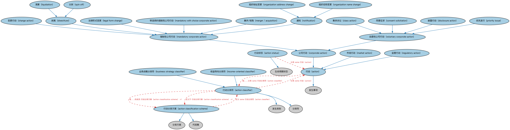

# 企业行动本体（Corporate Actions Ontology）结构与公理说明

本文档对应 `CorporateActions.rdf` / `CorporateActions.ttl`，说明该本体的类、继承关系、属性和公理约定。结构图见 `CorporateActions-structure.png`（`CorporateActions-structure.svg` 为可缩放版本）。

## 1. 本体概述

定义企业行动（corporate action）：由上市公司发起的、影响股东或证券的事件，如分红、拆股、并购、要约收购。

**在体系中的位置**：CAE（企业行动事件）域的核心本体，是证券相关企业行动与两套标准代码个体（GLEIF、ISO 15022）的共同基础。

**上下游关系**：上游依赖 FND 的事件与发生本体和 SEC 证券本体；下游被证券相关企业行动本体特化，并被 GLEIF、ISO 15022 个体本体给出标准代码。

**与相近概念的差别**：企业行动是「发生在证券身上的事件」，区别于证券本身；强制性（如并股）与自愿性（如要约）是重要分类轴；与信用事件的差别——信用事件关乎偿付能力，企业行动是公司治理行为。

## 2. 类（Class）

| 类（Class） | 定义（Definition） |
|---|---|
| 行动（action） | 由组织公告、发起或实施的、影响某法律实体或其发行证券、并可能对该实体利益相关方产生重大影响的事件。 |
| 行动分类方案（action classification scheme） | 对组织可能公告、发起或实施的各类行动与事件进行分类的方案。 |
| 行动分类符（action classifier） | 区分组织可能公告、发起或实施的各类行动与事件的分类符。 |
| 行动状态（action status） | 某行动在某时点所处的状态。 |
| 业务战略分类符（business strategy classifier） | 对涉及改善流动性或通过多元化、合并与分立改变组织整体结构的公司行动进行分类的分类符。 |
| 变更行动（change action） | 传播变更信息的公司行动，变更内容在公司行动细节中进一步说明。 |
| 集体诉讼（class action） | 涉及利益相关方就财务损失寻求赔偿之情形的事件（法律行动）。 |
| 同意征求（consent solicitation） | 旨在不召集会议的情况下取得持有人对发行人或第三方提案之同意的程序。 |
| 公司行动（corporate action） | 由法律实体实施或与其直接相关、可能影响其发行证券并对其利益相关方（如股东）产生重大影响的行动。 |
| 披露行动（disclosure action） | 要求持有人或受益所有人向发行人披露其姓名、所在地及所持任何发行之持仓的公司行动。 |
| 剥离（divestiture） | 涉及出售子公司业务权益或投资的公司行动。 |
| 收益导向分类符（income-oriented classifier） | 对影响股东收益的公司行动进行分类的分类符。 |
| 法律形式变更（legal form change） | 表明组织法律形式发生变更的公司行动。 |
| 清算（liquidation） | 与企业结业相关的公司行动，包括但不限于分配现金、资产或两者。 |
| 强制性公司行动（mandatory corporate action） | 由公司董事会发起、影响全体股东的行动。 |
| 带选择的强制性公司行动（mandatory with choice corporate action） | 股东可在多个选项中进行选择的强制性公司行动。 |
| 市场行动（market action） | 由市场（如证券交易所）发起的、影响某法律实体或其发行证券、并可能对其利益相关方产生重大影响的行动。 |
| 兼并/收购（merger / acquisition） | 涉及法律实体或资产合并的公司行动。 |
| 通知（notification） | 发行人提供信息、对持有人无会计/财务影响的公司行动。 |
| 组织地址变更（organization address change） | 提供法律实体地址变更详情的信息行动。 |
| 组织名称变更（organization name change） | 提供法律实体名称变更详情的信息行动。 |
| 优先发行（priority issue） | 一种公开要约：由于可用证券数量有限，现有股东享有优先权的公司行动。 |
| 监管行动（regulatory action） | 由监管机构发起的、影响某法律实体或其发行证券、并可能对其利益相关方产生重大影响的行动。 |
| 分拆（spin off） | 向母公司股东分配子公司股票、且股东无须交出所持股份的公司行动。 |
| 自愿性公司行动（voluntary corporate action） | 股东选择参与且必须作出回应、发行人才能处理该行动的事件。 |

### 2.1 继承关系（Inheritance）

- 行动（action） ⊑ 发生事项
- 行动分类方案（action classification scheme） ⊑ 分类方案
- 行动分类方案（action classification scheme） ⊑ 代码集
- 行动分类符（action classifier） ⊑ 发生类别
- 行动分类符（action classifier） ⊑ 分类符
- 行动状态（action status） ⊑ 生命周期状态
- 业务战略分类符（business strategy classifier） ⊑ 行动分类符（action classifier）
- 变更行动（change action） ⊑ 强制性公司行动（mandatory corporate action）
- 集体诉讼（class action） ⊑ 自愿性公司行动（voluntary corporate action）
- 同意征求（consent solicitation） ⊑ 自愿性公司行动（voluntary corporate action）
- 公司行动（corporate action） ⊑ 行动（action）
- 披露行动（disclosure action） ⊑ 自愿性公司行动（voluntary corporate action）
- 剥离（divestiture） ⊑ 强制性公司行动（mandatory corporate action）
- 收益导向分类符（income-oriented classifier） ⊑ 行动分类符（action classifier）
- 法律形式变更（legal form change） ⊑ 强制性公司行动（mandatory corporate action）
- 清算（liquidation） ⊑ 剥离（divestiture）
- 强制性公司行动（mandatory corporate action） ⊑ 公司行动（corporate action）
- 带选择的强制性公司行动（mandatory with choice corporate action） ⊑ 强制性公司行动（mandatory corporate action）
- 市场行动（market action） ⊑ 行动（action）
- 兼并/收购（merger / acquisition） ⊑ 强制性公司行动（mandatory corporate action）
- 通知（notification） ⊑ 强制性公司行动（mandatory corporate action）
- 组织地址变更（organization address change） ⊑ 通知（notification）
- 组织名称变更（organization name change） ⊑ 通知（notification）
- 优先发行（priority issue） ⊑ 自愿性公司行动（voluntary corporate action）
- 监管行动（regulatory action） ⊑ 行动（action）
- 分拆（spin off） ⊑ 剥离（divestiture）
- 自愿性公司行动（voluntary corporate action） ⊑ 公司行动（corporate action）

## 5. 公理约定（Axioms）

- 行动（action）：由……分类 some 行动分类符（action classifier）
- 行动（action）：适用于 some（restriction）
- 行动分类方案（action classification scheme）：具有成员 only 行动分类符（action classifier）
- 行动分类方案（action classification scheme）：定义 some 行动分类符（action classifier）
- 行动分类符（action classifier）：是……的成员 行动分类方案（action classification scheme） =1
- 行动分类符（action classifier）：定义于 行动分类方案（action classification scheme） =1
- 行动分类符（action classifier）：分类 some 行动（action）
- 行动分类符（action classifier）：具有标签 some xsd:string
- 行动状态（action status）：分类 some 行动（action）
- 行动状态（action status）：具有标签 some xsd:string
- 自愿性公司行动（voluntary corporate action） 与 强制性公司行动（mandatory corporate action） 互斥（disjointWith）

## 6. 依赖（owl:imports，11 个）

本本体通过 `owl:imports` 引入以下本体，各项的中文名称与简介如下：

| 导入本体 | 中文名称 | 简介 |
|---|---|---|
| `FBC/FinancialInstruments/FinancialInstruments.rdf` | 金融工具本体（Financial Instruments Ontology） | FIBO 核心本体之一，定义金融工具（financial instrument）的通用概念：可交易、代表某种权利义务的合同工具，是证券、衍生品等具体工具的共同基础。 |
| `FND/Arrangements/Lifecycles.rdf` | 生命周期本体（Lifecycles Ontology） | 定义生命周期、生命周期阶段与状态转移，用于描述合同、金融工具、机构从创设到终止的演化过程。 |
| `FND/DatesAndTimes/Occurrences.rdf` | 事件与发生本体（Occurrences Ontology） | 定义「发生」（occurrence）、事件与触发条件，用于表达企业行动、信用事件等「发生了什么」。 |
| `FND/Utilities/AnnotationVocabulary.rdf` | FIBO 标注词汇表（FIBO Annotation Vocabulary） | 定义 FIBO 专用的标注属性（如释义来源、成熟度等级），用于本体自身的元数据标注。 |
| `https://www.omg.org/spec/Commons/AnnotationVocabulary/` | OMG 通用标注词汇表（OMG Commons Annotation Vocabulary） | OMG 通用本体库（Commons）中的标注词汇表，提供概念映射等标注属性，FIBO 用它标注术语与外部标准的对应关系。 |
| `https://www.omg.org/spec/Commons/Classifiers/` | OMG 通用分类器本体（OMG Commons Classifiers） | OMG 通用本体库（Commons）中的分类器本体，定义分类方案、类别与归类关系的通用概念，FIBO 的分类建模建立在其上。 |
| `https://www.omg.org/spec/Commons/CodesAndCodeSets/` | OMG 通用代码与代码集本体（OMG Commons Codes and Code Sets） | Commons 库中的代码本体，定义代码、代码集及其维护方的通用概念，是 ISO 4217、ISO 3166 等编码体系建模的基础。 |
| `https://www.omg.org/spec/Commons/Collections/` | OMG 通用集合本体（OMG Commons Collections） | Commons 库中的集合本体，定义集合、成员等通用概念。 |
| `https://www.omg.org/spec/Commons/ContextualDesignators/` | OMG 通用语境指称本体（OMG Commons Contextual Designators） | Commons 库中的语境指称本体，定义「在某个语境下指代某物的名称/符号」，是地址、账户号码等语境相关标识的基础。 |
| `https://www.omg.org/spec/Commons/Designators/` | OMG 通用指称符本体（OMG Commons Designators） | Commons 库中的指称符本体，定义名称、标识符等「指代某物的符号」的通用概念。 |
| `https://www.omg.org/spec/Commons/Organizations/` | OMG 通用组织本体（OMG Commons Organizations） | Commons 库中的组织本体，定义组织、组织成员与组织结构的通用概念。 |

## 7. 文件

- 官方 RDF/XML：`CorporateActions.rdf`
- 中文 Turtle：`CorporateActions.ttl`
- 结构图：`CorporateActions-structure.png` / `CorporateActions-structure.svg`