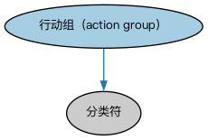

# GLEIF 企业行动个体本体（GLEIF Corporate Action Individuals Ontology）结构与公理说明

本文档对应 `GLEIF-CorporateActionIndividuals.rdf` / `GLEIF-CorporateActionIndividuals.ttl`，说明该本体的类、继承关系、属性和公理约定。结构图见 `GLEIF-CorporateActionIndividuals-structure.png`（`GLEIF-CorporateActionIndividuals-structure.svg` 为可缩放版本）。

## 1. 本体概述

收录 GLEIF（全球法人识别编码基金会）企业行动代码体系中的参考个体，并含少量配套类定义。

**在体系中的位置**：CAE 域的参考数据层，为企业行动提供 GLEIF 标准的事件类型取值。

**上下游关系**：上游依赖企业行动本体与 LCC 代码体系；下游被需要按 GLEIF 标准标注企业行动数据的应用使用。

**与相近概念的差别**：与 ISO 15022 企业行动个体本体的差别——代码来源标准不同：GLEIF 代码服务于 LEI 体系，ISO 15022 代码服务于证券报文，两者覆盖面与粒度不同。

## 2. 类（Class）

| 类（Class） | 定义（Definition） |
|---|---|
| 行动组（action group） | 按 GLEIF 特定分组对公司行动进行区分的分类符。 |

### 2.1 继承关系（Inheritance）

- 行动组（action group） ⊑ 分类符

## 5. 公理约定（Axioms）

- 行动组（action group）：分类 some 行动
- 行动组（action group）：具有标签 some xsd:string

## 6. 依赖（owl:imports，7 个）

本本体通过 `owl:imports` 引入以下本体，各项的中文名称与简介如下：

| 导入本体 | 中文名称 | 简介 |
|---|---|---|
| `CAE/CorporateEvents/CorporateActions.rdf` | 企业行动本体（Corporate Actions Ontology） | 定义企业行动（corporate action）：上市公司发起的、影响股东或证券的事件，如分红、拆股、并购。 |
| `FBC/DebtAndEquities/CreditEvents.rdf` | 信用事件本体（Credit Events Ontology） | 定义信用事件（credit event）：破产、拒付、重组等会触发信用衍生品结算的事件类型。 |
| `FND/Relations/Relations.rdf` | 关系本体（Relations Ontology） | FIBO 最底层的基础本体，定义参考（reference）、分类（classify）等通用关系与抽象概念，全库普遍依赖。 |
| `FND/Utilities/AnnotationVocabulary.rdf` | FIBO 标注词汇表（FIBO Annotation Vocabulary） | 定义 FIBO 专用的标注属性（如释义来源、成熟度等级），用于本体自身的元数据标注。 |
| `https://www.omg.org/spec/Commons/AnnotationVocabulary/` | OMG 通用标注词汇表（OMG Commons Annotation Vocabulary） | OMG 通用本体库（Commons）中的标注词汇表，提供概念映射等标注属性，FIBO 用它标注术语与外部标准的对应关系。 |
| `https://www.omg.org/spec/Commons/Classifiers/` | OMG 通用分类器本体（OMG Commons Classifiers） | OMG 通用本体库（Commons）中的分类器本体，定义分类方案、类别与归类关系的通用概念，FIBO 的分类建模建立在其上。 |
| `https://www.omg.org/spec/Commons/Designators/` | OMG 通用指称符本体（OMG Commons Designators） | Commons 库中的指称符本体，定义名称、标识符等「指代某物的符号」的通用概念。 |

## 7. 文件

- 官方 RDF/XML：`GLEIF-CorporateActionIndividuals.rdf`
- 中文 Turtle：`GLEIF-CorporateActionIndividuals.ttl`
- 结构图：`GLEIF-CorporateActionIndividuals-structure.png` / `GLEIF-CorporateActionIndividuals-structure.svg`