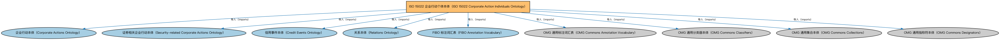

# ISO 15022 企业行动个体本体（ISO 15022 Corporate Action Individuals Ontology）说明

本文档对应 `ISO15022-CorporateActionIndividuals.rdf` / `ISO15022-CorporateActionIndividuals.ttl`。

## 1. 本文件是什么

收录 ISO 15022 证券报文标准中的企业行动事件类型个体。

从机制上说，这是一个个体（individuals）文件：它本身不定义任何新的类或属性，装的全是命名个体（owl:NamedIndividual）——也就是一条条真实存在的实例数据（如具体的货币、市场、监管机构、法域）。它的 `owl:imports` 引入的是这些个体所属的类定义所在的本体。应用需要实例级参考数据时加载这类文件。

## 2. 个体构成（共 40 个）

按个体所属类型统计（类型名为中文（English）对照）：

| 类型（Class） | 个体数量 |
|---|---|
| 业务战略分类符（BusinessStrategyClassifier） | 29 |
| 收益导向分类符（IncomeOrientedClassifier） | 12 |
| 行动分类方案（ActionClassificationScheme） | 1 |

个体数量较多，仅举前 10 个示例，完整清单见同名 `.ttl` 文件：

| 个体（示例） | 类型 |
|---|---|
| BIDS | 业务战略分类符（BusinessStrategyClassifier） |
| BONU | 业务战略分类符（BusinessStrategyClassifier） |
| BPUT | 业务战略分类符（BusinessStrategyClassifier） |
| CAPD | 收益导向分类符（IncomeOrientedClassifier） |
| CAPG | 收益导向分类符（IncomeOrientedClassifier） |
| CHAN | 业务战略分类符（BusinessStrategyClassifier） |
| CLSA | 业务战略分类符（BusinessStrategyClassifier） |
| CONS | 业务战略分类符（BusinessStrategyClassifier） |
| CONV | 业务战略分类符（BusinessStrategyClassifier） |
| DECR | 收益导向分类符（IncomeOrientedClassifier） |

## 3. 依赖的本体（owl:imports，9 个）

以下导入提供个体所属的类定义与相关参考数据：

| 导入本体 | 中文名称 | 简介 |
|---|---|---|
| `CAE/CorporateEvents/CorporateActions.rdf` | 企业行动本体（Corporate Actions Ontology） | 定义企业行动（corporate action）：上市公司发起的、影响股东或证券的事件，如分红、拆股、并购。 |
| `CAE/CorporateEvents/SecurityRelatedCorporateActions.rdf` | 证券相关企业行动本体（Security-related Corporate Actions Ontology） | 定义直接改变证券条款或数量的企业行动：拆股、并股、换股、权证行使等。 |
| `FBC/DebtAndEquities/CreditEvents.rdf` | 信用事件本体（Credit Events Ontology） | 定义信用事件（credit event）：破产、拒付、重组等会触发信用衍生品结算的事件类型。 |
| `FND/Relations/Relations.rdf` | 关系本体（Relations Ontology） | FIBO 最底层的基础本体，定义参考（reference）、分类（classify）等通用关系与抽象概念，全库普遍依赖。 |
| `FND/Utilities/AnnotationVocabulary.rdf` | FIBO 标注词汇表（FIBO Annotation Vocabulary） | 定义 FIBO 专用的标注属性（如释义来源、成熟度等级），用于本体自身的元数据标注。 |
| `https://www.omg.org/spec/Commons/AnnotationVocabulary/` | OMG 通用标注词汇表（OMG Commons Annotation Vocabulary） | OMG 通用本体库（Commons）中的标注词汇表，提供概念映射等标注属性，FIBO 用它标注术语与外部标准的对应关系。 |
| `https://www.omg.org/spec/Commons/Classifiers/` | OMG 通用分类器本体（OMG Commons Classifiers） | OMG 通用本体库（Commons）中的分类器本体，定义分类方案、类别与归类关系的通用概念，FIBO 的分类建模建立在其上。 |
| `https://www.omg.org/spec/Commons/Collections/` | OMG 通用集合本体（OMG Commons Collections） | Commons 库中的集合本体，定义集合、成员等通用概念。 |
| `https://www.omg.org/spec/Commons/Designators/` | OMG 通用指称符本体（OMG Commons Designators） | Commons 库中的指称符本体，定义名称、标识符等「指代某物的符号」的通用概念。 |

## 4. 文件

- 官方 RDF/XML：`ISO15022-CorporateActionIndividuals.rdf`
- 中文 Turtle：`ISO15022-CorporateActionIndividuals.ttl`
- 结构图：`ISO15022-CorporateActionIndividuals-structure.png` / `ISO15022-CorporateActionIndividuals-structure.svg`