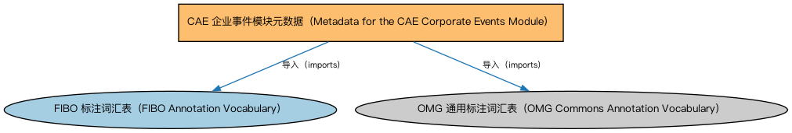

# CAE 企业事件模块元数据（Metadata for the CAE Corporate Events Module）说明

本文档对应 `MetadataCAECorporateEvents.rdf` / `MetadataCAECorporateEvents.ttl`。

## 1. 本文件是什么

声明企业事件（Corporate Events）模块的构成：企业行动本体、证券相关企业行动本体，以及 GLEIF 与 ISO 15022 两套企业行动代码个体本体。

从机制上说，这是一个元数据清单（metadata manifest）文件：它本身不定义任何类或属性，而是通过 `dct:hasPart` 声明一个域或模块由哪些本体构成，并携带版本 IRI、版权、许可与成熟度等发布管理信息。它回答的问题是「这个域/模块包含什么、当前是什么版本」，供发布工具和文档系统按模块组织内容；它的 `owl:imports` 只引入标注词汇表，不是用来加载业务本体的入口（加载入口是 `All*` 与 `About*` 聚合文件）。

## 2. 声明的构成（dct:hasPart，4 个）

| 构成项 | 中文名称 | 简介 |
|---|---|---|
| `CAE/CorporateEvents/CorporateActions.rdf` | 企业行动本体（Corporate Actions Ontology） | 定义企业行动（corporate action）：上市公司发起的、影响股东或证券的事件，如分红、拆股、并购。 |
| `CAE/CorporateEvents/GLEIF-CorporateActionIndividuals.rdf` | GLEIF 企业行动个体本体（GLEIF Corporate Action Individuals Ontology） | 收录全球法人识别编码基金会（GLEIF）企业行动代码体系中的参考个体。 |
| `CAE/CorporateEvents/ISO15022-CorporateActionIndividuals.rdf` | ISO 15022 企业行动个体本体（ISO 15022 Corporate Action Individuals Ontology） | 收录 ISO 15022 证券报文标准中的企业行动事件类型个体。 |
| `CAE/CorporateEvents/SecurityRelatedCorporateActions.rdf` | 证券相关企业行动本体（Security-related Corporate Actions Ontology） | 定义直接改变证券条款或数量的企业行动：拆股、并股、换股、权证行使等。 |

## 3. 标注依赖（owl:imports，2 个）

以下导入仅用于支撑元数据标注本身（如成熟度等级、概念映射），不属于业务内容：

| 导入本体 | 中文名称 | 简介 |
|---|---|---|
| `FND/Utilities/AnnotationVocabulary.rdf` | FIBO 标注词汇表（FIBO Annotation Vocabulary） | 定义 FIBO 专用的标注属性（如释义来源、成熟度等级），用于本体自身的元数据标注。 |
| `https://www.omg.org/spec/Commons/AnnotationVocabulary/` | OMG 通用标注词汇表（OMG Commons Annotation Vocabulary） | OMG 通用本体库（Commons）中的标注词汇表，提供概念映射等标注属性，FIBO 用它标注术语与外部标准的对应关系。 |

## 4. 文件

- 官方 RDF/XML：`MetadataCAECorporateEvents.rdf`
- 中文 Turtle：`MetadataCAECorporateEvents.ttl`
- 结构图：`MetadataCAECorporateEvents-structure.png` / `MetadataCAECorporateEvents-structure.svg`