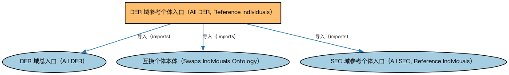

# DER 域参考个体入口（All DER, Reference Individuals）聚合说明

本文档对应 `AllDER-ReferenceIndividuals.rdf` / `AllDER-ReferenceIndividuals.ttl`。

## 1. 本文件是什么

聚合衍生品域的参考数据个体本体（标准化互换合约约定等实例）。

从机制上说，这是一个聚合入口（load-all）文件：它本身不定义任何新的类或属性，只通过 `owl:imports` 把一组本体打包在一起。应用只要导入这一个文件，推理机就会把它列出的所有本体一次性加载进来，免去逐个声明的麻烦。因此它的价值不在「内容」，而在「组合」——组合方式本身就表达了发布方的意图（例如按域打包、按区域扩展打包、按是否含参考数据打包）。

## 2. 聚合的本地本体（3 个）

以下本体均可在本目录结构中找到同名 `.rdf` 文件及配套中文文档：

| 导入本体 | 中文名称 | 简介 |
|---|---|---|
| `DER/AllDER.rdf` | DER 域总入口（All DER） | 聚合衍生品（Derivatives，DER）域的全部生产本体：期权、期货与远期、互换、信用衍生品、利率衍生品、结构化工具与主协议等，一次导入即获得 DER 域完整模型。 |
| `DER/DerivativesContracts/SwapsIndividuals.rdf` | 互换个体本体（Swaps Individuals Ontology） | 收录标准化互换合约的参考个体（如标准利率互换的市场约定）。 |
| `SEC/AllSEC-ReferenceIndividuals.rdf` | SEC 域参考个体入口（All SEC, Reference Individuals） | 聚合 SEC 域全部参考数据个体本体（CFI 分类、证券识别方案等参考数据），供需要完整参考数据的应用加载。 |

## 3. 文件

- 官方 RDF/XML：`AllDER-ReferenceIndividuals.rdf`
- 中文 Turtle：`AllDER-ReferenceIndividuals.ttl`
- 结构图：`AllDER-ReferenceIndividuals-structure.png` / `AllDER-ReferenceIndividuals-structure.svg`