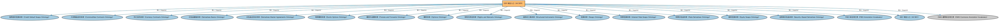

# DER 域总入口（All DER）聚合说明

本文档对应 `AllDER.rdf` / `AllDER.ttl`。

## 1. 本文件是什么

聚合衍生品（Derivatives，DER）域的全部生产本体：期权、期货与远期、互换、信用衍生品、利率衍生品、结构化工具与主协议等，一次导入即获得 DER 域完整模型。

从机制上说，这是一个聚合入口（load-all）文件：它本身不定义任何新的类或属性，只通过 `owl:imports` 把一组本体打包在一起。应用只要导入这一个文件，推理机就会把它列出的所有本体一次性加载进来，免去逐个声明的麻烦。因此它的价值不在「内容」，而在「组合」——组合方式本身就表达了发布方的意图（例如按域打包、按区域扩展打包、按是否含参考数据打包）。

## 2. 聚合的本地本体（17 个）

以下本体均可在本目录结构中找到同名 `.rdf` 文件及配套中文文档：

| 导入本体 | 中文名称 | 简介 |
|---|---|---|
| `DER/CreditDerivatives/CreditDefaultSwaps.rdf` | 信用违约互换本体（Credit Default Swaps Ontology） | 定义信用违约互换（CDS）：保护买方与卖方、参考实体、信用事件与结算方式。 |
| `DER/DerivativesContracts/CommoditiesContracts.rdf` | 大宗商品合约本体（Commodities Contracts Ontology） | 定义以大宗商品（能源、金属、农产品等）为标的的衍生品合约。 |
| `DER/DerivativesContracts/CurrencyContracts.rdf` | 外汇合约本体（Currency Contracts Ontology） | 定义以外汇为标的的衍生品合约：外汇远期、货币互换等。 |
| `DER/DerivativesContracts/DerivativesBasics.rdf` | 衍生品基础本体（Derivatives Basics Ontology） | 定义衍生品合约（derivatives contract）的核心概念：标的资产、行权、到期等，是 DER 域的根基。 |
| `DER/DerivativesContracts/DerivativesMasterAgreements.rdf` | 衍生品主协议本体（Derivatives Master Agreements Ontology） | 定义 ISDA 主协议等场外衍生品主协议（master agreement）及其条款结构。 |
| `DER/DerivativesContracts/ExoticOptions.rdf` | 奇异期权本体（Exotic Options Ontology） | 定义障碍期权、亚式期权等非标准化（奇异）期权。 |
| `DER/DerivativesContracts/FuturesAndForwards.rdf` | 期货与远期本体（Futures and Forwards Ontology） | 定义期货（futures）与远期（forwards）合约：标准化与非标准化的远期交割安排。 |
| `DER/DerivativesContracts/Options.rdf` | 期权本体（Options Ontology） | 定义期权（option）：买方权利、行权价、到期日、看涨与看跌等核心结构。 |
| `DER/DerivativesContracts/RightsAndWarrants.rdf` | 权利与权证本体（Rights and Warrants Ontology） | 定义认股权证（warrant）、配股权（rights）等赋予持有人购买权利的证券。 |
| `DER/DerivativesContracts/StructuredInstruments.rdf` | 结构化工具本体（Structured Instruments Ontology） | 定义结构化金融工具：由多个成分组合而成、现金流结构定制的工具。 |
| `DER/DerivativesContracts/Swaps.rdf` | 互换本体（Swaps Ontology） | 定义互换（swap）合约的通用结构：互换腿（swap leg）、现金流交换与名义本金。 |
| `DER/RateDerivatives/IRSwaps.rdf` | 利率互换本体（Interest Rate Swaps Ontology） | 定义利率互换（IRS）：固定利率与浮动利率现金流的交换结构。 |
| `DER/RateDerivatives/RateDerivatives.rdf` | 利率衍生品本体（Rate Derivatives Ontology） | 定义以利率为标的的衍生品的通用概念。 |
| `DER/SecurityBasedDerivatives/EquitySwaps.rdf` | 股权互换本体（Equity Swaps Ontology） | 定义股权互换（equity swap）：以股票或股指收益与利率现金流交换的合约。 |
| `DER/SecurityBasedDerivatives/SecurityBasedDerivatives.rdf` | 证券类衍生品本体（Security-Based Derivatives Ontology） | 定义以单个证券或证券组合为标的的衍生品。 |
| `FND/Utilities/AnnotationVocabulary.rdf` | FIBO 标注词汇表（FIBO Annotation Vocabulary） | 定义 FIBO 专用的标注属性（如释义来源、成熟度等级），用于本体自身的元数据标注。 |
| `SEC/AllSEC.rdf` | SEC 域总入口（All SEC） | 聚合证券（Securities，SEC）域的全部生产本体：债券、股票、基金、证券化产品、证券识别、分类、发行、上市与限制等，一次导入即获得 SEC 域完整模型。 |

## 3. 外部依赖（1 个，不在 FIBO 仓库内）

以下导入来自 OMG 的外部本体库，不在 FIBO 仓库中，加载时需从 spec.edmcouncil.org / omg.org 获取：

| 外部本体 | 中文名称 | 简介 |
|---|---|---|
| `https://www.omg.org/spec/Commons/AnnotationVocabulary/` | OMG 通用标注词汇表（OMG Commons Annotation Vocabulary） | OMG 通用本体库（Commons）中的标注词汇表，提供概念映射等标注属性，FIBO 用它标注术语与外部标准的对应关系。 |

## 4. 文件

- 官方 RDF/XML：`AllDER.rdf`
- 中文 Turtle：`AllDER.ttl`
- 结构图：`AllDER-structure.png` / `AllDER-structure.svg`