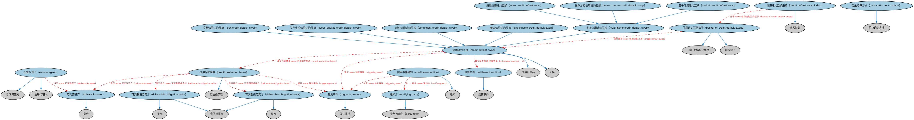

# 信用违约互换本体（Credit Default Swaps Ontology）结构与公理说明

本文档对应 `CreditDefaultSwaps.rdf` / `CreditDefaultSwaps.ttl`，说明该本体的类、继承关系、属性和公理约定。结构图见 `CreditDefaultSwaps-structure.png`（`CreditDefaultSwaps-structure.svg` 为可缩放版本）。

## 1. 本体概述

定义信用违约互换（credit default swap，CDS）：保护买方向保护卖方定期付费，一旦参考实体发生信用事件即获得赔付的合约。

**在体系中的位置**：DER 信用衍生品模块的核心本体。

**上下游关系**：上游继承衍生品基础与互换概念，并依赖 FBC 信用事件本体（定义触发条件）；下游关联合成 CDO（用 CDS 构建风险敞口）。

**与相近概念的差别**：CDS 像「债券违约保险」但在法律上是衍生品而非保险——买方无需实际持有参考实体的债务；与担保的差别——担保依附于具体债务合同，CDS 是独立可交易的合约。

## 2. 类（Class）

| 类（Class） | 定义（Definition） |
|---|---|
| 资产支持信用违约互换（asset-backed credit default swap） | 标的参考债务为资产支持证券（而非公司信用）的信用违约互换。 |
| 篮子信用违约互换（basket credit default swap） | 参考一组为特定场外衍生品交易约定的定制化合成资产组合的信用违约互换。 |
| 信用违约互换篮子（basket of credit default swaps） | 参考债务为信用违约互换工具的篮子。 |
| 现金结算方法（cash settlement method） | 计算或以其他方式确定合约最终参考价格的策略。 |
| 或有信用违约互换（contingent credit default swap） | 需要额外触发事件才能生效的信用违约互换。 |
| 信用违约互换（credit default swap） | 双边合约：一方（保护卖方）同意在信用事件发生时向另一方（保护买方）支付款项。 |
| 信用违约互换指数（credit default swap index） | 标的参考债务为信用违约互换工具的指数。 |
| 信用事件通知（credit event notice） | 声明触发事件已发生的不可撤销书面或口头通知。 |
| 信用保护条款（credit protection terms） | 规定触发事件及与结算相关条件的法律条款。 |
| 可交割资产（deliverable asset） | 在信用违约互换结算过程中必须交付的资产。 |
| 可交割债务买方（deliverable obligation buyer） | 在触发事件发生时（视事件和合约而定）有义务购买可交割债务（资产）的合约方。 |
| 可交割债务卖方（deliverable obligation seller） | 在触发事件发生时（视事件和合约而定）有义务出售可交割债务（资产）的合约方。 |
| 托管代理人（escrow agent） | 在资产或资金按合约条款从一方正式转移给另一方之前代为持有的第三方。 |
| 指数信用违约互换（index credit default swap） | 参考一族标准化信用衍生品指数的信用违约互换，其标的参考实体为一组既定实体篮子。 |
| 指数分档信用违约互换（index tranche credit default swap） | 参考基于信用指数的合成债务抵押债券（CDO）的信用违约互换，每一档参考不同的损失区间。 |
| 贷款信用违约互换（loan credit default swap） | 标的参考债务严格限于银团担保贷款（而非任何类型公司债务）的信用违约互换。 |
| 多名信用违约互换（multi-name credit default swap） | 参考不止一个债务或借款人的信用违约互换。 |
| 通知方（notifying party） | 负责发出一份或多份正式通知、表明与给定合约相关的事件已经发生的一方。 |
| 结算拍卖（settlement auction） | 针对一组既定可交割债务独立管理的合成拍卖程序，用于确定可用于结算的最终参考价格。 |
| 单名信用违约互换（single name credit default swap） | 标的风险为单一参考债务或单一参考实体（如公司或主权借款人）的信用违约互换。 |
| 触发事件（triggering event） | 与信用违约互换的某些方面相关或触发这些方面的事件。 |

### 2.1 继承关系（Inheritance）

- 资产支持信用违约互换（asset-backed credit default swap） ⊑ 信用违约互换（credit default swap）
- 篮子信用违约互换（basket credit default swap） ⊑ 多名信用违约互换（multi-name credit default swap）
- 信用违约互换篮子（basket of credit default swaps） ⊑ 加权篮子
- 信用违约互换篮子（basket of credit default swaps） ⊑ 带日期结构化集合
- 现金结算方法（cash settlement method） ⊑ 价格确定方法
- 或有信用违约互换（contingent credit default swap） ⊑ 信用违约互换（credit default swap）
- 信用违约互换（credit default swap） ⊑ 信用衍生品
- 信用违约互换（credit default swap） ⊑ 互换
- 信用违约互换指数（credit default swap index） ⊑ 参考指数
- 信用事件通知（credit event notice） ⊑ 通知
- 信用保护条款（credit protection terms） ⊑ 衍生品条款
- 可交割资产（deliverable asset） ⊑ 资产
- 可交割债务买方（deliverable obligation buyer） ⊑ 合同当事方
- 可交割债务买方（deliverable obligation buyer） ⊑ 买方
- 可交割债务卖方（deliverable obligation seller） ⊑ 合同当事方
- 可交割债务卖方（deliverable obligation seller） ⊑ 卖方
- 托管代理人（escrow agent） ⊑ 注册代理人
- 托管代理人（escrow agent） ⊑ 合同第三方
- 指数信用违约互换（index credit default swap） ⊑ 多名信用违约互换（multi-name credit default swap）
- 指数分档信用违约互换（index tranche credit default swap） ⊑ 多名信用违约互换（multi-name credit default swap）
- 贷款信用违约互换（loan credit default swap） ⊑ 信用违约互换（credit default swap）
- 多名信用违约互换（multi-name credit default swap） ⊑ 信用违约互换（credit default swap）
- 通知方（notifying party） ⊑ 参与方角色（party role）
- 结算拍卖（settlement auction） ⊑ 结算事件
- 单名信用违约互换（single name credit default swap） ⊑ 信用违约互换（credit default swap）
- 触发事件（triggering event） ⊑ 发生事项

## 3. 对象属性（Object Property）

| 属性（Property） | 中文（English） | 定义（Definition） | 说明 |
|---|---|---|---|
| fibo-der-cr-cds:hasContractPrice | 具有合约价格（has contract price） | 规定买方购买信用违约互换合约的预定价格。 | 值域（range）：货币价格；子属性（subPropertyOf）：具有价格 |
| fibo-der-cr-cds:hasMinimumQuotationAmount | 具有最低报价金额（has minimum quotation amount） | 指明报价所针对的参考债务未偿本金余额的最低预期门槛金额。 | 定义域（domain）：现金结算条款；值域（range）：货币数量；子属性（subPropertyOf）：具有货币数量 |
| fibo-der-cr-cds:hasQuotationMethod | 具有报价方法（has quotation method） | 指明在确定参考债务市场价值时向银行和/或交易商请求的报价性质。 | 定义域（domain）：现金结算条款；值域（range）：现金结算方法（cash settlement method）；子属性（subPropertyOf）：具有价格确定方法 |
| fibo-der-cr-cds:hasScheduledTerminationDate | 具有预定终止日（has scheduled termination date） | 双方约定的信用保护到期日期。 | 定义域（domain）：信用保护条款（credit protection terms）；值域（range）：显式日期；子属性（subPropertyOf）：具有终止日 |

## 4. 数据属性（Datatype Property）

| 属性（Property） | 中文（English） | 定义（Definition） |
|---|---|---|
| fibo-der-cr-cds:allowsSubstitution | 是否允许替换（allows substitution） | 表明是否可以用其他债务替换指定的可交割债务。 |

## 5. 公理约定（Axioms）

- 信用违约互换篮子（basket of credit default swaps）：具有成员 some 信用违约互换（credit default swap）
- 信用违约互换（credit default swap）：具有发生事项 结算拍卖（settlement auction） ≥0
- 信用违约互换（credit default swap）：具有合约价格（has contract price） some 货币价格
- 信用违约互换（credit default swap）：具有合同要素 some 信用保护条款（credit protection terms）
- 信用违约互换（credit default swap）：规定 some 触发事件（triggering event）
- 信用违约互换指数（credit default swap index）：基于 some 信用违约互换篮子（basket of credit default swaps）
- 信用事件通知（credit event notice）：关于 some 触发事件（triggering event）
- 信用事件通知（credit event notice）：由……提供 some 通知方（notifying party）
- 信用保护条款（credit protection terms）：具有预定终止日（has scheduled termination date） 显式日期 ≥0
- 信用保护条款（credit protection terms）：restriction
- 信用保护条款（credit protection terms）：具有买方 some 可交割债务买方（deliverable obligation buyer）
- 信用保护条款（credit protection terms）：具有卖方 some 可交割债务卖方（deliverable obligation seller）
- 信用保护条款（credit protection terms）：规定 some 可交割资产（deliverable asset）
- 信用保护条款（credit protection terms）：规定 some 触发事件（triggering event）
- 托管代理人（escrow agent）：持有 some 可交割资产（deliverable asset）
- 通知方（notifying party）：restriction

## 6. 依赖（owl:imports，25 个）

本本体通过 `owl:imports` 引入以下本体，各项的中文名称与简介如下：

| 导入本体 | 中文名称 | 简介 |
|---|---|---|
| `BE/FunctionalEntities/Publishers.rdf` | 出版方本体（Publishers Ontology） | 定义出版方及其出版物，用于标识金融信息与文档的发布来源。 |
| `DER/DerivativesContracts/DerivativesBasics.rdf` | 衍生品基础本体（Derivatives Basics Ontology） | 定义衍生品合约（derivatives contract）的核心概念：标的资产、行权、到期等，是 DER 域的根基。 |
| `DER/DerivativesContracts/Swaps.rdf` | 互换本体（Swaps Ontology） | 定义互换（swap）合约的通用结构：互换腿（swap leg）、现金流交换与名义本金。 |
| `FBC/DebtAndEquities/CreditEvents.rdf` | 信用事件本体（Credit Events Ontology） | 定义信用事件（credit event）：破产、拒付、重组等会触发信用衍生品结算的事件类型。 |
| `FBC/DebtAndEquities/Debt.rdf` | 债务本体（Debt Ontology） | 定义债务（debt）与债权债务关系的核心概念：借款人、贷款人、本金与利息义务。 |
| `FBC/FinancialInstruments/InstrumentPricing.rdf` | 工具定价本体（Instrument Pricing Ontology） | 定义金融工具的价格、报价与估值概念。 |
| `FBC/FinancialInstruments/Settlement.rdf` | 结算本体（Settlement Ontology） | 定义交易结算（settlement）：券款对付、结算日期与结算方式。 |
| `FBC/FunctionalEntities/Markets.rdf` | 市场本体（Markets Ontology） | 定义金融市场（market）：交易所、场外市场及其功能。 |
| `FBC/ProductsAndServices/FinancialProductsAndServices.rdf` | 金融产品与服务本体（Financial Products and Services Ontology） | 定义金融产品（financial product）与金融服务（financial service）及其提供、购买关系。 |
| `FND/Accounting/CurrencyAmount.rdf` | 货币金额本体（Currency Amount Ontology） | 定义「金额＋币种」的货币金额（currency amount）表示，是 FIBO 中表达价格、债务金额、付款额等一切带币种数值的基础构件。 |
| `FND/Agreements/Contracts.rdf` | 合同本体（Contracts Ontology） | 在协议之上定义具有法律约束力的合同（contract）：合同当事方、合同条款、义务与权利，是金融工具与交易合同建模的基石。 |
| `FND/Arrangements/Documents.rdf` | 文档本体（Documents Ontology） | 定义文档、文档类型及文档与其所记载内容的关系，为合同文本、募集说明书等法律文书建模。 |
| `FND/DatesAndTimes/FinancialDates.rdf` | 金融日期本体（Financial Dates Ontology） | 定义金融语境下的日期与期间概念：结算日、付息日、到期日、日计数基准等。 |
| `FND/DatesAndTimes/Occurrences.rdf` | 事件与发生本体（Occurrences Ontology） | 定义「发生」（occurrence）、事件与触发条件，用于表达企业行动、信用事件等「发生了什么」。 |
| `FND/OwnershipAndControl/Ownership.rdf` | 所有权本体（Ownership Ontology） | 定义「拥有」关系：所有者、被拥有资产及所有权份额。 |
| `FND/ProductsAndServices/ProductsAndServices.rdf` | 产品与服务本体（Products and Services Ontology） | 定义产品、服务及其提供者与客户的通用关系。 |
| `FND/Relations/Relations.rdf` | 关系本体（Relations Ontology） | FIBO 最底层的基础本体，定义参考（reference）、分类（classify）等通用关系与抽象概念，全库普遍依赖。 |
| `FND/Utilities/AnnotationVocabulary.rdf` | FIBO 标注词汇表（FIBO Annotation Vocabulary） | 定义 FIBO 专用的标注属性（如释义来源、成熟度等级），用于本体自身的元数据标注。 |
| `IND/MarketIndices/BasketIndices.rdf` | 篮子指数本体（Basket Indices Ontology） | 定义以一篮子成分为基础的指数：成分、权重与计算方法。 |
| `https://www.omg.org/spec/Commons/AnnotationVocabulary/` | OMG 通用标注词汇表（OMG Commons Annotation Vocabulary） | OMG 通用本体库（Commons）中的标注词汇表，提供概念映射等标注属性，FIBO 用它标注术语与外部标准的对应关系。 |
| `https://www.omg.org/spec/Commons/Collections/` | OMG 通用集合本体（OMG Commons Collections） | Commons 库中的集合本体，定义集合、成员等通用概念。 |
| `https://www.omg.org/spec/Commons/DatesAndTimes/` | OMG 通用日期与时间本体（OMG Commons Dates and Times） | Commons 库中的日期时间本体，定义日期、期间、时间点等通用时间概念。 |
| `https://www.omg.org/spec/Commons/Documents/` | OMG 通用文档本体（OMG Commons Documents） | Commons 库中的文档本体，定义文档及其组成部分的通用概念。 |
| `https://www.omg.org/spec/Commons/Organizations/` | OMG 通用组织本体（OMG Commons Organizations） | Commons 库中的组织本体，定义组织、组织成员与组织结构的通用概念。 |
| `https://www.omg.org/spec/Commons/PartiesAndSituations/` | OMG 通用参与方与情境本体（OMG Commons Parties and Situations） | Commons 库中的参与方本体，定义独立主体、参与方及其角色扮演的通用概念，是 FIBO 参与方模型的上游。 |

## 7. 文件

- 官方 RDF/XML：`CreditDefaultSwaps.rdf`
- 中文 Turtle：`CreditDefaultSwaps.ttl`
- 结构图：`CreditDefaultSwaps-structure.png` / `CreditDefaultSwaps-structure.svg`